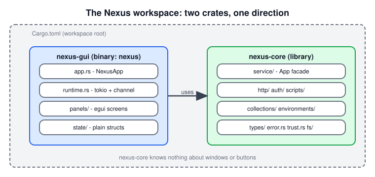
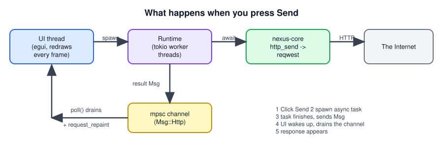
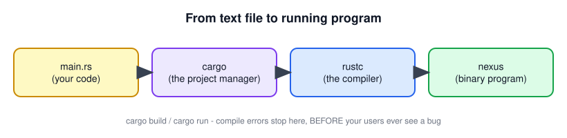
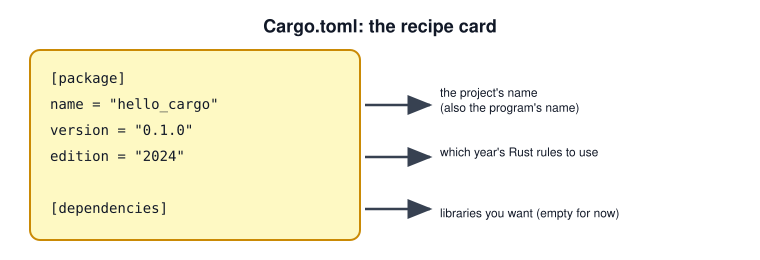

# Chapter 1: Hello, Cargo! A tour of Nexus

> **Brain Power**
> Postman is a big app with a web browser inside it. Nexus does the same job as one small native program. What do you think Rust gives you that makes that possible? Jot down two guesses.

## Meet the patient: Nexus

**Nexus** lets you build an HTTP request (URL, headers, body), press **Send**, and read the response. It also speaks GraphQL, WebSocket, and runs JavaScript test scripts. Everything is stored as plain JSON files in `~/.nexus/`.

It is written in Rust in two pieces (called **crates**):



* **`nexus-core`** ([`crates/nexus-core`](../../crates/nexus-core)) - the *engine*. It knows how to send HTTP requests, apply authentication, run scripts, save collections. It has **no idea** what a window is.
* **`nexus-gui`** ([`crates/nexus-gui`](../../crates/nexus-gui)) - the *face*. It uses a GUI library called **egui** to draw buttons and text boxes and calls the engine when you click.

Splitting a program like this is a classic trick: the engine can be tested without opening a single window.

## What happens when you press Send?



You do not need to understand every box yet. Just notice the *shape*:

1. The UI never waits for the internet. It hands the job to background workers.
2. The result comes back as a **message** through a **channel** (a pipe).
3. The UI picks up the message on its next redraw.

By Chapter 12 you will understand every arrow, using real code from [`runtime.rs`](../../crates/nexus-gui/src/runtime.rs).

## Your first Rust program

```rust
fn main() {
    println!("Hello, Nexus!");
}
```

Save it as `hello.rs`, then:

```bash
rustc hello.rs
./hello
```

Three things to notice:

* `fn main()` is where every Rust program starts. `fn` means "function".
* `println!` has an exclamation mark because it is a **macro**, a kind of code that writes code. For now, treat it as "print this line".
* Lines end with `;`. Forgetting one is the number-one beginner error.

Nexus has a `main` too: see [`main.rs`](../../crates/nexus-gui/src/main.rs). It reads command-line flags, picks the data folder (`~/.nexus`), and opens the window.

## Enter Cargo

Nobody runs `rustc` by hand on a big project. We use **Cargo**.



```bash
cargo new hello_cargo
cd hello_cargo
cargo run
```

Cargo creates:

```
hello_cargo/
  Cargo.toml     <- the recipe card (name, version, crates you need)
  src/main.rs    <- your code, already containing a Hello World
```



The commands you will use daily:

| Command | What it does |
|---|---|
| `cargo check` | Type-check quickly, produce no program. |
| `cargo build` | Compile (debug mode, fast to build, slow to run). |
| `cargo build --release` | Compile with optimizations (slow to build, fast to run). |
| `cargo run` | Build then run. |
| `cargo test` | Run all tests. |

Nexus's root [`Cargo.toml`](../../Cargo.toml) even tunes the release build:

```toml
[profile.release]
opt-level = "s"
lto = true
codegen-units = 1
strip = true
```

Translation: "optimize for small size, let the linker optimize across crates, use one big compile unit, and strip debug info". That is part of how Nexus stays one small file.

> **There are no Dumb Questions**
>
> **Q: Why does Rust "compile" instead of just running my file like Python?**
> A: Rust turns your code into machine instructions *before* it runs. The compiler checks a huge number of mistakes up front (using something that was freed, forgetting a case, mixing up types). You fight the compiler at your desk instead of fighting production bugs at 3 a.m.
>
> **Q: The compiler errors are long. Are they scary?**
> A: They are famously *helpful*. Read from the top. Rust often tells you exactly what to change.
>
> **Q: What's a "crate"?**
> A: A package of Rust code: either a library others can use, or a program you can run. Nexus has two. `serde`, `tokio`, `reqwest` are crates written by other people.

## Peek at the whole map

Open [`nexus-core/src/lib.rs`](../../crates/nexus-core/src/lib.rs). It is mostly a table of contents:

```rust
pub mod auth;
pub mod codegen;
pub mod collections;
pub mod error;
pub mod fs;
// ...more modules...
pub mod trust;
pub mod types;
pub mod websocket;

pub use error::{Error, Result};
```

Each `pub mod` is a **module**, a folder of related code: `auth` handles authentication, `collections` reads and writes collection files, `websocket` is the WebSocket client. (Modules get a whole chapter later.)

> **Sharpen your pencil**
> Look at the `Cargo.toml` pictured above and at the real one in [`crates/nexus-gui/Cargo.toml`](../../crates/nexus-gui/Cargo.toml).
> 1. Which line makes the `nexus-gui` crate depend on the engine?
> 2. Under which heading would a crate that only the *tests* need (like `tempfile`) be listed?
> 3. What is the name of the program that `cargo run -p nexus-gui` produces?
>
> *(Answers at the end of the chapter.)*

> **Watch it!**
> `cargo run` in debug mode is *much* slower at runtime than `--release`. If a Rust program feels slow, check you are not timing a debug build.

## Bullet Points

* Rust is **compiled**: source code becomes a native program.
* **Cargo** is the project manager: `cargo run`, `cargo test`, `cargo build --release`.
* `Cargo.toml` lists a crate's name, version and dependencies.
* Nexus = **`nexus-core`** (engine, no UI) + **`nexus-gui`** (egui window).
* Results from background work come back to the UI as messages in a channel.

## Cheat sheet

```
fn main() { println!("hi"); }    entry point + print macro
cargo new name                   make a project
cargo run | check | test         run | typecheck | test
Cargo.toml                       project recipe
crate                            package of Rust code
module                           folder-like unit inside a crate
```

## Answers

1. `nexus-core.workspace = true` under `[dependencies]` (it points at the workspace's `nexus-core` entry, which is a path dependency in the root `Cargo.toml`).
2. `[dev-dependencies]`.
3. `nexus` - the `[[bin]]` section in that file names the binary `nexus`.
