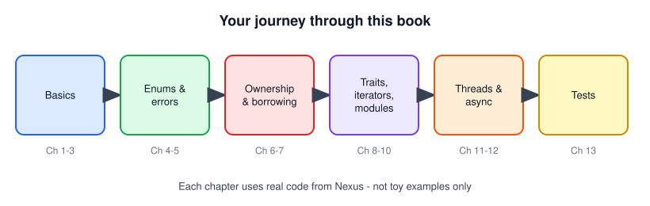
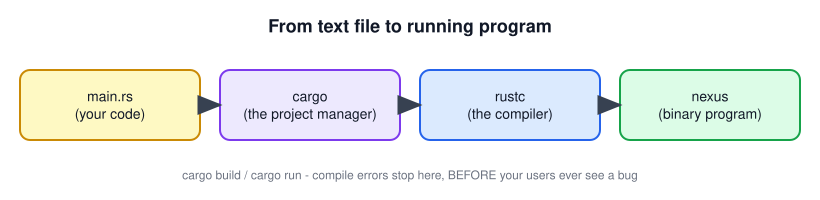
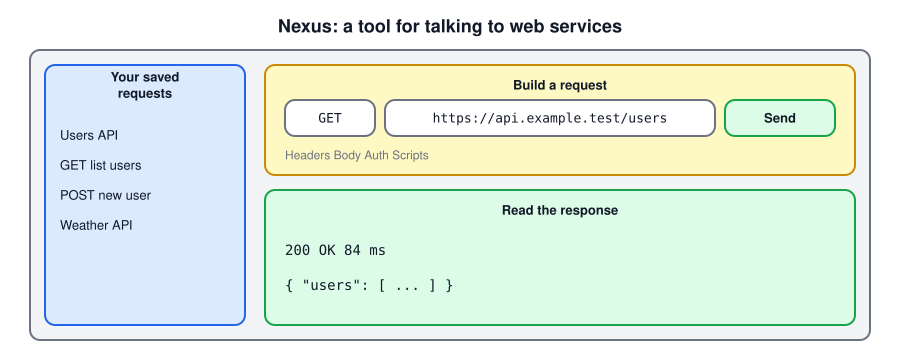
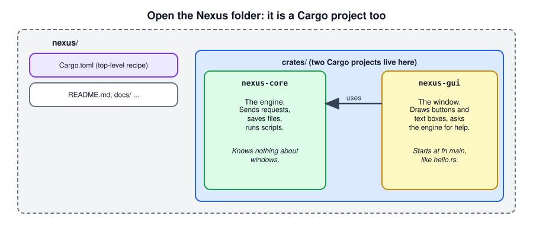
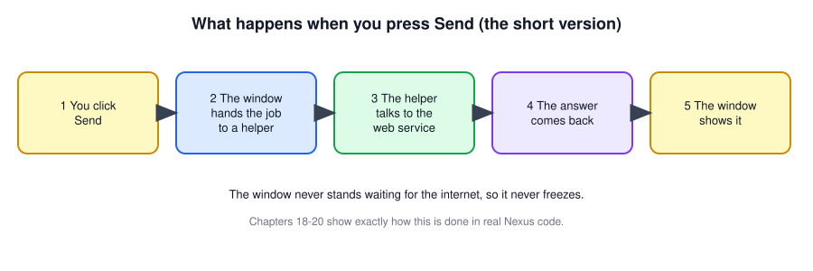
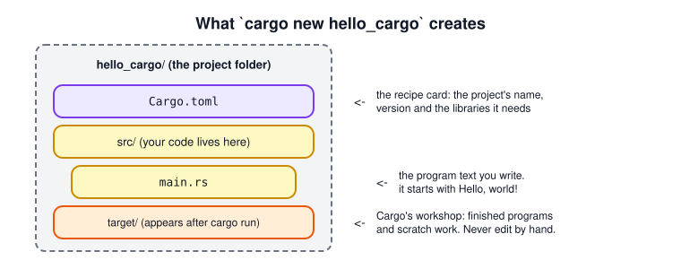
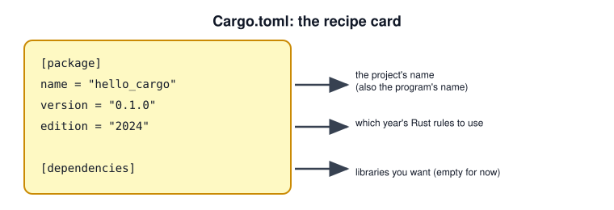

# Chapter 1: Hello, Cargo!

> **Brain Power**
> You write a note in English. A friend who only reads Morse code needs it. Somebody has to *translate* the note first. Where, in the journey from "text I typed" to "program that runs", do you think the translating happens? Jot down a guess.

In this chapter you will install Rust, run your first program, meet the tool that runs every Rust project, and take a quick look at the real application this book is built around. No hard ideas yet. We are just getting the engine warm.



## Programs, source code and the translator

A **program** is a list of instructions for a computer. You write the list as ordinary text in a file. That text is called **source code**.

But a computer cannot follow source code directly. It only understands its own very low-level language. So a translator turns your text into something the computer *can* run.

> **New word: compiler**
> The translator. It reads your source code and produces a program the computer can run. Rust's compiler is called **`rustc`**.



Look at the red box. This is the most important thing about Rust: the compiler is *picky*. If it finds a mistake, it stops and explains it, and you fix it at your desk. Many other languages wait until the program is running (maybe on your user's machine) to complain. Rust complains early.

That is the whole sales pitch for Rust: **programs that are fast, and mistakes that are caught before anyone runs them.** The price is that the compiler will argue with you a lot at first. This book is about making that argument friendly.

## Meet our running example: Nexus

You will not only write tiny programs. All through this book we peek at **Nexus**, a real program of about 48,000 lines of Rust.

Nexus is a tool for talking to web services. You type a web address, press **Send**, and read the answer. (Programmers use tools like this to test the services they build.)



Nexus is a normal Cargo project, like the one you are about to create:



And here is what happens inside when you press **Send**:



That is all the Nexus you need today. You will *not* understand its code yet, and that is perfectly fine: we will build up to it one idea at a time, and every few chapters we come back and read a few real lines. By Chapter 6 you will recognise real Nexus code. By Chapter 20 you will understand the picture above arrow by arrow.

## Install Rust

Rust installs through a helper called **rustup**. You type commands into a **terminal**.

> **New word: terminal**
> A window where you type commands instead of clicking buttons. It is also called the *command line* or *shell*. Each command you type is run when you press Enter.

On Linux or macOS, paste this into your terminal:

```bash
curl --proto '=https' --tlsv1.2 -sSf https://sh.rustup.rs | sh
```

On Windows, download the installer from <https://rustup.rs>. (Nexus itself builds on Linux and macOS only, but everything you learn in this book works on all three.)

Restart your terminal, then check it worked:

```bash
rustc --version
cargo --version
```

You should see two version numbers. This book was checked with version 1.99; any recent version works. If something later says a function "does not exist" and you are sure it should, run `rustup update` to get the newest Rust.

You just installed two tools: **`rustc`**, the compiler you met above, and **`cargo`**, which we will meet in a few minutes.

## Your first program

Create a file called `hello.rs` and type this. Type it, don't paste it. Your fingers learn too.

```rust
fn main() {
    println!("Hello, Nexus!");
}
```

Now compile it and run it:

```bash
rustc hello.rs
./hello
```

You should see:

```output
Hello, Nexus!
```

(On Windows, run `hello.exe` instead of `./hello`.) Two steps: `rustc hello.rs` translated your text into a program called `hello`, and `./hello` ran it. The `./` means "the file called hello in *this* folder".

### What each line means

```text
fn main() {                      <- line 1
    println!("Hello, Nexus!");   <- line 2
}                                <- line 3
```

* **`fn`** is short for *function*. A function is a named bundle of instructions. We will build our own in Chapter 3. For now: `fn main() { ... }` means "here is a bundle of instructions called `main`".
* **`main`** is a special name. When you run a Rust program, the computer starts with the function called `main`. Every program has one.
* **`()`** after the name is where *inputs* to the function would go. `main` takes none, so the parentheses are empty.
* **`{` and `}`** (curly braces) mark where the bundle begins and ends. Everything between them belongs to `main`.
* **`println!`** prints a line of text on the screen. (More on that `!` in a moment.)
* **`("Hello, Nexus!")`**: the text to print goes between parentheses, inside double quotes.
* **`;`** (semicolon) ends an instruction, the way a full stop ends a sentence.

> **New word: macro**
> `println!` ends with `!`. That marks it as a **macro**: a built-in helper that the compiler expands into more code *before* translating. For now, whenever you see a name followed by `!`, think "special built-in helper". We will not write our own macros in this book.

> **Sharpen your pencil**
> Before you try it, predict what this prints:
> ```rust
> fn main() {
>     println!("Hello, Nexus!");
>     println!("Welcome aboard.");
> }
> ```
> How many lines? In what order?
>
> <details><summary>Answer</summary>
>
> Two lines, in the order you wrote them. The computer follows instructions from top to bottom, one at a time.
>
> ```output
> Hello, Nexus!
> Welcome aboard.
> ```
> </details>

### Breaking it on purpose

Beginners fear compiler errors. Let's make one on purpose so it becomes a friend. Take the program above and delete the `;` at the end of the *first* `println!` line:

```rust,fails
fn main() {
    println!("Hello, Nexus!")
    println!("Welcome aboard.");
}
```

The compiler refuses, and says:

```error
error: expected `;`, found `println`
 --> src/main.rs:2:30
  |
2 |     println!("Hello, Nexus!")
  |                              ^ help: add `;` here
3 |     println!("Welcome aboard.");
  |     ------- unexpected token
```

Read it piece by piece, like a letter from a helpful friend:

* **`error: expected ';', found 'println'`**: the headline. "I was waiting for a `;` and instead I saw `println`."
* **`--> src/main.rs:2:30`**: *where*. File `src/main.rs`, line 2, character 30. (Your file name will be `hello.rs`.)
* The little arrow **`^ help: add ';' here`** points at the exact spot and says what to do.

Rust errors usually tell you the fix. Always read them from the top.

> **There are no Dumb Questions**
>
> **Q: Why does `println!` need that `!`?**
> A: It marks a macro. Macros can do things plain functions cannot, such as accepting a different number of inputs each time. You will use `println!` constantly; you do not need to understand how it works inside.
>
> **Q: What happens if I forget `fn main`?**
> A: `rustc` tells you `main function not found`. A program needs a starting point.
>
> **Q: Do I have to indent with four spaces?**
> A: The compiler doesn't care, but everyone does it, and the official tool `cargo fmt` does it for you automatically.

## Enter Cargo

`rustc hello.rs` is fine for one file. Real projects have many files, use libraries written by other people, and need tests. Typing `rustc` for all that would be miserable.

So Rust ships with a project manager.

> **New word: Cargo**
> Rust's project manager and build tool. It creates projects, calls `rustc` for you, downloads libraries, and runs tests. You will type `cargo` far more often than `rustc`.

Make a project:

```bash
cargo new hello_cargo
cd hello_cargo
```

`cargo new` prints a line like this:

```output
    Creating binary (application) `hello_cargo` package
```

(`cd hello_cargo` means "go into that folder".) Here is what Cargo made for you:



Open `src/main.rs`. Cargo has already written a Hello World for you:

```rust
fn main() {
    println!("Hello, world!");
}
```

```output
Hello, world!
```

Now open `Cargo.toml`. It is a short plain-text file:



* **`[package]`** is a heading: "facts about this project".
* **`name`** and **`version`** are what they look like.
* **`edition`** picks which "year" of Rust's rules to use. Leave it alone.
* **`[dependencies]`** is where you list libraries you want to use. It is empty for now. (Libraries are the subject of Chapter 15.)

> **New word: crate**
> Rust's word for *one compilable package of code*. The project you just made is one crate. When people say "the `uuid` crate", they mean a library somebody else wrote. We will meet more kinds of crates in Chapter 15. For now: **crate = a Cargo project's worth of Rust code.**

### Running it

```bash
cargo run
```

You will see something like:

```text
   Compiling hello_cargo v0.1.0 (/home/you/hello_cargo)
    Finished `dev` profile [unoptimized + debuginfo] target(s) in 0.54s
     Running `target/debug/hello_cargo`
Hello, world!
```

Cargo compiled your code (`Compiling`), then ran the result (`Running`). The last line is your program's own output. Cargo also created a folder called `target/` holding the finished program. You never edit anything in `target/`.

### Three ways to build

| Command | What it does | When |
|---|---|---|
| `cargo run` | Compile if needed, then run. | The one you type most. |
| `cargo check` | Check for mistakes but **don't** make a program. | Very fast. Great while you are typing. |
| `cargo build` | Compile, but don't run. | When you want the program without running it. |

Think of a restaurant. `cargo check` is reading the recipe to see if it makes sense. `cargo build` is cooking a practice dish. `cargo build --release` is cooking for the customers: it takes longer, because the compiler works harder to make the program *fast*, and the result runs much quicker.

> **Watch it!**
> A plain `cargo build` or `cargo run` makes a **debug** build: quick to compile, slow to run. If a Rust program feels slow, check you did not time a debug build. Use `cargo run --release` for the fast one.

## Checkpoint project: the request builder

From now on, every chapter ends with a **checkpoint**: you extend one small program. It is a **request builder**, a little cousin of what Nexus does.

First, one idea from the world of the web. When your browser asks a website for a page, it sends a short text message called a **request**. It looks like this:

```text
GET /users HTTP/1.1
Host: api.example.test
Accept: application/json
```

The first line says *what you want* (`GET` means "fetch"), *which thing* (`/users`), and which version of the conversation rules. Each following line is a **header**: a label, a colon, and a value that gives extra details.

Make a new project and print that request:

```bash
cargo new request_builder
```

Replace the contents of `src/main.rs` with:

```rust
fn main() {
    println!("GET /users HTTP/1.1");
    println!("Host: api.example.test");
    println!("Accept: application/json");
}
```

Run it with `cargo run`:

```output
GET /users HTTP/1.1
Host: api.example.test
Accept: application/json
```

It is boring on purpose: the text is stuck inside the code. In Chapter 2 we will give the pieces names, and then they will stop being stuck.

> **Sharpen your pencil**
> Change the program so it sends a `POST` request for `/orders` with an extra header `Content-Type: application/json`. Run it. Then run `cargo check` and notice how much faster *that* is.
>
> <details><summary>Answer</summary>
>
> ```rust
> fn main() {
>     println!("POST /orders HTTP/1.1");
>     println!("Host: api.example.test");
>     println!("Accept: application/json");
>     println!("Content-Type: application/json");
> }
> ```
>
> ```output
> POST /orders HTTP/1.1
> Host: api.example.test
> Accept: application/json
> Content-Type: application/json
> ```
> </details>

## Bullet Points

* A **compiler** (`rustc`) translates your source code into a program. Rust's compiler catches many mistakes before the program ever runs.
* `fn main() { ... }` is where every program starts.
* `println!("text");` prints a line. The `!` marks a **macro**. The `;` ends an instruction.
* **Cargo** is the project manager: `cargo new`, `cargo run`, `cargo check`, `cargo build`.
* A **crate** is one Cargo project's worth of Rust code. `Cargo.toml` is its recipe card; `src/main.rs` is where your code starts.
* Compiler errors say *where* (file:line:column) and usually *how to fix it*.

## Cheat sheet

```text
rustc hello.rs && ./hello    compile one file, run it
cargo new name               make a project
cargo run                    build and run
cargo check                  just look for mistakes (fast)
cargo build --release        slow to build, fast to run
fn main() { ... }            where the program starts
println!("hi");              print a line
```
