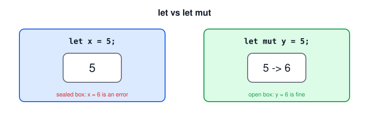
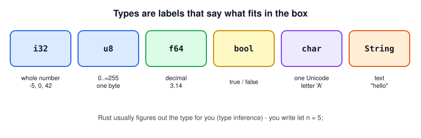

# Chapter 2: Values, variables and types

> **Brain Power**
> Look at your request builder from Chapter 1. The word `api.example.test` appears in the code. Imagine it appears 40 times and the server's name changes tomorrow. What would you *wish* you had, so you only had to change it in one place?

You wished for a **name** for a piece of information. This chapter is about giving things names, and about the different *kinds* of information a program can hold.

## Naming a value with `let`

Here is the smallest program that uses a name. Type it in (`cargo new` a playground project called `playground` and paste into `src/main.rs`, or use `rustc` as in Chapter 1):

```rust
fn main() {
    let method = "GET";
    println!("The method is {}", method);
}
```

```output
The method is GET
```

Line by line:

* **`let method = "GET";`** reads "let `method` be `"GET"`". It creates a **variable** called `method` and puts the text `GET` into it.
* **`println!("The method is {}", method);`** prints a line. The two curly braces `{}` are a **placeholder**: a hole in the text. Whatever comes after the comma fills the hole.

> **New word: variable**
> A name attached to a value, like a label stuck on a jar. You use the name whenever you want what is inside.

> **New word: value**
> A piece of information: the number `200`, the text `"GET"`, the answer `true`. Variables hold values.

Rust lets you write the name straight inside the braces, which is usually clearer:

```rust
fn main() {
    let method = "GET";
    let path = "/users";
    println!("{method} {path} HTTP/1.1");
}
```

> **Sharpen your pencil**
> What does that program print? Write it down before you look.
>
> <details><summary>Answer</summary>
>
> ```output
GET /users HTTP/1.1
> ```
> Each `{name}` is replaced by the value of the variable with that name.
> </details>

You can use as many placeholders as you like. With the older style `{}`, the values after the comma fill the holes in order, left to right: `println!("{} {}", method, path);` prints the same thing. Both styles are common. In this book we mostly use the `{name}` style.

A **comment** is a note for humans. The computer ignores everything after `//` on a line:

```rust
fn main() {
    // This line is a comment: the computer skips it.
    let retries = 3; // you can put one at the end of a line too
    println!("retries: {retries}");
}
```

```output
retries: 3
```

## Variables don't change (unless you ask)

Now a surprise. Try to change a variable:

```rust,fails
fn main() {
    let retries = 3;
    println!("retries: {retries}");
    retries = 4;
    println!("retries: {retries}");
}
```

Rust refuses:

```error
error[E0384]: cannot assign twice to immutable variable `retries`
 --> src/main.rs:4:5
  |
2 |     let retries = 3;
  |         ------- first assignment to `retries`
3 |     println!("retries: {retries}");
4 |     retries = 4;
  |     ^^^^^^^^^^^ cannot assign twice to immutable variable
  |
help: consider making this binding mutable
  |
2 |     let mut retries = 3;
  |         +++

error: aborting due to 1 previous error

For more information about this error, try `rustc --explain E0384`.
```

Decode it:

* **`error[E0384]: cannot assign twice to immutable variable 'retries'`**: the headline. `E0384` is the error's ID number. You can look it up with `rustc --explain E0384`. **Immutable** means "cannot be changed".
* The `-------` under `retries` on line 2 says "you first gave it a value *here*".
* The `^^^^^^^^^^^` under `retries = 4` on line 4 says "and then you tried to give it another *here*".
* **`help: consider making this binding mutable`**, with `+++` showing the three characters to add (`mut`): the cure.

Why would a language do this on purpose? When you read `let retries = 3;` you *know* `retries` is 3 for as long as it exists. In a program with thousands of lines, that is a big comfort. If something is *supposed* to change, you say so with the word `mut`:



```rust
fn main() {
    let mut retries = 3;
    println!("retries: {retries}");
    retries = 4;
    println!("retries: {retries}");
}
```

```output
retries: 3
retries: 4
```

> **New word: mutable**
> Changeable. `let mut retries` makes a variable you are allowed to change. Plain `let` makes one you are not. (Short for *mutable*, from the Latin for "change".)

When you read someone else's code, every `mut` is a little flag: *something changes here*.

> **There are no Dumb Questions**
>
> **Q: Isn't it annoying that I must write `mut`?**
> A: A bit, for a week. Then you notice that most variables never need it, and the ones that do stand out. It is also free: `mut` costs nothing when the program runs.
>
> **Q: Why does the error say "binding"?**
> A: A "binding" is the connection between a name and a value. `let` makes a binding. For us, "variable" and "binding" mean nearly the same thing.

## The kinds of value: types

So far we have stored text and a number. Rust cares about the *kind* of each value.

> **New word: type**
> The kind of a value: whole number, decimal number, text, true/false... Every value in Rust has exactly one type, and the compiler checks that you use values in ways that make sense for their type.



Here they all are at once:

```rust
fn main() {
    let status = 200;           // a whole number
    let timeout_seconds = 2.5;  // a number with a decimal point
    let secure = true;          // true or false
    let method = "GET";         // text between double quotes
    let initial = 'G';          // ONE character between single quotes
    println!("{status} {timeout_seconds} {secure} {method} {initial}");
}
```

```output
200 2.5 true GET G
```

You did not write any type names. Rust **inferred** (worked out) the types from the values. You *can* write them, after a colon:

```rust
fn main() {
    let status: u16 = 200;
    println!("{status}");
}
```

```output
200
```

`u16` is the type of whole numbers from 0 up to 65,535: plenty for an HTTP status code. Whole numbers come in many sizes, named by a letter and a bit count:

| Name | Meaning | Range (roughly) |
|---|---|---|
| `i32` | whole number, can be negative (the default) | about -2 billion to 2 billion |
| `u8` | zero and up, tiny | 0 to 255 |
| `u16` | zero and up | 0 to 65,535 |
| `u32`, `u64` | zero and up, bigger | up to about 4 billion / 18 quintillion |
| `usize` | zero and up, sized for *counting things* | depends on your computer |
| `f64` | number with a decimal point (the default) | huge |

The `i` stands for *integer* (may be negative); the `u` stands for *unsigned* (zero and up). Bigger numbers use more room. You rarely need to think hard: pick `i32` for ordinary maths, `u16`/`u32`/`u64` when negatives make no sense, and `usize` when you are counting or measuring something (you will meet it in a minute).

Big numbers are easier to read with underscores. They are ignored: `let timeout_ms = 30_000;` is just 30000.

> **Heads-up about text**
> The type of `"GET"` is written **`&str`**. The `&` has a meaning, and it deserves a whole chapter (Chapter 5). **Ignore the `&` for now**: until then, read `&str` as simply "text in double quotes".

### Doing maths

```rust
fn main() {
    let total = 7 + 3;
    let left = 10 - 4;
    let area = 6 * 7;
    let half = 7 / 2;
    let rest = 7 % 2;
    println!("{total} {left} {area} {half} {rest}");
}
```

`+ - *` do what you expect. `/` divides. `%` gives the *remainder*.

> **Sharpen your pencil**
> What does `half` hold: 3.5 or 3? Predict, then check the answer.
>
> <details><summary>Answer</summary>
>
> ```output
10 6 42 3 1
> ```
> `half` is **3**. Dividing two whole numbers gives a whole number: the leftover `.5` is thrown away. (`rest`, the remainder, is the `1` that was thrown away.) To get 3.5, divide *decimals*: `7.0 / 2.0`.
> </details>

### Types don't mix

Rust will not quietly turn text into a number or a small number into a big one. This is a compile error:

```rust,fails
fn main() {
    let retries: u32 = "three";
    println!("{retries}");
}
```

```error
error[E0308]: mismatched types
 --> src/main.rs:2:24
  |
2 |     let retries: u32 = "three";
  |                  ---   ^^^^^^^ expected `u32`, found `&str`
  |                  |
  |                  expected due to this

error: aborting due to 1 previous error

For more information about this error, try `rustc --explain E0308`.
```

Read it: **`expected 'u32', found '&str'`**. You promised a whole number (`: u32`) and then offered text. The compiler points at the text and at your promise. (And yes, that's the `&str` from above: text in quotes.)

To convert between *number* types, say so explicitly with **`as`**:

```rust
fn main() {
    let retries: u32 = 3;
    let delay: f64 = 1.5;
    let total = retries as f64 * delay;
    println!("{total}");
}
```

```output
4.5
```

`retries as f64` means "treat `retries` as a decimal number". Without it, Rust would not multiply a whole number by a decimal.

## Shadowing: a new label on a new jar

You can use `let` again with a name you already used. This is called **shadowing**. It does not change the old variable; it makes a brand-new one with the same name that hides ("shadows") the old one from then on.

```rust
fn main() {
    let host = "api.example.test";
    println!("host: {host}");
    let host = host.len();
    println!("host length: {host}");
}
```

```output
host: api.example.test
host length: 16
```

`host.len()` needs a quick explanation. A **method** is something a value knows how to do, called by putting a dot after the value. Text knows how to count its own characters: `.len()` ("length"). The parentheses are where inputs would go, and `len` needs none. In Chapter 6 you will teach your *own* types to do things.

> **New word: method**
> A function that belongs to a value, called with a dot: `host.len()`. (Chapter 3 explains functions; Chapter 6 shows how to write methods.)

Notice what shadowing just did: `host` started as text and ended as a number. A `mut` variable *cannot* do that. Try it:

```rust,fails
fn main() {
    let mut host = "api.example.test";
    host = host.len();
    println!("{host}");
}
```

```error
error[E0308]: mismatched types
 --> src/main.rs:3:12
  |
2 |     let mut host = "api.example.test";
  |                    ------------------ expected due to this value
3 |     host = host.len();
  |            ^^^^^^^^^^ expected `&str`, found `usize`

error: aborting due to 1 previous error

For more information about this error, try `rustc --explain E0308`.
```

A `mut` variable can change its *value* but never its *type*. Shadowing makes a new variable, so it can have a new type.

> **Sharpen your pencil**
> Which of these lines would the compiler accept? Decide for each, then check.
> ```text
> let a = 3;           // (a)
> a = 4;               // (b)
> let mut b = 3;       // (c)
> b = "three";         // (d)
> let b = "three";     // (e)
> ```
>
> <details><summary>Answer</summary>
>
> (a) fine. (b) **error**: `a` is not `mut`. (c) fine. (d) **error**: `b` holds a whole number; `mut` cannot change the type. (e) fine: shadowing makes a new `b` that holds text.
> </details>

## Tuples: a small bundle

A **tuple** bundles a few values, possibly of different types, into one.

```rust
fn main() {
    let reply = ("OK", 200);
    println!("{} {}", reply.0, reply.1);

    let (text, code) = reply;
    println!("{text} is {code}");

    println!("{:?}", reply);
}
```

```output
OK 200
OK is 200
("OK", 200)
```

* `("OK", 200)` is a tuple of two values.
* `reply.0` and `reply.1` pick out the first and second. (Counting starts at **0**, the way programmers count.)
* `let (text, code) = reply;` *unpacks* the tuple into two variables in one go.
* **`{:?}`** is a different placeholder: it prints a value in a "debug" style meant for programmers, which works even for things that don't have an obvious pretty form. A tuple is one of those.

## Constants

Some values never change and are known before the program runs. Give them a **constant**:

```rust
const MAX_RETRIES: u32 = 3;

fn main() {
    println!("We try at most {MAX_RETRIES} times");
}
```

```output
We try at most 3 times
```

Constants are always written in `UPPER_SNAKE_CASE`, *must* have their type written, and live outside `main`. Ordinary variables use `lower_snake_case`: lowercase words joined by underscores.

## Now look at real Nexus

Nexus has a limit on how big a response it is willing to keep. Here is the line, from [`request_sender.rs`](../../crates/nexus-core/src/http/request_sender.rs), with the one-line comment above it:

```rust,nexus
/// Largest response body kept in memory; the rest is dropped and the response marked truncated.
const MAX_RESPONSE_BYTES: usize = 100 * 1024 * 1024;
```

Decode it with what you know:

* `///` is a comment too (three slashes): a note that documents the line *below* it.
* `const` ... `MAX_RESPONSE_BYTES` ... `: usize` is a constant in `UPPER_SNAKE_CASE`, with its type written. `usize` fits: it counts bytes.
* `100 * 1024 * 1024` is plain maths: 100 megabytes. Rust works it out while compiling.

If a web service ever sends Nexus more than that, Nexus stops reading and says the answer was cut off, rather than filling your computer's memory. A whole safety feature in one line.

## Checkpoint project: request builder, version 1

Now the request builder's text is no longer stuck. Update `src/main.rs`:

```rust
const VERSION: &str = "HTTP/1.1";

fn main() {
    let method = "GET";
    let host = "api.example.test";
    let path = "/users";
    let accept = "application/json";

    println!("{method} {path} {VERSION}");
    println!("Host: {host}");
    println!("Accept: {accept}");
    println!("(the path is {} characters long)", path.len());
}
```

```output
GET /users HTTP/1.1
Host: api.example.test
Accept: application/json
(the path is 6 characters long)
```

Change `method` to `"POST"` and `path` to `"/orders"`, run again. One edit changes the whole message. That is what a name buys you.

> **Sharpen your pencil**
> Add a `let mut attempts = 1;`. Print `attempt {attempts}`, add one with `attempts = attempts + 1;`, print again. What are the two lines? What would the compiler say if you forgot `mut`?
>
> <details><summary>Answer</summary>
>
> ```rust
> fn main() {
>     let mut attempts = 1;
>     println!("attempt {attempts}");
>     attempts = attempts + 1;
>     println!("attempt {attempts}");
> }
> ```
> ```output
attempt 1
attempt 2
> ```
> Without `mut` you get `error[E0384]: cannot assign twice to immutable variable`, exactly like earlier.
> </details>

## Bullet Points

* `let name = value;` creates a **variable**. Variables are **immutable** by default; `let mut` allows change.
* `println!("{name}")` and `println!("{}", name)` fill **placeholders**; `{:?}` is the debug style.
* Every value has a **type**: `i32`, `u16`, `u64`, `usize` (whole numbers), `f64` (decimals), `bool`, `char`, and text in quotes (`&str`, explained in Chapter 5).
* Rust infers types, but you can write them: `let n: u16 = 5;`. Types are never mixed silently; use `as` to convert numbers.
* **Shadowing** (`let x = ...` again) makes a new variable and may change the type; `mut` may not.
* A **tuple** bundles values: `(a, b)`, read with `.0` and `.1`.
* `const NAME: Type = value;` is a never-changing value.
* A **method** is a function attached to a value: `path.len()`.

## Cheat sheet

```text
let x = 5;               immutable variable
let mut y = 5;           changeable variable
let x = x + 1;           shadow: a new variable, may change type
let n: u16 = 200;        write the type yourself
x as f64                 convert a number to another number type
const MAX: u32 = 3;      constant: UPPER_CASE, type required
(1, "a")  t.0  t.1       tuple and how to read it
println!("{x} {}", y)    placeholders; {:?} = debug style
// comment               ignored by the computer
```
