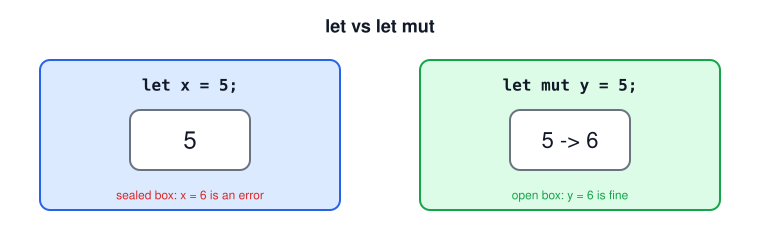
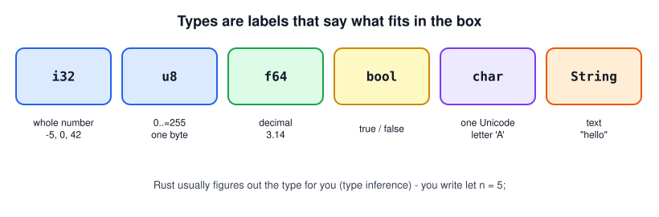
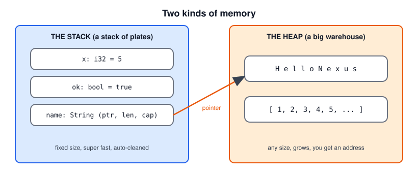

# Chapter 2: Variables, types and mutability

> **Brain Power**
> In most languages, `x = 5; x = 6;` is perfectly fine. Why might a language designer decide that variables should be *unchangeable by default*? Think about a program with 100,000 lines and 20 people editing it.

## Variables are sealed boxes (until you say otherwise)



```rust
fn main() {
    let x = 5;          // sealed box
    println!("x = {x}");

    let mut y = 5;      // open box: "mut" means mutable
    y = 6;
    println!("y = {y}");
}
```

`{x}` inside a string prints the variable's value. (This is called **inline formatting**.)

Try the next one. The compiler will **refuse** it, and that is the point:

```rust,fails
fn main() {
    let x = 5;
    x = 6; // error[E0384]: cannot assign twice to immutable variable
    println!("{x}");
}
```

Why is this good? When you read `let x = 5;` you *know* `x` is 5 for its whole life. Fewer surprises. When something *does* change, the word `mut` flags it.

In Nexus, `mut` appears exactly where something is being built up. From [`collections/mod.rs`](../../crates/nexus-core/src/collections/mod.rs):

```rust
let mut files: Vec<PathBuf> = rd
    .filter_map(|e| e.ok())
    .filter(|e| e.file_type().is_ok_and(|t| t.is_file()))
    .map(|e| e.path())
    .filter(|p| p.extension().is_some_and(|x| x == "json"))
    .collect();
files.sort();
```

`files` is `mut` only because `.sort()` rearranges it in place.

## Shadowing: new box, same label

You can reuse a name with a fresh `let`. This is called **shadowing**. It is not mutation; it is a brand-new variable that hides the old one.

```rust
fn main() {
    let spaces = "   ";          // text
    let spaces = spaces.len();   // now a number! (new variable, new type)
    println!("{spaces}");
}
```

Mutation (`mut`) cannot change a variable's *type*. Shadowing can.

## Types: labels on the boxes



Rust is **statically typed**: every value has a type known at compile time. You usually do not write them because of **type inference**: the compiler works them out.

```rust
fn main() {
    let count = 42;            // i32, the default whole-number type
    let big: u64 = 10_000_000; // type written out; underscores are just for reading
    let ratio = 0.75;          // f64
    let ready = true;          // bool
    let letter = 'N';          // char (single quotes, one Unicode character)
    let name = "Nexus";        // &str (a piece of text)
    println!("{count} {big} {ratio} {ready} {letter} {name}");
}
```

Whole numbers come in families: `i8 i16 i32 i64 i128 isize` (signed: may be negative) and `u8 u16 u32 u64 u128 usize` (unsigned: zero and up). `usize` is "the size of a memory address" and is used for lengths and indexes.

Nexus uses precise types on purpose. In [`http/request_sender.rs`](../../crates/nexus-core/src/http/request_sender.rs):

```rust
/// Largest response body kept in memory; the rest is dropped and the response marked truncated.
const MAX_RESPONSE_BYTES: usize = 100 * 1024 * 1024;
```

* `const` is a value fixed at compile time. Its type must be written.
* 100 * 1024 * 1024 bytes = 100 MiB. A response bigger than that gets cut off.

And a few lines further, a timeout in milliseconds:

```rust
let timeout = Duration::from_millis(opts.settings.timeout.unwrap_or(30_000));
```

`30_000` ms = 30 seconds, the default.

> **Watch it!**
> Mixing number types is a compile error. `let a: i32 = 5; let b: i64 = a;` fails. You must say `let b: i64 = a.into();` or `a as i64`. Rust will not silently convert and lose bits behind your back.

## Tuples and arrays

```rust
fn main() {
    let pair = ("GET", 200);      // tuple: fixed size, mixed types
    println!("{} {}", pair.0, pair.1);

    let codes = [200, 404, 500];  // array: fixed size, one type
    println!("{}", codes[1]);
    println!("{}", codes.len());
}
```

Need a list that grows? That is a `Vec`, coming in Chapter 9.

## Text: `String` vs `&str`

Beginners trip on this one. **Two** text types?



* `&str` ("string slice") is a *view* of text that lives somewhere else. String literals like `"hello"` are `&str`. You cannot grow it.
* `String` is text that **you own** and that lives on the **heap**. It can grow.

```rust
fn main() {
    let literal: &str = "GET";
    let mut owned: String = String::from(literal);
    owned.push_str(" /users");
    println!("{owned}");
}
```

The **stack** holds small, fixed-size things and is automatically cleaned when a function ends. The **heap** holds things whose size is only known at runtime. A `String` is a little stack-sized record (pointer, length, capacity) that points at its text on the heap. You will see in Chapter 6 why that matters so much.

> **Sharpen your pencil**
> For each line, say whether it compiles. If not, say why.
> ```rust
> let a = 3;           // (a)
> a += 1;              // (b)
> let mut b = 3;       // (c)
> b = "three";         // (d)
> let b = "three";     // (e)
> ```
> *(Answers at the end of the chapter.)*

> **There are no Dumb Questions**
>
> **Q: Why not make everything mutable, like in other languages?**
> A: Because a shared, changeable thing is the source of most bugs. Rust makes you opt in, and the compiler then helps you track who may change what.
>
> **Q: Is `let x = 5;` slower than `let mut x = 5;`?**
> A: No. `mut` is a rule checked at compile time, not a runtime cost.
>
> **Q: Why does the type `String` have a capital letter but `i32` doesn't?**
> A: `i32` and friends are built-in *primitive* types. `String` is a type defined in the standard library. Rust convention: types in `PascalCase`, variables and functions in `snake_case`.

## Bullet Points

* `let` makes an **immutable** variable; `let mut` makes a changeable one.
* **Shadowing** (`let x = ...` again) creates a new variable and can change the type.
* Rust is statically typed with **type inference**. Write types only when needed.
* Number types are explicit: `i32`, `u8`, `f64`, `usize`...
* `&str` is a borrowed view of text; `String` is owned, growable text on the heap.
* `const` values are fixed at compile time and need a written type.

## Cheat sheet

```
let x = 5;             immutable
let mut y = 5;         mutable
let x = x + 1;         shadow (new variable)
const N: usize = 10;   constant, type required
i32 u64 f64 bool char  scalar types
(1, "a")   [1, 2, 3]   tuple, array
"text" -> &str         String::from("text") -> String
```

## Answers

* (a) compiles. (b) **error**: `a` is not `mut`. (c) compiles. (d) **error**: `b` is an integer; `mut` cannot change the type. (e) compiles: shadowing creates a new `b` of type `&str`.
