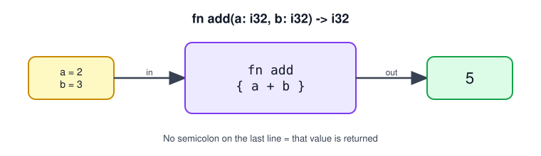

# Chapter 3: Functions and decisions

> **Brain Power**
> Your request builder prints `GET /users HTTP/1.1`. Now you need to print a request line forty times with different methods and paths. Copy-pasting forty `println!` lines sounds awful. What would you *wish* the language let you do?

You wished for a **machine**: something you build once, then feed different inputs. That is a function.

## Functions: build once, use many times

You have already met one function: `main`. Here is the smallest function you can write that is *not* `main`:

```rust
fn say_hello() {
    println!("Hello from a function!");
}

fn main() {
    say_hello();
    say_hello();
}
```

```output
Hello from a function!
Hello from a function!
```

Line by line:

* **`fn say_hello() { ... }`** *defines* a function called `say_hello`. Defining it does nothing yet. It is like writing a recipe on a card.
* **`say_hello();`** inside `main` *calls* it: "do that recipe now". We call it twice, so we get two lines.
* Order does not matter: Rust finds `say_hello` even though `main` was written below it. (In many older languages, it would matter.)

> **New word: function**
> A named bundle of instructions. You *define* it once with `fn` and *call* it as often as you like.

### Giving a function inputs

The machine becomes useful when you can feed it something:



```rust
fn print_request_line(method: &str, path: &str) {
    println!("{method} {path} HTTP/1.1");
}

fn main() {
    print_request_line("GET", "/users");
    print_request_line("POST", "/orders");
}
```

```output
GET /users HTTP/1.1
POST /orders HTTP/1.1
```

* **`(method: &str, path: &str)`** lists the function's **parameters**: the named holes for its inputs. After each colon goes the *type* (Chapter 2). Rust makes you write them: a function is a promise to the rest of the program, and the type is the fine print.
* **`print_request_line("GET", "/users");`** is the call. The values you hand over, `"GET"` and `"/users"`, are called **arguments**. The first argument fills the first parameter, and so on.
* Inside the function, `method` and `path` are ordinary variables.

(`&str` is "text in quotes", as in Chapter 2. We will explain the `&` in Chapter 5.)

> **New word: parameter / argument**
> A **parameter** is the named hole in a function's definition (`method: &str`). An **argument** is the actual value you put in the hole when you call it (`"GET"`).

### Getting an answer back

A machine often gives something back. The return type goes after an arrow `->`:

```rust
fn add(a: i32, b: i32) -> i32 {
    a + b
}

fn main() {
    let total = add(2, 3);
    println!("{total}");
}
```

```output
5
```

* **`-> i32`** means "this function gives back a whole number".
* **`a + b`** has **no semicolon**. That is deliberate and important: the last line of a function, when it has no semicolon, is its answer.

Why? Because Rust splits code into two kinds:

> **New word: expression**
> Code that *produces a value*: `a + b`, `5`, `"GET"`, `add(2, 3)`.

> **New word: statement**
> Code that *does something* and produces no value: `let x = 5;`, `println!("hi");`. It ends with a `;`.

The semicolon turns an expression into a statement, throwing its value away. Watch what happens if you add one to `a + b`:

```rust,fails
fn add(a: i32, b: i32) -> i32 {
    a + b;
}

fn main() {
    let total = add(2, 3);
    println!("{total}");
}
```

```error
error[E0308]: mismatched types
 --> src/main.rs:1:27
  |
1 | fn add(a: i32, b: i32) -> i32 {
  |    ---                    ^^^ expected `i32`, found `()`
  |    |
  |    implicitly returns `()` as its body has no tail or `return` expression
2 |     a + b;
  |          - help: remove this semicolon to return this value

error: aborting due to 1 previous error

For more information about this error, try `rustc --explain E0308`.
```

Decode:

* **`mismatched types ... expected 'i32', found '()'`**: you promised a number (`-> i32`) but the function ends without producing one.
* **`()`** is called **unit**. It is Rust's word for "nothing at all", the value of a statement.
* The compiler even guesses the cause: **"remove this semicolon to return this value"**.

This `expected ..., found ()` is the most common error new Rust programmers see. Now you know what it means: look for a stray `;` on the last line.

If you want to leave a function early, there is also an explicit **`return`**:

```rust
fn clamp_retries(n: u32) -> u32 {
    if n > 5 {
        return 5;
    }
    n
}

fn main() {
    println!("{}", clamp_retries(9));
    println!("{}", clamp_retries(2));
}
```

```output
5
2
```

`return 5;` leaves immediately with 5. If it is not taken, the last line `n` (no semicolon) is the answer. That `if` is next.

> **There are no Dumb Questions**
>
> **Q: Why must I write the types of parameters? Rust can guess them everywhere else!**
> A: Inside a function the compiler can work things out. But a function is a *boundary*: other code, written later, relies on it. Spelling out its inputs and output makes it a readable contract.
>
> **Q: Can a function return two things?**
> A: Return a tuple (Chapter 2): `-> (u16, bool)`. We will see better ways later.
>
> **Q: Is `main` really just a function?**
> A: Yes! It is a function with a special name. The computer calls it to start your program.

## Making decisions: `if`

```rust
fn main() {
    let status = 404;

    if status >= 500 {
        println!("server error");
    } else if status >= 400 {
        println!("client error");
    } else {
        println!("all fine");
    }
}
```

```output
client error
```

Reading top to bottom: Rust asks "is `status >= 500`?" No. "Is `status >= 400`?" Yes: it runs that block and **skips the rest**. Exactly one block runs.

The conditions use **comparison** symbols that give back `true` or `false` (a type called `bool`, Chapter 2):

| Symbol | Means |
|---|---|
| `==` | equal to (two equals signs! one `=` is for `let`) |
| `!=` | not equal to |
| `<` `>` `<=` `>=` | less, greater, less-or-equal, greater-or-equal |
| `&&` | **and**: both sides must be true |
| `\|\|` | **or**: at least one side true |
| `!` | **not**: flips true and false |

Rust is strict: the condition **must** be a `bool`. This is not allowed:

```rust,fails
fn main() {
    let retries = 1;
    if retries {
        println!("retrying");
    }
}
```

```error
error[E0308]: mismatched types
 --> src/main.rs:3:8
  |
3 |     if retries {
  |        ^^^^^^^ expected `bool`, found integer

error: aborting due to 1 previous error

For more information about this error, try `rustc --explain E0308`.
```

The compiler wants `bool`, found an integer. In some languages `if 1` means "true", and that is the source of many bugs. In Rust you must write what you mean: `if retries > 0`.

Functions can return a `bool`, which makes them great for asking questions:

```rust
fn is_success(status: u16) -> bool {
    status >= 200 && status < 300
}

fn main() {
    println!("{}", is_success(204));
    println!("{}", is_success(404));
}
```

```output
true
false
```

### `if` is an expression too

Remember: an *expression* produces a value. `if` is one, so you can use it on the right of a `let`:

```rust
fn main() {
    let attempts = 4;
    let wait_ms = if attempts > 2 { 1000 } else { 100 };
    println!("waiting {wait_ms} ms");
}
```

```output
waiting 1000 ms
```

The two branches must give the same type of value (both numbers here). Notice there is no semicolon after `1000` or `100`: they are the branches' answers.

## Doing things again: loops

Rust has three kinds of loop. Start with the most common, `for`:

```rust
fn main() {
    for attempt in 1..=3 {
        println!("attempt {attempt}");
    }
}
```

```output
attempt 1
attempt 2
attempt 3
```

`1..=3` is a **range**: the numbers 1, 2, 3. The `=` means "include the last one". Without it, `1..3` stops *before* 3 and gives only 1, 2. `for attempt in ...` runs the block once per number, with `attempt` set to each in turn.

> **Sharpen your pencil**
> What does this print? Think about whether `4` is included.
> ```rust
> fn main() {
>     for n in 1..4 {
>         println!("n = {n}");
>     }
> }
> ```
>
> <details><summary>Answer</summary>
>
> ```output
n = 1
n = 2
n = 3
> ```
> `1..4` excludes the 4. To include it you would write `1..=4`.
> </details>

`while` repeats *as long as* a condition is true:

```rust
fn main() {
    let mut wait_ms = 100;
    while wait_ms < 1000 {
        println!("waiting {wait_ms} ms");
        wait_ms = wait_ms * 2;
    }
}
```

```output
waiting 100 ms
waiting 200 ms
waiting 400 ms
waiting 800 ms
```

(`wait_ms` is `mut` because we change it.) And `loop` repeats **forever**, until you say `break`:

```rust
fn main() {
    let mut attempt = 0;
    loop {
        attempt += 1;
        println!("attempt {attempt}");
        if attempt == 3 {
            break;
        }
    }
    println!("gave up after {attempt} attempts");
}
```

```output
attempt 1
attempt 2
attempt 3
gave up after 3 attempts
```

`attempt += 1` is shorthand for `attempt = attempt + 1`. `break` jumps out of the loop.

> **Watch it!**
> A `while` or `loop` that never stops will run until you press **Ctrl+C** in the terminal. If your program seems frozen, that's probably why.

## Checkpoint project: request builder, version 2

Let's tidy the request builder with functions. Our first function-built version:

```rust
const VERSION: &str = "HTTP/1.1";

fn print_request_line(method: &str, path: &str) {
    println!("{method} {path} {VERSION}");
}

fn print_header(name: &str, value: &str) {
    println!("{name}: {value}");
}

fn is_success(status: u16) -> bool {
    status >= 200 && status < 300
}

fn main() {
    print_request_line("GET", "/users");
    print_header("Host", "api.example.test");
    print_header("Accept", "application/json");

    let status = 404;
    if is_success(status) {
        println!("Got {status}: success");
    } else {
        println!("Got {status}: failed, will try again");
    }

    for attempt in 1..=3 {
        println!("try number {attempt} of 3");
    }
}
```

```output
GET /users HTTP/1.1
Host: api.example.test
Accept: application/json
Got 404: failed, will try again
try number 1 of 3
try number 2 of 3
try number 3 of 3
```

Notice `main` now reads like a short story. The details live in small named functions.

> **Sharpen your pencil**
> Add a function `fn is_client_error(status: u16) -> bool` that is true for 400 to 499 (inclusive). Use it in `main` to print a special message for 404. Don't peek at the answer first.
>
> <details><summary>Answer</summary>
>
> ```rust
> fn is_client_error(status: u16) -> bool {
>     status >= 400 && status <= 499
> }
>
> fn main() {
>     let status = 404;
>     if is_client_error(status) {
>         println!("{status} is the client's fault");
>     } else {
>         println!("{status} is not a client error");
>     }
> }
> ```
>
> ```output
404 is the client's fault
> ```
> </details>

> **Where Nexus does this**
> Nexus is made of hundreds of small functions like these. One of the simplest, `format_size` in [`response/mod.rs`](../../crates/nexus-core/src/response/mod.rs), turns a number of bytes into text such as `1.5 KB`. After the next chapter (which introduces text you can build and change) you will be able to read it completely.

## Bullet Points

* `fn name(param: Type) -> ReturnType { ... }` defines a function; `name(arg)` calls it.
* **Parameters** are the holes; **arguments** are what you put in them. Types are required on both parameters and the return.
* The last **expression** in a function, with **no `;`**, is its answer. A stray `;` gives `expected ..., found ()`.
* `return value;` exits early.
* `if` / `else if` / `else` need a `bool` condition. `if` is an expression, so `let x = if ... { a } else { b };` works.
* Loops: `for n in 1..=3`, `while condition`, `loop` with `break`.
* `==  !=  <  >  <=  >=  &&  ||  !` are the comparison and logic symbols.

## Cheat sheet

```text
fn f(a: u16, b: u16) -> u16 { a + b }    function with answer
f(1, 2)                                  call it
return x;                                leave early
if c { .. } else if d { .. } else { .. } decide (c, d must be bool)
let v = if c { 1 } else { 2 };           if as an expression
for i in 1..=3 { }    for i in 1..4 { }  loop: 1,2,3  /  1,2,3
while cond { }       loop { break; }     repeat while / until break
x += 1;                                  same as x = x + 1;
```
