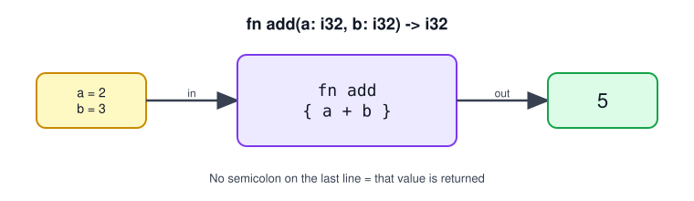
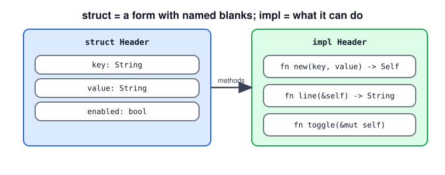

# Chapter 3: Functions, structs and `impl`

> **Brain Power**
> A Nexus request has a method, a URL, headers, a body, auth settings... If you had only numbers and strings, how would you pass "a whole request" to a function without 12 separate arguments?

## Functions



```rust
fn add(a: i32, b: i32) -> i32 {
    a + b
}

fn main() {
    let total = add(2, 3);
    println!("{total}");
}
```

* Parameters **must** have types: `a: i32`.
* `-> i32` is the return type.
* The last expression, **without a semicolon**, is the return value. Add a `;` and it becomes a statement that returns nothing, and the compiler complains.

> **Watch it!**
> `a + b;` (with semicolon) returns `()`, called "unit", Rust's "nothing". The error `expected i32, found ()` almost always means a stray semicolon.

You *can* write `return a + b;` for an early exit, and Rust programmers do, but the no-semicolon style is the norm for the final line.

A real one from [`http/request_sender.rs`](../../crates/nexus-core/src/http/request_sender.rs):

```rust
/// Appends `chunk` to `buf` without exceeding `cap` bytes; returns false when it had to cut.
fn append_capped(buf: &mut Vec<u8>, chunk: &[u8], cap: usize) -> bool {
    let room = cap.saturating_sub(buf.len());
    if chunk.len() > room {
        buf.extend_from_slice(&chunk[..room]);
        return false;
    }
    buf.extend_from_slice(chunk);
    true
}
```

Read it slowly:

* Three inputs, one `bool` out.
* `&mut Vec<u8>` and `&[u8]` are *borrows*. Do not worry; Chapter 7 explains them. For now: `buf` is something the function may change, `chunk` it may only look at.
* `saturating_sub` subtracts but stops at zero instead of wrapping around. Defensive programming!
* `&chunk[..room]` is "the first `room` bytes of `chunk`".
* The early `return false;`, then a final `true` with no semicolon.

Nexus keeps this function tiny and testable. Its test is right below it in the same file (we meet tests in Chapter 13).

## `if`, `loop`, `while`, `for`

```rust
fn main() {
    let status = 404;
    let kind = if status >= 500 { "server error" } else if status >= 400 { "client error" } else { "ok" };
    println!("{kind}");

    for n in 1..=3 {            // 1, 2, 3 (inclusive range)
        println!("try {n}");
    }

    let mut left = 3;
    while left > 0 {
        left -= 1;
    }
    println!("left = {left}");
}
```

`if` is an **expression**: it produces a value, so `let kind = if ... else ...` works. Both branches must give the same type.

## Structs: a form with named blanks



A **struct** groups related values and gives each a name. Here is a real one from [`types/mod.rs`](../../crates/nexus-core/src/types/mod.rs):

```rust
#[derive(Debug, Clone, PartialEq, Serialize, Deserialize)]
#[serde(rename_all = "camelCase")]
pub struct KeyValuePair {
    pub key: String,
    pub value: String,
    pub enabled: bool,
    #[serde(default, skip_serializing_if = "Option::is_none")]
    pub description: Option<String>,
}
```

This is one row in the "Headers" table of the Nexus UI: a key, a value, a checkbox, and an optional description. Ignore the `#[...]` lines for now (they are *attributes*, covered in Chapter 8), and focus on the fields. `pub` means "other modules may touch this field".

Your own:

```rust
struct Header {
    key: String,
    value: String,
    enabled: bool,
}

fn main() {
    let h = Header {
        key: String::from("Accept"),
        value: String::from("application/json"),
        enabled: true,
    };
    println!("{}: {} (enabled = {})", h.key, h.value, h.enabled);
}
```

Create with `Name { field: value, ... }`. Read a field with a dot.

## `impl`: giving structs behavior

Attach functions to a type with an `impl` block:

```rust
struct Header {
    key: String,
    value: String,
    enabled: bool,
}

impl Header {
    // "associated function": no self, called as Header::new(..)
    fn new(key: &str, value: &str) -> Self {
        Self { key: key.to_string(), value: value.to_string(), enabled: true }
    }

    // method that only reads: &self
    fn line(&self) -> String {
        format!("{}: {}", self.key, self.value)
    }

    // method that changes the struct: &mut self
    fn toggle(&mut self) {
        self.enabled = !self.enabled;
    }
}

fn main() {
    let mut h = Header::new("Accept", "*/*");
    h.toggle();
    println!("{} (enabled = {})", h.line(), h.enabled);
}
```

* `Self` (capital S) means "the type this `impl` is for".
* `&self` = "borrow me to look". `&mut self` = "borrow me to change". A function with `self` by itself would *consume* the value; that is Chapter 6.
* Call methods with a dot: `h.toggle()`. Call associated functions with `::`: `Header::new(..)`.
* `format!` is `println!`'s cousin: it **returns** a `String` instead of printing.

Real Nexus `impl` from [`types/mod.rs`](../../crates/nexus-core/src/types/mod.rs):

```rust
impl HttpMethod {
    pub fn as_str(self) -> &'static str {
        match self {
            HttpMethod::Get => "GET",
            HttpMethod::Post => "POST",
            HttpMethod::Put => "PUT",
            HttpMethod::Patch => "PATCH",
            HttpMethod::Delete => "DELETE",
            HttpMethod::Head => "HEAD",
            HttpMethod::Options => "OPTIONS",
        }
    }
}
```

`HttpMethod` is an enum (Chapter 4). `&'static str` is text baked into the program that lives forever (`'static` gets explained in Chapter 7).

## Default values

Some structs have a "blank form" state. Rust has a standard way to say it, the `Default` trait. Nexus writes it by hand for `RequestBody`:

```rust
impl Default for RequestBody {
    fn default() -> Self {
        Self {
            mode: BodyMode::None,
            raw: None,
            form_data: None,
            urlencoded: None,
            binary: None,
            graphql: None,
        }
    }
}
```

Then everywhere else `RequestBody::default()` gives you an empty body. Or you can ask the compiler to write this for you with `#[derive(Default)]`; Nexus does so for the `BodyMode` enum.

**Struct update syntax** copies the rest from another value:

```rust
#[derive(Debug, Default)]
struct Opts {
    width: u32,
    height: u32,
    dark: bool,
}

fn main() {
    let o = Opts { dark: true, ..Default::default() };
    println!("{o:?}");
}
```

`..Default::default()` means "and fill in everything I didn't mention with defaults". Nexus tests use this all over. `{o:?}` prints using the `Debug` format, which `#[derive(Debug)]` provides.

> **Sharpen your pencil**
> Write a `struct Endpoint` with a `url: String` and `retries: u32`. Give it:
> 1. an associated function `Endpoint::new(url: &str) -> Self` that sets retries to 3;
> 2. a method `describe(&self) -> String` returning `"<url> (retries: <retries>)"`;
> 3. a method `bump(&mut self)` that adds one to `retries`.
>
> Then in `main` build one, call `bump` twice, and print `describe()`. What number do you expect to see?
>
> *(Answer at the end of the chapter.)*

> **There are no Dumb Questions**
>
> **Q: Where is the `class` keyword?**
> A: Rust has no classes. A `struct` holds data, an `impl` block holds the methods. There is no inheritance; sharing behavior is done with *traits* (Chapter 8).
>
> **Q: Do all fields have to be `pub`?**
> A: No. Private fields are the default and are how a module hides its internals. Nexus's `types` module makes fields `pub` because it is plain data; many other structs keep fields private.
>
> **Q: Why does `Header::new` take `&str` and then call `.to_string()`?**
> A: The struct needs to **own** its text (a `String`). The caller can pass a cheap borrowed `&str`. `.to_string()` makes the owned copy.

## Bullet Points

* `fn name(arg: Type) -> Ret { ... }`. The last expression (no `;`) is the result.
* `if` is an expression; `for`, `while`, `loop` repeat things.
* A **struct** groups named fields. Create with `Name { field: value }`.
* An **`impl`** block adds functions (`Type::f()`) and methods (`value.f()`).
* `&self` reads, `&mut self` changes, `self` consumes.
* `Default` gives a blank value; `..Default::default()` fills in the rest.

## Cheat sheet

```
fn f(a: i32) -> i32 { a + 1 }       function, implicit return
struct S { a: i32, b: String }      data
impl S { fn new() -> Self {..}      associated fn
         fn get(&self) {..}         read method
         fn set(&mut self) {..} }   write method
S { a: 1, ..Default::default() }    struct update syntax
format!("{x}")  println!("{x:?}")   build string / debug print
```

## Answers

```rust
struct Endpoint {
    url: String,
    retries: u32,
}

impl Endpoint {
    fn new(url: &str) -> Self {
        Self { url: url.to_string(), retries: 3 }
    }
    fn describe(&self) -> String {
        format!("{} (retries: {})", self.url, self.retries)
    }
    fn bump(&mut self) {
        self.retries += 1;
    }
}

fn main() {
    let mut e = Endpoint::new("https://example.test");
    e.bump();
    e.bump();
    println!("{}", e.describe());
}
```

It prints `https://example.test (retries: 5)`. Note `let mut e`: calling a `&mut self` method needs a mutable variable.
