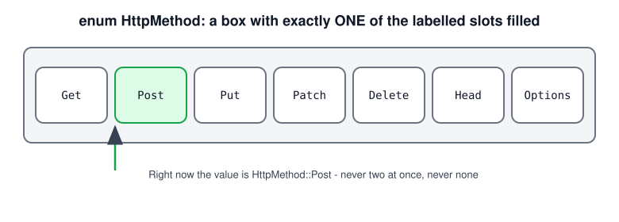
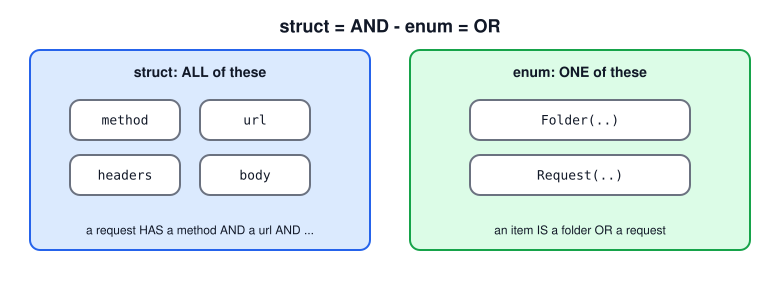
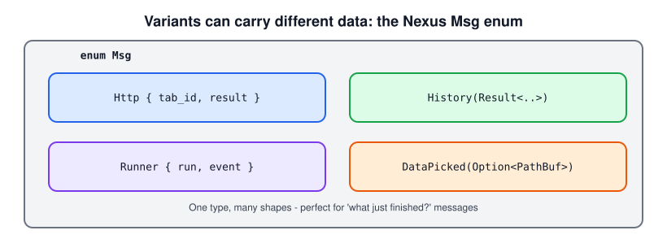
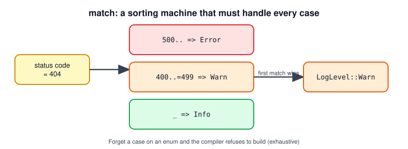

# Chapter 4: Enums and pattern matching

> **Brain Power**
> An HTTP request's method is GET *or* POST *or* PUT *or* ... never two at once. In a language with only strings, you could write `method = "GTE"` (typo!) and nothing would stop you until a user hit the bug. How could a language make that typo impossible?

## An enum is "exactly one of these"



From [`types/mod.rs`](../../crates/nexus-core/src/types/mod.rs):

```rust
#[derive(Debug, Clone, Copy, PartialEq, Eq, Hash, Serialize, Deserialize)]
#[serde(rename_all = "UPPERCASE")]
pub enum HttpMethod {
    Get,
    Post,
    Put,
    Patch,
    Delete,
    Head,
    Options,
}
```

A value of type `HttpMethod` is *always* one of those seven things. You write `HttpMethod::Post`. The typo `HttpMethod::Gte` is a compile error.

Compare with a struct:



* A **struct** has *this AND that AND the other*.
* An **enum** is *this OR that OR the other*.

## Matching: the sorting machine

To use an enum you almost always use `match`:

```rust
#[derive(Debug, Clone, Copy)]
enum HttpMethod {
    Get,
    Post,
    Delete,
}

fn as_str(m: HttpMethod) -> &'static str {
    match m {
        HttpMethod::Get => "GET",
        HttpMethod::Post => "POST",
        HttpMethod::Delete => "DELETE",
    }
}

fn main() {
    println!("{}", as_str(HttpMethod::Post));
}
```

The superpower: `match` must be **exhaustive**. Delete the `Delete` arm and the program will not compile: *"non-exhaustive patterns: `HttpMethod::Delete` not covered"*. Now imagine adding a new method `Trace` to Nexus. Every `match` that forgot it lights up as a compile error. You cannot ship a half-finished change by accident.

```rust,fails
enum Light { Red, Green }

fn name(l: Light) -> &'static str {
    match l {
        Light::Red => "stop",
        // forgot Green!
    }
}

fn main() {
    println!("{}", name(Light::Green));
}
```

## Enums can carry data

This is where Rust enums leave other languages' enums in the dust. Each *variant* may hold its own data.



Nexus has a `Msg` enum in [`runtime.rs`](../../crates/nexus-gui/src/runtime.rs). Whenever background work finishes, it announces itself as one of these:

```rust
pub enum Msg {
    /// A request finished (tab id = request id).
    Http {
        tab_id: String,
        result: Result<Box<(Resp, Vec<LogEntry>)>, String>,
    },
    /// The save dialog closed (`None` = cancelled).
    SavePicked {
        tab_id: String,
        path: Option<std::path::PathBuf>,
    },
    /// Fresh history entries (newest first).
    History(Result<Vec<HistoryEntry>, String>),
    /// A runner progress event of run `run`.
    Runner {
        run: u64,
        event: RunEvent,
    },
    // ...more variants...
}
```

Some variants have named fields (`Http { tab_id, result }`), some have one unnamed value in parentheses (`History(...)`). Each message carries exactly what its handler needs. Don't worry about `Result`, `Option` and `Box` yet; the next chapters explain them.

A runnable toy version:

```rust
enum Msg {
    Http { tab_id: String, status: u16 },
    Picked(Option<String>),
    Quit,
}

fn handle(msg: Msg) {
    match msg {
        Msg::Http { tab_id, status } => println!("tab {tab_id} got status {status}"),
        Msg::Picked(Some(path)) => println!("picked {path}"),
        Msg::Picked(None) => println!("cancelled"),
        Msg::Quit => println!("bye"),
    }
}

fn main() {
    handle(Msg::Http { tab_id: "t1".into(), status: 200 });
    handle(Msg::Picked(None));
    handle(Msg::Quit);
}
```

Notice the arms **unpack** the data into variables (`tab_id`, `status`, `path`). That is **destructuring**.

## Fancier patterns



From [`app.rs`](../../crates/nexus-gui/src/app.rs), picking a log level from a response:

```rust
let level = match (&resp.error, resp.status) {
    (Some(_), _) | (_, 500..) => LogLevel::Error,
    (_, 400..=499) => LogLevel::Warn,
    _ => LogLevel::Info,
};
```

Decode it:

* `match (a, b)` matches on a **tuple**, two things at once.
* `Some(_)` = "there is an error, I don't care what". `_` is the "anything" wildcard.
* `|` means **or**. `(Some(_), _) | (_, 500..)` = "has an error, or status is 500 or higher".
* `400..=499` is an inclusive range. `500..` has no upper bound.
* Arms are tried **top to bottom**; first match wins; `_` at the end catches the rest.

Add an `if` after a pattern to make a **guard**. From [`collections/mod.rs`](../../crates/nexus-core/src/collections/mod.rs):

```rust
match create_private_dir(&dir) {
    Ok(()) => return Ok(dir),
    Err(e) if e.kind() == io::ErrorKind::AlreadyExists => {}
    Err(e) => return Err(e.into()),
}
```

In English: "Try to create the directory. If it worked, return it. If it failed *because it already exists*, shrug and try the next name. Any other failure: give up with that error."

A tiny enum matcher in the same file picks the ID out of either kind of collection item:

```rust
fn item_id(item: &CollectionItem) -> &str {
    match item {
        CollectionItem::Folder(f) => &f.id,
        CollectionItem::Request(r) => &r.id,
    }
}
```

`CollectionItem` is an enum with two variants, `Folder(NexusFolder)` and `Request(NexusRequest)`. That is how Nexus models "a collection holds requests and folders, and folders hold more of the same". An enum that can contain itself through a folder is how trees are born. (See `walk` in [`trust.rs`](../../crates/nexus-core/src/trust.rs), which recurses over this very enum.)

## Shorter forms: `if let`, `let else`, `matches!`

When you only care about one case, a full `match` is a bit much:

```rust
#[derive(Debug)]
enum Item {
    Folder(String),
    Request(String),
}

fn main() {
    let item = Item::Folder("Users".to_string());

    // if let: do something only for one pattern
    if let Item::Folder(name) = &item {
        println!("folder {name}");
    }

    // matches!: just a yes/no answer
    let is_request = matches!(item, Item::Request(_));
    println!("{is_request}");

    // let else: unpack or leave the function
    let Item::Folder(n) = item else {
        println!("not a folder");
        return;
    };
    println!("unpacked {n}");
}
```

`let ... else` is a Nexus favorite for early exits. From the same `collections/mod.rs`:

```rust
let Ok(rd) = std::fs::read_dir(dir) else {
    return vec![];
};
```

"Try to open the directory. If that fails, return an empty list right now."

## Methods on enums, derive and `#[default]`

Enums get `impl` blocks just like structs (you saw `HttpMethod::as_str`). You can also mark one variant as the default. Nexus's `BodyMode`:

```rust
#[derive(Debug, Clone, Copy, PartialEq, Eq, Default, Serialize, Deserialize)]
pub enum BodyMode {
    #[default]
    #[serde(rename = "none")]
    None,
    #[serde(rename = "json")]
    Json,
    // ... xml, text, html, form-data, binary, graphql ...
}
```

`BodyMode::default()` is `BodyMode::None`. The `#[serde(rename = ...)]` lines say what each variant is called in the saved JSON file (Chapter 8).

> **Sharpen your pencil**
> 1. Write `enum Shape { Circle(f64), Rect { w: f64, h: f64 } }` and a function `area(s: &Shape) -> f64` using `match`. (Use `3.14 * r * r`.)
> 2. What does the compiler say if you add a third variant `Triangle` and don't touch `area`?
> 3. Given `match (code, flag) { (200..=299, _) => "ok", (_, true) => "flagged", _ => "other" }`, what is the result for `(404, true)`? For `(204, false)`?
>
> *(Answers at the end of the chapter.)*

> **Watch it!**
> `_ =>` is a convenient catch-all, but it **turns off exhaustiveness checking** for future variants. Use it when you truly mean "everything else"; list variants explicitly when you want the compiler to nag you after a change.

> **There are no Dumb Questions**
>
> **Q: Is a Rust enum like a Java/C enum?**
> A: Partly. The "list of names" part is the same. The part where each variant carries different data is more like a *tagged union* or an algebraic data type.
>
> **Q: Why is `Msg::Http` boxed (`Box<(Resp, Vec<LogEntry>)>`)?**
> A: An enum is as big as its *biggest* variant. `Resp` is large, so Nexus puts it on the heap with `Box` so that every small `Msg` isn't padded out to that size. The comment `#[allow(clippy::large_enum_variant)]` above the enum acknowledges the trade-off.
>
> **Q: Can I match on a `String`?**
> A: Yes, via `match s.as_str() { "GET" => ..., _ => ... }`.

## Bullet Points

* **enum** = one of several variants; **struct** = all of several fields.
* Variants can carry data: `Msg::Http { tab_id, result }`.
* `match` is **exhaustive**: the compiler checks you handled every case.
* Patterns: wildcard `_`, ranges `400..=499`, or `|`, guards `if ...`, destructuring.
* `if let`, `let ... else`, and `matches!` are shorthand for one-case matches.

## Cheat sheet

```
enum E { A, B(i32), C { x: u8 } }   three variant shapes
match e { E::A => .., E::B(n) => .., E::C { x } => .. }
(x, _) | (_, 5..)   patterns: tuple, wildcard, or, open range
Some(n) if n > 3 => ..              guard
if let E::B(n) = e { .. }           one case
let E::B(n) = e else { return };    unpack or leave
matches!(e, E::A | E::B(_))         boolean test
```

## Answers

1. ```rust
   enum Shape { Circle(f64), Rect { w: f64, h: f64 } }

   fn area(s: &Shape) -> f64 {
       match s {
           Shape::Circle(r) => 3.14 * r * r,
           Shape::Rect { w, h } => w * h,
       }
   }

   fn main() {
       println!("{}", area(&Shape::Circle(2.0)));
       println!("{}", area(&Shape::Rect { w: 2.0, h: 3.0 }));
   }
   ```
2. `error[E0004]: non-exhaustive patterns: Shape::Triangle not covered`. The compiler found every place you must update.
3. `(404, true)`: first arm needs 200..=299, no; second arm `(_, true)` matches, so `"flagged"`. `(204, false)`: first arm matches, so `"ok"`.
