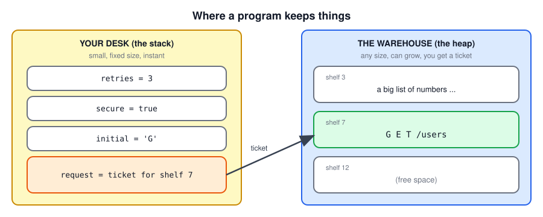
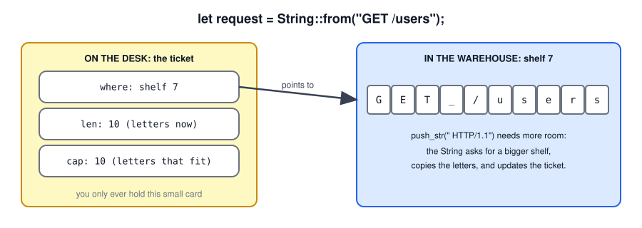
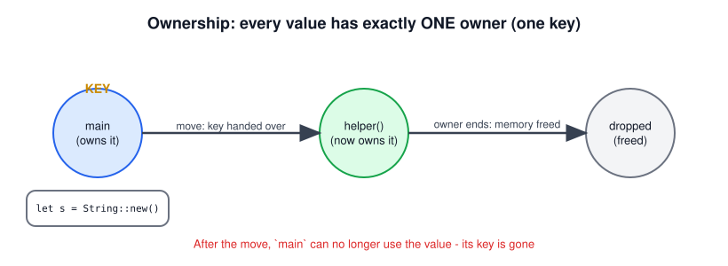
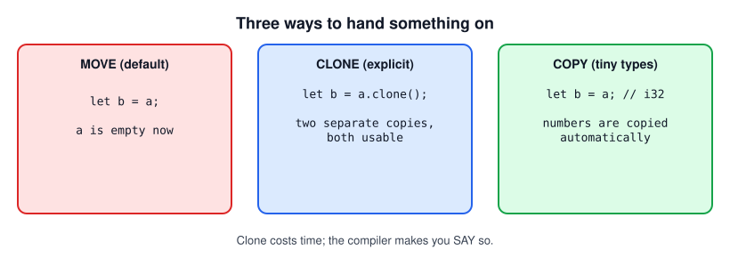

# Chapter 4: Ownership

> **Brain Power**
> You own exactly one copy of a paperback novel. You hand it to a friend. Can *you* read it this afternoon? Your friend hands it on to *their* friend. Now who has to give it back, and to whom? Write down the rule you used in your head.

Real objects can be in only one place at a time. Rust gives every value in your program that same simple rule, and in return it never needs a "garbage collector" or manual clean-up. This is the most famous idea in Rust, and it is not hard if we go slowly. Let's start with where programs keep their things.

## Where does a program keep things? A desk and a warehouse

Imagine you work at a desk beside a huge warehouse.

* Your **desk** is small, tidy and fast. Anything you put on it has a **fixed size**: a number, a yes/no card, a single letter. You can grab things instantly, and when you finish a job you sweep the desk clean.
* The **warehouse** is huge. It can store things of *any* size, even ones that **grow** (like a note that keeps getting longer). But to use it you must ask the clerk for a shelf, you get back a **ticket** with the shelf's address, and somebody must remember to return the shelf when it is no longer needed.



Programmers have two names for these:

> **New word: stack**
> The "desk": small, fixed-size values, super fast, cleaned up automatically when a function finishes. (It is called a stack because new things go on top, like plates.)

> **New word: heap**
> The "warehouse": space for values whose size can change or isn't known until the program runs. You get an address (the ticket) and must give the space back when done.

> **New word: memory**
> The computer's working space, where a running program keeps its values. The desk and the warehouse are both parts of memory.

Numbers, `bool`s and `char`s are small and fixed, so they live on the desk. **Text that can grow** needs the warehouse. Which brings us to a second kind of text.

## `String`: text that can grow

In Chapter 2, `"GET"` was text *written into your program*. It can't grow or change. Rust has a second text type, `String`, for text your program builds while running:

```rust
fn main() {
    let mut request = String::from("GET /users");
    println!("{request}");

    request.push_str(" HTTP/1.1");
    println!("{request}");
}
```

```output
GET /users
GET /users HTTP/1.1
```

* **`String::from("GET /users")`** makes a `String` out of the quoted text. The double colon `::` reads as "inside". `String::from` means "the function named `from`, found inside `String`". (It is like a folder path: `String` / `from`.)
* **`let mut request`**: we plan to change it, so `mut`, just like Chapter 2.
* **`request.push_str(" HTTP/1.1")`** is a *method* (Chapter 2) that adds text on the end. The text grows, so it needs room in the warehouse.

A `String` is split in two parts: a small ticket on your desk and the letters in the warehouse.



The ticket records three things: *where* the letters are, *how many* there are right now (`len`), and *how many fit* before it must ask for a bigger shelf (`capacity`). You never see this ticket directly. It is just good to know it is there.

You can also write `"GET".to_string()`, another way to make a `String` from quoted text. It does exactly the same as `String::from("GET")`.

## The three rules of ownership

Here is the whole idea. Read these slowly.

> **The three rules**
> 1. Every value has exactly **one owner**: a variable.
> 2. There can only be **one owner at a time**.
> 3. When the owner goes away, the value is **dropped**: its memory is cleaned up, automatically.

> **New word: owner**
> The variable that currently holds a value, and is responsible for it.

> **New word: scope**
> The stretch of code where a variable exists: from its `let` to the closing `}` of the block it was made in.

> **New word: drop**
> To clean up a value: give its warehouse space back. Rust inserts the clean-up *for you*, at the closing `}` of the owner's scope.



Scope in action. Predict first: will this compile?

```rust,fails
fn main() {
    {
        let secret = String::from("token");
        println!("{secret}");
    }
    println!("{secret}");
}
```

<details><summary>Answer</summary>

```error
error[E0425]: cannot find value `secret` in this scope
 --> src/main.rs:6:16
  |
6 |     println!("{secret}");
  |                ^^^^^^
  |
help: the binding `secret` is available in a different scope in the same function
 --> src/main.rs:3:13
  |
3 |         let secret = String::from("token");
  |             ^^^^^^

error: aborting due to 1 previous error

For more information about this error, try `rustc --explain E0425`.
```

The inner `{ ... }` is a smaller scope. `secret` lives only inside it. At the inner `}`, `secret` is dropped, and the name stops existing. That is why the compiler says **"cannot find value `secret` in this scope"**, and even helpfully adds that the binding "is available in a different scope", pointing at the inner one.

</details>

No `free()`, no `delete`, no "garbage collector" sweeping up behind you: the compiler works out where the `}` is, and puts the clean-up exactly there. You get the safety of a managed language and the speed of a hand-tuned one.

## Moving

Now the interesting part. What does `let b = a;` do when `a` is a `String`?

You might think it makes a second copy of the text. It doesn't. That would be slow, so Rust **moves** the value: ownership is handed from `a` to `b`, like handing over the one key. After the move, `a` has nothing.

Predict: does this compile?

```rust,fails
fn main() {
    let a = String::from("GET");
    let b = a;
    println!("{a} and {b}");
}
```

<details><summary>Answer</summary>

```error
error[E0382]: borrow of moved value: `a`
 --> src/main.rs:4:16
  |
2 |     let a = String::from("GET");
  |         - move occurs because `a` has type `String`, which does not implement the `Copy` trait
3 |     let b = a;
  |             - value moved here
4 |     println!("{a} and {b}");
  |                ^ value borrowed here after move
  |
help: consider cloning the value if the performance cost is acceptable
  |
3 |     let b = a.clone();
  |              ++++++++

error: aborting due to 1 previous error

For more information about this error, try `rustc --explain E0382`.
```

Read it like a detective:

* **`borrow of moved value: 'a'`**: "you used `a` after it was moved". (*Borrow* here just means "use"; it gets its own chapter.)
* **`move occurs because 'a' has type 'String', which does not implement the 'Copy' trait`**: the *reason*. A `String` is not a "copy" type (we meet those in a moment). *(Ignore the word "trait" for now. It means "ability", and Chapter 10 explains.)*
* **`value moved here`** (the `let b = a;`) and **`value borrowed here after move`** (the `println!`): the compiler shows *both* places, so you can see the crime and the scene.
* **`help: consider cloning the value if the performance cost is acceptable`**: one fix, which we'll do shortly.

</details>

Why does Rust care? Imagine `a` and `b` both thought they owned the same warehouse shelf. At the closing `}` *both* would try to return it. Returning the same shelf twice is a famous bug ("double free") that crashes programs and creates security holes. By allowing only **one** owner, Rust makes it impossible.



### Moving into a function

Handing a value to a function is also a move, because the function's parameter becomes the new owner:

```rust,fails
fn shout(text: String) {
    println!("{} !!!", text);
}

fn main() {
    let greeting = String::from("hello");
    shout(greeting);
    println!("I still have {greeting}");
}
```

```error
error[E0382]: borrow of moved value: `greeting`
 --> src/main.rs:8:29
  |
6 |     let greeting = String::from("hello");
  |         -------- move occurs because `greeting` has type `String`, which does not implement the `Copy` trait
7 |     shout(greeting);
  |           -------- value moved here
8 |     println!("I still have {greeting}");
  |                             ^^^^^^^^ value borrowed here after move
  |
note: consider changing this parameter type in function `shout` to borrow instead if owning the value isn't necessary
 --> src/main.rs:1:16
  |
1 | fn shout(text: String) {
  |    -----       ^^^^^^ this parameter takes ownership of the value
  |    |
  |    in this function
help: consider cloning the value if the performance cost is acceptable
  |
7 |     shout(greeting.clone());
  |                   ++++++++

error: aborting due to 1 previous error

For more information about this error, try `rustc --explain E0382`.
```

Same story: `shout(greeting)` moved the key to `text`, and `text` was dropped at the end of `shout`. The compiler even points at the function's parameter: **"this parameter takes ownership of the value"**, and suggests two cures: change the parameter to *borrow* (Chapter 5) or clone.

## Fix 1: clone

If you really want two separate texts, say so explicitly with **`.clone()`**:

```rust
fn shout(text: String) {
    println!("{} !!!", text);
}

fn main() {
    let greeting = String::from("hello");
    shout(greeting.clone());
    println!("I still have {greeting}");
}
```

```output
hello !!!
I still have hello
```

`greeting.clone()` makes a brand-new copy of the text in the warehouse and hands *that* to `shout`. We still own the original. Cloning costs time (it copies every letter), which is exactly why Rust makes you ask for it out loud instead of doing it secretly.

> **New word: clone**
> To make a complete, independent duplicate of a value. You must ask for it with `.clone()`.

## Fix 2 (for small things): copy

Wait. Why did this work in Chapter 2?

```rust
fn main() {
    let a = 5;
    let b = a;
    println!("{a} and {b}");
}
```

```output
5 and 5
```

Because numbers are tiny and live on the desk, copying one costs nothing. Rust copies them automatically instead of moving them.

> **New word: Copy**
> A type that is so small and simple that assigning or passing it makes an automatic copy, and the original stays usable. Numbers, `bool` and `char` are all `Copy`. `String` is not.

Rule of thumb: **small, fixed-size things are copied; things that own warehouse space are moved.**

> **Sharpen your pencil**
> For each variable below, will the line after it be fine, or will the compiler complain about a move? Decide first.
> ```text
> let n = 42;               let m = n;        println!("{n}");   // (a)
> let t = String::from("x");  let u = t;      println!("{t}");   // (b)
> let c = 'Z';              let d = c;        println!("{c}");   // (c)
> let s = String::from("y");  let r = s.clone(); println!("{s}"); // (d)
> ```
>
> <details><summary>Answer</summary>
>
> (a) fine: numbers are `Copy`. (b) **error**: `String` was moved. (c) fine: `char` is `Copy`. (d) fine: we made a separate clone, so `s` still owns its own text.
> </details>

## Fix 3: give it back (and why it's clumsy)

A function can take ownership, do its work, and **return** the value so the caller owns it again:

```rust
fn add_header(mut request: String, name: &str, value: &str) -> String {
    request.push('\n');
    request.push_str(name);
    request.push_str(": ");
    request.push_str(value);
    request
}

fn main() {
    let request = String::from("GET /users HTTP/1.1");
    let request = add_header(request, "Host", "api.example.test");
    println!("{request}");
}
```

```output
GET /users HTTP/1.1
Host: api.example.test
```

New pieces:

* `mut request: String` in the parameter list: the function is allowed to change the `String` it was given, just like `let mut`.
* `request.push('\n')` adds one character (single quotes, as in Chapter 2). `\n` is a **newline**: the character that starts a new line.
* The last line, `request`, has no semicolon (Chapter 3), so it is the answer: ownership goes *out* of the function and back to the caller.
* In `main`, `let request = add_header(request, ...)` shadows (Chapter 2) the old `request` with the returned one. The key goes in, and comes back out.

It works. But imagine every function having to hand your things back. Often a function only wants to *look at* your text. Chapter 5 is the polite solution: lending without giving away.

> **There are no Dumb Questions**
>
> **Q: Python and Java don't make me think about any of this. Why does Rust?**
> A: Those languages clean up with a "garbage collector" that runs while your program runs, tracking who is still using what. It is convenient but costs time and memory, at unpredictable moments. Rust decides who cleans up what **while compiling**, at zero cost when running. The price is that you learn these rules.
>
> **Q: Does `let b = a;` copy the letters or not?**
> A: Not for a `String`. It moves only the little ticket on the desk, and the old variable is marked as empty. The letters in the warehouse stay put. That's why a move is fast.
>
> **Q: What happens to a variable that is never used again?**
> A: It still lives until the end of its scope, then it is dropped. Nothing leaks.

## Now look at real Nexus

Here is a complete real function from Nexus ([`response/mod.rs`](../../crates/nexus-core/src/response/mod.rs)). It turns a byte count into friendly text, such as `1.5 KB`. You promised in Chapter 3 that you would read it, and now you can.

```rust,nexus
pub fn format_size(bytes: u64) -> String {
    if bytes < 1024 {
        format!("{bytes} B")
    } else if bytes < 1024 * 1024 {
        format!("{:.1} KB", bytes as f64 / 1024.0)
    } else {
        format!("{:.2} MB", bytes as f64 / (1024.0 * 1024.0))
    }
}
```

Decode:

* **`pub`** is a word we have not met. Ignore it for now: Chapter 14 explains it. (It means other parts of the program may use this function.) **Standing rule for the next nine chapters:** real Nexus code is full of `pub`. Wherever an excerpt says `pub`, read the code as if the word were not there.
* `fn format_size(bytes: u64) -> String` takes a whole number and returns a `String`, a brand-new one, built inside, whose ownership passes to whoever called it.
* **`format!`** is `println!`'s cousin. Instead of printing, it *builds and returns* a `String`. Its placeholders work the same.
* **`{:.1}`** is a placeholder with a *recipe*: show **one** digit after the decimal point. `{:.2}` shows two.
* **`bytes as f64 / 1024.0`** converts the number to a decimal (that `as` from Chapter 2), then divides.
* The chain of `if` / `else if` / `else` (Chapter 3) has no semicolons on the three branches, so the chosen branch is the function's answer.

Try the same idea yourself:

```rust
fn format_size(bytes: u64) -> String {
    if bytes < 1024 {
        format!("{bytes} B")
    } else if bytes < 1024 * 1024 {
        format!("{:.1} KB", bytes as f64 / 1024.0)
    } else {
        format!("{:.2} MB", bytes as f64 / (1024.0 * 1024.0))
    }
}

fn main() {
    println!("{}", format_size(512));
    println!("{}", format_size(1536));
    println!("{}", format_size(5_500_000));
}
```

```output
512 B
1.5 KB
5.25 MB
```

## Checkpoint project: request builder, version 3

Now the builder produces a `String` instead of printing straight away:

```rust
const VERSION: &str = "HTTP/1.1";

fn request_line(method: &str, path: &str) -> String {
    format!("{method} {path} {VERSION}")
}

fn add_header(mut request: String, name: &str, value: &str) -> String {
    request.push('\n');
    request.push_str(name);
    request.push_str(": ");
    request.push_str(value);
    request
}

fn main() {
    let request = request_line("GET", "/users");
    let request = add_header(request, "Host", "api.example.test");
    let request = add_header(request, "Accept", "application/json");
    println!("{request}");
}
```

```output
GET /users HTTP/1.1
Host: api.example.test
Accept: application/json
```

Trace the key: `request_line` builds a `String` and hands it out. `main` owns it, passes it *into* `add_header` (moved), gets it back (moved out), and so on. At the end of `main`, the final owner drops it.

> **Sharpen your pencil**
> After the line `let request = add_header(request, "Host", ...);` the original `String` has been moved. Why does using the *name* `request` on the next line still work?
>
> <details><summary>Answer</summary>
>
> Because `let request = ...` made a **new** variable with the same name (shadowing, Chapter 2) that owns the returned `String`. The name was reused; the old variable is gone. Each line hands the key from the old `request` to the next.
> </details>

## Bullet Points

* The **stack** (desk) holds small fixed-size things; the **heap** (warehouse) holds things that can grow. A `String` is a ticket on the desk pointing to letters on the heap.
* **Ownership rules:** every value has exactly one **owner**; one owner at a time; when the owner's **scope** ends, the value is **dropped** (cleaned up), automatically.
* Assigning or passing a `String` **moves** it; the old variable can no longer be used.
* `.clone()` makes an independent copy on request. Small types like numbers, `bool` and `char` are **`Copy`**: copied automatically.
* `String::from("..")`, `.to_string()`, `format!(..)` make a `String`; `push_str` and `push` grow one.
* `::` means "inside": `String::from`. `{:.1}` means "one digit after the decimal point".

## Cheat sheet

```text
let s = String::from("hi");   make a String        (also "hi".to_string())
s.push_str("!!");             grow it   (needs let mut)
let t = s;                    MOVE: s is unusable now
let t = s.clone();            COPY the text: both usable
let n = 5; let m = n;         numbers/bool/char: copied automatically
format!("{a} {b}")            build a String
{ let x = ..; }               x is dropped at the closing brace
```
