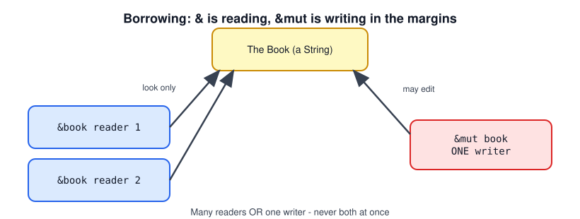
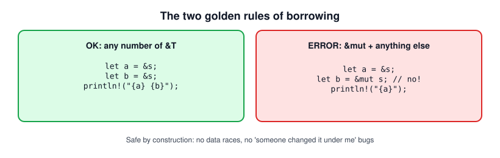

# Chapter 5: Borrowing

> **Brain Power**
> Last chapter, handing a `String` to `shout` made it vanish from `main`, even though `shout` only wanted to *print* it. Think of a polite human equivalent: you want a friend to read your notes. You do not give your only copy away forever. What do you do instead?

You *lend* it. Rust has exactly that: you hand over a **reference**, a pass that lets someone look at your value while you keep owning it.

## References: borrowing a value

Think of a **library**. The library owns every book. You borrow one, read it, and give it back. While you are reading, the book is still the library's.



In Rust, the `&` symbol (an **ampersand**) means "a borrowed look at". Here is `shout` again, this time politely:

```rust
fn shout(text: &String) {
    println!("{} !!!", text);
}

fn main() {
    let greeting = String::from("hello");
    shout(&greeting);
    println!("I still have {greeting}");
}
```

```output
hello !!!
I still have hello
```

Two places have a `&`:

* **`text: &String`** in the parameter list: "I want a *borrowed look at* a `String`, not the `String` itself."
* **`shout(&greeting)`** in the call: "here, borrow `greeting` for the duration of this call."

When `shout` finishes, the borrow ends. `greeting` was owned by `main` the whole time, so we can still use it. Compare with Chapter 4, where the same program failed to compile.

> **New word: reference**
> A value that *points at* another value instead of owning it. You make one by putting `&` in front of a variable. It is like the library slip saying "the book is on shelf 7": you can read it, but the library still owns the book.

> **New word: borrow**
> To use a value through a reference. When you borrow, the owner keeps ownership and the borrow ends when you are done.

Because the function does not own the text, it does **not** drop it at the end. Only the owner cleans up.

## Borrowing so you can change it: `&mut`

`&` is read-only, like a library book you must not scribble in. If the function needs to *change* the value, you ask for a **mutable** reference, written `&mut`:

```rust
fn add_header(request: &mut String, name: &str, value: &str) {
    request.push('\n');
    request.push_str(name);
    request.push_str(": ");
    request.push_str(value);
}

fn main() {
    let mut request = String::from("GET /users HTTP/1.1");
    add_header(&mut request, "Host", "api.example.test");
    add_header(&mut request, "Accept", "application/json");
    println!("{request}");
}
```

```output
GET /users HTTP/1.1
Host: api.example.test
Accept: application/json
```

Compare with Chapter 4's version. No returning the key, no shadowing, no `let request =` again. `add_header` borrows the `String`, writes into it, and gives it back automatically when it ends. Notice that you need `&mut` in **both** places: the parameter (`request: &mut String`) and the call (`&mut request`), and the variable itself must be `let mut`.

| Syntax | Name | You can | In the library... |
|---|---|---|---|
| `&x` | shared reference | read | borrow a book to read |
| `&mut x` | mutable reference | read and change | borrow it to write in the margins |

## The two golden rules

Why two kinds? Because of a simple rule that prevents a whole family of bugs:

> **The borrowing rules**
> At any moment you may have **either**:
> * as many `&` (readers) as you like, **or**
> * exactly **one** `&mut` (a writer),
>
> but never both at once.



It's how a library would work if two people reading a page could never be surprised by a third person scribbling on it. Let's see the compiler enforce it. Predict first: does this compile?

```rust,fails
fn main() {
    let mut request = String::from("GET /users");
    let reader = &request;
    request.push_str(" HTTP/1.1");
    println!("{reader}");
}
```

<details><summary>Answer</summary>

```error
error[E0502]: cannot borrow `request` as mutable because it is also borrowed as immutable
 --> src/main.rs:4:5
  |
3 |     let reader = &request;
  |                  -------- immutable borrow occurs here
4 |     request.push_str(" HTTP/1.1");
  |     ^^^^^^^^^^^^^^^^^^^^^^^^^^^^^ mutable borrow occurs here
5 |     println!("{reader}");
  |                ------ immutable borrow later used here

error: aborting due to 1 previous error

For more information about this error, try `rustc --explain E0502`.
```

* **`cannot borrow 'request' as mutable because it is also borrowed as immutable`**: "immutable borrow" is the plain `&`. `push_str` secretly needs `&mut request`, but `reader` is still being used on the last line.
* The three markers tell the story in order: *immutable borrow occurs here* (`let reader = &request`), *mutable borrow occurs here* (`request.push_str(...)`), *immutable borrow later used here* (the `println!`).

If the `println!` were removed, the code would compile: a borrow only lasts until its **last use**.

</details>

Why is this rule so valuable? If `push_str` had to grow the text, the letters might move to a new shelf in the warehouse (Chapter 4). `reader` would then point at the *old*, empty shelf. In other languages this is a crash or a security hole. In Rust it is a compile error.

Two writers is just as bad:

```rust,fails
fn main() {
    let mut request = String::from("GET /users");
    let a = &mut request;
    let b = &mut request;
    a.push('!');
    b.push('?');
    println!("{request}");
}
```

```error
error[E0499]: cannot borrow `request` as mutable more than once at a time
 --> src/main.rs:4:13
  |
3 |     let a = &mut request;
  |             ------------ first mutable borrow occurs here
4 |     let b = &mut request;
  |             ^^^^^^^^^^^^ second mutable borrow occurs here
5 |     a.push('!');
  |     - first borrow later used here

error: aborting due to 1 previous error

For more information about this error, try `rustc --explain E0499`.
```

**`cannot borrow 'request' as mutable more than once at a time`**. One writer at a time.

Many readers, however, are perfectly fine:

```rust
fn main() {
    let request = String::from("GET /users");
    let a = &request;
    let b = &request;
    println!("{a} {b} {request}");
}
```

```output
GET /users GET /users GET /users
```

> **Sharpen your pencil**
> Which of these programs compile? Decide first.
> * (a) Create `&s` twice and print both.
> * (b) Create `&s` once, then `&mut s`, then use the first reference.
> * (c) Create `&mut s`, use it, and *then* create `&s` and use it.
>
> <details><summary>Answer</summary>
>
> (a) compiles: any number of readers. (b) fails: the reader is still alive when the writer appears. (c) compiles: the writer's last use was *before* the reader appeared, so the borrows never overlap.
> </details>

> **There are no Dumb Questions**
>
> **Q: When should I pass `&` and when `&mut`?**
> A: Start with `&`. Move to `&mut` only when the function has to change the value. Only give away ownership (Chapter 4's style) when the function needs to *keep* the value, for example to store it somewhere.
>
> **Q: Why can't I just have everything mutable and shared like in Python?**
> A: Because two pieces of code changing the same thing at once is the root of many bugs, especially when programs do several things at once (Chapter 18). Rust's rule makes those bugs impossible to write.
>
> **Q: A reference to a number is `&i32`. Can I just do maths on it?**
> A: Reading, yes (`*r + 1` or often just `r + 1`). Writing through a `&mut i32` needs the star: `*r += 1`. The `*` means "go through the reference to the value itself". You will see it from time to time.

## A reference can't outlive what it points at

A reference is like a library slip: useless if the book is thrown away. Rust refuses to let you keep a slip for a book that has been dropped:

```rust,fails
fn main() {
    let reference;
    {
        let secret = String::from("token");
        reference = &secret;
    }
    println!("{reference}");
}
```

```error
error[E0597]: `secret` does not live long enough
 --> src/main.rs:5:21
  |
4 |         let secret = String::from("token");
  |             ------ binding `secret` declared here
5 |         reference = &secret;
  |                     ^^^^^^^ borrowed value does not live long enough
6 |     }
  |     - `secret` dropped here while still borrowed
7 |     println!("{reference}");
  |                --------- borrow later used here

error: aborting due to 1 previous error

For more information about this error, try `rustc --explain E0597`.
```

`secret` lives only inside the inner braces (scope, Chapter 4). `reference` tries to outlive it, and the compiler says **"`secret` does not live long enough"**. In Chapter 12 we will give this idea a proper name (*lifetimes*). For now, the rule is simply: **a borrow can never last longer than the owner.**

## `&str`: the borrowed text you have been using all along

Remember `&str` from Chapters 2 and 3, the type of text in quotes? Now we can decode it. It is **`&` + `str`**: a *borrowed look at some text*. It is called a **string slice**.

> **New word: slice**
> A borrowed look at *part* (or all) of some text. `&str` is a slice of text. The text itself is owned by somebody else: a `String`, or (for quoted text) the program itself.

So there are two text types and now you can tell them apart:

| Type | Who owns the letters? | Can grow? | Example |
|---|---|---|---|
| `String` | the variable (letters on the heap) | yes | `String::from("GET")` |
| `&str` | someone else; you are borrowing a look | no | `"GET"`, or a slice of a `String` |

A slice can look at just a *part* of the text. Put a range (Chapter 3) in square brackets:

```rust
fn main() {
    let request = String::from("GET /users HTTP/1.1");
    let method = &request[0..3];
    let path = &request[4..10];
    println!("method={method} path={path}");
}
```

```output
method=GET path=/users
```

`&request[0..3]` is "borrow a look at letters 0, 1, 2". No new text is made; the slice just points into the original. (The numbers count **bytes**. For plain English letters, one letter is one byte.)

Because a `&str` only looks, the *best* type for a function parameter that just reads text is `&str`. It accepts quoted text, and it also accepts a `&String` (Rust converts it for you):

```rust
fn shout(text: &str) {
    println!("{} !!!", text);
}

fn main() {
    let greeting = String::from("hello");
    shout(&greeting);
    shout("goodbye");
}
```

```output
hello !!!
goodbye !!!
```

That is why `add_header` above took `name: &str, value: &str`: the caller may pass quoted text or a `String`'s look. **Rule of thumb: parameters that only read text should be `&str`.**

## Now look at real Nexus

Here is a small real function from Nexus ([`payload.rs`](../../crates/nexus-gui/src/payload.rs)). When Nexus sends a form with a field value that contains quote marks or line breaks, it has to *escape* them so they cannot break the message.

```rust,nexus
fn quote_param(s: &str) -> String {
    s.replace('"', "%22")
        .replace('\r', "%0D")
        .replace('\n', "%0A")
}
```

Decode:

* **`s: &str`**: it only *reads* its input, so it borrows a `&str`. Quoted text, or any `String`'s look, may be passed in.
* **`-> String`**: it returns a *new* `String`, owned by the caller. Nothing is changed in place; the original text is untouched.
* **`.replace('"', "%22")`** is a method on text: "make a new `String` where every `"` is replaced with `%22`". A **char** (`'"'`, single quotes) is replaced by text (`"%22"`, double quotes).
* The next `.replace(...)` is called on that *new* `String`, and the next on that. This is called **chaining**: each call makes a new `String` and hands it to the next dot.
* No `;`, no `return`: the final `String` is the function's answer (Chapter 3).

You can try the same recipe:

```rust
fn quote_param(s: &str) -> String {
    s.replace('"', "%22")
        .replace('\r', "%0D")
        .replace('\n', "%0A")
}

fn main() {
    let original = String::from("say \"hi\"\nplease");
    println!("{}", quote_param(&original));
    println!("{}", original.len());
}
```

```output
say %22hi%22%0Aplease
15
```

(In a quoted piece of text, `\"` means a quote mark that is *part of the text*, and `\n` is the newline you met earlier.) Notice that `original` is still ours: `quote_param` only borrowed it.

## Checkpoint project: request builder, version 4

Rewrite the builder so no ownership gets passed back and forth:

```rust
const VERSION: &str = "HTTP/1.1";

fn request_line(method: &str, path: &str) -> String {
    format!("{method} {path} {VERSION}")
}

fn add_header(request: &mut String, name: &str, value: &str) {
    request.push('\n');
    request.push_str(name);
    request.push_str(": ");
    request.push_str(value);
}

fn show(request: &str) {
    println!("{request}");
    println!("({} characters)", request.len());
}

fn main() {
    let mut request = request_line("GET", "/users");
    add_header(&mut request, "Host", "api.example.test");
    add_header(&mut request, "Accept", "application/json");
    show(&request);
}
```

```output
GET /users HTTP/1.1
Host: api.example.test
Accept: application/json
(67 characters)
```

Walk through who owns what. `main` owns `request` the whole time. `add_header` borrows it mutably for a moment. `show` borrows it read-only. There is one owner and no confusion.

> **Sharpen your pencil**
> What would the compiler say if you changed `show(&request);` to `show(request);`? Predict the error in your own words before you try it.
>
> <details><summary>Answer</summary>
>
> `show` wants a `&str` (a borrowed look) and you handed it a `String` directly. You get **`mismatched types: expected '&str', found 'String'`** and the compiler suggests: **consider borrowing here: `&request`**.
> </details>

## Bullet Points

* A **reference** (`&x`) lets you use a value without owning it; the owner keeps ownership. Using one is called **borrowing**.
* `&T` is a shared, read-only borrow. `&mut T` is an exclusive, writing borrow; the variable must be `let mut`, and you write `&mut` in the parameter *and* at the call.
* **Rule:** any number of `&`, **or** exactly one `&mut`, never both at once. A borrow lasts until its last use.
* A reference can never outlive its owner.
* `&str` is a borrowed **slice** of text. Parameters that only read text should be `&str`.
* `&text[0..3]` borrows part of a text.

## Cheat sheet

```text
fn f(x: &String)        borrow to read      call: f(&s)
fn f(x: &mut String)    borrow to change    call: f(&mut s)     (s must be let mut)
fn f(x: &str)           borrow text         accepts "lit" and &String
&s[0..3]                slice: a look at part of a text
many & OR one &mut      never both at the same time
*r += 1                 reach through a &mut to a number
```
