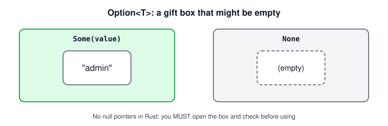
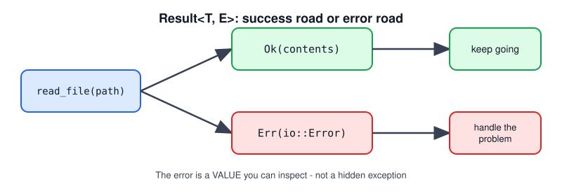
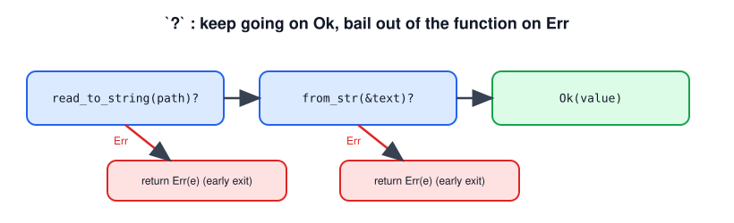
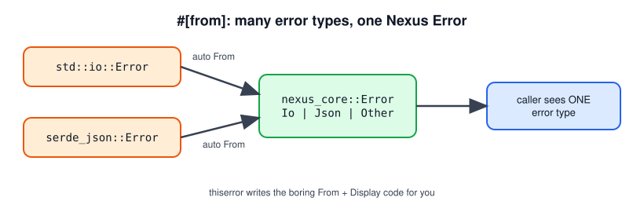

# Chapter 5: `Option`, `Result`, `?` and errors

> **Brain Power**
> Tony Hoare, who invented the "null reference", called it his *billion-dollar mistake*. When a function says "here's a string" and secretly gives you `null`, what goes wrong? How would *you* design a language so that "maybe nothing" is impossible to forget?

## Rust has no `null`

Instead it has an ordinary enum in the standard library:



```rust
enum Option<T> {
    Some(T),   // a value is here
    None,      // nothing here
}
```

(`T` is a placeholder for "any type", more in Chapter 8.) A function that might not find something returns `Option<...>`, and you **cannot use the inside without opening the box**:

```rust
fn find_header(headers: &[(&str, &str)], name: &str) -> Option<String> {
    for (k, v) in headers {
        if k.eq_ignore_ascii_case(name) {
            return Some(v.to_string());
        }
    }
    None
}

fn main() {
    let headers = [("Content-Type", "application/json"), ("X-Id", "7")];

    match find_header(&headers, "content-type") {
        Some(v) => println!("found {v}"),
        None => println!("no such header"),
    }

    // shorthand: use a default if empty
    let missing = find_header(&headers, "Accept").unwrap_or("*/*".to_string());
    println!("{missing}");
}
```

Real Nexus: [`trust.rs`](../../crates/nexus-core/src/trust.rs) has a function that extracts an origin (like `https://api.example.com`) from a URL, or `None` if the text isn't a web URL:

```rust
pub fn origin_of(url: &str) -> Option<String> {
    let u = url::Url::parse(url.trim()).ok()?;
    matches!(u.scheme(), "http" | "https").then(|| u.origin().ascii_serialization())
}
```

Two things to unpack. `.ok()?` is coming up in a minute. `.then(|| ...)` turns a `bool` into an `Option`: `true.then(|| x)` is `Some(x)`, `false.then(...)` is `None`. (`|| ...` is a closure, Chapter 9.)

## Handy `Option` helpers

| Method | Meaning |
|---|---|
| `opt.unwrap_or(default)` | the value, or `default` if `None` |
| `opt.unwrap_or_default()` | the value, or the type's `Default` |
| `opt.map(f)` | transform the inside if present |
| `opt.is_some()`, `opt.is_none()` | yes/no |
| `opt.ok_or(err)` | turn `Option` into `Result` |
| `opt.unwrap()` / `opt.expect("msg")` | the value or **crash the program**. Avoid in real code. |

Nexus uses the first row for the timeout: `opts.settings.timeout.unwrap_or(30_000)` ("use 30 seconds if the user didn't set one").

## `Result`: success or a *reason* for failure



```rust
enum Result<T, E> {
    Ok(T),    // it worked, here's the value
    Err(E),   // it failed, here's why
}
```

Rust has no exceptions that fly invisibly up the stack. A function that can fail says so in its **signature**. You *see* it and you must deal with it.

```rust
use std::fs;

fn main() {
    match fs::read_to_string("definitely-not-here.txt") {
        Ok(text) => println!("{} bytes", text.len()),
        Err(e) => println!("could not read: {e}"),
    }
}
```

If you ignore a `Result`, the compiler warns you (`unused Result that must be used`).

## The `?` operator: the escape hatch

Handling every `Result` with `match` gets noisy. The `?` operator is the shortcut for "if this is `Err`, return that error from **my** function right now; if it is `Ok`, give me the value inside."



```rust
use std::fs;
use std::num::ParseIntError;

#[derive(Debug)]
enum ConfigError {
    Io(std::io::Error),
    Parse(ParseIntError),
}

impl From<std::io::Error> for ConfigError {
    fn from(e: std::io::Error) -> Self { ConfigError::Io(e) }
}
impl From<ParseIntError> for ConfigError {
    fn from(e: ParseIntError) -> Self { ConfigError::Parse(e) }
}

fn read_port(path: &str) -> Result<u16, ConfigError> {
    let text = fs::read_to_string(path)?;   // io::Error -> ConfigError automatically
    let port = text.trim().parse::<u16>()?; // ParseIntError -> ConfigError automatically
    Ok(port)
}

fn main() {
    println!("{:?}", read_port("no-such-file"));
}
```

Two more things to see here:

* `?` also **converts** the error using the `From` trait: `io::Error` becomes `ConfigError::Io`. That is why your function can return *one* error type while calling things that fail in different ways.
* The last line is `Ok(port)`, wrapping the success value.

> **Watch it!**
> You can only use `?` inside a function that returns `Result` (or `Option`). Using it in plain `fn main()` without a return type is an error. Fix by writing `fn main() -> Result<(), Box<dyn std::error::Error>>`.

## Real Nexus: `error.rs`, the whole thing

Writing all those `impl From` blocks by hand is boring. Nexus uses a crate called **`thiserror`** that writes them for you. Here is the entire file [`error.rs`](../../crates/nexus-core/src/error.rs):

```rust
/// Errors produced by the Nexus engine.
#[derive(Debug, thiserror::Error)]
pub enum Error {
    #[error("io error: {0}")]
    Io(#[from] std::io::Error),
    #[error("json error: {0}")]
    Json(#[from] serde_json::Error),
    #[error("{0}")]
    Other(String),
}

pub type Result<T> = std::result::Result<T, Error>;
```



* It is an **enum** (Chapter 4) with three kinds of error.
* `#[from]` generates `impl From<std::io::Error> for Error`, so `?` converts automatically.
* `#[error("...")]` writes the human-readable message (`{0}` is the first field).
* `pub type Result<T> = ...` is a **type alias**: inside Nexus, `Result<Foo>` means `Result<Foo, Error>`. Shorter signatures everywhere.

A runnable miniature with the same crate (this needs the `thiserror` and `serde_json` crates):

```rust
// needs-deps
#[derive(Debug, thiserror::Error)]
enum Error {
    #[error("io error: {0}")]
    Io(#[from] std::io::Error),
    #[error("json error: {0}")]
    Json(#[from] serde_json::Error),
}

type Result<T> = std::result::Result<T, Error>;

fn read_json(path: &str) -> Result<serde_json::Value> {
    Ok(serde_json::from_str(&std::fs::read_to_string(path)?)?)
}

fn main() {
    match read_json("nope.json") {
        Ok(v) => println!("{v}"),
        Err(e) => println!("failed: {e}"),
    }
}
```

That `read_json` function is nearly a copy of one in [`collections/mod.rs`](../../crates/nexus-core/src/collections/mod.rs):

```rust
fn read_json(path: &Path) -> Result<Value> {
    Ok(serde_json::from_str(&std::fs::read_to_string(path)?)?)
}
```

Two `?`s on one line. The first can fail with `io::Error` (file missing), the second with `serde_json::Error` (bad JSON). Both become the one `Error`. The outer `Ok(...)` wraps the final answer.

## `?` on `Option` and friends

`?` works on `Option` inside a function that returns `Option`: `None` returns `None` early. `Result` and `Option` need an adapter to mix; `.ok()` turns a `Result` into an `Option` (dropping the error). From [`collections/mod.rs`](../../crates/nexus-core/src/collections/mod.rs):

```rust
fn load_request(path: &Path) -> Option<NexusRequest> {
    serde_json::from_str(&std::fs::read_to_string(path).ok()?).ok()
}
```

"Read the file. If that fails, `None`. Parse it. If *that* fails, `None`. Otherwise `Some(request)`." A broken file is silently skipped. (Is that the right call? Hold that thought for Chapter 14.)

When you need the reverse, turning `None` into an error with a message, use `ok_or_else`. From [`service/mod.rs`](../../crates/nexus-core/src/service/mod.rs):

```rust
let client = clients
    .get(id)
    .ok_or_else(|| format!("No WebSocket connection with id: {id}"))?;
client.send(data).map_err(|e| e.to_string())
```

* `clients.get(id)` returns `Option<&WebSocketClient>`.
* `.ok_or_else(|| ...)` turns `None` into `Err("No WebSocket connection...")`.
* `?` returns that error or unwraps the client.
* `.map_err(|e| e.to_string())` converts the *error type* to a `String`, because this function returns `Result<_, String>`.

That is a Nexus convention: the engine uses the `thiserror` enum internally, but the boundary the UI sees uses plain `String` errors ("`thiserror` in core, `Result<T, String>` at the service boundary", from the project's [conventions](../../.cursor/rules/project-conventions.mdc)).

## When *is* panicking OK?

`unwrap()` and `expect()` crash the thread if the value is bad. Nexus uses `expect` only on things that "cannot" fail, such as a regex written as a literal:

```rust
static TOKEN_RE: LazyLock<Regex> =
    LazyLock::new(|| Regex::new(r"\{\{([^\n\r\u{2028}\u{2029}]+?)\}\}").expect("valid regex"));
```

If that pattern were wrong it would be a programmer bug, caught the first time the program ran. For anything involving user input, files or the network: use `Result`.

> **Sharpen your pencil**
> What type does each expression have? Choose from `i32`, `Option<i32>`, `Result<i32, ParseIntError>`.
> 1. `"42".parse::<i32>()`
> 2. `"42".parse::<i32>().ok()`
> 3. `"42".parse::<i32>().unwrap_or(0)`
> 4. `vec![1, 2, 3].first().copied()`
>
> Then fix this function so it compiles, using `?`:
> ```rust,fails
> fn double(s: &str) -> i32 {
>     let n = s.parse::<i32>()?;
>     n * 2
> }
> fn main() { println!("{}", double("4")); }
> ```
> *(Answers at the end of the chapter.)*

> **There are no Dumb Questions**
>
> **Q: Isn't `Result` everywhere tedious?**
> A: At first. `?` removes most of the pain. And the payoff is big: every failure path is visible in the types.
>
> **Q: What is `Box<dyn Error>`?**
> A: A "box that holds any error". It's a quick way to say "I don't care which error type". Nexus prefers its own precise `Error` enum in the engine.
>
> **Q: What about `anyhow`?**
> A: A popular crate for "just give me an easy error type in an app". Nexus doesn't use it; it chose `thiserror` for precise types.

## Bullet Points

* **`Option<T>`** = `Some(T)` or `None`: Rust's replacement for null.
* **`Result<T, E>`** = `Ok(T)` or `Err(E)`: Rust's replacement for exceptions.
* **`?`** returns early on `Err`/`None` and converts errors with `From`.
* `thiserror` writes `Display` and `From` code for custom error enums.
* `unwrap`/`expect` crash on failure; use only for impossible cases.
* Nexus: core uses the `Error` enum; the UI boundary uses `String` errors.

## Cheat sheet

```
Option<T>: Some(x) | None            Result<T,E>: Ok(x) | Err(e)
x?                                   unwrap or early-return the error
opt.unwrap_or(d)  .map(f)  .ok_or(e) common Option helpers
res.map_err(|e| ..)  res.ok()        change error / drop error
#[derive(thiserror::Error)]          custom error enum
#[from]                              automatic From for `?`
type Result<T> = std::result::Result<T, Error>;   alias
```

## Answers

1. `Result<i32, ParseIntError>`  2. `Option<i32>`  3. `i32`  4. `Option<i32>` (`first()` gives `Option<&i32>`, `.copied()` turns `&i32` into `i32`).

Fix: the function must return a `Result`, since `?` has to have somewhere to send the error:

```rust
use std::num::ParseIntError;

fn double(s: &str) -> Result<i32, ParseIntError> {
    let n = s.parse::<i32>()?;
    Ok(n * 2)
}

fn main() {
    println!("{:?}", double("4"));
    println!("{:?}", double("four"));
}
```
