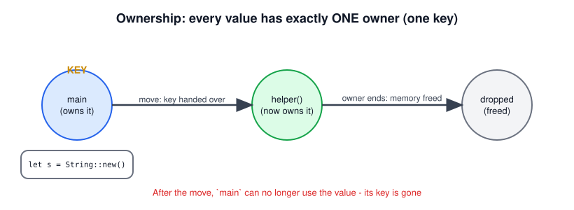
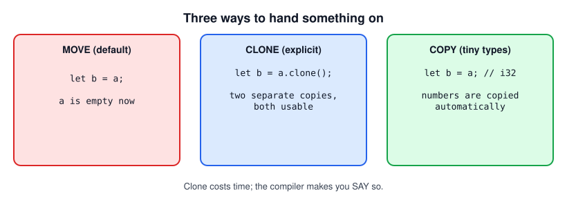
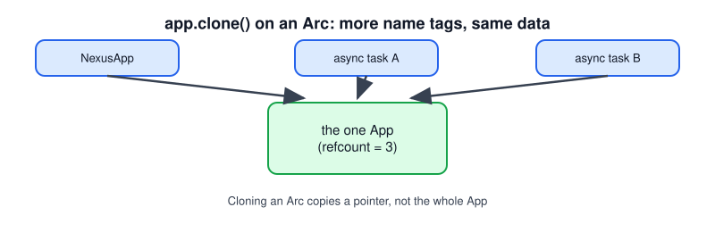

# Chapter 6: Ownership

> **Brain Power**
> You lend your only house key to a friend. Can *you* still unlock the door? Now imagine your friend makes a copy and gives it to three other people, and later the house is demolished. Who is responsible for demolishing it? Who gets blamed if someone uses a key afterwards? Hold that thought: it is exactly the problem Rust's ownership solves for memory.

## The big problem

Programs ask for memory (a string, a list, a response body) and must give it back when done.

* **Forget** to give it back: a **memory leak**. (Rust makes leaks rare but does not forbid them; the classic way to leak is two `Arc`s pointing at each other.)
* Give it back **twice**: a crash (a *double free*).
* Use it **after** giving it back: a crash or a security hole (*use after free*).

Other languages handle this with a **garbage collector** (a janitor that runs while your program runs, costing time and memory) or by trusting the programmer (C: good luck).

Rust has a third way: **ownership**, checked by the compiler *before* the program runs, with no runtime cost.

## The three rules

1. Every value has exactly **one owner** (a variable).
2. When the owner goes out of scope (the `}` of its block), the value is **dropped** (cleaned up) automatically.
3. Ownership can be **moved** to someone else, but then the old owner can't use it anymore.



```rust
fn main() {
    {
        let s = String::from("hello"); // s owns the text
        println!("{s}");
    } // <- s goes out of scope here; the text is freed. No `free()` call needed.

    println!("done");
}
```

## Moving

```rust,fails
fn consume(text: String) {
    println!("got {text}");
} // text dropped here

fn main() {
    let s = String::from("hello");
    consume(s);          // ownership MOVES into consume
    println!("{s}");     // error[E0382]: borrow of moved value: `s`
}
```

Calling `consume(s)` hands over the key. After that `main` no longer owns the text, so it is an error to use `s`. The compiler even draws arrows to the line where it moved.

Why not let both use it? Because then *both* would try to free it at the end: the double-free. One owner means one cleanup.

## Three ways to pass something on



```rust
fn consume(text: String) {
    println!("got {text}");
}

fn main() {
    // 1. MOVE (default for things that own heap data)
    let a = String::from("moved");
    consume(a);
    // a is unusable now

    // 2. CLONE: an explicit, deep, possibly expensive copy
    let b = String::from("cloned");
    consume(b.clone());
    println!("b still works: {b}");

    // 3. COPY: tiny plain values (numbers, bool, char) are copied automatically
    let n = 5;
    let m = n;
    println!("{n} {m}");
}
```

Types that are cheap to duplicate (`i32`, `bool`, `char`, `f64`...) implement a trait called **`Copy`**, so assigning them never "moves". Types that own heap memory (`String`, `Vec`) are *not* `Copy`.

> **Watch it!**
> Beginners reach for `.clone()` to silence the borrow checker. It works, but each clone may allocate and copy a lot of data. In real code, ask: *do I need my own copy, or only to look?* (Next chapter: borrowing.)

## Functions that take ownership: `self`

A method that takes `self` (no `&`) **consumes** its value. Nexus has a tiny example in [`http/request_sender.rs`](../../crates/nexus-core/src/http/request_sender.rs):

```rust
pub enum SendBody {
    Text(String),
    Bytes(Vec<u8>),
}

impl SendBody {
    fn into_bytes(self) -> Vec<u8> {
        match self {
            SendBody::Text(s) => s.into_bytes(),
            SendBody::Bytes(b) => b,
        }
    }
}
```

The `SendBody` is *used up*: its inner text or bytes are moved out and handed to the caller with **no copy**. Rust naming convention: `into_*` methods consume `self`.

## Taking something out of a struct: `mem::take`

You cannot just move a field out of something you only *borrow*; that would leave a hole. The standard fix: **swap in a blank replacement** and take the old value. `std::mem::take` does exactly that (it needs the type to implement `Default`):

```rust
use std::mem;

fn main() {
    let mut name = String::from("draft");
    let old = mem::take(&mut name); // old = "draft", name = "" (the default)
    println!("old = {old:?}, name = {name:?}");
}
```

Nexus uses it for one-shot flags. From [`panels/request/mod.rs`](../../crates/nexus-gui/src/panels/request/mod.rs):

```rust
if std::mem::take(&mut view.focus_url) {
    resp.request_focus();
    // ...
}
```

`view.focus_url` is a `bool`. `take` returns its old value *and resets it to `false`*, so "please focus the URL box" fires exactly once. Clever, tidy, and one line. And in [`scripts/sandbox.rs`](../../crates/nexus-core/src/scripts/sandbox.rs), the results are lifted out of the shared script state:

```rust
let mut result = std::mem::take(&mut st.result);
context.environment = std::mem::take(&mut st.environment);
context.collection_variables = std::mem::take(&mut st.collection);
```

## Shared ownership: `Arc`

Sometimes several parts of a program genuinely need to *own* the same thing, such as the UI and a background task both holding the app engine. The answer is a **reference-counted pointer**. `Arc<T>` ("atomically reference counted") keeps a counter of how many owners exist and frees the value when it reaches zero.



```rust
use std::sync::Arc;

fn main() {
    let shared = Arc::new(String::from("one big value"));
    let a = Arc::clone(&shared); // cheap: just a counter increment
    let b = shared.clone();      // same thing
    println!("owners: {}", Arc::strong_count(&shared));
    println!("{a} / {b}");
}
```

(`Arc::clone` is cheap, it copies a pointer, unlike `String::clone`.)

This is how Nexus hands its engine to async tasks. In [`app.rs`](../../crates/nexus-gui/src/app.rs), `send_active` gathers what the background task will need, **clones it all out of `self`**, then moves the clones into the task:

```rust
let scopes = self.scopes_for(t);
let collection = self.collection_of(t).cloned();
let untrusted = self.tab_untrusted(t);
let request = t.request.clone();
// ...
let tab_id = t.id.clone();
let app = self.app.clone();   // Arc clone: cheap, a new owner of the same engine
// ...
let handle = self.rt.spawn(async move {
    // uses request, tab_id, app, scopes ...
});
```

`async move { ... }` means "this block **takes ownership** of everything it mentions". The task may outlive the function that created it, so it can't borrow from `self`; it must *own* its data. That's why every needed value is cloned first. (We will see in Chapter 12 why spawned work must be `'static`.)

> **Sharpen your pencil**
> Will each program compile? If not, name the rule broken and give one fix.
> ```rust,fails
> // A
> fn main() {
>     let v = vec![1, 2, 3];
>     let w = v;
>     println!("{:?} {:?}", v, w);
> }
> ```
> ```rust
> // B
> fn main() {
>     let x = 10;
>     let y = x;
>     println!("{x} {y}");
> }
> ```
> ```rust,fails
> // C
> fn show(s: String) { println!("{s}"); }
> fn main() {
>     let t = String::from("hi");
>     show(t);
>     show(t);
> }
> ```
> *(Answers at the end of the chapter.)*

> **There are no Dumb Questions**
>
> **Q: When does the drop happen, exactly?**
> A: At the closing `}` of the scope that owns the value, in reverse order of creation. Nexus relies on this: `impl Drop for WebSocketClient` closes the connection when the client goes out of scope. Cleanup that "just happens" is called **RAII**.
>
> **Q: Why can I `Copy` an `i32` but not a `String`?**
> A: An `i32` is 4 bytes and has no cleanup. A `String` owns heap memory; copying the *handle* would create two owners of one buffer.
>
> **Q: Is `Arc` the same as a garbage collector?**
> A: Close cousin, but explicit: you opt in per value, the count is exact, and cleanup is immediate and predictable (unless values form a cycle, which leaks). No background collector thread.
>
> **Q: What about `Rc`?**
> A: `Rc` is the single-thread version (no atomics, a bit faster). Nexus uses `Rc<RefCell<..>>` inside its JavaScript bridge, which runs on one thread only, and `Arc` where threads are involved.

## Bullet Points

* Each value has **one owner**; when it goes out of scope, it's **dropped**.
* Assigning or passing a non-`Copy` value **moves** it. The old name becomes unusable.
* `.clone()` makes an explicit duplicate. `Copy` types (numbers) duplicate automatically.
* A method taking `self` consumes the value (`into_bytes`).
* `mem::take` swaps in a default and hands you the old value.
* `Arc<T>` gives shared ownership with a reference count; clone it to share.
* `async move` and spawned threads must **own** their data.

## Cheat sheet

```
let b = a;               move (a dead) unless a is Copy
let b = a.clone();       duplicate (both live)
fn f(x: String)          takes ownership
fn f(self)               consumes the value
mem::take(&mut x)        take value, leave default
Arc::new(v) / .clone()   shared owners, count goes up
{ ... }                  end of scope = value dropped
```

## Answers

* **A** fails: `v` was moved into `w`. Fix: `let w = v.clone();`, or just don't use `v` afterwards.
* **B** compiles: `i32` is `Copy`.
* **C** fails: `t` moved into the first `show`. Fix: `show(t.clone());` for the first call, or change `show` to borrow (`&str`, next chapter!).
