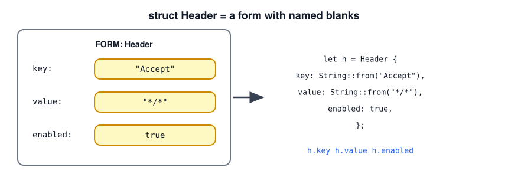
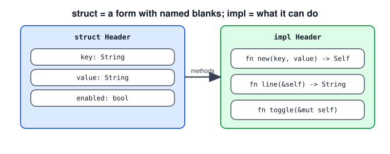

# Chapter 6: Structs and methods

> **Brain Power**
> A request has a method, a path, a list of headers, maybe a body... A header itself has a name, a value and an on/off switch. If all you had were numbers and text, how would you hand "a header" to a function without passing three separate arguments every time? Sketch what you would *like* to write.

You want a way to say "this *bundle* of values is one thing, with a name". Tuples (Chapter 2) bundle values, but `header.0` and `header.1` do not tell you which is which. Rust's answer is the **struct**.

## Structs: a form with named blanks

Think of a paper form: a title at the top ("Header") and labelled blanks to fill in (`key`, `value`, `enabled`).



```rust
struct Header {
    key: String,
    value: String,
    enabled: bool,
}

fn main() {
    let h = Header {
        key: String::from("Accept"),
        value: String::from("*/*"),
        enabled: true,
    };
    println!("{}: {} (enabled = {})", h.key, h.value, h.enabled);
}
```

```output
Accept: */* (enabled = true)
```

* **`struct Header { ... }`** defines a *new type* called `Header`. This only describes the shape of the form. Inside the braces each **field** has a name, a colon, and a type, separated by commas. By convention, type names start with a **Capital** letter (`Header`), variables and fields in `snake_case`.
* **`Header { key: ..., value: ..., enabled: ... }`** fills in the form: it makes one *value* of that type. You must fill in every blank.
* **`h.key`** reads a field with a dot, just like `.0` on a tuple, but with a name.

> **New word: struct**
> A type that bundles several named values (**fields**) into one. A struct is the "this **and** that **and** the other" type.

> **New word: field**
> One named piece of a struct.

A struct **owns** its fields, which is why the fields are `String`, not `&str`: the `Header` must keep its text alive by itself. (Chapter 12 shows how a struct *can* hold borrowed text, with extra care.) And since `h` owns them, when `h` goes out of scope the whole `Header` is dropped: all the texts at once.

To change a field, the whole variable must be `mut`, as in Chapter 2:

```rust
struct Header {
    key: String,
    value: String,
    enabled: bool,
}

fn main() {
    let mut h = Header {
        key: String::from("Accept"),
        value: String::from("*/*"),
        enabled: true,
    };
    h.enabled = false;
    println!("{}: {} (enabled = {})", h.key, h.value, h.enabled);
}
```

```output
Accept: */* (enabled = false)
```

### Printing a struct

Let's try to print the whole thing at once with the debug placeholder `{:?}` from Chapter 2:

```rust,fails
struct Header {
    key: String,
    value: String,
    enabled: bool,
}

fn main() {
    let h = Header {
        key: String::from("Accept"),
        value: String::from("*/*"),
        enabled: true,
    };
    println!("{:?}", h);
}
```

```error
error[E0277]: `Header` doesn't implement `Debug`
  --> src/main.rs:13:22
   |
13 |     println!("{:?}", h);
   |               ----   ^ `Header` cannot be formatted using `{:?}` because it doesn't implement `Debug`
   |               |
   |               required by this formatting parameter
   |
   = help: the trait `Debug` is not implemented for `Header`
help: consider annotating `Header` with `#[derive(Debug)]`
   |
 1 + #[derive(Debug)]
 2 | struct Header {
   |

error: aborting due to 1 previous error

For more information about this error, try `rustc --explain E0277`.
```

Decode: **``Header` doesn't implement `Debug```**. Rust does not know how to print your new type, because *you* invented it. The `help:` line gives the cure: **add `#[derive(Debug)]`**. (The compiler talks about a "trait" here: that is the word for an *ability* a type can have, and it is the subject of Chapter 10. *Ignore it for now.*)

`#[derive(Debug)]` is a one-line request put just above the struct:

```rust
#[derive(Debug)]
struct Header {
    key: String,
    value: String,
    enabled: bool,
}

fn main() {
    let h = Header {
        key: String::from("Accept"),
        value: String::from("*/*"),
        enabled: true,
    };
    println!("{:?}", h);
    println!("{:#?}", h);
}
```

```output
Header { key: "Accept", value: "*/*", enabled: true }
Header {
    key: "Accept",
    value: "*/*",
    enabled: true,
}
```

> **New word: attribute**
> A note to the compiler written as `#[ ... ]` above an item. **`#[derive(Debug)]`** says: "please *write the printing code for me*". Without it you would write dozens of lines. `{:?}` prints on one line; `{:#?}` prints neatly spread over many lines.

> **New word: warning**
> Besides errors, the compiler sometimes prints a **warning**: "this compiles, but look at it". When you run the example above, you may see `warning: fields 'key', 'value', and 'enabled' are never read`. It only means the program printed the struct without ever using the fields one by one. Warnings do not stop your program; they are hints.

You will put `#[derive(Debug)]` above nearly every struct you write. We will see what *else* `derive` can write in Chapter 10.

## Methods: teaching a struct to do things

Right now a `Header` is just data. In Chapter 2 you met **methods**: things a value can do, like `text.len()`. Now you can teach *your own* types to do things, with an **`impl`** block ("implementation"):



```rust
struct Header {
    key: String,
    value: String,
    enabled: bool,
}

impl Header {
    fn line(&self) -> String {
        format!("{}: {}", self.key, self.value)
    }
}

fn main() {
    let h = Header {
        key: String::from("Accept"),
        value: String::from("*/*"),
        enabled: true,
    };
    println!("{} (enabled = {})", h.line(), h.enabled);
}
```

```output
Accept: */* (enabled = true)
```

Line by line:

* **`impl Header { ... }`**: "here are the things a `Header` can do." Functions inside become **methods**.
* **`fn line(&self) -> String`** is a function with one special first parameter, **`&self`**. `self` means "the value this method was called on". So in `h.line()`, `self` is `h`.
* The `&` in front is exactly Chapter 5's borrow: `line` borrows `h` for a look, so `h` is still ours afterwards.
* **`self.key`** reads a field of that value.
* **`h.line()`** *calls* the method, using a dot.

### Three ways to hold `self`

Just as you can lend, lend-to-edit, or give away a book, a method can take `self` three ways:

| Parameter | Meaning | Library | Needs a `mut` variable? |
|---|---|---|---|
| `&self` | borrow to **read** | read it in the library | no |
| `&mut self` | borrow to **change** | write in the margins | yes |
| `self` | **take** it (consume) | take it home, forever | no, but the original is gone |

Here is a method that changes the header:

```rust
struct Header {
    key: String,
    value: String,
    enabled: bool,
}

impl Header {
    fn line(&self) -> String {
        format!("{}: {}", self.key, self.value)
    }

    fn toggle(&mut self) {
        self.enabled = !self.enabled;
    }
}

fn main() {
    let mut h = Header {
        key: String::from("Accept"),
        value: String::from("*/*"),
        enabled: true,
    };
    println!("{} (enabled = {})", h.line(), h.enabled);
    h.toggle();
    println!("{} (enabled = {})", h.line(), h.enabled);
}
```

```output
Accept: */* (enabled = true)
Accept: */* (enabled = false)
```

`!` in front of a `bool` flips it (Chapter 3), so `toggle` switches the header on or off. Because it takes `&mut self`, the variable has to be `let mut h`.

### A constructor: `new`

Writing out `Header { key: String::from(...), ... }` every time is tedious. By convention, a type gets a function called **`new`** that builds one. It has **no `self`**, because there is no value yet to call it on. Such a function is called an **associated function**, and you call it with `::` (Chapter 4), not a dot:

```rust
struct Header {
    key: String,
    value: String,
    enabled: bool,
}

impl Header {
    fn new(key: &str, value: &str) -> Self {
        Self {
            key: key.to_string(),
            value: value.to_string(),
            enabled: true,
        }
    }

    fn line(&self) -> String {
        format!("{}: {}", self.key, self.value)
    }
}

fn main() {
    let h = Header::new("Accept", "*/*");
    println!("{} (enabled = {})", h.line(), h.enabled);
}
```

```output
Accept: */* (enabled = true)
```

* **`Self`** (capital S) is shorthand for "the type this `impl` block is for", so `-> Self` means `-> Header`, and `Self { ... }` means `Header { ... }`.
* **`Header::new("Accept", "*/*")`** reads: "the function `new` inside `Header`". A method uses `.`; an associated function (no `self`) uses `::`.
* `new` takes `&str` (Chapter 5: the caller may pass quoted text) and uses `.to_string()` (Chapter 4) because the struct must **own** its `String`s.

> **There are no Dumb Questions**
>
> **Q: Where is the `class` keyword?**
> A: Rust has no classes. A `struct` holds data and an `impl` block holds the methods. They are written separately.
>
> **Q: Is `new` a special keyword?**
> A: No. It is an ordinary function that people agreed to call `new`. You could name it `create`.
>
> **Q: Can I have several `impl` blocks for one struct?**
> A: Yes. It's allowed and sometimes useful, but one block is the norm.
>
> **Q: Why does `new` build `Self { ... }` with no semicolon?**
> A: It is the last expression (Chapter 3), so it is the function's return value.

> **Sharpen your pencil**
> Write a `struct Endpoint` with a `url: String` and `retries: u32`. Give it:
> 1. an associated function `Endpoint::new(url: &str) -> Self` that sets `retries` to 3;
> 2. a method `describe(&self) -> String` that returns `"<url> (retries: <retries>)"`;
> 3. a method `bump(&mut self)` that adds one to `retries`.
>
> In `main` build one, call `bump` twice, and print `describe()`. What number do you expect to see?
>
> <details><summary>Answer</summary>
>
> ```rust
> struct Endpoint {
>     url: String,
>     retries: u32,
> }
>
> impl Endpoint {
>     fn new(url: &str) -> Self {
>         Self { url: url.to_string(), retries: 3 }
>     }
>     fn describe(&self) -> String {
>         format!("{} (retries: {})", self.url, self.retries)
>     }
>     fn bump(&mut self) {
>         self.retries += 1;
>     }
> }
>
> fn main() {
>     let mut e = Endpoint::new("https://example.test");
>     e.bump();
>     e.bump();
>     println!("{}", e.describe());
> }
> ```
>
> ```output
https://example.test (retries: 5)
> ```
> Start at 3, add 1 twice: 5. Note `let mut e`: calling a `&mut self` method needs a mutable variable.
> </details>

## Structs inside structs

Fields can be structs too. Ownership follows along: the outer struct owns the inner one.

```rust,fails
#[derive(Debug)]
struct Header {
    key: String,
    value: String,
}

#[derive(Debug)]
struct Request {
    method: String,
    path: String,
    header: Header,
}

fn main() {
    let host = Header { key: String::from("Host"), value: String::from("api.example.test") };
    let request = Request {
        method: String::from("GET"),
        path: String::from("/users"),
        header: host,
    };
    println!("{:?}", request);
    println!("{}", host.key);
}
```

Before you run it: look at the last line. What do you think the compiler will say? (Hint: Chapter 4.)

<details><summary>Answer</summary>

```error
error[E0382]: borrow of moved value: `host`
  --> src/main.rs:22:20
   |
15 |     let host = Header { key: String::from("Host"), value: String::from("api.example.test") };
   |         ---- move occurs because `host` has type `Header`, which does not implement the `Copy` trait
...
19 |         header: host,
   |                 ---- value moved here
...
22 |     println!("{}", host.key);
   |                    ^^^^^^^^ value borrowed here after move
   |
note: if `Header` implemented `Clone`, you could clone the value
  --> src/main.rs:2:1
   |
 2 | struct Header {
   | ^^^^^^^^^^^^^ consider implementing `Clone` for this type
...
19 |         header: host,
   |                 ---- you could clone this value

error: aborting due to 1 previous error

For more information about this error, try `rustc --explain E0382`.
```

`header: host` **moved** `host` into the `Request`. Using `host.key` afterwards is a "borrow of moved value" error, just like handing a `String` to a function. The compiler says **`borrow of moved value: 'host'`**, with `value moved here` pointing at `header: host`. (The `{:?}` line above it is fine: it only borrows the request.)

</details>

## Now look at real Nexus

Nexus keeps a history of requests you sent. For each response it remembers four facts. Here is the struct that holds them, from [`types/mod.rs`](../../crates/nexus-core/src/types/mod.rs):

```rust,nexus
pub struct HistoryResponse {
    pub status: u16,
    pub status_text: String,
    pub response_time: f64,
    pub size: u64,
}
```

You can read all of it now:

* `struct HistoryResponse { ... }` is a form with four blanks.
* `status: u16`: the status code, like `200` (a `u16`, as you chose in Chapter 2).
* `status_text: String`: owned text such as `OK`.
* `response_time: f64`: how long it took, a decimal number.
* `size: u64`: how many bytes came back.
* **`pub`** in front of each field: ignore it for now. (Chapter 14: it decides who else may touch the field.)

In the real file, two attribute lines sit above the struct (`#[derive(...)]`, like you just used, with more things in the list). They ask the compiler to write extra code: Chapter 10 and Chapter 17 explain them.

## Checkpoint project: request builder, version 5

The builder gets structs and methods:

```rust
#[derive(Debug)]
struct Header {
    key: String,
    value: String,
}

impl Header {
    fn new(key: &str, value: &str) -> Self {
        Self { key: key.to_string(), value: value.to_string() }
    }

    fn line(&self) -> String {
        format!("{}: {}", self.key, self.value)
    }
}

#[derive(Debug)]
struct Request {
    method: String,
    path: String,
    header: Header,
}

impl Request {
    fn new(method: &str, path: &str, header: Header) -> Self {
        Self { method: method.to_string(), path: path.to_string(), header }
    }

    fn request_line(&self) -> String {
        format!("{} {} HTTP/1.1", self.method, self.path)
    }

    fn to_text(&self) -> String {
        format!("{}\n{}", self.request_line(), self.header.line())
    }

    fn set_path(&mut self, path: &str) {
        self.path = path.to_string();
    }
}

fn main() {
    let host = Header::new("Host", "api.example.test");
    let mut request = Request::new("GET", "/users", host);
    println!("{}", request.to_text());

    request.set_path("/orders");
    println!("{}", request.to_text());
    println!("{:?}", request);
}
```

```output
GET /users HTTP/1.1
Host: api.example.test
GET /orders HTTP/1.1
Host: api.example.test
Request { method: "GET", path: "/orders", header: Header { key: "Host", value: "api.example.test" } }
```

New in `Request::new`: the last field is written just `header`, not `header: header`. When a variable has the **same name** as the field, you may write it once. This is called *field init shorthand*. (And yes, the `host` header was *moved* into the request: `main` can no longer use `host`.)

Notice how readable `main` is now: it just *describes what to do*. The details live inside the types.

> **Sharpen your pencil**
> A request should be able to say whether it has a body. Add a field `body: String` to `Request`, and a method `has_body(&self) -> bool` that returns `true` when the body is not empty. (Hint: text has `.is_empty()`.) Which other places in the code must change when you add a field?
>
> <details><summary>Answer</summary>
>
> Only `Request::new` builds a `Request` literally, so it must fill in the new field (`body: String::new()`, an empty `String`). Everything else keeps working: that is a benefit of the constructor. The method is:
>
> ```rust,frag
> impl Request {
>     fn has_body(&self) -> bool {
>         !self.body.is_empty()
>     }
> }
> ```
> </details>

## Bullet Points

* A **struct** bundles named **fields** into one type: `struct Name { field: Type, }`. Build one with `Name { field: value, }`; read with `value.field`.
* A struct **owns** its fields; passing a value into a field **moves** it.
* `#[derive(Debug)]` (an **attribute**) lets you print with `{:?}` / `{:#?}`.
* An **`impl`** block adds **methods** (take `self`) and **associated functions** (no `self`, called with `::`, e.g. `new`).
* `&self` reads, `&mut self` changes, `self` consumes. `Self` means "this type".
* When a variable has the same name as a field, you may write it once (`Self { header }`).

## Cheat sheet

```text
#[derive(Debug)]
struct S { a: u32, b: String }       define a type
S { a: 1, b: String::from("x") }     make one
s.a   s.b                            read fields
impl S {
    fn new(b: &str) -> Self { .. }   associated fn: S::new("x")
    fn get(&self) -> u32 { .. }      reads:   s.get()
    fn set(&mut self) { .. }         changes: s.set()  (s must be mut)
    fn eat(self) { .. }              consumes: s is gone afterwards
}
println!("{:?}", s)  {:#?}           debug print (needs derive(Debug))
```
