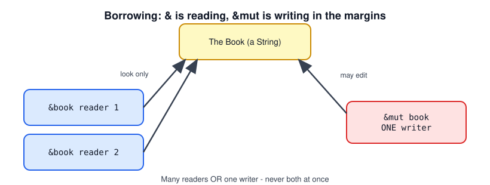
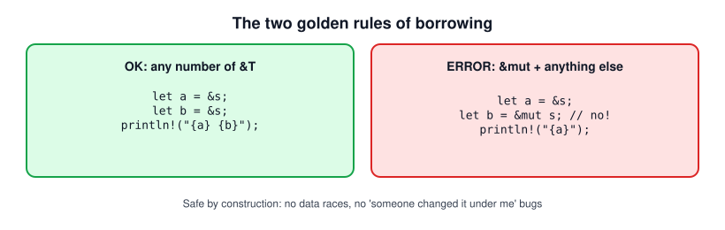
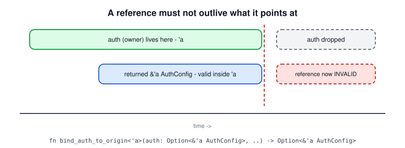

# Chapter 7: Borrowing and lifetimes

> **Brain Power**
> Last chapter, passing a `String` to a function made it vanish from the caller. That's annoying if all the function wanted to do was *print* it. What would a polite alternative look like: one where you let someone use your thing for a while and get it back?

## References: borrow it, don't take it

A **reference** (`&`) lets code *use* a value without owning it. Think of a **library book**: the library (the owner) still owns it; you borrow it, read it, and give it back.



```rust
fn length(text: &String) -> usize {
    text.len()
} // `text` is only a borrow: nothing is dropped here

fn main() {
    let s = String::from("hello");
    let n = length(&s);        // lend s to the function
    println!("{s} has {n} letters"); // s still ours
}
```

`&s` creates a reference. The function's parameter type `&String` says "I just need to look". 

Idiom: prefer `&str` over `&String` in parameters. A `&String` converts to `&str` for free, and `&str` also accepts string literals. You see this everywhere in Nexus, e.g. `fn get(&self, key: &str) -> Option<&str>`.

## Two kinds of borrow

| Syntax | Name | Can do | How many at once |
|---|---|---|---|
| `&T` | shared reference | **read** | any number |
| `&mut T` | mutable (exclusive) reference | **read and write** | exactly **one**, and no `&T` at the same time |



```rust
fn add_exclaim(text: &mut String) {
    text.push('!');
}

fn main() {
    let mut s = String::from("hi");
    add_exclaim(&mut s);   // note: &mut at the call site too
    add_exclaim(&mut s);
    println!("{s}");       // hi!!
}
```

The rule is brutally simple: **many readers *or* one writer, never both at the same time.** The compiler enforces it. Why so strict? Because "someone changed it while I was reading" is the root of data races, iterator invalidation, and countless bugs. Rust turns that whole class of bug into a compile error.

```rust,fails
fn main() {
    let mut s = String::from("hello");
    let r1 = &s;          // reader
    let r2 = &mut s;      // writer: error[E0502] cannot borrow `s` as mutable
    r2.push('!');         // because `r1` is still alive...
    println!("{r1}");     // ...here
}
```

Moving the `println!` *before* the `&mut` line makes it compile: borrows only last until their **last use** (Rust calls this *non-lexical lifetimes*).

## Borrowing in Nexus: `&self`, `&mut self`

Every method from Chapter 3 is already a borrow. In [`scripts/sandbox.rs`](../../crates/nexus-core/src/scripts/sandbox.rs):

```rust
pub fn get(&self, key: &str) -> Option<&str> {
    self.data.get(key).map(String::as_str)
}

pub fn set(&mut self, key: &str, value: &str) {
    self.data.insert(key.to_string(), value.to_string());
    // ...
}
```

* `get` takes `&self`: read only. It returns `Option<&str>`: a **view** of text inside `self.data`. No copy, no allocation!
* `set` takes `&mut self`: it modifies the store, so it needs the exclusive reference.
* `key: &str` is borrowed input; to *store* it, `set` makes owned copies with `.to_string()`.

## The borrow checker in the wild

In the UI code from Chapter 6, `send_active` has this dance:

```rust
let Some(t) = self.tabs.active() else { return };   // t borrows self.tabs
// ...
let request = t.request.clone();                    // copy what we need
let tab_id = t.id.clone();
// ...
self.console.log(/* ... */);                        // needs &mut self.console
```

Why does `self.console.log(..)` compile here? Two reasons. First, `t`'s last use comes *before* that line, so the borrow has already ended (the compiler is smart about this; people call it *non-lexical lifetimes*). Second, `t` only borrows the field `self.tabs`, and `self.console` is a *different* field, so Rust lets you borrow disjoint fields separately.

The same function ends with the other classic move: **let the borrow end, then look the thing up again.** After spawning the task it does `if let Some(t) = self.tabs.active_mut() { ... t.abort = Some(handle); }`, a fresh lookup instead of holding one borrow across the whole function. The usual fix when the borrow checker complains: **copy out what you need, then let the borrow end** (and re-borrow later if you must). It is a skill, and every Rust programmer learns it.

> **Watch it!**
> "Fighting the borrow checker" usually means *your design shares and mutates the same thing from two places at once*. Don't just sprinkle `.clone()`; ask whether a different split of data (e.g., small structs, or indexes instead of references) would fix it. Nexus's `Tabs::active_index` returns an *index* rather than a reference for the same reason, we can guess.

## Lifetimes: how long does the loan last?

Every reference has a **lifetime**: the stretch of time it is valid. Most of the time Rust works it out silently. But when a function *returns* a reference, Rust must know **which input** it borrows from.



Dangling references are impossible:

```rust,fails
fn main() {
    let r;
    {
        let x = 5;
        r = &x;           // x lives only inside these braces
    }                     // x dropped here
    println!("{r}");      // error[E0597]: `x` does not live long enough
}
```

### Naming a lifetime: `'a`

An apostrophe + name (`'a`) is a **lifetime parameter**. It's a label that says "these references are tied together".

```rust
fn longest<'a>(a: &'a str, b: &'a str) -> &'a str {
    if a.len() >= b.len() { a } else { b }
}

fn main() {
    let x = String::from("short");
    let y = String::from("a bit longer");
    println!("{}", longest(&x, &y));
}
```

Read `<'a>` as "for some lifetime I'll call `a`...". The result may be either input, so the result is only valid as long as **both** inputs are. The label does not change how long anything lives; it only *describes* the relationship so the compiler can check it.

Here is the real thing in [`trust.rs`](../../crates/nexus-core/src/trust.rs):

```rust
/// The auth to attach to a request whose URL was `configured_url` before scripts ran and is
/// `final_url` now. Auth is dropped, with a warning, when the origin changed.
pub fn bind_auth_to_origin<'a>(
    auth: Option<&'a AuthConfig>,
    configured_url: &str,
    final_url: &str,
) -> (Option<&'a AuthConfig>, Option<LogEntry>) {
    let (before, after) = (origin_of(configured_url), origin_of(final_url));
    if auth.is_none() || before == after {
        return (auth, None);
    }
    // ... build a warning ...
    (None, Some(warning(msg)))
}
```

This function exists for security: if a pre-request script changes the URL to another website, it must **not** send your saved credentials there. Look at the signature:

* `auth: Option<&'a AuthConfig>` goes in; `Option<&'a AuthConfig>` comes out (the *same* `'a`). The returned auth is a borrow of the caller's data, not a copy.
* `configured_url` and `final_url` have **no** `'a`. That is deliberate: the result does not borrow from them, so they can be dropped the moment the function returns.
* It returns a **tuple** `(auth, warning)`: Rust's way to return two things.

### Lifetime elision: the free pass

You rarely write lifetimes because Rust applies *elision rules*. The commonest: if there is `&self`, any returned reference is tied to `self`. That is why `fn get(&self, key: &str) -> Option<&str>` compiles with no `'a`: the result borrows from `self`, not from `key`.

When you do need them, they often appear with recursion. In [`scripts/script_runner.rs`](../../crates/nexus-core/src/scripts/script_runner.rs), `find_parent_folders<'a>` returns `Vec<&'a NexusFolder>`: a list of *borrowed* folders inside a collection. No folder is copied; the result simply points into the collection and cannot outlive it.

### `'static`

`&'static str` means "a reference valid for the entire program". String literals have that type, because the text is baked into the executable. You also see `'static` as a **bound** in async code (Chapter 12), as in `T: 'static`. That is a different, weaker idea: "this value contains no temporary borrows, so nothing it holds can disappear under it". A `String` moved into a task satisfies it, and is still dropped when the task ends. `'static` as a bound does *not* mean "lives forever".

> **Sharpen your pencil**
> 1. Which compiles?
> ```rust,fails
> fn first_word(s: &str) -> &str { s.split(' ').next().unwrap_or("") }
> fn pick() -> &str { "hello" }
> fn main() { println!("{} {}", first_word("a b"), pick()); }
> ```
> It fails. Which function is the problem, and what small change fixes it?
> 2. Fill in the blank to make this compile: `fn pick_first<___>(a: &___ str, b: &str) -> &___ str { a }`.
> 3. True or false: `let r1 = &s; let r2 = &mut s; r2.push('!');` compiles if `r1` is never used again after the `&mut` line.
>
> *(Answers at the end of the chapter.)*

> **There are no Dumb Questions**
>
> **Q: Are references pointers?**
> A: Under the hood, yes. But Rust guarantees they are never null and never dangling, and shared/exclusive rules make them safe to use.
>
> **Q: When do I use `&` vs `&mut` vs plain value in a parameter?**
> A: Read-only: `&T`. Needs to change it: `&mut T`. Needs to keep or consume it: `T`.
>
> **Q: Do lifetimes exist at runtime?**
> A: No. They are compile-time labels only. They cost nothing.
>
> **Q: I keep getting "does not live long enough". Help?**
> A: Usually you tried to return a reference to a local variable (it dies at `}`), or store a borrow in something that outlives the owner. Return an owned value (`String`) instead.

## Bullet Points

* `&T` borrows to **read**; `&mut T` borrows to **write**.
* **Many readers or one writer**, never both: the borrow checker enforces this.
* References never outlive their owner; dangling references can't exist.
* A **lifetime** (`'a`) names how long a reference is valid and ties outputs to inputs.
* Elision lets you skip most lifetime annotations; `&self` methods tie results to `self`.
* `&'static str` = a reference valid for the whole program (string literals). `T: 'static` (a *bound*) = the value holds no temporary borrows, so it may be kept as long as needed. It is not kept forever.
* Stuck? Copy out what you need, return owned values, or restructure the data.

## Cheat sheet

```
&x         shared borrow (read)      &mut x   exclusive borrow (write)
fn f(a: &str) -> &str                lifetime elided: tied to a
fn f<'a>(a: &'a str, b: &str) -> &'a str     result tied to a only
&'static str                         lives forever
many &T  XOR  one &mut T             the golden rule
```

## Answers

1. `pick` fails: "missing lifetime specifier": there is no input to borrow from. Fix: write `-> &'static str`. The literal is baked into the program, so it lives forever.
   ```rust
   fn first_word(s: &str) -> &str { s.split(' ').next().unwrap_or("") }
   fn pick() -> &'static str { "hello" }
   fn main() { println!("{} {}", first_word("a b"), pick()); }
   ```
2. `fn pick_first<'a>(a: &'a str, b: &str) -> &'a str { a }`
3. **True.** A borrow ends at its last use, so a `&s` that is never touched again does not conflict with the later `&mut s`. The compiler tracks this exactly.
