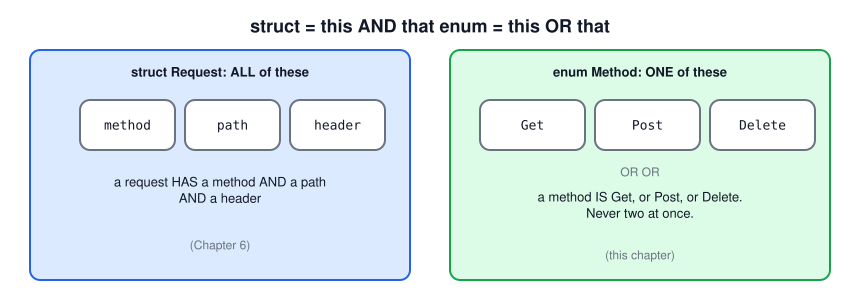
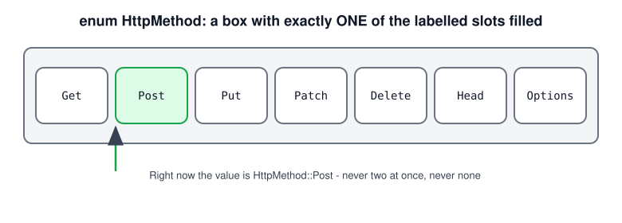
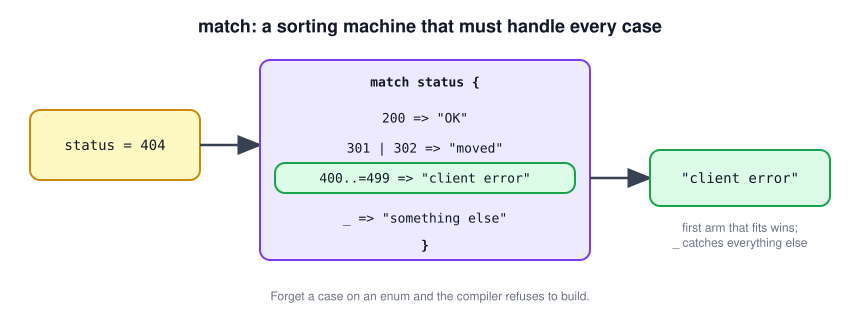
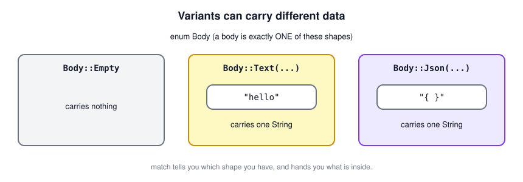

# Chapter 7: Enums and match

> **Brain Power**
> An HTTP request's method is `GET` *or* `POST` *or* `DELETE`... never two at once. If you store the method as plain text, someone can write `"GTE"` by mistake, and nothing stops it until a real user hits the bug. How could a *language* make that typo impossible?

You want a type with a **fixed list of allowed values**. That's what an **enum** is.

## Enums: exactly one of these

Chapter 6's structs are "this **and** that **and** the other". An enum is "this **or** that **or** the other".



```rust
#[derive(Debug)]
enum Method {
    Get,
    Post,
    Delete,
}

fn main() {
    let m = Method::Get;
    println!("{:?}", m);
}
```

```output
Get
```

* **`enum Method { ... }`** defines a new type called `Method`. Inside the braces is the complete list of values it may have. Each is called a **variant**.
* **`Method::Get`** is one value of the type. The `::` means "inside" (Chapter 4): "the `Get` that lives inside `Method`".
* `#[derive(Debug)]` (Chapter 6) lets us print it with `{:?}`.
* You may see a warning that the variants `Post` and `Delete` are "never constructed". True, we haven't used them yet. In toy programs like these, such warnings are harmless.

> **New word: enum**
> A type whose value is **exactly one** of a fixed list of **variants**. Short for *enumeration*.



Now the typo from the Brain Power:

```rust,fails
#[derive(Debug)]
enum Method {
    Get,
    Post,
    Delete,
}

fn main() {
    let m = Method::Gte;
    println!("{:?}", m);
}
```

```error
error[E0599]: no variant, associated function, or constant named `Gte` found for enum `Method` in the current scope
 --> src/main.rs:9:21
  |
2 | enum Method {
  | ----------- variant, associated function, or constant `Gte` not found for this enum
...
9 |     let m = Method::Gte;
  |                     ^^^ variant, associated function, or constant not found in `Method`
  |
help: there is a variant with a similar name
  |
9 -     let m = Method::Gte;
9 +     let m = Method::Get;
  |

error: aborting due to 1 previous error

For more information about this error, try `rustc --explain E0599`.
```

The compiler says **no variant, associated function, or constant named `Gte` found for enum `Method`**, and (very kindly) adds **"there is a variant with a similar name"**, showing `Get` as the fix. The typo can never reach your users.

## `match`: handle every case

How do you *use* an enum? You ask which variant it is, with **`match`**:

```rust
enum Method {
    Get,
    Post,
    Delete,
}

impl Method {
    fn as_str(&self) -> &str {
        match self {
            Method::Get => "GET",
            Method::Post => "POST",
            Method::Delete => "DELETE",
        }
    }
}

fn main() {
    let m = Method::Post;
    println!("{}", m.as_str());
}
```

```output
POST
```

Take the `match` apart:

* **`match self { ... }`**: "look at `self` and find which case it is."
* Each line inside is an **arm**: a **pattern**, then `=>`, then the result. `Method::Get => "GET"` reads "if it is `Get`, the answer is `"GET"`".
* The arms are separated by commas.
* The whole `match` is an **expression** (Chapter 3): it produces a value. Here it is the function's answer, so there is no `;` after it.
* `-> &str` means a borrowed look at text (Chapter 5). The text here is quoted text sitting inside the program, which always sticks around. (Chapter 12 explains the full story of how Rust checks this.)



### The superpower: `match` must cover everything

Predict: what happens if you forget the `Delete` arm?

```rust,fails
enum Method {
    Get,
    Post,
    Delete,
}

fn as_str(m: &Method) -> &str {
    match m {
        Method::Get => "GET",
        Method::Post => "POST",
    }
}

fn main() {
    println!("{}", as_str(&Method::Delete));
}
```

<details><summary>Answer</summary>

```error
error[E0004]: non-exhaustive patterns: `&Method::Delete` not covered
  --> src/main.rs:8:11
   |
 8 |     match m {
   |           ^ pattern `&Method::Delete` not covered
   |
note: `Method` defined here
  --> src/main.rs:1:6
   |
 1 | enum Method {
   |      ^^^^^^
...
 4 |     Delete,
   |     ------ not covered
   = note: the matched value is of type `&Method`
help: ensure that all possible cases are being handled by adding a match arm with a wildcard pattern or an explicit pattern as shown
   |
10 ~         Method::Post => "POST",
11 ~         &Method::Delete => todo!(),
   |

error: aborting due to 1 previous error

For more information about this error, try `rustc --explain E0004`.
```

**`non-exhaustive patterns: '&Method::Delete' not covered`**. The compiler checks that every possible variant has an arm. And it tells you which one is missing. It even offers to add the missing arm.

Now imagine your program has fifty `match`es on `Method`, and a teammate adds a new variant `Put`. Every one of the fifty lights up as a compile error until someone decides what `Put` should do there. You cannot forget a case by accident.

</details>

### Matching numbers

`match` works on more than enums. Patterns can be numbers, **ranges** (Chapter 3's `..=`), several choices joined with **`|`** ("or"), and **`_`**, which means "anything else":

```rust
fn main() {
    let status = 404;
    let kind = match status {
        200 => "OK",
        301 | 302 => "moved",
        400..=499 => "client error",
        500..=599 => "server error",
        _ => "something else",
    };
    println!("{status} is: {kind}");
}
```

```output
404 is: client error
```

Arms are tried **top to bottom**, and the first one that fits wins. Because "all other numbers" is a gigantic list, the final `_` arm is required here.

> **Sharpen your pencil**
> Add a fourth variant `Put` to the `Method` enum from the `as_str` example, and change nothing else. Predict: will the program still compile? If not, on which line will the compiler complain, and what will it say?
>
> <details><summary>Answer</summary>
>
> It will not compile. The `match` inside `as_str` has no arm for `Method::Put`, so you get "non-exhaustive patterns: `&Method::Put` not covered", pointing at the `match` line. That is exactly the safety net: you must go to `as_str` and decide what `Put` becomes.
> </details>

## Variants that carry data

Here's where Rust enums become really powerful. A variant can **carry values with it**:



```rust
enum Body {
    Empty,
    Text(String),
    Json(String),
}

impl Body {
    fn size(&self) -> usize {
        match self {
            Body::Empty => 0,
            Body::Text(text) => text.len(),
            Body::Json(json) => json.len(),
        }
    }
}

fn main() {
    let a = Body::Empty;
    let b = Body::Text(String::from("hello"));
    let c = Body::Json(String::from("{\"id\":7}"));
    println!("{} {} {}", a.size(), b.size(), c.size());
}
```

```output
0 5 8
```

* **`Text(String)`** means: a `Text` variant *holds one `String`*. You make one with `Body::Text(String::from("hello"))`: it looks like a function call.
* `Body::Empty` carries nothing at all.
* In the `match`, **`Body::Text(text)`** is a pattern that both *recognises* the `Text` variant **and gives the name `text`** to whatever is inside it. Because we matched on `self`, which is `&Body`, `text` is a borrowed look at the `String`, so we can call `.len()` on it.

A variant can also have **named fields**, like a little struct:

```rust
enum Auth {
    None,
    Bearer(String),
    Basic { user: String, password: String },
}

fn describe(auth: &Auth) -> String {
    match auth {
        Auth::None => String::from("no authentication"),
        Auth::Bearer(token) => format!("bearer token of {} characters", token.len()),
        Auth::Basic { user, .. } => format!("basic login for {user}"),
    }
}

fn main() {
    let a = Auth::Basic { user: String::from("ada"), password: String::from("s3cret") };
    println!("{}", describe(&a));
    println!("{}", describe(&Auth::Bearer(String::from("abc123"))));
    println!("{}", describe(&Auth::None));
}
```

```output
basic login for ada
bearer token of 6 characters
no authentication
```

The `..` in `Auth::Basic { user, .. }` means "and the other fields, which I don't need". (We deliberately don't print the password.)

### Shortcuts: `if let` and `matches!`

Sometimes you only care about **one** variant. A full `match` with a catch-all arm is bulky, so Rust has **`if let`**:

```rust
enum Body {
    Empty,
    Text(String),
}

fn main() {
    let body = Body::Text(String::from("hello"));

    if let Body::Text(t) = &body {
        println!("text body: {t}");
    }

    let is_empty = matches!(body, Body::Empty);
    println!("empty? {is_empty}");
}
```

```output
text body: hello
empty? false
```

* `if let PATTERN = value { ... }` runs the block only if the value fits the pattern, and gives you the inside part.
* **`matches!(value, PATTERN)`** gives `true` or `false`, with no block at all. (It's a macro, like `println!`.)

> **There are no Dumb Questions**
>
> **Q: Isn't this like a Java/C# `enum`?**
> A: Those enums are just named constants. Rust's variants can *carry data*, and `match` hands you the data safely. Rust's enums are closer to "a union that knows which one it is".
>
> **Q: When do I use a struct and when an enum?**
> A: If the thing **has** several parts at once, struct. If it **is** one of several kinds, enum. A request *has* a method and a path (struct); a method *is* Get or Post (enum).
>
> **Q: What does `_` mean?**
> A: "Anything, and I don't care what." In a `match` it is the catch-all arm. Inside a pattern, `Body::Text(_)` means "a Text, whatever is in it".

## Now look at real Nexus

In Nexus, an HTTP method is an enum, exactly like yours ([`types/mod.rs`](../../crates/nexus-core/src/types/mod.rs)):

```rust,nexus
pub enum HttpMethod {
    Get,
    Post,
    Put,
    Patch,
    Delete,
    Head,
    Options,
}
```

(`pub` again: ignore for now. Above it sit attribute lines like `#[derive(...)]`: Chapters 10 and 17.) Its method `as_str` is just your `match`:

```rust,nexus
match self {
    HttpMethod::Get => "GET",
    HttpMethod::Post => "POST",
    // ...
    HttpMethod::Options => "OPTIONS",
}
```

And in the same file is a **data-carrying** enum. The sidebar of Nexus shows a list in which each entry is either a folder or a single request:

```rust,nexus
pub enum CollectionItem {
    Folder(NexusFolder),
    Request(NexusRequest),
}
```

`CollectionItem` is "one of: a `Folder` that carries a `NexusFolder` struct, or a `Request` that carries a `NexusRequest` struct". Just like `Body::Text(String)`, but the thing inside is a struct. A few lines later it has a method that uses the shortcut you just learned:

```rust,nexus
impl CollectionItem {
    pub fn is_folder(&self) -> bool {
        matches!(self, CollectionItem::Folder(_))
    }
```

Decode: a method that borrows `self` (Chapter 6), returns a `bool` (Chapter 3), and answers with `matches!`: "is this item a `Folder`, whatever is inside it (`_`)?" You could have written this yourself.

## Checkpoint project: request builder, version 6

Methods become an enum. The request also gets a body:

```rust
#[derive(Debug)]
enum Method {
    Get,
    Post,
    Delete,
}

impl Method {
    fn as_str(&self) -> &str {
        match self {
            Method::Get => "GET",
            Method::Post => "POST",
            Method::Delete => "DELETE",
        }
    }
}

enum Body {
    Empty,
    Text(String),
    Json(String),
}

struct Header {
    key: String,
    value: String,
}

impl Header {
    fn new(key: &str, value: &str) -> Self {
        Self { key: key.to_string(), value: value.to_string() }
    }

    fn line(&self) -> String {
        format!("{}: {}", self.key, self.value)
    }
}

struct Request {
    method: Method,
    path: String,
    header: Header,
    body: Body,
}

impl Request {
    fn to_text(&self) -> String {
        let mut text = format!(
            "{} {} HTTP/1.1\n{}",
            self.method.as_str(),
            self.path,
            self.header.line()
        );
        match &self.body {
            Body::Empty => {}
            Body::Text(t) => {
                text.push_str("\n\n");
                text.push_str(t);
            }
            Body::Json(j) => {
                text.push_str("\nContent-Type: application/json\n\n");
                text.push_str(j);
            }
        }
        text
    }
}

fn main() {
    let get = Request {
        method: Method::Get,
        path: String::from("/users"),
        header: Header::new("Host", "api.example.test"),
        body: Body::Empty,
    };
    let post = Request {
        method: Method::Post,
        path: String::from("/users"),
        header: Header::new("Host", "api.example.test"),
        body: Body::Json(String::from("{\"name\":\"Ada\"}")),
    };
    let delete = Request {
        method: Method::Delete,
        path: String::from("/users/7"),
        header: Header::new("Host", "api.example.test"),
        body: Body::Text(String::from("reason: cleanup")),
    };
    println!("{}\n", get.to_text());
    println!("{}\n", post.to_text());
    println!("{}", delete.to_text());
}
```

```output
GET /users HTTP/1.1
Host: api.example.test

POST /users HTTP/1.1
Host: api.example.test
Content-Type: application/json

{"name":"Ada"}

DELETE /users/7 HTTP/1.1
Host: api.example.test

reason: cleanup
```

Two new details. `Body::Empty => {}` is an arm whose result is an empty block `{}`: "do nothing for this case". And `match &self.body` borrows the body, so `to_text` can look inside without taking it from the request.

> **Sharpen your pencil**
> Add a `Put` variant to `Method` and a new `Body::Form(String)` variant. List every place in the program above that the compiler will now force you to update. Don't run it; predict.
>
> <details><summary>Answer</summary>
>
> Two places: the `match self` in `Method::as_str` (needs a `Put` arm) and the `match &self.body` in `Request::to_text` (needs a `Body::Form` arm). Nothing else matches on those enums, so nothing else breaks.
> </details>

## Bullet Points

* An **enum** is a type that is exactly **one** of a fixed list of **variants**: `Method::Get`.
* `match value { pattern => result, }` picks the first arm that fits. It **must be exhaustive**: every possibility covered, or the compiler refuses.
* Patterns: variants, numbers, ranges (`400..=499`), alternatives (`301 | 302`), and the catch-all `_`.
* A variant can **carry data**: `Text(String)` or `Basic { user: String, .. }`. A pattern like `Text(t)` gives you the data.
* `if let PATTERN = value { }` and `matches!(value, PATTERN)` are shortcuts for "just one case".
* **struct = AND, enum = OR.**

## Cheat sheet

```text
enum E { A, B(String), C { x: u32 } }      define
let e = E::B(String::from("hi"));          make
match &e {
    E::A => 0,
    E::B(s) => s.len(),
    E::C { x } => 0,                       (x is available inside)
}
if let E::B(s) = &e { .. }                 just one variant
matches!(e, E::A)                          true or false
_                                          anything else
```
