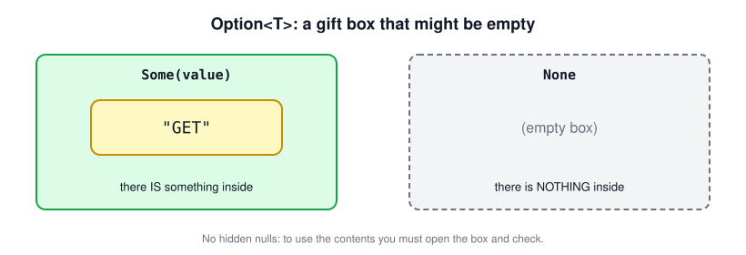
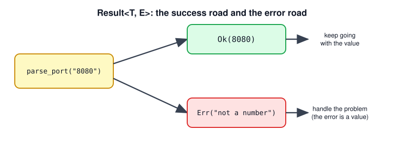
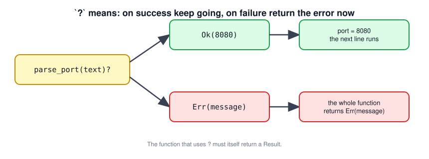

# Chapter 8: When things go missing or wrong: Option, Result and `?`

> **Brain Power**
> You ask a program to find the `Accept` header of a request, and the request has none. In many languages the answer is a special "nothing" value called `null`, and your program crashes later, far from the cause. How would you design a language so you *cannot* forget that an answer might be missing?

Rust's answer uses nothing new: it uses an **enum** (Chapter 7). Let's see.

## Option: "there might be nothing"

Here is a function that turns text into a `Method`. It can't always succeed: `"FETCH"` is not a method we know. What should it return?

```rust
#[derive(Debug)]
enum Method {
    Get,
    Post,
}

impl Method {
    fn parse(text: &str) -> Option<Method> {
        match text {
            "GET" => Some(Method::Get),
            "POST" => Some(Method::Post),
            _ => None,
        }
    }
}

fn main() {
    println!("{:?}", Method::parse("GET"));
    println!("{:?}", Method::parse("FETCH"));
}
```

```output
Some(Get)
None
```

The star is **`Option<Method>`**. `Option` is an enum, built into Rust, with just two variants:



* **`Some(value)`**: there is something, and here it is.
* **`None`**: there is nothing.

> **New word: Option**
> A type that is either `Some(value)` or `None`. Use it whenever "no answer" is a normal, expected possibility.

Two small bits of notation:

* **`Option<Method>`**: the angle brackets `< >` read as **"of"**. An `Option` *of* `Method`: a gift box that may hold a `Method`. The name between them says what is inside. (There are `Option<u16>`, `Option<String>`... you will learn to build such types yourself in Chapter 11.)
* **`match text { "GET" => ... }`**: `match` (Chapter 7) works on text too. Text patterns are quoted text, and `_` catches the rest.

### You must open the box

The brilliant part: an `Option<Method>` is **not** a `Method`. You cannot use it as one until you check what is inside. Try to treat the box as the thing:

```rust,fails
#[derive(Debug)]
enum Method {
    Get,
    Post,
}

impl Method {
    fn as_str(&self) -> &str {
        match self {
            Method::Get => "GET",
            Method::Post => "POST",
        }
    }

    fn parse(text: &str) -> Option<Method> {
        match text {
            "GET" => Some(Method::Get),
            "POST" => Some(Method::Post),
            _ => None,
        }
    }
}

fn main() {
    let m = Method::parse("GET");
    println!("{}", m.as_str());
}
```

```error
error[E0599]: no method named `as_str` found for enum `Option<T>` in the current scope
  --> src/main.rs:26:22
   |
26 |     println!("{}", m.as_str());
   |                      ^^^^^^ method not found in `Option<Method>`
   |
note: the method `as_str` exists on the type `Method`
  --> src/main.rs:8:5
   |
 8 |     fn as_str(&self) -> &str {
   |     ^^^^^^^^^^^^^^^^^^^^^^^^
help: consider using `Option::expect` to unwrap the `Method` value, panicking if the value is an `Option::None`
   |
26 |     println!("{}", m.expect("REASON").as_str());
   |                     +++++++++++++++++

error: aborting due to 1 previous error

For more information about this error, try `rustc --explain E0599`.
```

Decode: **`no method named 'as_str' found for enum 'Option' in the current scope`**. The compiler says "`m` is an `Option`, a gift box. Boxes don't have `as_str`." Its note even says that `as_str` exists on the type `Method`, and hints at **`Option::expect`**: a way to take the value out, crashing if it is missing. In other languages this mistake would be a `null` crash in production. In Rust it is a compile error on your desk.

### Opening the box politely

The safest way is the `match` you already know:

```rust
fn main() {
    let found: Option<u16> = Some(8080);
    match found {
        Some(port) => println!("port is {port}"),
        None => println!("no port given"),
    }
}
```

```output
port is 8080
```

You will also often use these shortcuts:

```rust
fn main() {
    let port: Option<u16> = None;

    println!("{}", port.unwrap_or(80));
    println!("{}", port.is_some());

    if let Some(p) = port {
        println!("got {p}");
    } else {
        println!("using the default");
    }
}
```

```output
80
false
using the default
```

* **`.unwrap_or(80)`**: "give me what's inside, or 80 if the box is empty."
* **`.is_some()`** / **`.is_none()`**: ask `true`/`false` without opening it.
* **`if let Some(p) = port { ... } else { ... }`**: Chapter 7's shortcut, with an `else`.

> **Watch it! `unwrap` and `expect`**
> `.unwrap()` means "open the box and trust me that it holds something". If it is empty, the program **panics**: it stops immediately with an error message. `.expect("message")` does the same but prints your message, which helps you find the problem.
>
> ```rust,panics
> fn main() {
>     let port: Option<u16> = None;
>     let p = port.expect("the port should be set by now");
>     println!("{p}");
> }
> ```
>
> ```output

thread 'main' (432716) panicked at src/main.rs:3:18:
the port should be set by now
note: run with `RUST_BACKTRACE=1` environment variable to display a backtrace
> ```
>
> A **panic** is the program saying "something impossible happened; I give up". (The number in parentheses after `thread 'main'` is different on every run, and older versions of Rust don't print it at all.) Read the message: it names the file, line and column, then your text. Use `unwrap` / `expect` in quick experiments, tests, or when you can truly prove the value is there. In real code, prefer `match`, `if let` or `unwrap_or`.

## Result: "it might go wrong, and I want to know why"

`Option` says *"nothing"*, but does not say *why*. When something can **fail**, you want an explanation. That is **`Result`**, another built-in enum with two variants:



* **`Ok(value)`**: it worked, here's the result.
* **`Err(error)`**: it failed, here's what went wrong.

> **New word: Result**
> A type that is either `Ok(value)` or `Err(error)`. It is written **`Result<T, E>`**: "a Result of *success type* T, or *error type* E". Use it when something can fail and the caller needs to know why.

Turning text into a number can fail, so the standard `parse` method returns a `Result`:

```rust
fn parse_port(text: &str) -> Result<u16, String> {
    let parsed: Result<u16, _> = text.parse();
    match parsed {
        Ok(number) => Ok(number),
        Err(_) => Err(format!("'{text}' is not a valid port number")),
    }
}

fn main() {
    println!("{:?}", parse_port("8080"));
    println!("{:?}", parse_port("http"));
    println!("{:?}", parse_port("70000"));
}
```

```output
Ok(8080)
Err("'http' is not a valid port number")
Err("'70000' is not a valid port number")
```

Walk through it:

* **`-> Result<u16, String>`**: "gives back a `u16` on success, or a `String` explaining the failure."
* **`let parsed: Result<u16, _> = text.parse();`**: we tell Rust we want a `u16` out of the text. The `_` in a type means "work this part out yourself" (it's the library's own error type, which we do not need to name).
* **`Ok(number) => Ok(number)`**: on success, pass the number along. The first `Ok` is the *pattern*; the second `Ok(...)` *builds* a new `Result`.
* **`Err(_) => Err(format!(...))`**: on failure, throw away the library's error (`_`) and write our own friendlier message.

`70000` fails because the biggest `u16` is 65,535. (Chapter 2.) The type system just prevented an impossible port number.

### The `?` operator

Now imagine a function with *several* steps that can fail. With `match` it gets deeply nested:

```rust
fn parse_port(text: &str) -> Result<u16, String> {
    let parsed: Result<u16, _> = text.parse();
    match parsed {
        Ok(number) => Ok(number),
        Err(_) => Err(format!("'{text}' is not a valid port number")),
    }
}

fn parse_address(host: &str, port_text: &str) -> Result<String, String> {
    match parse_port(port_text) {
        Ok(port) => Ok(format!("{host}:{port}")),
        Err(message) => Err(message),
    }
}

fn main() {
    println!("{:?}", parse_address("example.test", "8080"));
    println!("{:?}", parse_address("example.test", "oops"));
}
```

```output
Ok("example.test:8080")
Err("'oops' is not a valid port number")
```

`parse_address` only wants to say: "if `parse_port` failed, fail with the same message; otherwise keep going". That's such a common wish that Rust has a one-character shortcut: **`?`**.



```rust
fn parse_port(text: &str) -> Result<u16, String> {
    let parsed: Result<u16, _> = text.parse();
    match parsed {
        Ok(number) => Ok(number),
        Err(_) => Err(format!("'{text}' is not a valid port number")),
    }
}

fn parse_address(host: &str, port_text: &str) -> Result<String, String> {
    if host.is_empty() {
        return Err(String::from("the host is empty"));
    }
    let port = parse_port(port_text)?;
    Ok(format!("{host}:{port}"))
}

fn main() {
    println!("{:?}", parse_address("example.test", "8080"));
    println!("{:?}", parse_address("example.test", "oops"));
    println!("{:?}", parse_address("", "8080"));
}
```

```output
Ok("example.test:8080")
Err("'oops' is not a valid port number")
Err("the host is empty")
```

The key line is **`let port = parse_port(port_text)?;`**:

* If `parse_port` returned `Ok(8080)`, the `?` **unwraps** it: `port` is just `8080`, and we carry on to the next line.
* If it returned `Err(message)`, the `?` **returns that `Err` from `parse_address` immediately**. The rest of the function doesn't run.

The success path stays a straight line. The failure path is one character. Two more things to notice: the function's last line, `Ok(format!(...))`, *wraps* the success value back into a `Result` (every path must give a `Result`), and `return Err(...)` shows an early exit.

> **Watch it!**
> `?` can only be used inside a function that itself returns a `Result` (or an `Option`; below). Use it in plain `main()` with no return type and the compiler complains. The reason is simple: `?` has to *return* the error from somewhere.

`?` works the same way for `Option`: on `None` it returns `None` immediately.

```rust
#[derive(Debug)]
enum Method {
    Get,
    Post,
}

impl Method {
    fn parse(text: &str) -> Option<Method> {
        match text {
            "GET" => Some(Method::Get),
            "POST" => Some(Method::Post),
            _ => None,
        }
    }
}

fn is_known(text: &str) -> Option<bool> {
    let _method = Method::parse(text)?;
    Some(true)
}

fn main() {
    println!("{:?}", is_known("GET"));
    println!("{:?}", is_known("FETCH"));
}
```

```output
Some(true)
None
```

> **Sharpen your pencil**
> What does each call print? Decide first.
> ```text
> parse_address("example.test", "8080")
> parse_address("example.test", "99999")
> parse_address("", "oops")
> ```
> (Use the `?` version of `parse_address` from above.)
>
> <details><summary>Answer</summary>
>
> 1. `Ok("example.test:8080")`
> 2. `Err("'99999' is not a valid port number")`: 99999 is bigger than `u16` allows.
> 3. `Err("the host is empty")`: the host check happens **first**, so `parse_port` never even runs.
> </details>

> **There are no Dumb Questions**
>
> **Q: When do I use `Option` and when `Result`?**
> A: `Option` when "nothing" is a normal answer (a lookup that may find nothing). `Result` when something can *fail* and the caller should know why (parsing, reading files, network).
>
> **Q: Isn't `?` like exceptions in other languages?**
> A: It *looks* like it, but nothing is hidden. The error travels as an ordinary value, the function's type announces it (`-> Result<...>`), and every `?` is visible in the code.
>
> **Q: What if the error types of the two functions differ?**
> A: Then `?` needs a way to convert one into the other. Chapter 16 shows how, and it is neat.
>
> **Q: Why would `Result<(), String>` have `()` in it?**
> A: `()` is "unit" (Chapter 3): "nothing". `Result<(), String>` means "either it worked and there is nothing to report, or it failed with this message": ideal for *checks*. You write the success as `Ok(())`.

## Now look at real Nexus

Nexus often receives web addresses that might be garbage (the user typed them). Here is the start of a real function in [`trust.rs`](../../crates/nexus-core/src/trust.rs), which decides whether it is safe to send saved passwords to an address:

```rust,nexus
pub fn origin_of(url: &str) -> Option<String> {
    let u = url::Url::parse(url.trim()).ok()?;
    // ...
}
```

Decode:

* `url: &str` is a borrowed look at text (Chapter 5); `-> Option<String>`: either `Some(` an owned `String` `)` or `None`.
* `url.trim()` is a method that cuts off spaces at both ends.
* `url::Url::parse(...)` is a function from a library called `url` (written by other people; Chapter 15 shows how libraries are added). Its `::` path reads "the `parse` function inside the `Url` type inside the `url` library". It returns a `Result`: success if the text is a valid address, `Err` if not.
* **`.ok()`** turns a `Result` into an `Option`: `Ok(x)` becomes `Some(x)`, and an `Err` becomes `None` (the error detail is thrown away, since this function only wants to know "valid or not").
* **`?`** on that `Option`: if it is `None`, the whole function returns `None` right now. Otherwise `u` is the parsed address and the function carries on.

Garbage in, `None` out, and no crash. You could have written that line yourself.

## Checkpoint project: request builder, version 7

The builder now has to cope with bad input. First, parsing a header line such as `Accept: */*` (`split_once(':')` cuts the text at the first colon and returns an `Option`!):

```rust,frag
impl Header {
    fn parse(line: &str) -> Result<Header, String> {
        match line.split_once(':') {
            Some((key, value)) => Ok(Header::new(key.trim(), value.trim())),
            None => Err(format!("header line '{line}' has no ':'")),
        }
    }
}
```

Then a `Method::parse` like the one above, a check that the path starts with `/`, and a `build` function that puts them together with `?`:

```rust,frag
fn build(method: &str, path: &str, header_line: &str) -> Result<Request, String> {
    let method = match Method::parse(method) {
        Some(m) => m,
        None => return Err(format!("unknown method '{method}'")),
    };
    let header = Header::parse(header_line)?;
    let request = Request { method, path: path.to_string(), header };
    request.validate()?;
    Ok(request)
}
```

Here's the whole program. Type it in, or just add the new pieces to your own.

<details><summary>The whole program so far</summary>

```rust
#[derive(Debug)]
enum Method {
    Get,
    Post,
}

impl Method {
    fn parse(text: &str) -> Option<Method> {
        match text {
            "GET" => Some(Method::Get),
            "POST" => Some(Method::Post),
            _ => None,
        }
    }

    fn as_str(&self) -> &str {
        match self {
            Method::Get => "GET",
            Method::Post => "POST",
        }
    }
}

struct Header {
    key: String,
    value: String,
}

impl Header {
    fn new(key: &str, value: &str) -> Self {
        Self { key: key.to_string(), value: value.to_string() }
    }

    fn parse(line: &str) -> Result<Header, String> {
        match line.split_once(':') {
            Some((key, value)) => Ok(Header::new(key.trim(), value.trim())),
            None => Err(format!("header line '{line}' has no ':'")),
        }
    }

    fn line(&self) -> String {
        format!("{}: {}", self.key, self.value)
    }
}

struct Request {
    method: Method,
    path: String,
    header: Header,
}

impl Request {
    fn validate(&self) -> Result<(), String> {
        if !self.path.starts_with('/') {
            return Err(format!("path '{}' must start with '/'", self.path));
        }
        Ok(())
    }

    fn to_text(&self) -> String {
        format!("{} {} HTTP/1.1\n{}", self.method.as_str(), self.path, self.header.line())
    }
}

fn build(method: &str, path: &str, header_line: &str) -> Result<Request, String> {
    let method = match Method::parse(method) {
        Some(m) => m,
        None => return Err(format!("unknown method '{method}'")),
    };
    let header = Header::parse(header_line)?;
    let request = Request { method, path: path.to_string(), header };
    request.validate()?;
    Ok(request)
}

fn main() {
    let attempts = [
        build("GET", "/users", "Host: api.example.test"),
        build("FETCH", "/users", "Host: api.example.test"),
        build("GET", "users", "Host: api.example.test"),
        build("POST", "/users", "Host api.example.test"),
    ];
    for attempt in attempts {
        match attempt {
            Ok(request) => println!("OK:\n{}", request.to_text()),
            Err(message) => println!("ERROR: {message}"),
        }
    }
}
```

```output
OK:
GET /users HTTP/1.1
Host: api.example.test
ERROR: unknown method 'FETCH'
ERROR: path 'users' must start with '/'
ERROR: header line 'Host api.example.test' has no ':'
```

</details>

(I sneaked in an *array* `[ ... ]` of four results and a `for` loop over it: Chapter 9 explains them properly. For now read it as "do this four times, once per attempt".)

Each failure has a precise message, and `main` never crashes: it decides what to show.

> **Sharpen your pencil**
> Add a rule to `validate`: the path must not contain a space. (Hint: text has `.contains(' ')`.) Then add a fifth attempt to `main` that triggers it and predict the message before you run.
>
> <details><summary>Answer</summary>
>
> ```rust,frag
> if self.path.contains(' ') {
>     return Err(format!("path '{}' must not contain spaces", self.path));
> }
> ```
> Put it before `Ok(())` in `validate`. An attempt like `build("GET", "/my users", "Host: x")` then prints `ERROR: path '/my users' must not contain spaces`.
> </details>

## Bullet Points

* **`Option<T>`** is `Some(value)` or `None`: "there may be nothing". It replaces `null`, and the compiler forces you to check.
* **`Result<T, E>`** is `Ok(value)` or `Err(error)`: "this may fail, and here is why".
* `< >` read as "of": `Option<u16>` is an Option *of* `u16`.
* Open them with `match`, `if let`, or helpers like `unwrap_or`, `is_some()`.
* `.unwrap()` / `.expect("msg")` **panic** (stop the program) on `None`/`Err`. Prefer them only in experiments, tests, or provably-safe spots.
* **`?`** after an expression: on `Ok`/`Some` keep going with the inside value; on `Err`/`None` return it from this function *right now*. The function must return a `Result` / `Option`.
* `Result<(), String>` is the shape of a check that returns nothing on success: `Ok(())`.

## Cheat sheet

```text
Option<T>:  Some(x)  None          Result<T, E>:  Ok(x)  Err(e)
match o { Some(x) => .., None => .. }
if let Some(x) = o { .. }
o.unwrap_or(default)   o.is_some()   o.is_none()
o.unwrap()  o.expect("why")        panic if None / Err
let x = f()?;                      Ok/Some: x = inside;  Err/None: return it
Ok(value)   Err(String::from(..))  build a Result
fn f() -> Result<u16, String>      announce that f can fail
```
