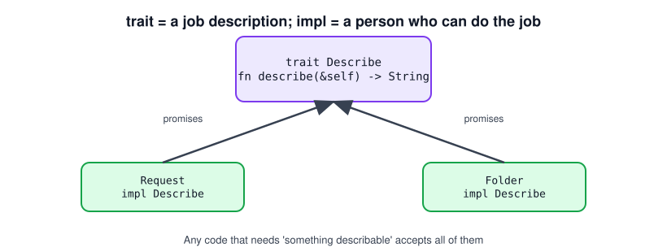
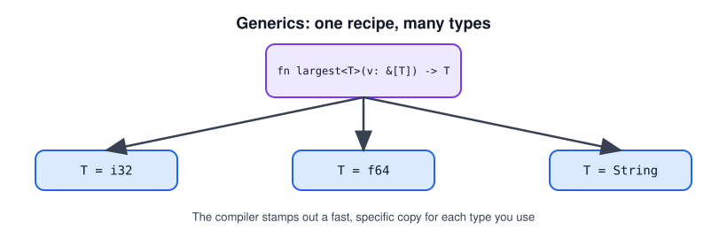
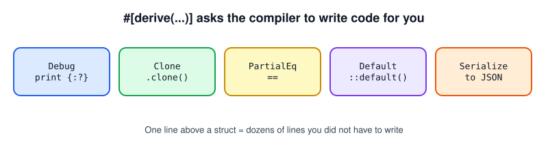
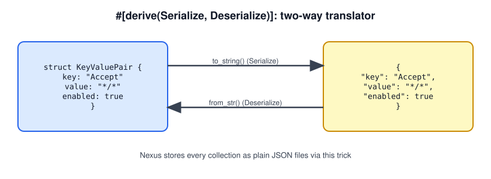

# Chapter 8: Traits, generics, derive and serde

> **Brain Power**
> A printer driver, a USB stick and a network share all "can be saved to". A program that just says "save this" shouldn't care which one it's talking to. How would you describe, in code, "anything that can be saved to" without naming each thing?

## Traits: a job contract

A **trait** is a list of abilities: "to do this job, you must be able to do X and Y". Any type can promise to follow the contract by writing an `impl Trait for Type` block.



```rust
trait Describe {
    fn describe(&self) -> String;
}

struct Request { method: String, url: String }
struct Folder { name: String, count: usize }

impl Describe for Request {
    fn describe(&self) -> String {
        format!("{} {}", self.method, self.url)
    }
}

impl Describe for Folder {
    fn describe(&self) -> String {
        format!("folder '{}' with {} items", self.name, self.count)
    }
}

fn print_it(thing: &impl Describe) {
    println!("{}", thing.describe());
}

fn main() {
    print_it(&Request { method: "GET".into(), url: "https://a.test".into() });
    print_it(&Folder { name: "Users".into(), count: 3 });
}
```

`print_it` accepts *anything* that implements `Describe`. It doesn't know or care what the type is. (If you know Java/C#, think "interface". If you know Python, think "duck typing", but checked at compile time.)

### Traits you'll meet constantly

You already used several without knowing:

| Trait | What it promises |
|---|---|
| `Debug` | can be printed with `{:?}` |
| `Display` | can be printed with `{}` for humans |
| `Clone` | has `.clone()` |
| `Copy` | is duplicated automatically (small, plain types) |
| `PartialEq` / `Eq` | can be compared with `==` |
| `Default` | has `T::default()` |
| `From` / `Into` | can be converted |
| `Drop` | runs code when the value is dropped |
| `Iterator` | can produce a sequence (Chapter 9) |

A real implementation of `Drop`, from [`websocket/mod.rs`](../../crates/nexus-core/src/websocket/mod.rs):

```rust
impl Drop for WebSocketClient {
    /// Dropping the client closes the connection gracefully (and ends reconnecting).
    fn drop(&mut self) {
        self.disconnect(None, None);
    }
}
```

You never call `drop` yourself. When a `WebSocketClient` goes out of scope (Chapter 6), Rust calls this for you. Clean up on exit, guaranteed.

The same file implements a trait from another crate, `rustls`'s `ServerCertVerifier`, for a struct `NoVerify`, a verifier that accepts any TLS certificate (only used when the user explicitly asks to skip verification). Implementing someone else's trait for your own type is how you plug into a library.

And in [`app.rs`](../../crates/nexus-gui/src/app.rs), the whole GUI is "just" a type that implements the `eframe::App` trait:

```rust
impl eframe::App for NexusApp {
    fn ui(&mut self, ui: &mut Ui, _frame: &mut eframe::Frame) {
        self.show(ui);
    }

    fn on_exit(&mut self, _gl: Option<&eframe::glow::Context>) {
        self.save_ui_state();
        // ...
    }
}
```

eframe says "give me a type with a `ui` method and I'll call it every frame". Nexus says "here is `NexusApp`". 

> Fun fact: Nexus defines **no traits of its own**. It uses concrete structs and closures instead. Traits are for when you need many different types to be interchangeable; Nexus's architecture didn't need that. Not every Rust program is trait-heavy!

## Generics: one recipe, many types



You've been using generics: `Vec<String>`, `Option<i32>`, `Result<T, E>`. The `<...>` fills in a type. You can write your own:

```rust
fn largest<T: PartialOrd + Copy>(items: &[T]) -> T {
    let mut best = items[0];
    for &item in items {
        if item > best {
            best = item;
        }
    }
    best
}

fn main() {
    println!("{}", largest(&[3, 9, 4]));
    println!("{}", largest(&[1.5, 0.2]));
    println!("{}", largest(&['a', 'z', 'q']));
}
```

`T: PartialOrd + Copy` is a **trait bound**: "T can be any type, *provided* it can be compared with `>` and copied". Without the bound the compiler can't know `>` makes sense. The compiler generates a specialized version for each type you use, so there is zero speed penalty (this is called **monomorphization**, a fancy word for "stamping out copies").

### `impl Trait` and `where`

Two friendlier spellings for bounds. From [`service/mod.rs`](../../crates/nexus-core/src/service/mod.rs):

```rust
pub async fn runner_start(
    &self,
    config: RunConfig,
    sink: impl Fn(RunEvent) + Send + Sync + 'static,
) -> RunSummary {
```

`sink: impl Fn(RunEvent) + Send + Sync + 'static` reads: "`sink` is *some* function-like thing that takes a `RunEvent`, can be sent between threads (`Send`), shared between threads (`Sync`), and holds no short-lived borrows (`'static`, so it can be stored or spawned and kept as long as needed)". The UI passes in a closure that forwards each event to the channel (Chapter 9, 11, 12).

And the same idea with `where` in [`runner/mod.rs`](../../crates/nexus-core/src/runner/mod.rs):

```rust
pub async fn run<F>(&self, config: RunConfig, sink: F) -> RunSummary
where
    F: Fn(RunEvent) + Send + Sync,
{
```

Both spellings express the same kind of bound (`impl Trait` in argument position is sugar for a generic parameter); `where` is tidier for long bounds. Notice `run` has no `'static`: it awaits the sink inline instead of storing or spawning it, so it doesn't need one.

More friendly generic arguments from [`trust.rs`](../../crates/nexus-core/src/trust.rs):

```rust
pub fn warning(message: impl Into<String>) -> LogEntry {
```

The caller may pass `"text"` (a `&str`) *or* a `String`; `message.into()` turns either into the `String` the function needs.

## Attributes and `#[derive]`

The `#[...]` lines above structs are **attributes**: notes to the compiler. The most important is `#[derive(...)]`: "write the boring trait implementation for me".



```rust
#[derive(Debug, Clone, PartialEq, Default)]
struct Header {
    key: String,
    value: String,
}

fn main() {
    let a = Header { key: "A".into(), value: "1".into() };
    let b = a.clone();        // from Clone
    println!("{:?}", b);      // from Debug
    println!("{}", a == b);   // from PartialEq
    println!("{:?}", Header::default()); // from Default
}
```

Nexus puts derives on nearly every type:

```rust
#[derive(Debug, Clone, Copy, PartialEq, Eq, Hash, Serialize, Deserialize)]
pub enum HttpMethod { Get, Post, /* ... */ }
```

`Hash` lets it be a key in a `HashMap`. `Serialize`/`Deserialize` come from the next section.

## serde: struct to JSON and back

Nexus stores everything as JSON. The crate **`serde`** ("serialize/deserialize") does the translation, driven entirely by `derive`:



```rust
// needs-deps
use serde::{Deserialize, Serialize};

#[derive(Debug, Serialize, Deserialize)]
#[serde(rename_all = "camelCase")]
struct KeyValuePair {
    key: String,
    value: String,
    enabled: bool,
    #[serde(default, skip_serializing_if = "Option::is_none")]
    description: Option<String>,
}

fn main() {
    let kv = KeyValuePair {
        key: "Accept".into(),
        value: "*/*".into(),
        enabled: true,
        description: None,
    };

    let json = serde_json::to_string(&kv).unwrap();
    println!("{json}");   // description is omitted when None

    let back: KeyValuePair = serde_json::from_str(r#"{"key":"X","value":"1","enabled":false}"#).unwrap();
    println!("{back:?}");
}
```

That struct is practically verbatim from [`types/mod.rs`](../../crates/nexus-core/src/types/mod.rs). The `serde` attributes tune the JSON:

| Attribute | Effect |
|---|---|
| `rename_all = "camelCase"` | Rust `form_data` becomes JSON `formData` |
| `rename = "type"` | one field/variant gets a custom JSON name (needed because `type` is a Rust keyword) |
| `default` | if missing from the JSON, use `Default` |
| `skip_serializing_if = "Option::is_none"` | leave the key out when `None` |
| `flatten` | merge a nested map's keys into the parent |
| `untagged` | for enums: try each variant until one fits |

Nexus uses all of them. Look at `AuthConfig`:

```rust
#[derive(Debug, Clone, PartialEq, Serialize, Deserialize)]
pub struct AuthConfig {
    #[serde(rename = "type")]
    pub auth_type: AuthType,
    #[serde(flatten)]
    pub extra: Map<String, Value>,
}
```

The JSON `{ "type": "bearer", "token": "abc" }` becomes `auth_type = Bearer` with `extra = {"token": "abc"}`. Every auth kind has different extra keys, and `flatten` catches them all without a struct per kind.

And a *tree* of items is modelled as an enum that serde guesses by shape:

```rust
#[derive(Debug, Clone, PartialEq, Serialize, Deserialize)]
#[serde(untagged)]
pub enum CollectionItem {
    Folder(NexusFolder),
    Request(NexusRequest),
}
```

"Try parsing as a `Folder`; if that doesn't fit, try `Request`." The comment above it explains the order: a request never has `items`, but a folder has no `method`, so `Folder` goes first.

The `RunEvent` enum sent from the collection runner to the UI uses an *adjacently tagged* layout:

```rust
#[derive(Debug, Clone, Serialize)]
#[serde(tag = "type", content = "data", rename_all = "kebab-case", rename_all_fields = "camelCase")]
pub enum RunEvent { /* IterationStart { iteration, total }, ... */ }
```

producing `{ "type": "iteration-start", "data": { "iteration": 1, "total": 3 } }`. (Note it derives only `Serialize`: events flow *out* only.)

Finally, `serde_json::Value` is a dynamic "any JSON" type when you don't know the shape in advance:

```rust
// needs-deps
use serde_json::json;

fn main() {
    let v = json!({ "name": "nexus", "tags": ["api", "rust"], "stars": 3 });
    println!("{}", v["tags"][0]);    // "api"
    println!("{}", v["missing"]);    // null (no crash)
}
```

> **Sharpen your pencil**
> 1. Write a trait `Area` with `fn area(&self) -> f64`, implement it for `struct Square(f64)` and `struct Circle(f64)`, and write `fn total(shapes: &[&dyn Area]) -> f64` (hint: `&dyn Area` means "a reference to any `Area`" and lets you mix types in one list).
> 2. Which serde attribute would make this struct field appear in JSON as `"x-id"`? `struct H { id: String }`
> 3. Why can `largest` above not be written without `T: PartialOrd`?
>
> *(Answers at the end of the chapter.)*

> **Watch it!**
> Forgetting `#[derive(Clone)]` on a struct and then calling `.clone()` gives "method `clone` not found". Forgetting `Debug` makes `{:?}` fail. These are the commonest "missing trait" errors; the fix is nearly always a derive.

> **There are no Dumb Questions**
>
> **Q: What's `dyn Trait`?**
> A: A *trait object*: a pointer to "some value implementing the trait", with the exact type decided at runtime. It lets you put different types in one `Vec`. Nexus's `Opener = Arc<dyn Fn(&Path) -> ...>` is one: a shared function whose body can be swapped by tests so they don't launch a real browser.
>
> **Q: `impl Trait` vs `dyn Trait`?**
> A: `impl Trait` = one specific type, chosen at compile time, fastest. `dyn Trait` = any type, chosen at runtime, small cost, more flexible.
>
> **Q: Does derive slow my compile?**
> A: A little; serde in particular generates a lot of code. Nexus's release profile (`lto`, `codegen-units = 1`) makes the *final* program lean, at the price of slower release builds.

## Bullet Points

* A **trait** is a set of methods a type promises to provide; `impl Trait for Type` fulfils it.
* **Generics** (`<T>`) write code once for many types; **bounds** (`T: Trait`) say what T must be able to do.
* `impl Trait` in argument position is shorthand for a bound; `where` clauses tidy long bounds.
* `Drop` runs cleanup when a value goes out of scope.
* `#[derive(...)]` writes standard trait impls for you.
* **serde** + derive turns structs into JSON and back; attributes tune names, defaults and shapes.

## Cheat sheet

```
trait T { fn f(&self) -> i32; }     define      impl T for S { .. }   implement
fn g<X: T>(x: &X)   fn g(x: &impl T)   fn g<X>(x: &X) where X: T      same idea
&dyn T  /  Box<dyn T>               any T, decided at runtime
#[derive(Debug, Clone, PartialEq, Default)]
#[derive(Serialize, Deserialize)]  #[serde(rename_all = "camelCase")]
#[serde(default)] #[serde(skip_serializing_if = "Option::is_none")]
#[serde(flatten)] #[serde(untagged)]
```

## Answers

1. ```rust
   trait Area { fn area(&self) -> f64; }
   struct Square(f64);
   struct Circle(f64);
   impl Area for Square { fn area(&self) -> f64 { self.0 * self.0 } }
   impl Area for Circle { fn area(&self) -> f64 { 3.14 * self.0 * self.0 } }

   fn total(shapes: &[&dyn Area]) -> f64 {
       shapes.iter().map(|s| s.area()).sum()
   }

   fn main() {
       let sq = Square(2.0);
       let c = Circle(1.0);
       println!("{}", total(&[&sq, &c]));
   }
   ```
2. `#[serde(rename = "x-id")]` on the field.
3. Because `T` could be a type with no ordering (a `struct` without comparison), and `item > best` would make no sense. The bound is a promise the compiler can check.
