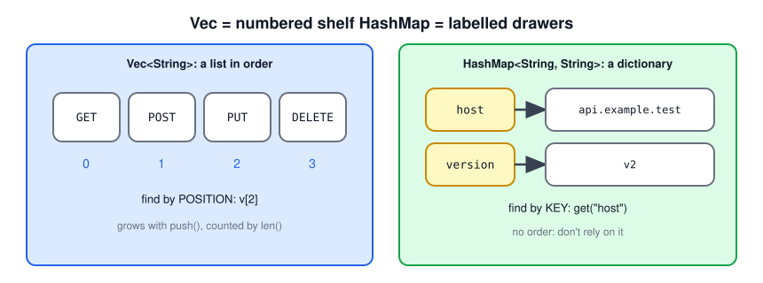
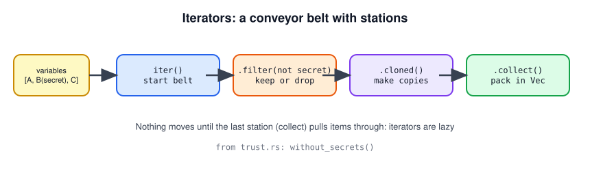
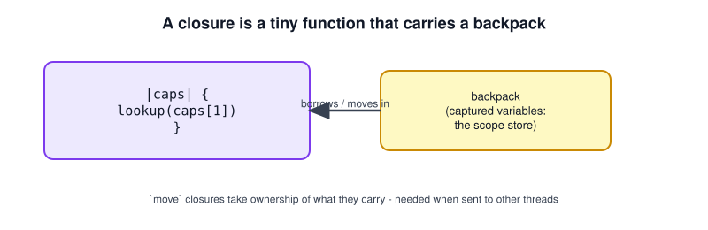

# Chapter 9: Collections, iterators and closures

> **Brain Power**
> You have a list of 1,000 variables and want only the non-secret ones, copied into a new list. In a language with loops, you'd write: *make an empty list, loop, if-statement, push*. Can you imagine a way to say this in a single readable line, without any loop counters?

## `Vec<T>`: a growable list



```rust
fn main() {
    let mut methods = Vec::new();
    methods.push("GET");
    methods.push("POST");
    methods.push("PUT");

    println!("{} methods, first = {}", methods.len(), methods[0]);

    let nums = vec![10, 20, 30];     // vec! macro: build with values
    println!("{:?}", nums);

    // Safe access: get() returns an Option instead of crashing
    match nums.get(7) {
        Some(n) => println!("{n}"),
        None => println!("nothing at index 7"),
    }
}
```

`nums[7]` on a too-short `Vec` **panics** (crashes). `.get(7)` returns `None`. Pick based on whether a miss is a bug or normal.

A `Vec` owns its items on the heap. A `&[T]` ("slice") is a borrowed view of part or all of one. Functions accept `&[T]` so they work with Vecs, arrays and sub-ranges.

## `HashMap<K, V>`: look things up by key

```rust
use std::collections::HashMap;

fn main() {
    let mut headers: HashMap<String, String> = HashMap::new();
    headers.insert("Accept".to_string(), "*/*".to_string());
    headers.insert("Host".to_string(), "a.test".to_string());

    if let Some(v) = headers.get("Host") {
        println!("Host = {v}");
    }

    // count words with the "entry" API
    let mut counts: HashMap<&str, u32> = HashMap::new();
    for w in "a b a c a b".split(' ') {
        *counts.entry(w).or_insert(0) += 1;
    }
    let mut sorted: Vec<_> = counts.into_iter().collect();
    sorted.sort();
    println!("{sorted:?}");
}
```

A plain `HashMap` has **no promised order**. Nexus wants JSON keys to stay where the user put them, so its types use **`IndexMap`** (from the `indexmap` crate), a map that remembers insertion order. You can see `use indexmap::IndexMap;` at the top of [`types/mod.rs`](../../crates/nexus-core/src/types/mod.rs).

## Iterators: the conveyor belt

An **iterator** produces items one at a time. Chain *adapters* (stations on the belt) to transform, filter and combine; finish with a *consumer* that collects the result.



Here's the real thing, from [`trust.rs`](../../crates/nexus-core/src/trust.rs):

```rust
/// `variables` without the Secret-typed ones.
pub fn without_secrets(variables: &[Variable]) -> Vec<Variable> {
    variables
        .iter()
        .filter(|v| v.var_type != VariableType::Secret)
        .cloned()
        .collect()
}
```

Step by step:

1. `.iter()` starts a belt of `&Variable` (borrowed items).
2. `.filter(|v| ...)` keeps only items for which the closure says `true`.
3. `.cloned()` turns each `&Variable` into an owned copy.
4. `.collect()` gathers them into a `Vec<Variable>` (the return type tells `collect` what to build).

The same, runnable:

```rust
fn main() {
    let words = ["apple", "kiwi", "banana", "fig"];

    let long_upper: Vec<String> = words
        .iter()
        .filter(|w| w.len() > 3)
        .map(|w| w.to_uppercase())
        .collect();
    println!("{long_upper:?}");

    let total_len: usize = words.iter().map(|w| w.len()).sum();
    println!("{total_len}");

    let first_f = words.iter().find(|w| w.starts_with('f'));
    println!("{first_f:?}");

    for (i, w) in words.iter().enumerate() {
        println!("{i}: {w}");
    }
}
```

Handy stations: `map`, `filter`, `enumerate`, `zip`, `rev`, `take`, `skip`, `chain`, `flat_map`, `filter_map`. Handy finishers: `collect`, `sum`, `count`, `find`, `any`, `all`, `min`, `max`, `fold`.

Iterators are **lazy**: nothing happens until a consumer pulls. And they compile down to code as fast as a hand-written loop.

Another Nexus classic, listing `*.json` files in a folder ([`collections/mod.rs`](../../crates/nexus-core/src/collections/mod.rs)):

```rust
let mut files: Vec<PathBuf> = rd
    .filter_map(|e| e.ok())
    .filter(|e| e.file_type().is_ok_and(|t| t.is_file()))
    .map(|e| e.path())
    .filter(|p| p.extension().is_some_and(|x| x == "json"))
    .collect();
files.sort();
```

Each directory entry may be an error (`e.ok()` + `filter_map` drops the bad ones), must be a file, is turned into a path, and must end in `.json`. Four stations, no loop counters.

**Collecting into a `Result`:** `collect` is clever: an iterator of `Result<T, E>` can be collected into `Result<Vec<T>, E>`, stopping at the first error:

```rust
fn main() {
    let good: Result<Vec<i32>, _> = "1 2 3".split(' ').map(|s| s.parse::<i32>()).collect();
    let bad: Result<Vec<i32>, _> = "1 x 3".split(' ').map(|s| s.parse::<i32>()).collect();
    println!("{good:?}");
    println!("{bad:?}");
}
```

## Closures: tiny functions with a backpack

A **closure** is an unnamed function written `|args| body`. It can *capture* variables from where it was written.



```rust
fn main() {
    let threshold = 3;
    let longer_than = |s: &str| s.len() > threshold; // captures `threshold`

    let words = ["a", "abcd", "xyz", "hello"];
    let n = words.iter().filter(|w| longer_than(w)).count();
    println!("{n}");

    let mut calls = 0;
    let mut counter = || { calls += 1; calls };   // captures `calls` by mutable borrow
    counter();
    counter();
    println!("calls = {calls}");
}
```

Real Nexus: replacing `{{variable}}` tokens in text ([`environments/variable_store.rs`](../../crates/nexus-core/src/environments/variable_store.rs)):

```rust
pub fn resolve(&self, template: &str) -> String {
    TOKEN_RE
        .replace_all(template, |caps: &Captures| {
            let trimmed = caps[1].trim();
            if trimmed.starts_with('$') {
                return Self::resolve_dynamic(trimmed);
            }
            for level in SCOPE_ORDER {
                if let Some(val) = self.scope(level).get(trimmed) {
                    return val.to_string();
                }
            }
            caps[0].to_string()
        })
        .into_owned()
}
```

The regex finds every `{{...}}`. For each match, the closure runs: dynamic variables (like `{{$randomEmail}}`) are generated; otherwise the scopes are searched in order (local, environment, collection, global); if nothing is found the original token is left alone. The closure uses `self`, captured from the surrounding method.

### Three closure flavours

| Trait | The closure... | Example |
|---|---|---|
| `Fn` | only reads what it captured | `|x| x + offset` |
| `FnMut` | changes what it captured | `|| { count += 1; }` |
| `FnOnce` | consumes what it captured, so it can run only once | `|| drop(big_vec)` |

You'll see these in signatures, such as `sink: impl Fn(RunEvent) + Send + Sync + 'static` (Chapter 8): "a callback I can call many times without mutating".

### `move` closures

A plain closure captures each variable in the gentlest way its body allows: by `&`, by `&mut`, or by value only if the body moves it (like `drop(big_vec)` above). Add `move` and it **takes ownership** of everything it captures instead. That is needed whenever the closure must outlive the function that made it, such as when passed to another thread or stored as a callback. From [`service/mod.rs`](../../crates/nexus-core/src/service/mod.rs):

```rust
let event_id = id.to_string();
let client = WebSocketClient::new(move |event| sink(&event_id, event));
```

The WebSocket client will call this closure whenever something happens on the connection, long after `ws_connect` returned. So the closure *owns* `event_id` and `sink`. Each event is tagged with its connection's id and forwarded.

```rust
fn make_logger(prefix: String) -> impl Fn(&str) {
    move |msg| println!("[{prefix}] {msg}")   // owns `prefix`
}

fn main() {
    let log = make_logger("http".to_string());
    log("started");
    log("finished");
}
```

Without `move`, this would not compile: `prefix` would be borrowed from a function that has already returned.

### Closures stored as values

Callbacks are Nexus's replacement for "observers". [`websocket/mod.rs`](../../crates/nexus-core/src/websocket/mod.rs) keeps one in a struct:

```rust
struct Shared {
    state: Mutex<State>,
    sink: Box<dyn Fn(WsEvent) + Send + Sync>,
}
```

`Box<dyn Fn(...)>` = "a heap-allocated closure of any type that matches this call shape". And [`preview.rs`](../../crates/nexus-gui/src/preview.rs) uses a closure so tests can *swap out* "open this file in the browser":

```rust
pub type Opener = Arc<dyn Fn(&Path) -> Result<(), String> + Send + Sync>;
```

> **Sharpen your pencil**
> 1. With `let v = vec![1, 2, 3, 4, 5, 6];` write a one-line iterator chain that gives the sum of the squares of the even numbers (expect 56).
> 2. What does this print? `let n = (1..=4).map(|x| x * 10).filter(|x| x % 20 == 0).count();`
> 3. Make this compile by adding one keyword:
> ```rust,fails
> fn adder(n: i32) -> impl Fn(i32) -> i32 {
>     |x| x + n
> }
> fn main() { println!("{}", adder(2)(3)); }
> ```
> *(Answers at the end of the chapter.)*

> **Watch it!**
> `.iter()` gives **references** (`&T`), `.into_iter()` gives **owned** items (moves the collection), and `.iter_mut()` gives `&mut T`. Many "expected `i32`, found `&i32`" errors come from this. `.cloned()` / `.copied()` convert `&T` to `T`.

> **There are no Dumb Questions**
>
> **Q: Are iterator chains slower than `for` loops?**
> A: No. The compiler flattens them into the same machine code. Use whichever reads better.
>
> **Q: Why does `.collect()` need a type?**
> A: It can build a `Vec`, `HashMap`, `String`, `Result<Vec<_>, _>`... it asks *you* by the target type: `let v: Vec<_> = ...` or `.collect::<Vec<_>>()` (the "turbofish").
>
> **Q: When do I choose `Vec` vs `HashMap`?**
> A: Order and position matter, or you just loop: `Vec`. Lookup by name: `HashMap` (or `IndexMap` if order should be remembered).

## Bullet Points

* `Vec<T>` is a growable list; `HashMap<K, V>` looks up by key; `IndexMap` keeps insertion order.
* A `&[T]` slice is a borrowed view of a list.
* **Iterators** are lazy chains: `iter().filter(..).map(..).collect()`.
* `collect()` builds the collection named by the target type, even `Result<Vec<_>, _>`.
* **Closures** (`|x| ...`) can capture variables; `move` makes them own what they capture.
* `Fn` / `FnMut` / `FnOnce` describe how a closure uses its captures.
* Nexus passes closures as callbacks (`sink`) so the engine never knows about the UI.

## Cheat sheet

```
vec![1,2,3]   v.push(4)   v.len()   v.get(i)   &v[1..3]
m.insert(k,v)  m.get(&k)  *m.entry(k).or_insert(0) += 1
v.iter().filter(|x| ..).map(|x| ..).collect::<Vec<_>>()
.sum() .count() .find(..) .any(..) .all(..) .enumerate() .zip(..)
|a, b| a + b           closure       move |x| ..   owning closure
impl Fn(i32) -> i32    Box<dyn Fn(i32) -> i32>
```

## Answers

1. `let s: i32 = v.iter().filter(|x| **x % 2 == 0).map(|x| x * x).sum();` gives 4 + 16 + 36 = 56. (`**x` because `filter` hands a reference to a reference.)
2. `1..=4` becomes 10, 20, 30, 40; those divisible by 20 are 20 and 40, so it prints a count of `2`.
3. Add `move`: `move |x| x + n`. Otherwise the closure borrows `n`, which dies when `adder` returns.
