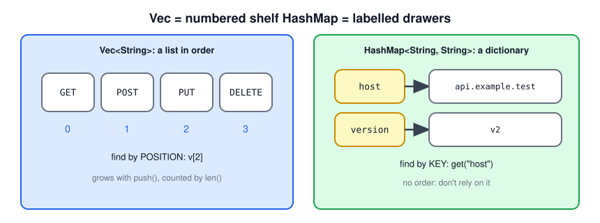

# Chapter 9: Collections: lists and dictionaries

> **Brain Power**
> A request can have any number of headers: two, twenty, none. Your `Request` struct from Chapter 6 only had room for *one*. And separately, you want to look things up by name: "what is the value of `host`?" Describe, in plain words, the two kinds of container you'd want.

One container is a **numbered list** ("the third header"). The other is a **dictionary** ("the value for the name `host`"). Rust has both.



## Arrays: a fixed row

The simplest container is an **array**: a row of values of the *same* type whose length is fixed when you write the program. (Chapter 2's tuple bundles *different* types; an array repeats *one*.)

```rust
fn main() {
    let codes = [200, 404, 500];
    println!("{} {}", codes[0], codes.len());

    let methods: [&str; 3] = ["GET", "POST", "PUT"];
    println!("{:?}", methods);
}
```

```output
200 3
["GET", "POST", "PUT"]
```

* **`[200, 404, 500]`** makes an array. **`codes[0]`** reads the **first** item. We count from zero, as with tuples.
* **`codes.len()`** is how many items there are.
* The type `[&str; 3]` reads "an array of three `&str`". The `;` and the number are part of the type.
* `{:?}` (Chapter 2) can print a whole array.

What if you ask for an item that isn't there?

```rust,panics
fn main() {
    let codes = [200, 404, 500];
    let position = codes.len() + 2;
    println!("{}", codes[position]);
}
```

```output

thread 'main' (433873) panicked at src/main.rs:4:20:
index out of bounds: the len is 3 but the index is 5
note: run with `RUST_BACKTRACE=1` environment variable to display a backtrace
```

The program **panics** (Chapter 8) rather than reading some random memory beyond the row. That safety check is one of the main reasons people choose Rust. (We'll see a gentler way to ask, which returns an `Option`, in a moment.)

## Vec: a list that can grow

An array can't grow. You can't add a header. For a list that grows, Rust has the **`Vec`** (say "vec", short for *vector*). It lives in the warehouse (Chapter 4), because its size changes.

```rust
fn main() {
    let mut methods = Vec::new();
    methods.push(String::from("GET"));
    methods.push(String::from("POST"));

    println!("{} methods", methods.len());
    println!("first: {}", methods[0]);

    let last = methods.pop();
    println!("popped {:?}, {} left", last, methods.len());
}
```

```output
2 methods
first: GET
popped Some("POST"), 1 left
```

* **`Vec::new()`** makes an empty list. (`Vec::new` is an associated function, Chapter 6: the `new` inside `Vec`.) Rust works out that it holds `String`s from the first `push`.
* **`methods.push(x)`** adds to the end. It changes the list, so the variable must be `mut`.
* **`methods[0]`** reads by position, `methods.len()` counts.
* **`methods.pop()`** removes the last item and returns it wrapped in an **`Option`**: `Some(item)`, or `None` if the list was empty. (Chapter 8 again!)

> **New word: Vec**
> A growable list of values of one type, written `Vec<T>`: "a Vec *of* T" (`Vec<String>`, `Vec<u16>`, `Vec<Header>`).

There's a shortcut to make a list with items already in it, a macro (Chapter 1's `!`) called **`vec!`**:

```rust
fn main() {
    let codes = vec![200, 404, 500];
    println!("{:?}", codes);
    println!("{:?}", codes.get(1));
    println!("{:?}", codes.get(7));
}
```

```output
[200, 404, 500]
Some(404)
None
```

**`.get(i)`** is the polite sibling of `codes[i]`: if there is no item `i`, you get `None` instead of a panic. Use `[i]` when you know the position is valid and `.get(i)` when you don't.

### Walking through a list

Use `for` (Chapter 3) to go through each item:

```rust
fn main() {
    let headers = vec![String::from("Host"), String::from("Accept")];
    for name in &headers {
        println!("header: {name}");
    }
    println!("{} headers in total", headers.len());
}
```

```output
header: Host
header: Accept
2 headers in total
```

Notice **`&headers`**, with the `&` from Chapter 5: "just *look at* each item; don't take them". Predict what happens if you leave the `&` off and use `headers` afterwards:

```rust,fails
fn main() {
    let headers = vec![String::from("Host"), String::from("Accept")];
    for name in headers {
        println!("header: {name}");
    }
    println!("{} headers in total", headers.len());
}
```

<details><summary>Answer</summary>

```error
error[E0382]: borrow of moved value: `headers`
 --> src/main.rs:6:37
  |
2 |     let headers = vec![String::from("Host"), String::from("Accept")];
  |         ------- move occurs because `headers` has type `Vec<String>`, which does not implement the `Copy` trait
3 |     for name in headers {
  |                 ------- `headers` moved due to this implicit call to `.into_iter()`
...
6 |     println!("{} headers in total", headers.len());
  |                                     ^^^^^^^ value borrowed here after move
  |
note: the `for` loop is desugared into a call to `std::iter::IntoIterator::into_iter`, which takes ownership of the receiver `self`, which moves `headers`
help: consider iterating over a slice of the `Vec<String>`'s content to avoid moving into the `for` loop
  |
3 |     for name in &headers {
  |                 +

error: aborting due to 1 previous error

For more information about this error, try `rustc --explain E0382`.
```

Without the `&`, the loop **moves** the whole list into itself (Chapter 4), taking each item out one by one. Afterwards `headers` is gone. The compiler even notes **"`headers` moved due to this implicit call to `.into_iter()`"** and suggests the cure: **"consider iterating over a slice of the `Vec<String>`'s content"**, with a `+` marking the `&` to add. (The technical details in the note, about desugaring and `IntoIterator`, are for Chapter 13. For now: loop over `&list` to look, `&mut list` to change, and plain `list` to consume.)

</details>

To change each item while looping, borrow mutably (Chapter 5):

```rust
struct Header {
    key: String,
    enabled: bool,
}

fn main() {
    let mut headers = vec![
        Header { key: String::from("Host"), enabled: true },
        Header { key: String::from("Accept"), enabled: true },
    ];

    for header in &mut headers {
        header.enabled = false;
    }

    for header in &headers {
        println!("{} enabled = {}", header.key, header.enabled);
    }
}
```

```output
Host enabled = false
Accept enabled = false
```

A `Vec` **owns** its items. Pushing a value into it **moves** the value in (Chapter 4), and when the `Vec` goes out of scope, all its items are dropped together.

### The shelf that moves

Chapter 5 mentioned that a growing text might move to a bigger warehouse shelf. A `Vec` does the same. What do you think of this program?

```rust,fails
fn main() {
    let mut codes = vec![200, 404];
    let first = &codes[0];
    codes.push(500);
    println!("first is {first}");
}
```

<details><summary>Answer</summary>

```error
error[E0502]: cannot borrow `codes` as mutable because it is also borrowed as immutable
 --> src/main.rs:4:5
  |
3 |     let first = &codes[0];
  |                  ----- immutable borrow occurs here
4 |     codes.push(500);
  |     ^^^^^^^^^^^^^^^ mutable borrow occurs here
5 |     println!("first is {first}");
  |                         ----- immutable borrow later used here

error: aborting due to 1 previous error

For more information about this error, try `rustc --explain E0502`.
```

It is Chapter 5's rule again: `first` is a reader, and `push` is a writer. If `push` needed more room, the numbers would move to a new shelf and `first` would point at an empty one. In another language that is a nasty crash; in Rust the compiler stops you. (Move the `println!` above the `push`, and it compiles.)

</details>

### Slices of a list: `&[T]`

In Chapter 5, `&str` was "a borrowed look at text". Lists have the same idea: **`&[T]`** is "a borrowed look at a run of `T`s". A function that only reads a list should take one:

```rust
fn count_enabled(flags: &[bool]) -> usize {
    let mut count = 0;
    for flag in flags {
        if *flag {
            count += 1;
        }
    }
    count
}

fn main() {
    let flags = vec![true, false, true, true];
    println!("{}", count_enabled(&flags));
    println!("{}", count_enabled(&flags[1..3]));
}
```

```output
3
1
```

`&flags` (a `&Vec<bool>`) is accepted where `&[bool]` is wanted, the same way `&String` is accepted for `&str`. `&flags[1..3]` borrows just items 1 and 2. And `*flag` is the star from Chapter 5: `flag` is a *reference* to a `bool`, and `*` reaches through it to the `bool`. **Rule of thumb: take `&[T]`, not `&Vec<T>`, when you only read.**

## HashMap: a dictionary

Now the second container. A **`HashMap`** stores **key → value** pairs and finds a value from its key very quickly:

```rust
use std::collections::HashMap;

fn main() {
    let mut variables = HashMap::new();
    variables.insert(String::from("host"), String::from("api.example.test"));
    variables.insert(String::from("version"), String::from("v2"));

    println!("{}", variables.len());
    println!("{:?}", variables.get("host"));
    println!("{:?}", variables.get("port"));
}
```

```output
2
Some("api.example.test")
None
```

* **`use std::collections::HashMap;`**: `HashMap` is not available automatically. `use` tells Rust "bring this name onto my desk so I can write it short". The path `std::collections::HashMap` reads "the `HashMap` inside `collections` inside `std`" (the standard library; Chapter 14 explains paths and `use` properly).
* **`insert(key, value)`** adds a pair (and replaces the value if the key already exists).
* **`get(key)`** finds a value. And since the key might be absent, it returns an **`Option`**: `Some(value)` or `None`. By now that should feel familiar.
* The type is written `HashMap<String, String>`: "a HashMap of key type String to value type String".

> **New word: HashMap**
> A collection of key → value pairs. Look up by key; each key appears once. It has **no order**: don't expect items to come out in the order you put them in.

To use what `get` returns, open the box (Chapter 8):

```rust
use std::collections::HashMap;

fn main() {
    let mut variables = HashMap::new();
    variables.insert(String::from("host"), String::from("api.example.test"));

    match variables.get("host") {
        Some(value) => println!("host is {value}"),
        None => println!("host is not set"),
    }

    println!("{}", variables.contains_key("port"));
}
```

```output
host is api.example.test
false
```

The `value` inside `Some` is a *reference* (`&String`) to the stored text: the map still owns it, and `get` only lends a look. Everything from Chapter 5 applies.

You can loop over a map with `for (key, value) in &map`: each step gives you a key and a value as a pair. Just remember: **no order**. When the order matters, collect the keys in a `Vec` and sort it (we'll do this in Chapter 13), or use an ordered map (Nexus does, with a type called `IndexMap` from a library).

> **There are no Dumb Questions**
>
> **Q: Why does `Vec::new()` not say what it holds?**
> A: Rust works it out from what you put in later. If you never put anything in, it asks you: `let v: Vec<u16> = Vec::new();`.
>
> **Q: Array or Vec?**
> A: If you don't know the length until the program runs, or it changes: `Vec`. Arrays are for small, fixed-size rows. Most day-to-day code uses `Vec`.
>
> **Q: `String` is a collection too, right?**
> A: Sort of. A `String` is like a `Vec` of bytes that is promised to be valid text, so many things you learn here (`push`, `len`, slices) carry over.
>
> **Q: Why can't a HashMap keep order?**
> A: To find keys fast, it files them by a calculation on the key, not by when you added them. There are ordered alternatives when you need one.

> **Sharpen your pencil**
> You are building a `HashMap<String, u16>` of "port by service name". Without running it, say what each line prints (or whether it panics).
> ```text
> ports.insert(String::from("http"), 80);
> ports.insert(String::from("https"), 443);
> ports.insert(String::from("http"), 8080);
> println!("{}", ports.len());
> println!("{:?}", ports.get("http"));
> println!("{:?}", ports.get("ftp"));
> ```
>
> <details><summary>Answer</summary>
>
> `2` (inserting `http` a second time *replaced* the value rather than adding a pair), then `Some(8080)`, then `None`.
> </details>

## Now look at real Nexus

You have been quietly rebuilding the heart of Nexus. A saved request in Nexus is a struct, in [`types/mod.rs`](../../crates/nexus-core/src/types/mod.rs); here are its first fields:

```rust,nexus
pub struct NexusRequest {
    pub id: String,
    pub name: String,
    pub method: HttpMethod,
    pub url: String,
    pub headers: Vec<KeyValuePair>,
    pub params: Vec<KeyValuePair>,
```

It is a struct (Chapter 6) with owned `String` fields, a `method` that is an enum (Chapter 7: the `HttpMethod` you met), and two `Vec`s: the list of headers and the list of query parameters, each item a `KeyValuePair`, which is itself a small struct:

```rust,nexus
pub struct KeyValuePair {
    pub key: String,
    pub value: String,
    pub enabled: bool,
    // ...
    pub description: Option<String>,
}
```

(The elided line is an attribute, Chapter 17.) A key, a value, an on/off checkbox, and a description that may be absent (`Option<String>`, Chapter 8). It is exactly your `Header` plus a checkbox, with the same `enabled` switch you gave your own struct. And here is where the UI keeps the collections it has loaded, from [`state/collections.rs`](../../crates/nexus-gui/src/state/collections.rs):

```rust,nexus
pub struct CollectionsState {
    pub metas: Vec<CollectionMeta>,
    /// Loaded collections by directory name.
    pub loaded: HashMap<String, NexusCollection>,
```

A `Vec` of small summaries, and a `HashMap` that finds a full `NexusCollection` by the **name of its folder** (a `String` key). Collections you've already opened are found instantly. Nothing here is new to you any more.

## Checkpoint project: request builder, version 8

Time for the builder to hold many headers, and for text like `{{host}}` to be filled in from a dictionary of **variables**. Real API tools do exactly this: it is how Nexus lets you write `{{host}}` once and use it in every request.

First the dictionary-filling function:

```rust,frag
fn resolve(template: &str, variables: &HashMap<String, String>) -> String {
    let mut result = template.to_string();
    for (name, value) in variables {
        let mut placeholder = String::from("{{");
        placeholder.push_str(name);
        placeholder.push_str("}}");
        result = result.replace(&placeholder, value);
    }
    result
}
```

Walk through it: start with a copy of the template; for each `(name, value)` pair, build the placeholder text `{{name}}` and replace it everywhere with the value. We *borrow* the map (`&HashMap`) because we only read it.

And in `Request`, headers become a `Vec`:

```rust,frag
struct Request {
    method: Method,
    path: String,
    headers: Vec<Header>,
}
```

Here is the whole program:

<details><summary>The whole program so far</summary>

```rust
use std::collections::HashMap;

#[derive(Debug)]
enum Method {
    Get,
    Post,
}

impl Method {
    fn as_str(&self) -> &str {
        match self {
            Method::Get => "GET",
            Method::Post => "POST",
        }
    }
}

struct Header {
    key: String,
    value: String,
    enabled: bool,
}

impl Header {
    fn new(key: &str, value: &str) -> Self {
        Self { key: key.to_string(), value: value.to_string(), enabled: true }
    }

    fn line(&self) -> String {
        format!("{}: {}", self.key, self.value)
    }
}

struct Request {
    method: Method,
    path: String,
    headers: Vec<Header>,
}

fn resolve(template: &str, variables: &HashMap<String, String>) -> String {
    let mut result = template.to_string();
    for (name, value) in variables {
        let mut placeholder = String::from("{{");
        placeholder.push_str(name);
        placeholder.push_str("}}");
        result = result.replace(&placeholder, value);
    }
    result
}

impl Request {
    fn new(method: Method, path: &str) -> Self {
        Self { method, path: path.to_string(), headers: Vec::new() }
    }

    fn add_header(&mut self, header: Header) {
        self.headers.push(header);
    }

    fn enabled_count(&self) -> usize {
        let mut count = 0;
        for header in &self.headers {
            if header.enabled {
                count += 1;
            }
        }
        count
    }

    fn to_text(&self, variables: &HashMap<String, String>) -> String {
        let mut text = format!(
            "{} {} HTTP/1.1",
            self.method.as_str(),
            resolve(&self.path, variables)
        );
        for header in &self.headers {
            if header.enabled {
                text.push('\n');
                text.push_str(&resolve(&header.line(), variables));
            }
        }
        text
    }
}

fn main() {
    let mut variables = HashMap::new();
    variables.insert(String::from("host"), String::from("api.example.test"));
    variables.insert(String::from("version"), String::from("v2"));

    let mut request = Request::new(Method::Get, "/{{version}}/users");
    request.add_header(Header::new("Host", "{{host}}"));
    request.add_header(Header::new("Accept", "application/json"));
    let mut debug = Header::new("X-Debug", "1");
    debug.enabled = false;
    request.add_header(debug);

    println!("{}", request.to_text(&variables));
    println!(
        "({} headers, {} enabled)",
        request.headers.len(),
        request.enabled_count()
    );
}
```

```output
GET /v2/users HTTP/1.1
Host: api.example.test
Accept: application/json
(3 headers, 2 enabled)
```

</details>

Read `main` aloud: "make a dictionary with two variables; make a GET request for `/{{version}}/users`; add three headers, one of them switched off; print it with the variables filled in." The disabled `X-Debug` header is left out, just like unticking a header row in Nexus.

> **Sharpen your pencil**
> What does `to_text` print if you *remove* the `version` variable from the dictionary? Decide first.
>
> <details><summary>Answer</summary>
>
> The placeholder `{{version}}` is never replaced, so the first line becomes `GET /{{version}}/users HTTP/1.1`. (Real Nexus keeps unknown placeholders as they are too.) Making unknown variables an *error* instead is a nice exercise in `Result` from Chapter 8.
> </details>

## Bullet Points

* An **array** `[a, b, c]` is a fixed-length row; `[T; N]` is its type.
* A **`Vec<T>`** is a growable list: `Vec::new()`, `vec![..]`, `.push(x)`, `.pop()` (returns an `Option`), `v[i]` (panics if out of range), `v.get(i)` (returns an `Option`), `v.len()`.
* Loop with `for x in &v` (look), `for x in &mut v` (change), `for x in v` (consume the list).
* A `Vec` owns its items. You can't hold a reference into a `Vec` while pushing to it.
* **`&[T]`** is a borrowed run of items: the list version of `&str`.
* **`HashMap<K, V>`** stores key → value pairs: `insert`, `get` (returns an `Option`), `contains_key`. It has no order.
* `use std::collections::HashMap;` makes the name available.

## Cheat sheet

```text
let a = [1, 2, 3];               array, fixed length
let mut v = Vec::new();          growable list        let v = vec![1, 2, 3];
v.push(4)  v.pop()  v.len()  v[0]  v.get(9)
for x in &v { .. }               look at each     &mut v: change each
fn f(items: &[u32]) { .. }       take a borrowed list     f(&v)
use std::collections::HashMap;
let mut m = HashMap::new();      dictionary
m.insert(k, v)   m.get(&k)       Option<&V>
m.contains_key(&k)   m.len()
```
