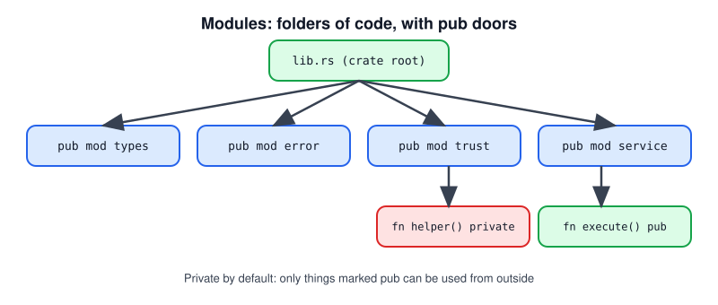
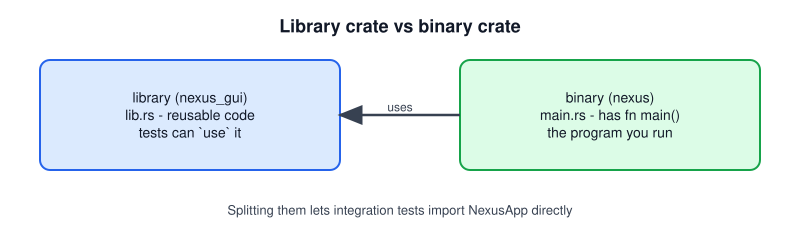
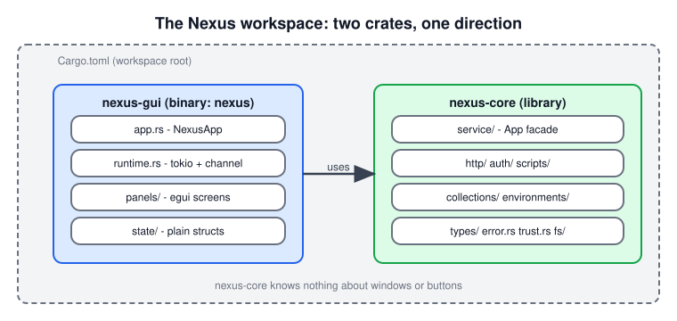

# Chapter 10: Modules, crates and Cargo workspaces

> **Brain Power**
> Nexus has about 48,000 lines of Rust. If all of it lived in one file, what would be painful? Now think about a *kitchen*: you have drawers (cutlery, spices, pans), and some things are meant to be used by guests while others are only for the cook. How could source code copy that idea?

## Modules: drawers for your code

A **module** groups related items (functions, structs, enums...) under a name. Modules also control **who can see what**.

```rust
mod shapes {
    pub struct Square {
        pub side: f64,
    }

    pub fn area(s: &Square) -> f64 {
        helper(s.side)
    }

    // private: only code inside `shapes` can call this
    fn helper(x: f64) -> f64 {
        x * x
    }
}

use shapes::{area, Square};

fn main() {
    let s = Square { side: 3.0 };
    println!("{}", area(&s));
    // shapes::helper(2.0);   // error: function `helper` is private
}
```

* `mod name { ... }` makes a module.
* Everything is **private by default**. Add `pub` to expose it.
* `use path::to::thing;` brings a name into scope so you can skip the long path.



## Modules and files

An inline `mod x { ... }` is fine for tiny things. In real projects each module gets its own file. The rule: `mod foo;` (with a semicolon) tells Rust to look for `foo.rs` or `foo/mod.rs`.

Open [`nexus-core/src/lib.rs`](../../crates/nexus-core/src/lib.rs):

```rust
pub mod auth;
pub mod codegen;
pub mod collections;
pub mod error;
pub mod fs;
pub mod trust;
pub mod types;
// ...

pub use error::{Error, Result};
```

That's why there's an [`error.rs`](../../crates/nexus-core/src/error.rs), a `types/mod.rs`, and so on. The last line, `pub use`, **re-exports**: it says "make `Error` and `Result` available directly as `nexus_core::Error` and `nexus_core::Result`". Users of the crate don't need to know the file is called `error.rs`.

Nexus uses a lovely pattern for *hiding internals but exposing a clean surface*, in [`scripts/mod.rs`](../../crates/nexus-core/src/scripts/mod.rs):

```rust
mod assertions;
mod sandbox;
mod script_runner;

pub use assertions::TestResult;
pub use sandbox::{
    ExecutionControl, LogEntry, MutableRequest, /* ... */ ScriptSandbox, /* ... */
};
pub use script_runner::{ScriptChainResult, ScriptRunner};
```

The submodules `sandbox`, `assertions`, `script_runner` are **private**. The outside world can't write `scripts::sandbox::Whatever`. But the `pub use` lines pick out the few types worth exposing, so users write `scripts::ScriptSandbox`. You can reorganize the files without breaking any user.

### Paths

| Path | Meaning |
|---|---|
| `crate::types::NexusRequest` | start from this crate's root |
| `super::helper` | the parent module |
| `self::inner` | the current module |
| `nexus_core::trust::origin_of` | a function in *another crate* |

### Visibility levels

| Keyword | Visible to |
|---|---|
| *(nothing)* | the current module **and its child modules** (that's how `mod tests` can test private functions) |
| `pub(crate)` | the whole crate, but not other crates (see `pub(crate) fn apply_auth_at` in [`auth/handler.rs`](../../crates/nexus-core/src/auth/handler.rs), exposed so tests can inject a clock) |
| `pub` | everyone |

## Test modules and conditional compilation

Look again at [`http/mod.rs`](../../crates/nexus-core/src/http/mod.rs):

```rust
mod request_sender;
#[cfg(test)]
mod tests;
```

`#[cfg(test)]` means "only compile this when running `cargo test`". The `tests` module lives in a sibling file, so tests don't bloat the shipped program. This idiom, `#[cfg(test)] mod tests;`, appears all over Nexus.

`cfg` can test other things too. In [`nexus-gui/src/lib.rs`](../../crates/nexus-gui/src/lib.rs):

```rust
/// Demo data for screenshots and tests (debug builds only).
#[cfg(debug_assertions)]
pub mod demo;
#[cfg(debug_assertions)]
mod dev;
```

`debug_assertions` is on in debug builds and off in `--release`. So the demo-seeding code isn't even in the release binary.

A related trick: **embed a file at compile time** with `include_str!`. From [`scripts/sandbox.rs`](../../crates/nexus-core/src/scripts/sandbox.rs):

```rust
const RUNTIME_JS: &str = include_str!("sandbox_runtime.js");
const ASSERTIONS_JS: &str = include_str!("assertions.js");
```

The JavaScript that runs inside the script sandbox is baked into the Nexus program as text. No loose files to ship or lose.

## One type, many files

You can also write `impl` blocks for the same type in *different* modules in the same crate. Nexus's `NexusApp` is defined in `app.rs`, but extra methods live in `shortcuts.rs`, `dialog_ops.rs` and others, each containing `impl NexusApp { ... }`. One struct, many files. It keeps the very large UI manageable.

## Crates

A **crate** is the unit the compiler compiles: either a **library** (code others use, has `lib.rs`) or a **binary** (a program, has `main.rs` with `fn main`). A **package** is what has a `Cargo.toml`; it contains one or more crates.



Look at [`crates/nexus-gui/Cargo.toml`](../../crates/nexus-gui/Cargo.toml):

```toml
[lib]
name = "nexus_gui"
path = "src/lib.rs"

[[bin]]
name = "nexus"
path = "src/main.rs"
```

This one package has **both** a library (`nexus_gui`) and a binary (`nexus`). Why? The integration tests under `crates/nexus-gui/tests/` can `use nexus_gui::{NexusApp, Opts};`. Tests can only import *libraries*. By keeping everything testable in `lib.rs` and leaving only a thin `main.rs`, the whole app can be driven from tests.

## Dependencies

External crates come from **crates.io**. List them in `Cargo.toml` and Cargo downloads and builds them:

```toml
[dependencies]
serde = { version = "1", features = ["derive"] }
reqwest = "0.13.5"
```

* `"1"` means "any compatible 1.x version" (semantic versioning).
* `features = [...]` switches optional parts of a crate on (`derive` makes `#[derive(Serialize)]` work). Some Nexus lines turn **off** default features with `default-features = false` and select only what's needed (see `eframe` and `rfd` in the GUI's `Cargo.toml`) to keep the binary small.
* `[dev-dependencies]` are needed only for tests/examples (`wiremock`, `tempfile`, `egui_kittest`).
* The exact versions that were built are recorded in **`Cargo.lock`**. For an application like Nexus, commit it so everyone builds identical bits.

## Workspaces: many crates, one project

A **workspace** ties several packages together: one `Cargo.lock`, one `target/` build folder, shared settings. Nexus's root [`Cargo.toml`](../../Cargo.toml):

```toml
[workspace]
resolver = "2"
members = ["crates/nexus-core", "crates/nexus-gui"]

[workspace.package]
version = "0.1.0"
edition = "2021"
license = "MIT"

[workspace.dependencies]
serde = { version = "1", features = ["derive"] }
serde_json = { version = "1", features = ["preserve_order"] }
tokio = { version = "1", features = ["rt-multi-thread", "macros", "sync", "time", "fs", "io-util", "net"] }
thiserror = "2"
nexus-core = { path = "crates/nexus-core" }
```

And the members *inherit*:

```toml
# crates/nexus-core/Cargo.toml
version.workspace = true
edition.workspace = true
serde.workspace = true
```

Define the version once at the root; every crate says `.workspace = true`. And `nexus-core = { path = "crates/nexus-core" }` is how one local crate depends on another: a **path dependency**, which is how `nexus-gui` uses the engine.



Handy workspace commands:

```bash
cargo build --workspace            # build everything
cargo test -p nexus-core           # test only the engine crate
cargo run -p nexus-gui             # run the GUI binary
```

> **Sharpen your pencil**
> You find this in `Cargo.toml`: `tempfile = "3"` under `[dev-dependencies]`.
> 1. Can code in `src/lib.rs` use `tempfile`?
> 2. Can a test in `tests/` use it?
> 3. You create `mod secrets;` in `lib.rs` with `fn hash(s: &str) -> u64` inside `secrets.rs`. A different module calls `secrets::hash(..)`. What *two* things must you add for this to compile?
>
> *(Answers at the end of the chapter.)*

> **Watch it!**
> `mod foo;` only *declares* the module. Creating `foo.rs` without declaring `mod foo;` in a parent means the compiler never sees the file at all. And a missing `pub` gives "function is private" errors; add `pub` (or `pub(crate)`) deliberately, not by reflex.

> **There are no Dumb Questions**
>
> **Q: `foo/mod.rs` or `foo.rs` plus a `foo/` folder?**
> A: Both are legal and Nexus uses both: `types/mod.rs` and `service/mod.rs`, but also `trust.rs` next to `trust/tests.rs`. The `foo.rs` style is newer and avoids a pile of files all named `mod.rs`.
>
> **Q: What does `edition = "2021"` mean?**
> A: Rust ships a language "edition" every few years for changes that would otherwise break old code. Old crates keep working on their old edition; they all interoperate.
>
> **Q: What is `resolver = "2"`?**
> A: A setting for how Cargo picks feature flags across a workspace. You can treat it as boilerplate.
>
> **Q: Where do the downloaded crates go?**
> A: `~/.cargo/registry`. Built output goes to `target/` in the workspace root.

## Bullet Points

* `mod` creates modules; things are **private** (to their module and its children) unless marked `pub`; `pub(crate)` = crate-wide.
* `use` imports names; `pub use` **re-exports** them, giving a clean public surface.
* `#[cfg(test)]` and `#[cfg(debug_assertions)]` include code only in some builds.
* A **crate** is a compilation unit (library or binary); a **package** has a `Cargo.toml`.
* A **workspace** groups packages: shared `Cargo.lock`, `target/`, and `[workspace.dependencies]`.
* Nexus = `nexus-core` (library) used by `nexus-gui` (library plus the `nexus` binary).

## Cheat sheet

```
mod x;  mod x { .. }   declare a module (file or inline)
pub  pub(crate)         visibility
use a::b::c;  use a::{b, c};   pub use a::b;   import / re-export
crate::  super::  self::       path starts
#[cfg(test)]  #[cfg(debug_assertions)]
[workspace] members=[..]       [workspace.dependencies]   x.workspace = true
[dev-dependencies]  [lib]  [[bin]]
```

## Answers

1. No. Dev-dependencies are available only to tests, examples and benchmarks.
2. Yes.
3. (a) Declare the module with `mod secrets;` in the parent. (b) Mark the function `pub fn hash` (or `pub(crate)`), since items are private by default.
