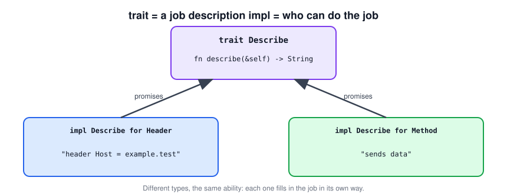
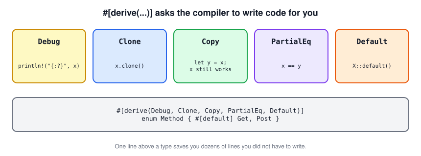

# Chapter 10: Traits: shared abilities

> **Brain Power**
> A header, a method and a whole request are three very different things. Yet you would like to do the *same* things with all of them: print them nicely, copy them, compare two of them with `==`. Is there a way to describe "can be printed nicely" as an *ability* that many different types can share?

There is. It is called a **trait**, and you have secretly been using traits since Chapter 6. Remember `#[derive(Debug)]`, and that rustc error that mentioned "the trait `Debug` is not implemented"? This chapter finally explains it.

## A trait is a job description

Think about the job description "can drive". It lists what you must be able to do (start, steer, stop), but not *how* you do each. Many people can fill the job, each in their own way.

A Rust **trait** is the job description, and an **`impl ... for ...`** block is a type saying "I can do that job, and here is how".



> **New word: trait**
> A named list of methods that a type can promise to provide. A trait describes an *ability*.

Here is our own trait, from scratch:

```rust
trait Describe {
    fn describe(&self) -> String;
}

struct Header {
    key: String,
    value: String,
}

enum Method {
    Get,
    Post,
}

impl Describe for Header {
    fn describe(&self) -> String {
        format!("header {} = {}", self.key, self.value)
    }
}

impl Describe for Method {
    fn describe(&self) -> String {
        match self {
            Method::Get => String::from("fetches data"),
            Method::Post => String::from("sends data"),
        }
    }
}

fn main() {
    let h = Header { key: String::from("Host"), value: String::from("api.example.test") };
    let m = Method::Post;
    println!("{}", h.describe());
    println!("{}", m.describe());
}
```

```output
header Host = api.example.test
sends data
```

* **`trait Describe { fn describe(&self) -> String; }`** defines the ability. Inside are method *signatures* with a `;` instead of a body: "whoever can do this job must provide this method".
* **`impl Describe for Header { ... }`** reads "`Header` can do the `Describe` job: here is how". The body fills in the method.
* **`impl Describe for Method { ... }`**: a completely different type does the same job in its own way.
* We call it as an ordinary method: `h.describe()`, `m.describe()`.

Notice what we wrote in Chapter 6: `impl Header { ... }`, with no trait. That was "methods that belong to `Header`". `impl Trait for Type` is "methods that make `Type` do the `Trait` job".

Traits are exactly how the standard library says "this type can be printed", "this type can be copied", and so on. Let's meet the most useful ones.

## Display: pretty printing

You have used `{:?}` ("debug style", for programmers) and `{}` (plain). Plain `{}` only works for types that provide the **`Display`** trait: numbers and text already do, your types don't. Predict what happens here:

```rust,fails
struct Header {
    key: String,
    value: String,
}

fn main() {
    let h = Header { key: String::from("Host"), value: String::from("api.example.test") };
    println!("{}", h);
}
```

<details><summary>Answer</summary>

```error
error[E0277]: `Header` doesn't implement `std::fmt::Display`
 --> src/main.rs:8:20
  |
8 |     println!("{}", h);
  |               --   ^ `Header` cannot be formatted with the default formatter
  |               |
  |               required by this formatting parameter
  |
help: the trait `std::fmt::Display` is not implemented for `Header`
 --> src/main.rs:1:1
  |
1 | struct Header {
  | ^^^^^^^^^^^^^
  = note: in format strings you may be able to use `{:?}` (or `{:#?}` for pretty-print) instead

error: aborting due to 1 previous error

For more information about this error, try `rustc --explain E0277`.
```

Exactly Chapter 6's `Debug` error, but for `Display`: **"`Header` doesn't implement `std::fmt::Display`"**. This time the compiler can't offer `derive` (its note only suggests the debug style `{:?}`), because only *you* know how a header should look as plain text. So you write it:

</details>

```rust
use std::fmt;

struct Header {
    key: String,
    value: String,
}

impl fmt::Display for Header {
    fn fmt(&self, f: &mut fmt::Formatter) -> fmt::Result {
        write!(f, "{}: {}", self.key, self.value)
    }
}

fn main() {
    let h = Header { key: String::from("Host"), value: String::from("api.example.test") };
    println!("{}", h);
    println!("{h}");
    let text = h.to_string();
    println!("{} characters", text.len());
}
```

```output
Host: api.example.test
Host: api.example.test
22 characters
```

The recipe is always the same:

* **`use std::fmt;`** brings the `fmt` toolbox onto the desk (like `use` in Chapter 9).
* **`impl fmt::Display for Header`**: "`Header` can do the Display job". The trait lives at `fmt::Display` (inside `fmt`).
* The required method is called **`fmt`**. It receives `&self` (the header, borrowed) and **`f: &mut fmt::Formatter`**: a *notepad* that Rust hands you (borrowed mutably, Chapter 5) to write the output onto.
* **`write!(f, "...", ...)`** is `println!`'s cousin that writes onto the notepad instead of the screen.
* The return type **`fmt::Result`** is a `Result` (Chapter 8): did the writing work? `write!(...)` already returns one, and since it is the last expression, we return it.

And as a bonus, **anything that has `Display` automatically gets a `.to_string()` method**. (That's why `.to_string()` has worked on text since Chapter 4.)

## Derive, explained

Now `#[derive(...)]` finally makes sense:

> **`#[derive(Debug)]`** says: "compiler, please write `impl Debug for ThisType` for me, the obvious way".

It's the compiler filling out the job description *for you*, for traits with an obvious recipe. Here are the ones you will use all the time:



### Clone: explicit duplicates

In Chapter 4 you called `.clone()` on a `String`. That is the **`Clone`** trait. Your own types can have it too, by deriving it. All the fields must be `Clone` too (they are: `String` is).

```rust
#[derive(Debug, Clone)]
struct Header {
    key: String,
    value: String,
}

fn main() {
    let original = Header { key: String::from("Host"), value: String::from("a.test") };
    let mut copy = original.clone();
    copy.value = String::from("b.test");
    println!("{:?}", original);
    println!("{:?}", copy);
}
```

```output
Header { key: "Host", value: "a.test" }
Header { key: "Host", value: "b.test" }
```

### PartialEq: comparing with `==`

How would Rust know when two `Method`s are "equal"? Only if you give it **`PartialEq`**:

```rust,fails
enum Method {
    Get,
    Post,
}

fn main() {
    let a = Method::Get;
    println!("{}", a == Method::Get);
}
```

```error
error[E0369]: binary operation `==` cannot be applied to type `Method`
 --> src/main.rs:8:22
  |
8 |     println!("{}", a == Method::Get);
  |                    - ^^ ----------- Method
  |                    |
  |                    Method
  |
note: an implementation of `PartialEq` might be missing for `Method`
 --> src/main.rs:1:1
  |
1 | enum Method {
  | ^^^^^^^^^^^ must implement `PartialEq`
help: consider annotating `Method` with `#[derive(PartialEq)]`
  |
1 + #[derive(PartialEq)]
2 | enum Method {
  |

error: aborting due to 1 previous error

For more information about this error, try `rustc --explain E0369`.
```

The compiler says **"binary operation `==` cannot be applied to type `Method`"**, and notes that `Method` doesn't implement `PartialEq` (a "binary operation" is an operator with two sides: `a == b`). Add `#[derive(PartialEq)]` and it works: two values are equal when they are the same variant, with equal contents. (`Partial` is mathematicians' caution about numbers like `NaN`; for us it just means "equal-able".)

### Copy: ending the moves

Chapter 4 told you numbers are `Copy` and `String` is not. Now we can say what `Copy` *is*: **a trait**. A type with `Copy` is duplicated automatically instead of moved. Predict: does this compile?

```rust,fails
#[derive(Debug)]
enum Method {
    Get,
    Post,
}

fn show(m: Method) {
    println!("{:?}", m);
}

fn main() {
    let m = Method::Post;
    show(m);
    show(m);
}
```

<details><summary>Answer</summary>

```error
error[E0382]: use of moved value: `m`
  --> src/main.rs:14:10
   |
12 |     let m = Method::Post;
   |         - move occurs because `m` has type `Method`, which does not implement the `Copy` trait
13 |     show(m);
   |          - value moved here
14 |     show(m);
   |          ^ value used here after move
   |
note: consider changing this parameter type in function `show` to borrow instead if owning the value isn't necessary
  --> src/main.rs:7:12
   |
 7 | fn show(m: Method) {
   |    ----    ^^^^^^ this parameter takes ownership of the value
   |    |
   |    in this function
note: if `Method` implemented `Clone`, you could clone the value
  --> src/main.rs:2:1
   |
 2 | enum Method {
   | ^^^^^^^^^^^ consider implementing `Clone` for this type
...
13 |     show(m);
   |          - you could clone this value

error: aborting due to 1 previous error

For more information about this error, try `rustc --explain E0382`.
```

It is Chapter 4 all over again: passing `m` to `show` **moves** it, so the second call finds `m` gone: **"use of moved value: `m`"**. The compiler suggests two cures: make `show` *borrow* (Chapter 5), or make `Method` cloneable. For a tiny plain enum there is a neater third cure: make it **`Copy`**.

</details>

```rust
#[derive(Debug, Clone, Copy, PartialEq)]
enum Method {
    Get,
    Post,
}

fn show(m: Method) {
    println!("{:?}", m);
}

fn main() {
    let m = Method::Post;
    show(m);
    show(m);
    println!("{}", m == Method::Post);
}
```

```output
Post
Post
true
```

(`Copy` requires `Clone` alongside, hence both in the list.) Types that own warehouse space, like `String` and `Vec`, can **never** be `Copy`. Small plain-data types can.

### Default: a blank form

**`Default`** gives a type a standard "blank" value, produced by `Type::default()`. Numbers default to `0`, `bool` to `false`, `String` to `""`, `Vec` to empty, `Option` to `None`. For your own types you can derive it, and for an enum you mark the default variant with `#[default]`:

```rust
#[derive(Debug, Default)]
enum Method {
    #[default]
    Get,
    Post,
}

#[derive(Debug, Default)]
struct Request {
    method: Method,
    path: String,
    retries: u32,
}

fn main() {
    let blank = Request::default();
    println!("{:?}", blank);

    let custom = Request { path: String::from("/users"), ..Default::default() };
    println!("{:?}", custom);
    println!("{:?}", Method::Post);
}
```

```output
Request { method: Get, path: "", retries: 0 }
Request { method: Get, path: "/users", retries: 0 }
Post
```

The last trick, **`..Default::default()`**, is called *struct update syntax*: "build a `Request` with this `path`, and take **all the other fields** from the defaults". It is wonderful for structs with many fields.

> **There are no Dumb Questions**
>
> **Q: Can I derive any trait?**
> A: Only traits that have a "derive recipe", and only when all the fields can do it too. You can't derive `Display`, because there's no obvious way to show a type as text.
>
> **Q: Do traits cost anything when the program runs?**
> A: No. The compiler works out which `impl` to call while compiling.
>
> **Q: Is a trait like an "interface" in Java or C#?**
> A: Very much. It is a set of promised methods. One difference: you can write `impl TheirTrait for YourType` and `impl YourTrait for TheirType`, but not their-trait-for-their-type.

## `From` and `Into`: conversions

Here is one more trait, and it is behind something you've typed a dozen times: **`String::from("text")`**. That is the **`From`** trait: "build me from this other thing". It comes with a free twin, **`.into()`**: if `X: From<Y>`, then `y.into()` produces an `X`.

You can give your own types a `From`:

```rust
#[derive(Debug)]
struct Header {
    key: String,
    value: String,
}

impl From<(&str, &str)> for Header {
    fn from(pair: (&str, &str)) -> Self {
        Header { key: pair.0.to_string(), value: pair.1.to_string() }
    }
}

fn main() {
    let a = Header::from(("Accept", "*/*"));
    let b: Header = ("Host", "a.test").into();
    println!("{:?}", a);
    println!("{:?}", b);
}
```

```output
Header { key: "Accept", value: "*/*" }
Header { key: "Host", value: "a.test" }
```

`impl From<(&str, &str)> for Header` reads: "a `Header` can be made *from* a pair of `&str`s". (`From<...>` has an "of" in angle brackets, as in Chapter 8: a `From` *of* a pair.) Because we also get `.into()` for free, `("Host", "a.test").into()` works, as long as the compiler can tell the target type: here the `: Header` on `b` says so.

In Chapter 16 you will see the star use of `From`: Rust's `?` operator uses it to turn one kind of error into another automatically.

## Drop: tidy up when you're gone

Chapter 4 said a value is **dropped** when its owner goes out of scope. Types can run code at that moment, by implementing the **`Drop`** trait:

```rust
struct Connection {
    name: String,
}

impl Drop for Connection {
    fn drop(&mut self) {
        println!("closing {}", self.name);
    }
}

fn main() {
    let _first = Connection { name: String::from("first") };
    {
        let _second = Connection { name: String::from("second") };
        println!("inside the block");
    }
    println!("end of main");
}
```

Before you look: in what order will the three lines appear? (Remember: scope ends at the closing `}`, and Chapter 4 said that is when the drop happens.)

<details><summary>Answer</summary>

```output
inside the block
closing second
end of main
closing first
```

`second` is dropped at the inner `}`, so "closing second" comes right after "inside the block". `first` lives to the end of `main`, so it closes last. (The leading `_` in `_first` tells Rust "I know I never use this variable".) No `free()` call anywhere: the compiler puts the drop in for you.

</details>

## Now look at real Nexus

**`#[derive(...)]` decoded.** Remember `BodyMode`, the enum Nexus uses for "what kind of body does this request have"? Its attribute line, in [`types/mod.rs`](../../crates/nexus-core/src/types/mod.rs), looks scary no more:

```rust,nexus
#[derive(Debug, Clone, Copy, PartialEq, Eq, Default, Serialize, Deserialize)]
```

`Debug` (print with `{:?}`), `Clone` (`.clone()`), `Copy` (no more moves), `PartialEq` (`==`), `Default` (a blank value: the variant marked `#[default]` below, which is `BodyMode::None`). `Eq` is `PartialEq`'s stricter sibling: ignore it. `Serialize` and `Deserialize` turn it into and out of JSON: that's Chapter 17.

**A hand-written `Default`.** Its neighbour `RequestBody` could not use `#[derive(Default)]`, so the authors wrote the `impl` by hand ([`types/mod.rs`](../../crates/nexus-core/src/types/mod.rs)):

```rust,nexus
impl Default for RequestBody {
    fn default() -> Self {
        Self {
            mode: BodyMode::None,
            raw: None,
            // ...
        }
    }
}
```

Read it with your new eyes: "`RequestBody` can do the `Default` job. The job's one method is `default`, which gives back a `Self` (a `RequestBody`) built with mode `None`, no raw text (`None` is an `Option`, Chapter 8), and so on."

**Drop, for real.** And here is Nexus using `Drop` the way you just did, in [`websocket/mod.rs`](../../crates/nexus-core/src/websocket/mod.rs):

```rust,nexus
impl Drop for WebSocketClient {
    /// Dropping the client closes the connection gracefully (and ends reconnecting).
    fn drop(&mut self) {
        self.disconnect(None, None);
    }
}
```

A `WebSocketClient` is a live network connection. When its owner goes out of scope (say, you close a tab), `drop` runs and shuts the connection politely. Nobody has to remember to do it. (The two `None`s mean "no special close code, no reason": `Option`s again.)

## Checkpoint project: request builder, version 9

The builder gets proper abilities: `Display` for printing, derives for copying and comparing, `Default` for blank requests, and `From` for quick headers:

<details><summary>The whole program so far</summary>

```rust
use std::collections::HashMap;
use std::fmt;

#[derive(Debug, Clone, Copy, PartialEq, Default)]
enum Method {
    #[default]
    Get,
    Post,
}

impl fmt::Display for Method {
    fn fmt(&self, f: &mut fmt::Formatter) -> fmt::Result {
        let text = match self {
            Method::Get => "GET",
            Method::Post => "POST",
        };
        write!(f, "{text}")
    }
}

#[derive(Debug, Clone, PartialEq)]
struct Header {
    key: String,
    value: String,
    enabled: bool,
}

impl Header {
    fn new(key: &str, value: &str) -> Self {
        Self { key: key.to_string(), value: value.to_string(), enabled: true }
    }
}

impl From<(&str, &str)> for Header {
    fn from(pair: (&str, &str)) -> Self {
        Header::new(pair.0, pair.1)
    }
}

impl fmt::Display for Header {
    fn fmt(&self, f: &mut fmt::Formatter) -> fmt::Result {
        write!(f, "{}: {}", self.key, self.value)
    }
}

#[derive(Debug, Clone, Default)]
struct Request {
    method: Method,
    path: String,
    headers: Vec<Header>,
}

impl fmt::Display for Request {
    fn fmt(&self, f: &mut fmt::Formatter) -> fmt::Result {
        write!(f, "{} {} HTTP/1.1", self.method, self.path)?;
        for header in &self.headers {
            if header.enabled {
                write!(f, "\n{header}")?;
            }
        }
        Ok(())
    }
}

fn resolve(template: &str, variables: &HashMap<String, String>) -> String {
    let mut result = template.to_string();
    for (name, value) in variables {
        let mut placeholder = String::from("{{");
        placeholder.push_str(name);
        placeholder.push_str("}}");
        result = result.replace(&placeholder, value);
    }
    result
}

impl Request {
    fn add_header(&mut self, header: Header) {
        self.headers.push(header);
    }

    fn to_text(&self, variables: &HashMap<String, String>) -> String {
        resolve(&self.to_string(), variables)
    }
}

fn main() {
    let mut variables = HashMap::new();
    variables.insert(String::from("host"), String::from("api.example.test"));
    variables.insert(String::from("version"), String::from("v2"));

    let mut request = Request::default();
    request.path = String::from("/{{version}}/users");
    request.add_header(("Host", "{{host}}").into());
    request.add_header(Header::from(("Accept", "application/json")));

    println!("{request}");
    println!("---");
    println!("{}", request.to_text(&variables));

    let backup = request.clone();
    println!("same headers? {}", backup.headers == request.headers);
    println!("{:?}", Method::Post);
}
```

```output
GET /{{version}}/users HTTP/1.1
Host: {{host}}
Accept: application/json
---
GET /v2/users HTTP/1.1
Host: api.example.test
Accept: application/json
same headers? true
Post
```

</details>

Look how much *shorter* the logic got. `to_text` is now one line: it prints the request with `Display` (via `.to_string()`) and then fills in the variables. The first `println!("{request}")` shows the raw template; the second shows it filled in.

> **Sharpen your pencil**
> Make `Request` print a *blank line followed by a body* when it has one. First decide which of the abilities from this chapter you would need to touch. Hint: the printing ability is the one in `impl fmt::Display for Request`.
>
> <details><summary>Answer</summary>
>
> Add a field (say `body: String`; `Default` and `Clone` keep working automatically because `String` has them) and extend the `fmt` method with `if !self.body.is_empty() { write!(f, "\n\n{}", self.body)?; }`. Nothing else changes. The `derive`d abilities rewrite themselves when a field is added, which is the entire point of `derive`.
> </details>

## Bullet Points

* A **trait** is a named list of methods: an *ability*. `impl Trait for Type { ... }` says "this type has the ability, here's how".
* **`Display`** (`{}`): you write it by hand with `write!(f, ...)`; you then get `.to_string()` free.
* **`#[derive(Debug, Clone, Copy, PartialEq, Default)]`** makes the compiler write those traits for you. `Debug` prints, `Clone` duplicates, `Copy` duplicates automatically (plain-data types only), `PartialEq` allows `==`, `Default` gives a blank value (`#[default]` marks an enum's).
* **`From`** (and its twin `.into()`) convert one type to another. `String::from("x")` is `From`.
* **`Drop`** lets a type run code when its owner's scope ends.
* `..Default::default()` fills the remaining struct fields with defaults.

## Cheat sheet

```text
trait T { fn f(&self) -> String; }        define an ability
impl T for MyType { fn f(&self) -> .. }   my type can do it
impl fmt::Display for X {
    fn fmt(&self, f: &mut fmt::Formatter) -> fmt::Result { write!(f, "..") }
}
#[derive(Debug, Clone, Copy, PartialEq, Default)]
{:?} debug   {} display   x.clone()   a == b   X::default()
impl From<A> for B { fn from(a: A) -> Self { .. } }     a.into()
impl Drop for X { fn drop(&mut self) { .. } }            runs at end of scope
```
