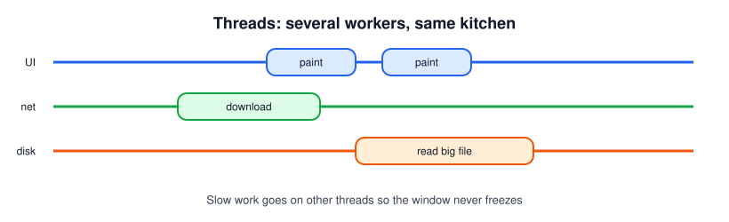
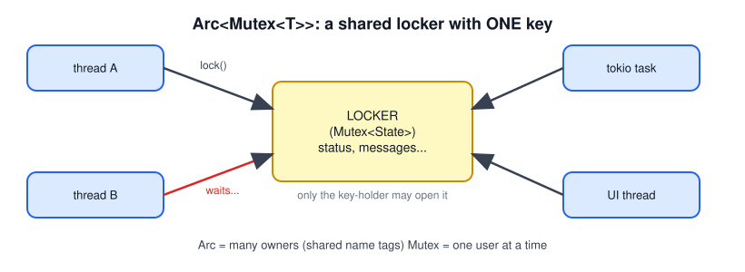
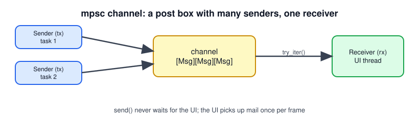

# Chapter 11: Concurrency: threads, `Arc`/`Mutex`, channels

> **Brain Power**
> Your Nexus window redraws about 60 times per second. A server takes 3 seconds to answer. If the code that waits for the server runs on the *same* thread that redraws the window, what does the user see for those 3 seconds? How would you fix it?

## Threads: several workers

A **thread** is an independent line of execution inside your program. The operating system runs many at once (truly in parallel on multi-core CPUs).



```rust
use std::thread;
use std::time::Duration;

fn main() {
    let worker = thread::spawn(|| {
        for i in 1..=3 {
            println!("worker step {i}");
            thread::sleep(Duration::from_millis(50));
        }
        "worker result"
    });

    println!("main keeps going...");
    let result = worker.join().unwrap(); // wait for the worker, get its return value
    println!("{result}");
}
```

* `thread::spawn(closure)` starts a thread and returns a `JoinHandle`.
* `.join()` waits for it and gives back what the closure returned.
* The output order of "worker" vs "main" lines may vary run to run. That unpredictability is the heart of concurrency problems.

### Threads must own their data

```rust,fails
use std::thread;

fn main() {
    let name = String::from("nexus");
    let h = thread::spawn(|| {
        println!("{name}");   // error: closure may outlive the current function
    });
    h.join().unwrap();
}
```

The new thread could keep running after `main` has dropped `name`. The fix is the `move` closure from Chapter 9. The thread *takes ownership*:

```rust
use std::thread;

fn main() {
    let name = String::from("nexus");
    let h = thread::spawn(move || {
        println!("{name}");
    });
    h.join().unwrap();
}
```

Notice how ownership (Chapter 6) quietly made this safe: after the `move`, `main` can't touch `name`, so no two threads can fight over it.

## Sharing: `Arc<Mutex<T>>`

What if several threads must really share and change the same data? Two ingredients:

* **`Arc<T>`** (Chapter 6): shared *ownership*. Many name tags on one value.
* **`Mutex<T>`** ("mutual exclusion"): a **lock**. Only one thread at a time may open the data.



```rust
use std::sync::{Arc, Mutex};
use std::thread;

fn main() {
    let counter = Arc::new(Mutex::new(0));
    let mut handles = Vec::new();

    for _ in 0..4 {
        let counter = Arc::clone(&counter);   // a new name tag for this thread
        handles.push(thread::spawn(move || {
            for _ in 0..1000 {
                let mut n = counter.lock().unwrap(); // take the key
                *n += 1;
            }                                         // key returned when `n` is dropped
        }));
    }

    for h in handles {
        h.join().unwrap();
    }
    println!("total = {}", *counter.lock().unwrap()); // always 4000
}
```

`lock()` waits until the key is free and returns a **guard**. While the guard lives, you hold the lock. When it is dropped (end of scope, thanks to ownership!) the lock is released automatically. You cannot forget to unlock.

> **Watch it!**
> Hold a lock for as *short* a time as possible, and **never call unknown code while holding it** (like a callback). You could deadlock: two threads each waiting forever for a key the other holds.

### Real Nexus: the WebSocket client

[`websocket/mod.rs`](../../crates/nexus-core/src/websocket/mod.rs) has exactly this pattern:

```rust
struct State {
    status: WsConnectionStatus,
    messages: Vec<WsMessage>,
    options: Option<WsConnectOptions>,
    cmd: Option<mpsc::UnboundedSender<Cmd>>,
    task: Option<JoinHandle<()>>,
}

struct Shared {
    state: Mutex<State>,
    sink: Box<dyn Fn(WsEvent) + Send + Sync>,
}

impl Shared {
    fn lock(&self) -> MutexGuard<'_, State> {
        self.state.lock().unwrap_or_else(|e| e.into_inner())
    }
    // ...
}

pub struct WebSocketClient {
    shared: Arc<Shared>,
}
```

The connection state (status, message log...) is shared between the UI side (which calls `send`, `disconnect`) and a background task (which receives frames). So `Arc<Shared>` is cloned into the task, and the `State` inside is behind a `Mutex`.

Two details worth admiring:

1. **Poison tolerance.** If a thread panics while holding a lock, the mutex becomes *poisoned* and later `.lock()` returns an `Err`. Nexus does `.unwrap_or_else(|e| e.into_inner())`: "if poisoned, take the data anyway", so one crashed task doesn't take down the app.
2. **Small lock scopes.** Look at `send_frame` in the same file:

```rust
fn send_frame(&self, frame: Message, msg: WsMessage) -> Result<WsMessage> {
    let not_connected = || Error::Other("WebSocket is not connected".into());
    {
        let st = self.shared.lock();
        if st.status != WsConnectionStatus::Open {
            return Err(not_connected());
        }
        st.cmd
            .as_ref()
            .ok_or_else(not_connected)?
            .send(Cmd::Send(frame))
            .map_err(|_| not_connected())?;
    }
    self.shared.add_message(msg.clone());
    Ok(msg)
}
```

The extra `{ ... }` block is deliberate: the guard `st` is dropped at its closing brace, so the lock is released *before* `add_message` takes it again (which would otherwise deadlock on a non-reentrant lock). Scopes are tools!

The same trick appears in `disconnect`, which copies what it needs out of the locked state `(live, st.cmd.clone())` and only *then* talks to the channel.

The engine's top-level [`App`](../../crates/nexus-core/src/service/mod.rs) holds all open WebSockets in `ws: Mutex<HashMap<String, WebSocketClient>>`, a map from connection id to client, guarded by one lock.

## `Send` and `Sync`: the compiler's thread-safety stickers

Two marker traits (no methods) the compiler adds automatically:

* **`Send`**: "a value of this type may be *moved* to another thread."
* **`Sync`**: "a `&T` of this type may be *shared* between threads."

`Arc<Mutex<T>>` has both (when `T: Send`). `Rc<T>` has neither. It uses faster non-atomic counting. If you try to send an `Rc` to a thread, the compiler says no:

```rust,fails
use std::rc::Rc;
use std::thread;

fn main() {
    let a = Rc::new(5);
    let h = thread::spawn(move || println!("{a}")); // error: `Rc<i32>` cannot be sent between threads safely
    h.join().unwrap();
}
```

This is what people mean by **fearless concurrency**: data races are compile errors, not midnight debugging sessions. You've been seeing `+ Send + Sync + 'static` in Nexus's callback signatures; it's the promise "safe to hand to another thread".

Nexus even contrasts the two: inside the JavaScript bridge, which only ever runs on *one* thread, it uses `Rc<RefCell<HostState>>` (single-threaded shared mutability); wherever threads are involved, it uses `Arc<Mutex<..>>`.

## Atomics: a lock for a single value

For one simple flag or counter, a full `Mutex` is overkill. **Atomics** (`AtomicBool`, `AtomicU64`...) are values the CPU can change in one indivisible step. Nexus's runner cancel switch ([`runner/mod.rs`](../../crates/nexus-core/src/runner/mod.rs)):

```rust
#[derive(Debug, Clone, Default)]
pub struct CancelToken {
    flag: Arc<AtomicBool>,
    notify: Arc<Notify>,
}

impl CancelToken {
    pub fn cancel(&self) {
        self.flag.store(true, Ordering::SeqCst);
        self.notify.notify_waiters();
    }

    pub fn is_cancelled(&self) -> bool {
        self.flag.load(Ordering::SeqCst)
    }
    // ...
}
```

The UI's "Stop" button calls `cancel()`; the running collection checks `is_cancelled()` between requests. The `Arc`s mean every clone of the token controls the *same* flag. `Ordering::SeqCst` is the strictest (simplest to reason about) memory-ordering setting; use it unless you have a reason not to. `Notify` additionally *wakes* anyone waiting asynchronously (Chapter 12).

A standalone version:

```rust
use std::sync::atomic::{AtomicBool, Ordering};
use std::sync::Arc;
use std::thread;
use std::time::Duration;

fn main() {
    let stop = Arc::new(AtomicBool::new(false));

    let flag = Arc::clone(&stop);
    let worker = thread::spawn(move || {
        let mut ticks = 0;
        while !flag.load(Ordering::SeqCst) {
            ticks += 1;
            thread::sleep(Duration::from_millis(10));
        }
        ticks
    });

    thread::sleep(Duration::from_millis(55));
    stop.store(true, Ordering::SeqCst);
    println!("worker stopped after some ticks: {}", worker.join().unwrap() > 0);
}
```

## Channels: passing messages

"Don't communicate by sharing memory; share memory by communicating." A **channel** is a pipe: one side **sends** values, the other **receives** them. Ownership of each value moves through the pipe, so no locks are needed.



`mpsc` = **m**ultiple **p**roducer, **s**ingle **c**onsumer: many senders, one receiver.

```rust
use std::sync::mpsc;
use std::thread;

fn main() {
    let (tx, rx) = mpsc::channel();

    for id in 1..=3 {
        let tx = tx.clone();          // each producer gets its own sender
        thread::spawn(move || {
            tx.send(format!("hello from worker {id}")).unwrap();
        });
    }
    drop(tx);                         // drop the original, or the loop below never ends

    let mut msgs: Vec<String> = rx.iter().collect(); // blocks until all senders are gone
    msgs.sort();
    for m in msgs {
        println!("{m}");
    }
}
```

`rx.recv()` blocks until a message arrives. `rx.try_recv()` and `rx.try_iter()` **don't** block; they return whatever is waiting right now. That is exactly what a GUI wants. Here is the heart of the Nexus UI bridge, [`runtime.rs`](../../crates/nexus-gui/src/runtime.rs):

```rust
pub struct Runtime {
    rt: tokio::runtime::Runtime,
    tx: Sender<Msg>,
    rx: Receiver<Msg>,
    ctx: Option<eframe::egui::Context>,
}

// ...
pub fn drain(&self) -> Vec<Msg> {
    self.rx.try_iter().collect()
}
```

Once per frame the UI calls `drain()`: "give me every message that has arrived, and don't wait". That is the *polling* end of the pipe. Background tasks hold clones of `tx` and call `tx.send(msg)`. Chapter 12 shows the other half.

And `Notifier`, a handle for non-async threads (the WebSocket event callback uses it):

```rust
#[derive(Clone)]
pub struct Notifier {
    tx: Sender<Msg>,
    ctx: Option<eframe::egui::Context>,
}

impl Notifier {
    pub fn send(&self, msg: Msg) {
        let _ = self.tx.send(msg);
        if let Some(ctx) = &self.ctx {
            ctx.request_repaint();
        }
    }
}
```

It sends the message *and* pokes the window: "something new is in the post box, redraw!" The `let _ =` deliberately ignores the `Result` from `send` (it only fails if the UI is already gone). Cloning the `Notifier` is cheap, so each event source gets its own.

The WebSocket client uses a *different* channel type for the opposite direction: [`websocket/mod.rs`](../../crates/nexus-core/src/websocket/mod.rs) has `mpsc::unbounded_channel` (tokio's async version) to send **commands** (`Send`, `Close`) *into* the background task. Messages flow in both directions, each through its own pipe.

> **Sharpen your pencil**
> 1. Four threads each add 1 to a shared counter 500 times. Which type do you need for the counter? Fill in: `let counter = ______::new(______::new(0));`
> 2. What goes wrong if you forget `drop(tx)` in the channel example above?
> 3. For each, pick **Mutex**, **atomic** or **channel**: (a) a "stop" flag; (b) a growing log many threads append to; (c) worker threads delivering finished results to a main loop.
>
> *(Answers at the end of the chapter.)*

> **There are no Dumb Questions**
>
> **Q: Is a `Mutex` the same as in Java/C++?**
> A: Similar idea, one big difference: in Rust the mutex **wraps the data**. You cannot reach the data without locking. In C++ you can forget to lock; here the type system won't let you.
>
> **Q: `std::sync::Mutex` or `tokio::sync::Mutex`?**
> A: Use the std one for short critical sections with no `.await` inside. Use tokio's when you must hold the lock *across* an `.await`. Nexus's MCP client keeps its connection map behind a `tokio::sync::Mutex`.
>
> **Q: When is a deadlock possible in Rust?**
> A: Rust prevents data races, not deadlocks. Locking in inconsistent orders, or locking again while holding the lock, will still hang.
>
> **Q: Why not just use threads for everything?**
> A: Each OS thread costs memory and scheduling. Waiting on 1,000 network connections with 1,000 threads is wasteful, which is the motivation for async (next chapter).

## Bullet Points

* `thread::spawn` runs a closure on a new thread; `join` waits for it. Use `move`.
* `Arc<Mutex<T>>`: shared ownership (`Arc`) plus exclusive access (`Mutex`). The guard unlocks on drop.
* Keep lock scopes small, with an inner `{ }` block to release early.
* `Send` / `Sync` are compile-time proof that a type is thread-safe; `Rc` is not.
* Atomics are lock-free single values (flags, counters).
* `mpsc` channels move values between threads. `try_iter()` lets a UI poll without blocking.
* Nexus: `Arc<Mutex<State>>` in WebSockets, `AtomicBool` cancel token, `mpsc` channel from tasks to the UI.

## Cheat sheet

```
thread::spawn(move || ..)  h.join()       Arc::new(Mutex::new(x))  Arc::clone(&a)
let g = m.lock().unwrap(); *g += 1;       guard unlocks at end of scope
AtomicBool::new(false)  .store(true, Ordering::SeqCst)  .load(..)
let (tx, rx) = mpsc::channel();  tx.send(v)  rx.recv()  rx.try_iter()
F: Send + 'static                        what spawned work must satisfy (Sync only if shared by &)
```

## Answers

1. `Arc::new(Mutex::new(0))`: `Arc` for sharing across threads, `Mutex` for exclusive writes.
2. The original `tx` stays alive in `main`, so the receiver thinks more messages might come and `rx.iter()` blocks forever.
3. (a) **atomic** (one bool); (b) **Mutex** (needs exclusive access to a `Vec`); (c) **channel**.
