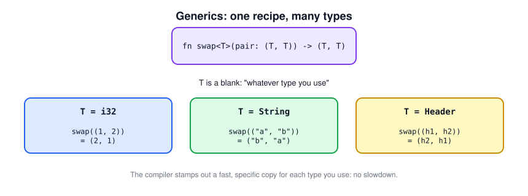

# Chapter 11: Generics: one recipe, many types

> **Brain Power**
> You wrote a function that swaps the two halves of a pair of numbers. Tomorrow you need the same for a pair of texts, and the day after for a pair of headers. The logic is identical; only the *type* changes. Would you copy-paste the function three times? What would you wish to write instead?

You'd wish to write the recipe **once**, leaving the type as a blank to fill in later. Rust calls this **generics**.

## The copy-paste problem

Here are two functions that do the same thing for different types:

```rust
fn swap_numbers(pair: (i32, i32)) -> (i32, i32) {
    (pair.1, pair.0)
}

fn swap_texts(pair: (String, String)) -> (String, String) {
    (pair.1, pair.0)
}

fn main() {
    println!("{:?}", swap_numbers((1, 2)));
    println!("{:?}", swap_texts((String::from("a"), String::from("b"))));
}
```

```output
(2, 1)
("b", "a")
```

The bodies are identical. Only the types differ. Now the generic version:



```rust
fn swap<T>(pair: (T, T)) -> (T, T) {
    (pair.1, pair.0)
}

fn main() {
    println!("{:?}", swap((1, 2)));
    println!("{:?}", swap((String::from("a"), String::from("b"))));
    println!("{:?}", swap((true, false)));
}
```

```output
(2, 1)
("b", "a")
(false, true)
```

* **`swap<T>`**: the `<T>` right after the function name *declares a blank*. `T` is a **type parameter**: "some type, to be decided by whoever calls me". (`T` is just a conventional name, short for "Type". Any capital letter or word works.)
* **`(pair: (T, T)) -> (T, T)`**: wherever the blank appears, it stands for the *same* type. A pair of two `T`s goes in, a pair of two `T`s comes out.
* When you call `swap((1, 2))`, Rust sees whole numbers and fills in `T = i32`. For `swap((true, false))` it fills in `T = bool`. You never write the type yourself.

> **New word: generic**
> Code written with a **type parameter** (a blank like `T`) instead of a specific type, so one definition works for many types.

And now something you've been wondering about since Chapter 8. **`Option<T>`**, **`Vec<T>`**, **`Result<T, E>`**, **`HashMap<K, V>`**: those `<...>` bits are exactly this. `Option<T>` is "a gift box that can hold *some* type `T`". When you write `Option<u16>`, you fill in the blank with `u16`.

## Two blanks

You can declare more than one:

```rust
fn swap<A, B>(pair: (A, B)) -> (B, A) {
    (pair.1, pair.0)
}

fn main() {
    println!("{:?}", swap(("GET", 200)));
}
```

```output
(200, "GET")
```

`A` and `B` may be different types, so `("GET", 200)` becomes `(200, "GET")`.

## Generic structs and enums

The blank can appear in a type too:

```rust
#[derive(Debug)]
struct Pair<T> {
    first: T,
    second: T,
}

impl<T> Pair<T> {
    fn new(first: T, second: T) -> Self {
        Pair { first, second }
    }

    fn swap(self) -> Pair<T> {
        Pair { first: self.second, second: self.first }
    }
}

fn main() {
    let numbers = Pair::new(1, 2);
    let words = Pair::new("left", "right");
    println!("{:?}", numbers.swap());
    println!("{:?}", words);
}
```

```output
Pair { first: 2, second: 1 }
Pair { first: "left", second: "right" }
```

Notice **`impl<T> Pair<T>`**: the `<T>` after `impl` says "I'm declaring a blank `T` for this whole block", and `Pair<T>` says "this is the impl for a `Pair` *of* `T`". It looks repetitive the first time, but it makes sense: you are declaring `T` once and then using it.

Here is the payoff for the whole book so far. You can now write **`Option`** yourself, in four lines:

```rust
#[derive(Debug)]
enum Maybe<T> {
    Nothing,
    Just(T),
}

fn main() {
    let a: Maybe<u16> = Maybe::Just(8080);
    let b: Maybe<u16> = Maybe::Nothing;
    println!("{:?} {:?}", a, b);

    match a {
        Maybe::Just(port) => println!("port {port}"),
        Maybe::Nothing => println!("no port"),
    }
}
```

```output
Just(8080) Nothing
port 8080
```

`Option<T>` is not magic. It is *exactly* this, with the names `Some` and `None`.

## When "any type" is too much: trait bounds

A blank that accepts *any* type can't do much with its values: it doesn't know what the type can do. Suppose we want the largest item of a list. That needs comparing with `>`. Predict what happens:

```rust,fails
fn largest<T>(items: &[T]) -> &T {
    let mut best = &items[0];
    for item in items {
        if item > best {
            best = item;
        }
    }
    best
}

fn main() {
    println!("{}", largest(&[3, 9, 4]));
}
```

<details><summary>Answer</summary>

```error
error[E0369]: binary operation `>` cannot be applied to type `&T`
 --> src/main.rs:4:17
  |
4 |         if item > best {
  |            ---- ^ ---- &T
  |            |
  |            &T
  |
help: consider restricting type parameter `T` with trait `PartialOrd`
  |
1 | fn largest<T: std::cmp::PartialOrd>(items: &[T]) -> &T {
  |             ++++++++++++++++++++++

error: aborting due to 1 previous error

For more information about this error, try `rustc --explain E0369`.
```

**"binary operation `>` cannot be applied to type `&T`"**. A `T` could be *anything*, including types that can't be compared, so the compiler refuses. The help says it all: **"consider restricting type parameter `T` with trait `PartialOrd`"**.

</details>

This is what Chapter 10's traits are for. You tell the compiler: "`T` can be any type **that has this ability**". That is a **trait bound**, written after a colon:

```rust
fn largest<T: PartialOrd>(items: &[T]) -> &T {
    let mut best = &items[0];
    for item in items {
        if item > best {
            best = item;
        }
    }
    best
}

fn main() {
    println!("{}", largest(&[3, 9, 4]));
    println!("{}", largest(&[2.5, 0.5]));
    println!("{}", largest(&["pear", "apple", "zebra"]));
}
```

```output
9
2.5
zebra
```

**`T: PartialOrd`** reads "T, *which can be compared with `<` and `>`*". `PartialOrd` is the standard comparison trait (`PartialEq`'s cousin from Chapter 10). Numbers and text have it, so all three calls work. A type that doesn't (say, your own `Header` struct without the derive) would be rejected at the call, with a clear message.

Ask for several abilities with a `+`: `T: PartialOrd + Clone`. When the list gets long, tidy it into a **`where`** clause, which means exactly the same thing:

```rust
use std::fmt::Display;

fn show_both<T, U>(a: T, b: U) -> String
where
    T: Display,
    U: Display,
{
    format!("{a} and {b}")
}

fn main() {
    println!("{}", show_both("GET", 200));
}
```

```output
GET and 200
```

### `impl Trait`: the shorthand

For function *parameters*, there's a friendlier spelling. Instead of `<T: Display>` and then `T`, write **`impl Display`** right where the type goes:

```rust
use std::fmt::Display;

fn show_all(title: &str, items: &[impl Display]) {
    println!("{title}:");
    for item in items {
        println!("  - {item}");
    }
}

fn main() {
    show_all("codes", &[200, 404, 500]);
    show_all("methods", &["GET", "POST"]);
}
```

```output
codes:
  - 200
  - 404
  - 500
methods:
  - GET
  - POST
```

`items: &[impl Display]` means "a borrowed list of *some* type that can be shown with `{}`". It is the same as the longer generic form, just easier to read. This is the form you will see most in real code, including Nexus.

Here is where your Chapter 10 trait pays off. A function can accept **anything that can do a job**, whatever its type:

```rust
trait Describe {
    fn describe(&self) -> String;
}

struct Header {
    key: String,
}

enum Method {
    Get,
}

impl Describe for Header {
    fn describe(&self) -> String {
        format!("header {}", self.key)
    }
}

impl Describe for Method {
    fn describe(&self) -> String {
        String::from("a method")
    }
}

fn announce(thing: &impl Describe) {
    println!("Look: {}", thing.describe());
}

fn main() {
    announce(&Header { key: String::from("Host") });
    announce(&Method::Get);
}
```

```output
Look: header Host
Look: a method
```

`announce` has no idea whether it holds a header or a method. It only knows it can call `.describe()`.

> **There are no Dumb Questions**
>
> **Q: Does generic code run slower?**
> A: No. While compiling, Rust makes a separate, fully specialised copy of the function for every type you use it with (`swap` for numbers, `swap` for texts, ...). This is called *monomorphization*, and it means generics are "zero-cost". The only price is a slightly bigger program.
>
> **Q: Why is `T` always a capital letter?**
> A: Convention. `T` for "type", `E` for "error", `K` and `V` for "key" and "value". Longer names are fine too.
>
> **Q: Is there a way to hold a *mixed* list of different types, like a list of describable things?**
> A: Yes, with something called a trait object (`Box<dyn Describe>`). Generics decide the type while compiling; trait objects decide while running. Nexus uses them for stored callbacks; we peek at those in Chapter 13. Start with generics: they're simpler and faster.

> **Sharpen your pencil**
> Write a generic function `first_or<T: Clone>(items: &[T], fallback: T) -> T` that returns a clone of the first item, or `fallback` if the list is empty. Call it with a list of numbers and with an *empty* list of texts. (Hint: `items.get(0)` gives an `Option<&T>`.)
>
> <details><summary>Answer</summary>
>
> ```rust
> fn first_or<T: Clone>(items: &[T], fallback: T) -> T {
>     match items.get(0) {
>         Some(item) => item.clone(),
>         None => fallback,
>     }
> }
>
> fn main() {
>     println!("{}", first_or(&[7, 8, 9], 0));
>     let empty: Vec<String> = Vec::new();
>     println!("{}", first_or(&empty, String::from("default")));
> }
> ```
>
> ```output
7
default
> ```
> `item.clone()` needs `T: Clone` (Chapter 10). Without the bound, the compiler would refuse: it can't promise that `T` can be cloned.
> </details>

## Now look at real Nexus

Nexus often wants to say "any text-like thing": a quoted `&str`, a `String`... whichever the caller has. This is the whole function, from [`mcp/mod.rs`](../../crates/nexus-core/src/mcp/mod.rs):

```rust,nexus
fn err(msg: impl Into<String>) -> Error {
    Error::Other(msg.into())
}
```

Decode it with this chapter and the last:

* **`msg: impl Into<String>`**: "`msg` can be *any type that can be turned into a `String`*." Chapter 10's `.into()` is the twin of `From`; and both `&str` and `String` can become a `String`. So `err("timed out")` and `err(format!("{what} failed"))` both work.
* **`-> Error`**: it returns Nexus's own error type, `Error`. (Chapter 16 shows it in full. For now: it's an enum, and `Other` is a variant that carries a `String`, just like your `Body::Text(String)` in Chapter 7.)
* **`msg.into()`**: do the conversion, giving a `String`.

A caller never needs to write `.to_string()` first. One tiny generic made every call site shorter.

## Checkpoint project: request builder, version 10

Let's give the builder a function that prints *any list of displayable things*, such as headers or methods. It reuses the `Display` impls you wrote in Chapter 10:

```rust,frag
fn print_list(title: &str, items: &[impl fmt::Display]) {
    println!("{title}:");
    for item in items {
        println!("  {item}");
    }
}
```

And in `main`, call it with two different types:

```rust,frag
print_list("Headers", &request.headers);
print_list("Methods", &[Method::Get, Method::Post]);
```

<details><summary>The whole program so far</summary>

```rust
use std::collections::HashMap;
use std::fmt;

#[derive(Debug, Clone, Copy, PartialEq, Default)]
enum Method {
    #[default]
    Get,
    Post,
}

impl fmt::Display for Method {
    fn fmt(&self, f: &mut fmt::Formatter) -> fmt::Result {
        let text = match self {
            Method::Get => "GET",
            Method::Post => "POST",
        };
        write!(f, "{text}")
    }
}

#[derive(Debug, Clone, PartialEq)]
struct Header {
    key: String,
    value: String,
    enabled: bool,
}

impl Header {
    fn new(key: &str, value: &str) -> Self {
        Self { key: key.to_string(), value: value.to_string(), enabled: true }
    }
}

impl From<(&str, &str)> for Header {
    fn from(pair: (&str, &str)) -> Self {
        Header::new(pair.0, pair.1)
    }
}

impl fmt::Display for Header {
    fn fmt(&self, f: &mut fmt::Formatter) -> fmt::Result {
        write!(f, "{}: {}", self.key, self.value)
    }
}

#[derive(Debug, Clone, Default)]
struct Request {
    method: Method,
    path: String,
    headers: Vec<Header>,
}

impl fmt::Display for Request {
    fn fmt(&self, f: &mut fmt::Formatter) -> fmt::Result {
        write!(f, "{} {} HTTP/1.1", self.method, self.path)?;
        for header in &self.headers {
            if header.enabled {
                write!(f, "\n{header}")?;
            }
        }
        Ok(())
    }
}

fn resolve(template: &str, variables: &HashMap<String, String>) -> String {
    let mut result = template.to_string();
    for (name, value) in variables {
        let mut placeholder = String::from("{{");
        placeholder.push_str(name);
        placeholder.push_str("}}");
        result = result.replace(&placeholder, value);
    }
    result
}

impl Request {
    fn add_header(&mut self, header: Header) {
        self.headers.push(header);
    }

    fn to_text(&self, variables: &HashMap<String, String>) -> String {
        resolve(&self.to_string(), variables)
    }
}

fn print_list(title: &str, items: &[impl fmt::Display]) {
    println!("{title}:");
    for item in items {
        println!("  {item}");
    }
}

fn main() {
    let mut variables = HashMap::new();
    variables.insert(String::from("host"), String::from("api.example.test"));

    let mut request = Request::default();
    request.path = String::from("/users");
    request.add_header(("Host", "{{host}}").into());
    request.add_header(Header::from(("Accept", "application/json")));

    println!("{}", request.to_text(&variables));
    print_list("Headers", &request.headers);
    print_list("Methods", &[Method::Get, Method::Post]);
}
```

```output
GET /users HTTP/1.1
Host: api.example.test
Accept: application/json
Headers:
  Host: {{host}}
  Accept: application/json
Methods:
  GET
  POST
```

</details>

The same `print_list` printed a list of `Header`s and a list of `Method`s: one recipe, two types.

## Bullet Points

* **Generics** write code once for many types: `fn swap<T>(pair: (T, T)) -> (T, T)`. `<T>` declares a blank; Rust fills it in from how you call the function.
* `Option<T>`, `Vec<T>`, `Result<T, E>`, `HashMap<K, V>` are generic types. You can define your own: `struct Pair<T> { .. }`, `enum Maybe<T> { .. }`, `impl<T> Pair<T> { .. }`.
* A **trait bound** limits the blank to types with an ability: `<T: PartialOrd>`, `T: Display + Clone`. A `where` clause says the same thing more tidily.
* **`impl Trait`** in a parameter is a friendly shorthand: `items: &[impl Display]`.
* Generic code is as fast as hand-written code (the compiler writes a copy for every type used).

## Cheat sheet

```text
fn f<T>(x: T) -> T { x }                  any type
fn g<T: Display + Clone>(x: &T) { .. }    only types with these abilities
fn g<T>(x: &T) where T: Display { .. }    the same, tidier
fn h(x: &impl Display) { .. }             shorthand for a parameter
struct S<T> { a: T }     impl<T> S<T> { .. }
enum Maybe<T> { Nothing, Just(T) }        how Option is built
```
