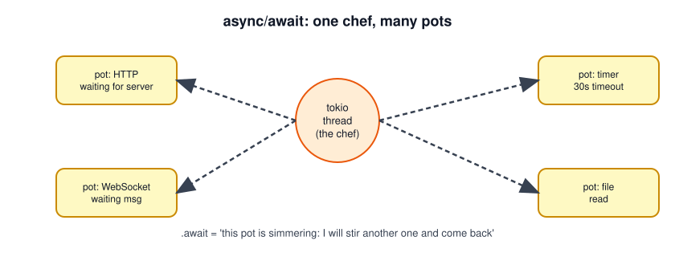
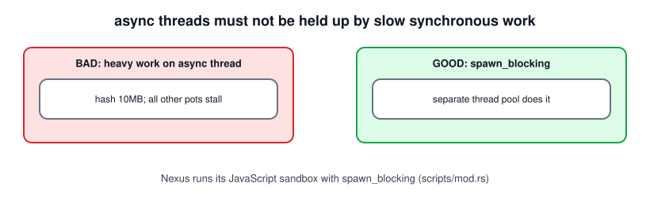
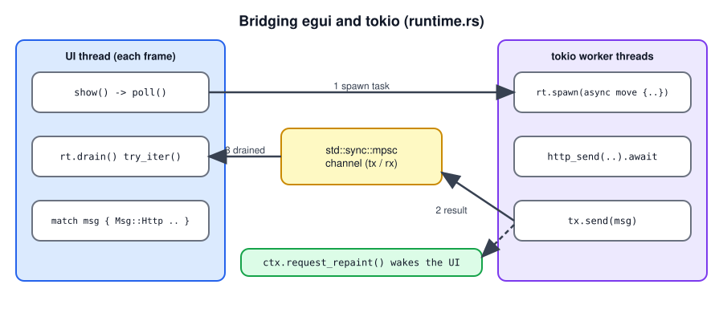

# Chapter 12: Async/await, tokio, and talking to the egui UI

> **Brain Power**
> A restaurant has one chef and 50 tables. A bad chef boils water, stands staring at the pot until it boils, and *only then* starts the next order. A good chef starts the water, chops onions while it heats, and checks back when it bubbles. Which style would a server handling 1,000 network connections prefer, and why?

## The problem async solves

Waiting for the network is mostly... waiting. The CPU sits idle while bytes crawl in. With plain threads (Chapter 11) you'd need one thread per waiting connection. **Async** code lets *one* thread juggle many waiting jobs: when a job has to wait, it politely steps aside so another can run.



## `async fn` and `.await`

```rust
async fn fetch_number() -> u32 {
    42
}

async fn double() -> u32 {
    let n = fetch_number().await;  // "wait here, but let others run meanwhile"
    n * 2
}
```

Two rules:

* An `async fn` doesn't run when called. It returns a **future**, a recipe card for work that hasn't started.
* A future only makes progress when something **polls** it, which is the job of an **async runtime**. Rust's standard library has no runtime built in on purpose; you choose one. Nexus uses **`tokio`**, the most popular.

`.await` means "run this future to completion, but if it has to wait, let other tasks run". You can only write `.await` inside an `async fn` or `async` block.

## A runnable tokio program

```rust
// needs-deps
use std::time::Duration;
use tokio::time::sleep;

async fn download(name: &str, ms: u64) -> String {
    sleep(Duration::from_millis(ms)).await;   // pretend network wait
    format!("{name} done after {ms}ms")
}

#[tokio::main]
async fn main() {
    // sequential: total ~ 300ms
    let a = download("A", 100).await;
    let b = download("B", 200).await;
    println!("{a}\n{b}");

    // concurrent: total ~ 200ms (the slowest one)
    let (c, d) = tokio::join!(download("C", 100), download("D", 200));
    println!("{c}\n{d}");
}
```

`#[tokio::main]` is a macro that builds a runtime and runs your `async fn main` on it. `tokio::join!` runs several futures concurrently and waits for all.

## Spawning tasks

A **task** is a lightweight unit of async work, like a thread but costing almost nothing. Start one with `tokio::spawn`:

```rust
// needs-deps
use std::time::Duration;

#[tokio::main]
async fn main() {
    let handle = tokio::spawn(async {
        tokio::time::sleep(Duration::from_millis(50)).await;
        "task finished"
    });

    println!("main continues");
    let result = handle.await.unwrap();   // JoinHandle is itself awaitable
    println!("{result}");
}
```

Because a spawned task may run on *any* of tokio's worker threads, long after the spawning function returned, the future must be **`Send + 'static`**: it must own all its data (Chapters 6, 7, 11). That is why Nexus's `Runtime::spawn` in [`runtime.rs`](../../crates/nexus-gui/src/runtime.rs) has this signature:

```rust
pub fn spawn(
    &self,
    fut: impl Future<Output = Msg> + Send + 'static,
) -> tokio::task::AbortHandle {
```

"Give me any future that produces a `Msg`, can move between threads, and owns its data."

## Timeouts and `select!`

Two superpowers that fall out of futures being plain values.

**Timeouts.** Race any future against a clock. From [`http/request_sender.rs`](../../crates/nexus-core/src/http/request_sender.rs):

```rust
pub async fn send_http_request(opts: SendOptions) -> Result<NexusResponse> {
    let timeout = Duration::from_millis(opts.settings.timeout.unwrap_or(30_000));
    match tokio::time::timeout(timeout, send_inner(opts)).await {
        Ok(r) => r,
        Err(_) => Err(Error::Other("Request timed out".to_string())),
    }
}
```

If `send_inner` takes longer than 30 s, `timeout` returns `Err` and *drops* the future, which cancels the request. (The doc comment above this function says exactly that: "Dropping the returned future cancels the request.")

**`select!`.** Wait for whichever of several things happens first. From [`runner/mod.rs`](../../crates/nexus-core/src/runner/mod.rs), the pause between runner iterations:

```rust
tokio::select! {
    _ = tokio::time::sleep(Duration::from_millis(config.delay_ms)) => {}
    _ = self.cancel.cancelled() => {}
}
```

"Sleep for the configured delay, *or* wake immediately if the user presses Stop; whichever comes first." The same appears in the WebSocket reconnect logic, racing a sleep against an incoming `Close` command.

A runnable version:

```rust
// needs-deps
use std::time::Duration;
use tokio::sync::oneshot;
use tokio::time::sleep;

#[tokio::main]
async fn main() {
    let (cancel_tx, cancel_rx) = oneshot::channel::<()>();

    tokio::spawn(async move {
        sleep(Duration::from_millis(50)).await;
        let _ = cancel_tx.send(());              // "user pressed Stop"
    });

    tokio::select! {
        _ = sleep(Duration::from_secs(5)) => println!("delay finished"),
        _ = cancel_rx => println!("cancelled early"),
    }
}
```

## Streaming with `while let`

Reading a response body chunk by chunk (same file as above):

```rust
let mut body_bytes: Vec<u8> = Vec::new();
let mut truncated = false;
while let Some(chunk) = response
    .chunk()
    .await
    .map_err(|e| Error::Other(e.to_string()))?
{
    if !append_capped(&mut body_bytes, &chunk, MAX_RESPONSE_BYTES) {
        truncated = true;
        break;
    }
}
```

Every ingredient is something you have already met: `while let` (Chapter 4), `.await`, `.map_err(...)` and `?` (Chapter 5), `&mut` (Chapter 7), and our friend `append_capped` (Chapter 3), which stops at 100 MiB.

## Don't block the chef: `spawn_blocking`

Async works only if every task **returns control quickly**. Heavy CPU work or a blocking call (reading a huge file, running a script) freezes the worker thread, and every other task scheduled on it stalls.



Tokio's answer: `spawn_blocking` runs a normal function on a *separate* thread pool and gives you a future to await. Nexus's script runner, [`scripts/mod.rs`](../../crates/nexus-core/src/scripts/mod.rs), is a lovely, complete example:

```rust
/// Runs a script on a blocking thread (QuickJS is synchronous and may use its whole timeout) and
/// hands the context back so scopes persist across a chain.
pub async fn execute_blocking(
    sandbox: &ScriptSandbox,
    script: &str,
    mut ctx: ScriptContext,
) -> crate::Result<(ScriptResult, ScriptContext)> {
    let sandbox = sandbox.clone();
    let script = script.to_string();
    tokio::task::spawn_blocking(move || {
        let result = sandbox.execute(&script, &mut ctx);
        (result, ctx)
    })
    .await
    .map_err(|e| crate::Error::Other(format!("script task failed: {e}")))
}
```

Read it as a recap of the whole book:

* `async fn ... -> crate::Result<...>`: async + `Result` (Chapter 5).
* `sandbox.clone()` and `script.to_string()`: the blocking closure must **own** its data (ownership, Chapter 6), so we copy what we only borrowed.
* `move ||`: a move closure (Chapter 9).
* `ctx` is moved *in*, mutated by `&mut ctx`, and handed back out in the returned tuple. A neat way to lend something to a thread and get it back.
* `.await` yields a `Result` (the thread might have panicked), turned into Nexus's `Error::Other` with `map_err`.

A runnable toy:

```rust
// needs-deps
use std::time::Duration;

fn heavy(n: u64) -> u64 {
    std::thread::sleep(Duration::from_millis(100)); // pretend this is CPU work
    n * n
}

#[tokio::main]
async fn main() {
    let r = tokio::task::spawn_blocking(|| heavy(12)).await.unwrap();
    println!("{r}");
}
```

## Bridging async to an immediate-mode GUI

Now the finale: how Nexus's window (egui, which is *not* async) cooperates with background tasks. This is the whole architecture in the diagram from Chapter 1, now fully decoded.



**egui is "immediate mode".** Instead of building a tree of widgets and mutating it, the app code runs **every frame**, describing the whole UI from scratch from plain structs ("if this checkbox is clicked, flip that bool"). Nexus's frame is `NexusApp::show` in [`app.rs`](../../crates/nexus-gui/src/app.rs); eframe calls it ~60 times a second (more precisely: whenever something asks for a repaint).

The `Runtime` struct ([`runtime.rs`](../../crates/nexus-gui/src/runtime.rs)) owns a tokio runtime and the receiving end of a channel:

```rust
pub fn new() -> Self {
    let (tx, rx) = channel();
    Self {
        rt: tokio::runtime::Builder::new_multi_thread()
            .worker_threads(2)
            .enable_all()
            .build()
            .expect("tokio runtime"),
        tx,
        rx,
        ctx: None,
    }
}
```

Two worker threads, plus the pipe `tx`/`rx`. The key method:

```rust
/// Runs `fut` on the runtime; its output is delivered through [`Runtime::drain`].
pub fn spawn(
    &self,
    fut: impl Future<Output = Msg> + Send + 'static,
) -> tokio::task::AbortHandle {
    let tx = self.tx.clone();
    let ctx = self.ctx.clone();
    self.rt
        .spawn(async move {
            let msg = fut.await;
            let _ = tx.send(msg);
            if let Some(ctx) = ctx {
                ctx.request_repaint();
            }
        })
        .abort_handle()
}
```

In English: wrap the caller's future in one more async block that (1) awaits it to get a `Msg`, (2) puts the `Msg` in the channel, and (3) **calls `ctx.request_repaint()`**, which wakes the UI. Without step 3 the app would sleep until the mouse moved, and the response would sit unseen in the pipe.

The returned `AbortHandle` lets the UI cancel the task (the "Cancel" button). In `send_active` the handle is stored on the tab: `t.abort = Some(handle)`.

### The full round trip

1. **Click Send.** [`send_active`](../../crates/nexus-gui/src/app.rs) *clones* what the task needs (Chapter 6) and calls `self.rt.spawn(async move { ... })`.
2. **The async block** builds the payload (file reads in `spawn_blocking`), calls `app.http_send(payload).await`, logs history, converts the response (more `spawn_blocking`), and finally *returns* `Msg::Http { tab_id, result }`.
3. **`Runtime::spawn`** puts that `Msg` in the channel and requests a repaint.
4. **Next frame**, `poll()` in `app.rs` runs:

```rust
fn poll(&mut self) {
    for msg in self.rt.drain() {
        match msg {
            Msg::Http { tab_id, result } => {
                // turn the result into a Resp, log it, store it on the tab ...
            }
            // one arm per Msg variant
        }
    }
}
```

`drain()` is the non-blocking `try_iter()` from Chapter 11. The `match` over the `Msg` enum (Chapter 4) is *exhaustive*, so adding a new kind of background result forces you to handle it here.

Notice what the UI thread **never** does: wait. It touches only plain `NexusApp` fields, so there is no `Mutex` around the UI state at all. All the concurrency is concentrated in one small file.

### A runnable miniature of the same idea

This is Nexus's bridge in about 40 lines: a fake "UI loop" that polls a channel while tokio tasks do the slow work.

```rust
// needs-deps
use std::sync::mpsc::{channel, Receiver, Sender};
use std::time::Duration;

enum Msg {
    Http { tab: u32, result: Result<String, String> },
}

struct Runtime {
    rt: tokio::runtime::Runtime,
    tx: Sender<Msg>,
    rx: Receiver<Msg>,
}

impl Runtime {
    fn new() -> Self {
        let (tx, rx) = channel();
        let rt = tokio::runtime::Builder::new_multi_thread()
            .worker_threads(2)
            .enable_all()
            .build()
            .expect("runtime");
        Self { rt, tx, rx }
    }

    fn spawn(&self, fut: impl std::future::Future<Output = Msg> + Send + 'static) {
        let tx = self.tx.clone();
        self.rt.spawn(async move {
            let msg = fut.await;
            let _ = tx.send(msg);       // (the real code also calls ctx.request_repaint())
        });
    }

    fn drain(&self) -> Vec<Msg> {
        self.rx.try_iter().collect()
    }
}

fn main() {
    let rt = Runtime::new();

    // "user clicks Send" on two tabs
    for tab in 1..=2 {
        rt.spawn(async move {
            tokio::time::sleep(Duration::from_millis(100 * tab as u64)).await;
            Msg::Http { tab, result: Ok(format!("200 OK for tab {tab}")) }
        });
    }

    // the "UI loop": never blocks, just polls once per frame
    let mut got = 0;
    while got < 2 {
        for msg in rt.drain() {
            match msg {
                Msg::Http { tab, result } => {
                    println!("frame: tab {tab} -> {result:?}");
                    got += 1;
                }
            }
        }
        std::thread::sleep(Duration::from_millis(16)); // ~60 frames per second
    }
}
```

Run it: the "frames" keep ticking, and each result appears when ready, never blocking the loop.

## Event streams: callbacks into the UI

Some work produces *many* results over time: WebSocket messages, collection-runner progress, GraphQL subscriptions. These use a callback ("sink") instead of a single return value. The engine function takes `sink: impl Fn(RunEvent) + Send + Sync + 'static` (Chapter 8), and the UI passes in a closure holding a `Notifier` (Chapter 11) that wraps each event in a `Msg` and calls `request_repaint`. The engine has no idea the UI exists, and it *shouldn't*.

> **Sharpen your pencil**
> 1. Which prints first? `let h = tokio::spawn(async { println!("A"); }); println!("B"); h.await.unwrap();` Why is the answer not guaranteed?
> 2. In `Runtime::spawn`, what would visibly go wrong in the app if `ctx.request_repaint()` were deleted?
> 3. Your task needs to hash a 200 MB file. `tokio::spawn(async { hash(file) })` or `spawn_blocking(|| hash(file))`? Why?
>
> *(Answers at the end of the chapter.)*

> **Watch it!**
> Never call a blocking function (`std::thread::sleep`, heavy loops, synchronous file reads of big files) inside an `async fn` without `spawn_blocking`. It compiles fine and then mysteriously freezes unrelated tasks. In `async` code, use `tokio::time::sleep`, not `thread::sleep`.

> **There are no Dumb Questions**
>
> **Q: Why did Nexus use a plain `std::sync::mpsc` channel instead of a tokio channel?**
> A: The *receiving* side lives on the UI thread, which isn't async. `try_iter()` (never blocks) is exactly what a per-frame poll needs. Tokio's channels shine when both ends are async.
>
> **Q: Is `async` the same as multithreading?**
> A: No. Async is cooperative multitasking of tasks; tokio's *multi-thread* runtime then spreads tasks across a few OS threads (Nexus: two workers). A single-threaded runtime also works.
>
> **Q: What does cancelling a task do?**
> A: `AbortHandle::abort()` drops the future at its next `.await` point, so its locals are dropped (RAII again!). Blocking work already running on `spawn_blocking` can't be aborted. A script that is mid-run will keep going until it finishes or times out.
>
> **Q: Do I need `async` for everything?**
> A: No. `nexus-core` has plenty of ordinary synchronous functions (collection CRUD, JSON parsing). Use async where there is real waiting: network, timers, channels.

## Bullet Points

* `async fn` returns a **future**; nothing happens until it is awaited/polled by a **runtime** (tokio).
* `.await` pauses *this* task so others can run; only legal inside async code.
* `tokio::spawn` starts a task; spawned futures must be `Send + 'static`: own your data.
* `timeout` and `select!` race futures; dropping a future cancels it.
* Slow synchronous work belongs in `spawn_blocking`.
* Nexus bridges async to the immediate-mode UI with: tokio runtime, `std::sync::mpsc` channel of `Msg`, `request_repaint()`, and a per-frame `poll()`/`drain()`.

## Cheat sheet

```
async fn f() -> T      f().await            #[tokio::main] async fn main()
tokio::spawn(async move { .. })  -> JoinHandle     .abort_handle()
tokio::join!(a, b)     tokio::select! { x = a => .., y = b => .. }
tokio::time::{sleep, timeout}
tokio::task::spawn_blocking(move || ..).await
UI side: ctx.request_repaint();   rx.try_iter().collect()
```

## Answers

1. Not guaranteed. The spawned task may run on another thread at any moment, so "A" and "B" can appear in either order. (Typically "B" first, but never rely on it.)
2. The response would arrive in the channel but the window would not redraw until something else (mouse, key press, timer) triggered a frame, so the result would seem to "hang" until the user wiggled the mouse.
3. `spawn_blocking`. Hashing 200 MB is long CPU-bound work; on a plain async task it would block a worker thread and delay everything else scheduled there.
