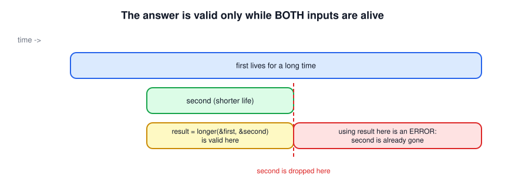

# Chapter 12: Lifetimes: how long does a borrow last?

> **Brain Power**
> You borrow two library books and write down the *longer* quotation from one of them. Later, the library takes one of the books back. Is your note still safe? It depends on which book the quote came from. How would a *computer* know, if all it sees is "a function took two borrowed things and returned a borrowed thing"?

Lifetimes sound scary. They are really just **labels that answer that question**. You already know the idea from Chapter 5: *a reference can never outlive the thing it points at*. This chapter gives you the vocabulary for the places where Rust needs a little help to check it.

## The problem

Here is a function that returns the longer of two texts:

```rust,fails
fn longer(a: &str, b: &str) -> &str {
    if a.len() >= b.len() {
        a
    } else {
        b
    }
}

fn main() {
    println!("{}", longer("GET /users", "POST"));
}
```

```error
error[E0106]: missing lifetime specifier
 --> src/main.rs:1:32
  |
1 | fn longer(a: &str, b: &str) -> &str {
  |              ----     ----     ^ expected named lifetime parameter
  |
  = help: this function's return type contains a borrowed value, but the signature does not say whether it is borrowed from `a` or `b`
help: consider introducing a named lifetime parameter
  |
1 | fn longer<'a>(a: &'a str, b: &'a str) -> &'a str {
  |          ++++     ++          ++          ++

error: aborting due to 1 previous error

For more information about this error, try `rustc --explain E0106`.
```

Decode it. **`missing lifetime specifier`**. Then the compiler explains in its own words: *"this function's return type contains a borrowed value, but the signature does not say whether it is borrowed from `a` or `b`"*.

That is the library puzzle exactly. The function returns a borrowed look (`&str`). But borrowed *from where*? From `a`, from `b`, or from somewhere else? The answer matters, because the returned look is only safe while *that* owner is alive. The compiler cannot guess from the signature alone, so it asks you.

## Naming a lifetime

> **New word: lifetime**
> How long a reference stays valid: from when the borrow starts until the thing borrowed is gone. Every reference has one; usually the compiler works it out by itself.

You answer with a **lifetime name**: an apostrophe followed by a lowercase word, such as **`'a`** (say "tick a"). Declare it in angle brackets, like the type blank `<T>` in Chapter 11, and then attach it to the references it describes:

```rust
fn longer<'a>(a: &'a str, b: &'a str) -> &'a str {
    if a.len() >= b.len() {
        a
    } else {
        b
    }
}

fn main() {
    println!("{}", longer("GET /users", "POST"));
}
```

```output
GET /users
```

* **`<'a>`** after the function name: "here is a lifetime called `'a`".
* **`a: &'a str`**: "a borrowed look at text that lives for at least `'a`".
* **`-> &'a str`**: "the answer is borrowed for `'a` too".
* Because **both** inputs and the output carry the same `'a`, you are saying: **"the answer is only valid for as long as *both* inputs are."** Rust uses the shorter of the two.

> **Heads-up:** a lifetime label does not *change* how long anything lives. It only *describes* a relationship, so the compiler can check it. It is a note on a map, not a bulldozer.

Let's see the compiler enforce the relationship. Predict: which line causes a problem?

```rust,fails
fn longer<'a>(a: &'a str, b: &'a str) -> &'a str {
    if a.len() >= b.len() {
        a
    } else {
        b
    }
}

fn main() {
    let first = String::from("a fairly long request line");
    let result;
    {
        let second = String::from("short");
        result = longer(&first, &second);
    }
    println!("{result}");
}
```



<details><summary>Answer</summary>

```error
error[E0597]: `second` does not live long enough
  --> src/main.rs:14:33
   |
13 |         let second = String::from("short");
   |             ------ binding `second` declared here
14 |         result = longer(&first, &second);
   |                                 ^^^^^^^ borrowed value does not live long enough
15 |     }
   |     - `second` dropped here while still borrowed
16 |     println!("{result}");
   |                ------ borrow later used here

error: aborting due to 1 previous error

For more information about this error, try `rustc --explain E0597`.
```

`second` lives only inside the inner braces. But `result` might be a borrowed look at `second`, and we try to use `result` *after* `second` is dropped. The compiler cannot know which of the two `longer` returned, so it plays safe: **"`second` does not live long enough"**. Move the `println!` inside the inner braces, and the program compiles.

</details>

## Why you rarely write them: elision

You wrote plenty of functions with references already, in Chapters 5 to 9, and never needed `'a`. That's because Rust applies three tidy **elision rules** (*elision* = "leaving out"), and fills the labels in for you. The two you need to know:

1. **One borrowed input?** The output borrows from it.
2. **A `&self` or `&mut self` method?** The output borrows from `self`.

```rust
fn first_word(text: &str) -> &str {
    match text.split_once(' ') {
        Some((word, _)) => word,
        None => text,
    }
}

fn main() {
    println!("{}", first_word("GET /users HTTP/1.1"));
    println!("{}", first_word("HEAD"));
}
```

```output
GET
HEAD
```

There is only one input, so Rust fills in `fn first_word<'a>(text: &'a str) -> &'a str` behind the scenes. The same is true for `fn as_str(&self) -> &str` from Chapter 7: the answer is tied to `self`.

You only write labels yourself when there are **two or more** borrowed inputs and a borrowed output, like `longer`.

## Pointing the label at the right input

Labels become really useful when a function has several references, but the answer comes from only *one* of them. Let's search a list of headers by name:

```rust,fails
struct Header {
    key: String,
    value: String,
}

fn find_header(headers: &[Header], name: &str) -> Option<&Header> {
    for header in headers {
        if header.key == name {
            return Some(header);
        }
    }
    None
}

fn main() {
    let headers = vec![Header { key: String::from("Host"), value: String::from("a.test") }];
    println!("{}", find_header(&headers, "Host").is_some());
}
```

```error
error[E0106]: missing lifetime specifier
 --> src/main.rs:6:58
  |
6 | fn find_header(headers: &[Header], name: &str) -> Option<&Header> {
  |                         ---------        ----            ^ expected named lifetime parameter
  |
  = help: this function's return type contains a borrowed value, but the signature does not say whether it is borrowed from `headers` or `name`
help: consider introducing a named lifetime parameter
  |
6 | fn find_header<'a>(headers: &'a [Header], name: &'a str) -> Option<&'a Header> {
  |               ++++           ++                  ++                 ++

error: aborting due to 1 previous error

For more information about this error, try `rustc --explain E0106`.
```

Two borrowed inputs (`headers` and `name`), one borrowed output: the same puzzle. We know the answer points **into `headers`**, never into `name`. So we label only `headers`:

```rust
struct Header {
    key: String,
    value: String,
}

fn find_header<'a>(headers: &'a [Header], name: &str) -> Option<&'a Header> {
    for header in headers {
        if header.key == name {
            return Some(header);
        }
    }
    None
}

fn main() {
    let headers = vec![Header { key: String::from("Host"), value: String::from("a.test") }];
    {
        let wanted = String::from("Host");
        match find_header(&headers, &wanted) {
            Some(h) => println!("{} = {}", h.key, h.value),
            None => println!("not found"),
        }
    }
}
```

```output
Host = a.test
```

`name` has no label: the answer doesn't depend on it. The `wanted` text could even be dropped right after the call and the answer would still be fine, because the answer points into `headers`. Being precise gives *callers* more freedom.

> **Sharpen your pencil**
> Add a method to a struct, `impl Request { fn first_header(&self) -> Option<&Header> { ... } }` (assume `Request` has a `headers: Vec<Header>` field). Do you need to write any `'a` labels?
>
> <details><summary>Answer</summary>
>
> No. It is a `&self` method with a borrowed output, so elision rule 2 applies: the answer is tied to `self`. You would write `self.headers.get(0)`. (Chapter 9's `.get` already returns an `Option<&T>`.)
> </details>

## Structs that hold references

Back in Chapter 6 we said a struct **owns** its fields, so we used `String`. A struct *can* hold a borrowed `&str` instead, if you promise it never outlives the text. That promise is a lifetime label on the struct:

```rust
#[derive(Debug)]
struct RequestLine<'a> {
    method: &'a str,
    path: &'a str,
}

impl<'a> RequestLine<'a> {
    fn parse(line: &'a str) -> Option<RequestLine<'a>> {
        let (method, rest) = line.split_once(' ')?;
        let (path, _version) = rest.split_once(' ')?;
        Some(RequestLine { method, path })
    }
}

fn main() {
    let raw = String::from("POST /orders HTTP/1.1");
    let parsed = RequestLine::parse(&raw);
    println!("{:?}", parsed);
}
```

```output
Some(RequestLine { method: "POST", path: "/orders" })
```

* **`struct RequestLine<'a>`**: "this struct holds references that live for `'a`".
* `parse` doesn't copy any text. `method` and `path` are *slices* (Chapter 5) that look straight into `raw`. Fast: no new `String`s.
* The compiler guarantees a `RequestLine` can't outlive `raw`: it would be pointing at nothing.

This "borrow, don't copy" style is great for parsers and is how Nexus reads big imported files without making many copies. If it ever gets in your way, the escape hatch is easy: switch the fields to `String` (owned) and clone once.

## `'static`: the label for "forever"

There is one special label: **`'static`**, meaning "lives for the entire run of the program". You have used it without knowing: **quoted text in your program** is baked into the program itself, so it can never go away. Its full type is `&'static str`.

```rust
fn status_word(code: u16) -> &'static str {
    match code {
        200..=299 => "ok",
        400..=499 => "client error",
        500.. => "server error",
        _ => "other",
    }
}

fn main() {
    println!("{}", status_word(404));
    println!("{}", status_word(503));
}
```

```output
client error
server error
```

The function takes a number and returns a borrowed `&str`... of what? Not of its input (a number has nothing to borrow). It returns quoted text, which lives forever. So we say so: **`&'static str`**. (`500..` is a range with no end: "500 and up".)

You'll meet `'static` again when you send work to other threads (Chapter 18) and to async tasks (Chapter 19): such work might outlive the function that started it, so it may not borrow anything short-lived.

> **There are no Dumb Questions**
>
> **Q: Do lifetimes exist at runtime? Are they extra work?**
> A: No. They are used only while compiling and then vanish. They cost nothing.
>
> **Q: I get a lifetime error I don't understand. Help!**
> A: Three cures, in order of how often they work. (1) Return an *owned* value (`String`) instead of a reference. (2) Clone once. (3) Add a label that expresses what you mean. The first two are not "cheating": plenty of excellent Rust code does exactly that.
>
> **Q: Why `'a`? Can I call it something else?**
> A: Yes: `'request`, `'input`... Any lowercase word. `'a` is a convention for short functions.
>
> **Q: What is `'_`?**
> A: "A lifetime I don't want to name": `RequestLine<'_>` in a return type says "this holds a borrow, tied by the usual elision rules".

## Now look at real Nexus

Nexus has the same `&'static str` function as the one you just wrote, from [`response/mod.rs`](../../crates/nexus-core/src/response/mod.rs). It maps an HTTP status code to a colour word for the UI:

```rust,nexus
pub fn get_status_color(status: u16) -> &'static str {
    match status {
        200..=299 => "positive",
        300..=399 => "informative",
        400..=499 => "notice",
        500.. => "negative",
        _ => "neutral",
    }
}
```

You can read every line: a `match` over number ranges (Chapter 7), `500..` ("and up"), a `_` catch-all, and quoted text that lives forever. And here is a function whose lifetime label expresses the library puzzle exactly, from [`trust.rs`](../../crates/nexus-core/src/trust.rs). When a script changes a request's address, Nexus refuses to send your saved password to the new site:

```rust,nexus
pub fn bind_auth_to_origin<'a>(
    auth: Option<&'a AuthConfig>,
    configured_url: &str,
    final_url: &str,
) -> (Option<&'a AuthConfig>, Option<LogEntry>) {
    // ...
    if auth.is_none() || before == after {
        return (auth, None);
    }
    // ...
}
```

Decode it:

* There are three borrowed inputs (`auth`, `configured_url`, `final_url`), and the output holds a borrow too (`Option<&'a AuthConfig>`: an `Option` of a reference).
* **`'a` is on `auth` only**, and in the output. So the answer is the *same borrowed* auth that came in (or `None` if the origin changed). It never points into the URLs. Exactly like your `find_header`: the label lets callers throw the URL text away afterwards.
* The output is a **tuple** (Chapter 2) of two things: the auth to use (maybe none), and an optional warning message to show the user. `return (auth, None)` says "keep the auth, no warning".
* `auth.is_none() || before == after` is `Option` and `||` from Chapters 8 and 3. `LogEntry` is just another struct.

Real-world lifetime annotations look exactly like the ones in your toy examples.

## Checkpoint project: request builder, version 11

The builder learns to **find** a header, and to **parse** a request line back out of raw text (borrowing, not copying):

```rust,frag
impl Request {
    fn header(&self, name: &str) -> Option<&Header> {
        for header in &self.headers {
            if header.key.eq_ignore_ascii_case(name) {
                return Some(header);
            }
        }
        None
    }
}

#[derive(Debug)]
struct RequestLine<'a> {
    method: &'a str,
    path: &'a str,
}

impl<'a> RequestLine<'a> {
    fn parse(line: &'a str) -> Option<RequestLine<'a>> {
        let (method, rest) = line.split_once(' ')?;
        let (path, _version) = rest.split_once(' ')?;
        Some(RequestLine { method, path })
    }
}
```

Notice that `Request::header` needs **no label**: it's a `&self` method (elision rule 2). `RequestLine::parse` does need one, since the struct holds borrows.

<details><summary>The whole program so far</summary>

```rust
use std::collections::HashMap;
use std::fmt;

#[derive(Debug, Clone, Copy, PartialEq, Default)]
enum Method {
    #[default]
    Get,
    Post,
}

impl fmt::Display for Method {
    fn fmt(&self, f: &mut fmt::Formatter) -> fmt::Result {
        let text = match self {
            Method::Get => "GET",
            Method::Post => "POST",
        };
        write!(f, "{text}")
    }
}

#[derive(Debug, Clone, PartialEq)]
struct Header {
    key: String,
    value: String,
    enabled: bool,
}

impl Header {
    fn new(key: &str, value: &str) -> Self {
        Self { key: key.to_string(), value: value.to_string(), enabled: true }
    }
}

impl From<(&str, &str)> for Header {
    fn from(pair: (&str, &str)) -> Self {
        Header::new(pair.0, pair.1)
    }
}

impl fmt::Display for Header {
    fn fmt(&self, f: &mut fmt::Formatter) -> fmt::Result {
        write!(f, "{}: {}", self.key, self.value)
    }
}

#[derive(Debug, Clone, Default)]
struct Request {
    method: Method,
    path: String,
    headers: Vec<Header>,
}

impl fmt::Display for Request {
    fn fmt(&self, f: &mut fmt::Formatter) -> fmt::Result {
        write!(f, "{} {} HTTP/1.1", self.method, self.path)?;
        for header in &self.headers {
            if header.enabled {
                write!(f, "\n{header}")?;
            }
        }
        Ok(())
    }
}

fn resolve(template: &str, variables: &HashMap<String, String>) -> String {
    let mut result = template.to_string();
    for (name, value) in variables {
        let mut placeholder = String::from("{{");
        placeholder.push_str(name);
        placeholder.push_str("}}");
        result = result.replace(&placeholder, value);
    }
    result
}

impl Request {
    fn add_header(&mut self, header: Header) {
        self.headers.push(header);
    }

    fn to_text(&self, variables: &HashMap<String, String>) -> String {
        resolve(&self.to_string(), variables)
    }

    fn header(&self, name: &str) -> Option<&Header> {
        for header in &self.headers {
            if header.key.eq_ignore_ascii_case(name) {
                return Some(header);
            }
        }
        None
    }
}

#[derive(Debug)]
struct RequestLine<'a> {
    method: &'a str,
    path: &'a str,
}

impl<'a> RequestLine<'a> {
    fn parse(line: &'a str) -> Option<RequestLine<'a>> {
        let (method, rest) = line.split_once(' ')?;
        let (path, _version) = rest.split_once(' ')?;
        Some(RequestLine { method, path })
    }
}

fn main() {
    let mut variables = HashMap::new();
    variables.insert(String::from("host"), String::from("api.example.test"));

    let mut request = Request::default();
    request.path = String::from("/users");
    request.add_header(("Host", "{{host}}").into());
    request.add_header(Header::from(("Accept", "application/json")));

    let text = request.to_text(&variables);
    println!("{text}");

    match request.header("accept") {
        Some(h) => println!("accept header is: {}", h.value),
        None => println!("no accept header"),
    }
    println!("{}", request.header("Cookie").is_some());

    let first_line = text.lines().next().unwrap_or("");
    println!("{:?}", RequestLine::parse(first_line));
}
```

```output
GET /users HTTP/1.1
Host: api.example.test
Accept: application/json
accept header is: application/json
false
Some(RequestLine { method: "GET", path: "/users" })
```

</details>

(`text.lines().next()` takes the first line of the text: `lines()` walks the lines and `.next()` gives an `Option` of the first. Chapter 13 explains how that pair works.) Look at the last step: the builder's own output is parsed back by `RequestLine`, which just *borrows* from `text`. If you tried to drop `text` before printing, the compiler would stop you.

> **Sharpen your pencil**
> In the program above, what happens if you move the line `let text = ...` into an inner `{ ... }` block and try to use `RequestLine::parse` on it *outside* the block? Predict the error's headline.
>
> <details><summary>Answer</summary>
>
> `` `text` does not live long enough ``: `RequestLine` holds borrowed slices of `text`, and the parsed value would outlive `text`. Exactly Chapter 5's `does not live long enough`, now with a struct in the middle.
> </details>

## Bullet Points

* A **lifetime** is how long a reference stays valid. Every reference has one; the compiler usually works it out (**elision**: one borrowed input, or a `&self` method).
* When a function has two or more borrowed inputs and a borrowed output, you label: `fn f<'a>(x: &'a str, y: &str) -> &'a str`. A label **describes**; it never changes how long anything lives.
* Put the label only on the inputs the answer really comes from: it gives callers more freedom.
* A struct holding references needs a label too: `struct S<'a> { text: &'a str }`, `impl<'a> S<'a> { .. }`.
* **`'static`** means "lives forever": quoted text is `&'static str`.
* When fighting a lifetime error: return an owned value, or clone once.

## Cheat sheet

```text
fn f<'a>(x: &'a str, y: &'a str) -> &'a str     answer tied to BOTH inputs
fn g<'a>(x: &'a [T], k: &str) -> Option<&'a T>  tied to x only
fn h(&self) -> &str                             elided: tied to self
struct P<'a> { s: &'a str }                     struct that borrows
impl<'a> P<'a> { .. }
&'static str                                    lives forever (quoted text)
'_                                              "a lifetime I won't name"
```
