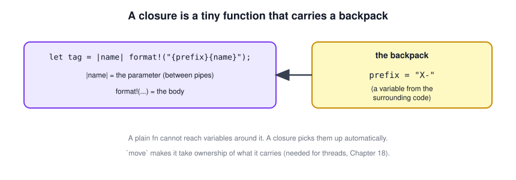
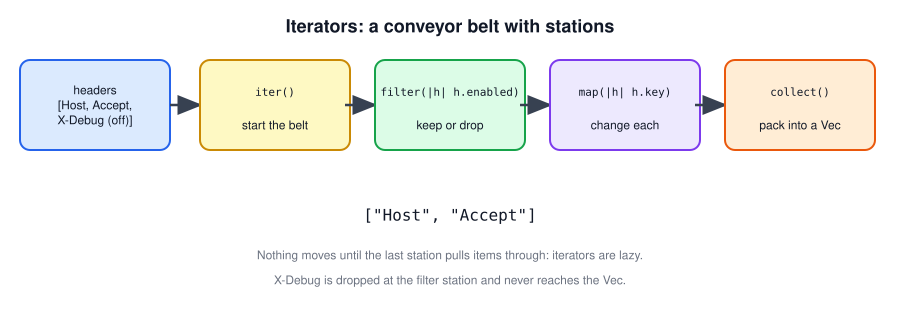

# Chapter 13: Closures and iterators

> **Brain Power**
> You have a list of headers, and some are switched off. You want the *names of the enabled ones, in capital letters*. With the tools you have so far you'd write: make an empty list, loop, check `enabled`, convert, push. About six lines. Could you imagine *saying* it in one sentence instead: "from the headers, keep the enabled ones, take each name, capitalise it"? What would the pieces of that sentence need to be?

The pieces would be (a) something that hands you the items one at a time, and (b) tiny bits of behaviour you can pass in: "keep it if enabled", "capitalise it". Rust's names for them are **iterators** and **closures**. We start with the small pieces.

## Closures: tiny unnamed functions

You can write a function without giving it a name, right where you need it. It is called a **closure**:

```rust
fn main() {
    let add_one = |n| n + 1;
    println!("{}", add_one(5));

    let greet = |name: &str, punctuation: &str| format!("Hello, {name}{punctuation}");
    println!("{}", greet("Ada", "!"));
}
```

```output
6
Hello, Ada!
```

* **`|n| n + 1`**: between the two vertical bars `| |` are the **parameters** (like the `(n: i32)` of a function). After them comes the **body**. This closure takes `n` and gives back `n + 1`. No `fn`, no name, no braces needed for one expression.
* `let add_one = ...` stores the closure in a variable, and **`add_one(5)`** calls it, just like a function.
* You *may* write parameter types (`name: &str`), but usually Rust infers them.
* For a longer body, use braces: `|a, b| { ... }`.

> **New word: closure**
> A small function with no name, written `|parameters| body`, that you can store in a variable or hand to another function.

### The backpack

Closures have a superpower plain functions lack: they can **use variables from the surrounding code**, as if they carried a backpack.



```rust
fn main() {
    let prefix = "X-";
    let tag = |name: &str| format!("{prefix}{name}");
    println!("{}", tag("Trace"));
    println!("{}", tag("Debug"));
}
```

```output
X-Trace
X-Debug
```

`tag` uses `prefix`, which is defined *outside* the closure. We say the closure **captures** `prefix`. A plain function cannot do that. Predict: what does the compiler say if you turn `tag` into a nested `fn`?

```rust,fails
fn main() {
    let prefix = "X-";
    fn tag(name: &str) -> String {
        format!("{prefix}{name}")
    }
    println!("{}", tag("Trace"));
}
```

<details><summary>Answer</summary>

```error
error[E0434]: can't capture dynamic environment in a fn item
 --> src/main.rs:4:19
  |
4 |         format!("{prefix}{name}")
  |                   ^^^^^^
  |
  = help: use the `|| { ... }` closure form instead

warning: unused variable: `prefix`
 --> src/main.rs:2:9
  |
2 |     let prefix = "X-";
  |         ^^^^^^ help: if this is intentional, prefix it with an underscore: `_prefix`
  |
  = note: `#[warn(unused_variables)]` (part of `#[warn(unused)]`) on by default

error: aborting due to 1 previous error; 1 warning emitted

For more information about this error, try `rustc --explain E0434`.
```

**"can't capture dynamic environment in a fn item"**, with the help *"use the `|| { ... }` closure form instead"*. The compiler is telling you exactly what this section just said.

</details>

### Closures and ownership

A closure captures by **borrowing** (a quick look) unless it has to do more, and ownership rules apply as always (Chapters 4 and 5). Sometimes the closure needs to *own* what it carries, for instance when it is returned from a function and the function's variables are about to be dropped. Predict what happens here:

```rust,fails
fn make_prefixer(prefix: String) -> impl Fn(&str) -> String {
    |name| format!("{prefix}{name}")
}

fn main() {
    let f = make_prefixer(String::from("X-"));
    println!("{}", f("a"));
}
```

<details><summary>Answer</summary>

```error
error[E0373]: closure may outlive the current function, but it borrows `prefix`, which is owned by the current function
 --> src/main.rs:2:5
  |
2 |     |name| format!("{prefix}{name}")
  |     ^^^^^^           ------ `prefix` is borrowed here
  |     |
  |     may outlive borrowed value `prefix`
  |
note: closure is returned here
 --> src/main.rs:2:5
  |
2 |     |name| format!("{prefix}{name}")
  |     ^^^^^^^^^^^^^^^^^^^^^^^^^^^^^^^^
help: to force the closure to take ownership of `prefix` (and any other referenced variables), use the `move` keyword
  |
2 |     move |name| format!("{prefix}{name}")
  |     ++++

error: aborting due to 1 previous error

For more information about this error, try `rustc --explain E0373`.
```

The closure only *borrows* `prefix`, but `prefix` is dropped when `make_prefixer` ends, while the closure is still being used by the caller: a borrow outliving its owner (Chapter 5). The compiler's fix is the keyword **`move`**: **"to force the closure to take ownership of `prefix`, use the `move` keyword"**.

</details>

```rust
fn make_prefixer(prefix: String) -> impl Fn(&str) -> String {
    move |name| format!("{prefix}{name}")
}

fn main() {
    let f = make_prefixer(String::from("X-"));
    println!("{}", f("a"));
}
```

```output
X-a
```

**`move |name| ...`** means "this closure takes ownership of everything it uses". You will need `move` for threads in Chapter 18, so remember it.

And the return type: **`impl Fn(&str) -> String`** reads "something I can *call*, with a `&str`, that gives back a `String`". `Fn` is a trait (Chapter 10) for "callable", and `impl Trait` is the Chapter 11 shorthand.

### Passing closures to functions

The same `impl Fn(...)` works for a *parameter*. This lets you hand behaviour to a function:

```rust
fn apply_twice(f: impl Fn(i32) -> i32, start: i32) -> i32 {
    f(f(start))
}

fn main() {
    let add_three = |n| n + 3;
    println!("{}", apply_twice(add_three, 10));
    println!("{}", apply_twice(|n| n * 2, 10));
}
```

```output
16
40
```

There are three flavours of "callable", named by what the closure does with its backpack:

| Trait | The closure... | Can be called |
|---|---|---|
| `Fn` | only *reads* what it captured | many times |
| `FnMut` | *changes* what it captured | many times |
| `FnOnce` | *gives away* what it captured | once |

You rarely need to pick on purpose: ask for `Fn` first, and the compiler will tell you if you need a more permissive one.

## Iterators: a conveyor belt

An **iterator** is something that hands you items *one at a time*, like a conveyor belt. You have used one already: `for x in &list` runs over an iterator behind the scenes. You can also drive one by hand with **`.next()`**:

```rust
fn main() {
    let codes = vec![200, 404, 500];
    let mut belt = codes.iter();

    println!("{:?}", belt.next());
    println!("{:?}", belt.next());
    println!("{:?}", belt.next());
    println!("{:?}", belt.next());
}
```

Before running: the fourth `.next()` call goes past the end. What do you think it returns? (Chapter 8 is your hint.)

<details><summary>Answer</summary>

```output
Some(200)
Some(404)
Some(500)
None
```

**`None`**. `.next()` returns an `Option` (Chapter 8): `Some(item)` while there are items, `None` when the belt is empty. That is all an iterator is, and it is how `for` knows when to stop.

</details>

* `codes.iter()` starts a belt that *borrows* each item (like `&codes`).
* The belt remembers where it is, so it must be `let mut belt`.

> **New word: iterator**
> Something that produces a sequence of items, one at a time, via `.next()`. Lists, text, maps and ranges can all give you one.

### Stations on the belt: adapters

The fun part: you can add **stations** to the belt. Each station takes the items coming along and does something, and each is a method that takes... a closure.



```rust
struct Header {
    key: String,
    enabled: bool,
}

fn main() {
    let headers = vec![
        Header { key: String::from("Host"), enabled: true },
        Header { key: String::from("Accept"), enabled: true },
        Header { key: String::from("X-Debug"), enabled: false },
    ];

    let names: Vec<String> = headers
        .iter()
        .filter(|h| h.enabled)
        .map(|h| h.key.to_uppercase())
        .collect();

    println!("{:?}", names);
    println!("{}", names.join(", "));
}
```

```output
["HOST", "ACCEPT"]
HOST, ACCEPT
```

This answers the Brain Power. Read the chain from the top, like a sentence:

* **`headers.iter()`**: start a belt over the headers.
* **`.filter(|h| h.enabled)`**: keep only those for which the closure answers `true`. (The closure receives a *look* at each item: so `h.enabled` works directly.)
* **`.map(|h| h.key.to_uppercase())`**: change each item into something else. Here, the key in capitals.
* **`.collect()`**: the last station. It **packs everything that arrived into a collection**. We tell it which kind with the type on the left: `Vec<String>`.
* `names.join(", ")` glues a list of texts together with a separator, giving a `String`.

> **New word: adapter / consumer**
> A station that *changes* the belt (`filter`, `map`) is an **adapter**; it makes a new iterator. A station that *finishes* it and gives you a result (`collect`, `count`, `sum`) is a **consumer**.

Some other everyday stations (try them):

```rust
fn main() {
    let codes = vec![200, 404, 500, 301];

    let errors: Vec<i32> = codes.iter().copied().filter(|c| *c >= 400).collect();
    let total: i32 = codes.iter().sum();
    let has_404 = codes.iter().any(|c| *c == 404);
    let first_redirect = codes.iter().copied().find(|c| *c >= 300 && *c < 400);

    println!("{:?}", errors);
    println!("{total}");
    println!("{has_404}");
    println!("{:?}", first_redirect);
    println!("{}", codes.iter().filter(|c| **c >= 400).count());
}
```

```output
[404, 500]
1405
true
Some(301)
2
```

A few notes:

* **`.copied()`** turns "a look at a number" into the number itself (it copies each item: fine, numbers are `Copy`, Chapter 10).
* Closures receive items **by reference**, so for plain numbers you may need a star (`*c`, from Chapter 5) to reach the number. Without `.copied()`, `filter` hands you a *look at a look*, so `**c`. If stars bother you, `.copied()` removes one. (With structs, like `h.enabled`, Rust adds the stars for you.)
* **`.sum()`** adds everything up. It needs to know the type: `let total: i32`.
* **`.any(|c| ...)`** is `true` if the closure is true for at least one item; **`.find(|c| ...)`** gives `Some(first match)` or `None`; **`.count()`** counts.

### Belts are lazy

One more important fact: a belt does **nothing until something at the end pulls items through**. Predict what this program prints:

```rust
fn main() {
    let codes = vec![200, 404];
    codes.iter().map(|c| println!("code {c}"));
    println!("done");
}
```

<details><summary>Answer</summary>

```output
done
```

Just `done`. The `.map(...)` station *describes* work, but with no consumer at the end, nothing runs. The compiler even warns you:

```text
warning: unused `Map` that must be used
  = note: iterators are lazy and do nothing unless consumed
```

To *run* something for every item, use a `for` loop, or the consumer `.for_each(...)`, or finish with `.collect()` / `.count()`.

</details>

Laziness is a feature: a long chain makes a single pass over the data, with no temporary lists.

### Sorting and reversing

Two helpers you'll often need. `.sort()` rearranges a `Vec` in place (so it must be `mut`), and `.rev()` runs a belt backwards. They also fix a promise from Chapter 9: **a `HashMap` has no order, so collect its keys and sort them**:

```rust
use std::collections::HashMap;

fn main() {
    let mut variables = HashMap::new();
    variables.insert(String::from("version"), String::from("v2"));
    variables.insert(String::from("host"), String::from("a.test"));
    variables.insert(String::from("env"), String::from("dev"));

    let mut keys: Vec<&String> = variables.keys().collect();
    keys.sort();

    for key in keys {
        println!("{key} = {}", variables[key]);
    }

    let countdown: Vec<i32> = (1..=3).rev().collect();
    println!("{:?}", countdown);
}
```

```output
env = dev
host = a.test
version = v2
[3, 2, 1]
```

(`variables.keys()` is a belt over the keys, and `variables[key]` looks up a value by key. And yes: a *range* like `1..=3` is an iterator too.)

> **There are no Dumb Questions**
>
> **Q: Is an iterator chain slower than a hand-written loop?**
> A: No. The compiler turns the chain into the same machine code as a loop, or better. This is one of Rust's "zero-cost abstraction" promises.
>
> **Q: `iter()` vs `into_iter()` vs `iter_mut()`?**
> A: Same trio as the `for` loops of Chapter 9. `iter()` borrows each item (`&`), `iter_mut()` borrows mutably, `into_iter()` consumes the list and hands you the items themselves.
>
> **Q: How do I know what type `collect()` should make?**
> A: You tell it: `let names: Vec<String> = ...collect();` or `.collect::<Vec<String>>()` (the "turbofish" `::<>`). `collect` can also build a `String`, a `HashMap`, and more.
>
> **Q: Why can a closure be passed where a function is expected?**
> A: Because both are "callable". A closure is simply a function whose body can see variables around it.

> **Sharpen your pencil**
> Using the `headers` vector from above, write one chain that counts how many *enabled* headers have a key starting with `"A"`. (Text has `.starts_with("A")`.) Predict the answer, then check it.
>
> <details><summary>Answer</summary>
>
> ```rust
> struct Header {
>     key: String,
>     enabled: bool,
> }
>
> fn main() {
>     let headers = vec![
>         Header { key: String::from("Host"), enabled: true },
>         Header { key: String::from("Accept"), enabled: true },
>         Header { key: String::from("X-Debug"), enabled: false },
>     ];
>     let n = headers
>         .iter()
>         .filter(|h| h.enabled && h.key.starts_with("A"))
>         .count();
>     println!("{n}");
> }
> ```
>
> ```output
1
> ```
> Only `Accept` is both enabled and starts with `A`.
> </details>

## Peek: storing closures

Sometimes you want to *keep* closures in a variable or list for later: a list of rules, a callback. Closures all have different, unnameable types, so to store them you put each one in a **`Box`** (a ticket to the warehouse, Chapter 4) and describe them as `dyn Fn(...)`: "some callable, decided at run time". This is an advanced corner, so skim:

```rust
fn main() {
    let rules: Vec<Box<dyn Fn(&str) -> bool>> = vec![
        Box::new(|path| path.starts_with('/')),
        Box::new(|path| !path.contains(' ')),
    ];

    for path in ["/users", "users", "/my users"] {
        let ok = rules.iter().all(|rule| rule(path));
        println!("{path:?} valid? {ok}");
    }
}
```

```output
"/users" valid? true
"users" valid? false
"/my users" valid? false
```

`Box<dyn Fn(&str) -> bool>` is "a boxed something-callable that takes a `&str` and returns a `bool`". Nexus stores callbacks this way: a console that tells subscribers when a new entry appears keeps them as `Box<dyn Fn(...)>`. You don't need to write these yet.

## Now look at real Nexus

Nexus has *secret* variables (like API keys). When it exports a collection it must leave them out. Here is the whole function, from [`trust.rs`](../../crates/nexus-core/src/trust.rs). Everything in it is yours now:

```rust,nexus
pub fn without_secrets(variables: &[Variable]) -> Vec<Variable> {
    variables
        .iter()
        .filter(|v| v.var_type != VariableType::Secret)
        .cloned()
        .collect()
}
```

Read it as a sentence:

* **`variables: &[Variable]`**: a borrowed list (Chapter 9), read-only.
* **`.iter()`**: a belt over borrowed variables.
* **`.filter(|v| v.var_type != VariableType::Secret)`**: keep a variable if its type is *not* the `Secret` variant of an enum (Chapter 7). `!=` works because the enum derives `PartialEq` (Chapter 10).
* **`.cloned()`**: the belt carries only *looks*, but we must return *owned* values (`Vec<Variable>`), so make a clone of each. (The `Clone` trait of Chapter 10. It is `.copied()`'s bigger sibling, for things that cost something to copy.)
* **`.collect()`**: pack them into the `Vec<Variable>` that the return type asks for. No type annotation needed: the function's `-> Vec<Variable>` tells `collect` what to build.

Its neighbour is just as short:

```rust,nexus
pub fn secret_count(variables: &[Variable]) -> usize {
    variables
        .iter()
        .filter(|v| v.enabled && v.var_type == VariableType::Secret)
        .count()
}
```

"How many enabled variables are secret?" A `filter` and a `count`. This style fills the Nexus code base.

## Checkpoint project: request builder, version 12

Replace three hand-written loops with belts. The `Request` methods become:

```rust,frag
fn enabled_count(&self) -> usize {
    self.headers.iter().filter(|h| h.enabled).count()
}

fn header(&self, name: &str) -> Option<&Header> {
    self.headers.iter().find(|h| h.key.eq_ignore_ascii_case(name))
}
```

and `Display` can walk only the enabled headers:

```rust,frag
for header in self.headers.iter().filter(|h| h.enabled) {
    write!(f, "\n{header}")?;
}
```

We also add a way to print variables in a *predictable* order, using `.keys()` and `.sort()`:

```rust,frag
fn sorted_names(variables: &HashMap<String, String>) -> Vec<&String> {
    let mut names: Vec<&String> = variables.keys().collect();
    names.sort();
    names
}
```

<details><summary>The whole program so far</summary>

```rust
use std::collections::HashMap;
use std::fmt;

#[derive(Debug, Clone, Copy, PartialEq, Default)]
enum Method {
    #[default]
    Get,
    Post,
}

impl fmt::Display for Method {
    fn fmt(&self, f: &mut fmt::Formatter) -> fmt::Result {
        let text = match self {
            Method::Get => "GET",
            Method::Post => "POST",
        };
        write!(f, "{text}")
    }
}

#[derive(Debug, Clone, PartialEq)]
struct Header {
    key: String,
    value: String,
    enabled: bool,
}

impl Header {
    fn new(key: &str, value: &str) -> Self {
        Self { key: key.to_string(), value: value.to_string(), enabled: true }
    }
}

impl From<(&str, &str)> for Header {
    fn from(pair: (&str, &str)) -> Self {
        Header::new(pair.0, pair.1)
    }
}

impl fmt::Display for Header {
    fn fmt(&self, f: &mut fmt::Formatter) -> fmt::Result {
        write!(f, "{}: {}", self.key, self.value)
    }
}

#[derive(Debug, Clone, Default)]
struct Request {
    method: Method,
    path: String,
    headers: Vec<Header>,
}

impl fmt::Display for Request {
    fn fmt(&self, f: &mut fmt::Formatter) -> fmt::Result {
        write!(f, "{} {} HTTP/1.1", self.method, self.path)?;
        for header in self.headers.iter().filter(|h| h.enabled) {
            write!(f, "\n{header}")?;
        }
        Ok(())
    }
}

fn resolve(template: &str, variables: &HashMap<String, String>) -> String {
    let mut result = template.to_string();
    for (name, value) in variables {
        let mut placeholder = String::from("{{");
        placeholder.push_str(name);
        placeholder.push_str("}}");
        result = result.replace(&placeholder, value);
    }
    result
}

fn sorted_names(variables: &HashMap<String, String>) -> Vec<&String> {
    let mut names: Vec<&String> = variables.keys().collect();
    names.sort();
    names
}

impl Request {
    fn add_header(&mut self, header: Header) {
        self.headers.push(header);
    }

    fn to_text(&self, variables: &HashMap<String, String>) -> String {
        resolve(&self.to_string(), variables)
    }

    fn enabled_count(&self) -> usize {
        self.headers.iter().filter(|h| h.enabled).count()
    }

    fn header(&self, name: &str) -> Option<&Header> {
        self.headers.iter().find(|h| h.key.eq_ignore_ascii_case(name))
    }
}

fn main() {
    let mut variables = HashMap::new();
    variables.insert(String::from("version"), String::from("v2"));
    variables.insert(String::from("host"), String::from("api.example.test"));

    let mut request = Request::default();
    request.path = String::from("/{{version}}/users");
    request.add_header(("Host", "{{host}}").into());
    request.add_header(Header::from(("Accept", "application/json")));
    let mut debug = Header::new("X-Debug", "1");
    debug.enabled = false;
    request.add_header(debug);

    println!("{}", request.to_text(&variables));
    println!("{} of {} headers enabled", request.enabled_count(), request.headers.len());
    println!("{:?}", request.header("ACCEPT").map(|h| h.value.as_str()));

    for name in sorted_names(&variables) {
        println!("variable {name} = {}", variables[name]);
    }
}
```

```output
GET /v2/users HTTP/1.1
Host: api.example.test
Accept: application/json
2 of 3 headers enabled
Some("application/json")
variable host = api.example.test
variable version = v2
```

</details>

(`request.header("ACCEPT").map(...)` uses `.map` on an *`Option`* ("if there is a value, change it"). Option has `map` too: the same idea as on belts.) The variables always print in alphabetical order now, no matter how the `HashMap` shuffled them.

> **Sharpen your pencil**
> Write `fn enabled_keys(&self) -> Vec<&str>` for `Request` using one chain. (Hint: `.map(|h| h.key.as_str())`.) What does the elided lifetime say about the result?
>
> <details><summary>Answer</summary>
>
> ```rust,frag
> fn enabled_keys(&self) -> Vec<&str> {
>     self.headers.iter().filter(|h| h.enabled).map(|h| h.key.as_str()).collect()
> }
> ```
> It is a `&self` method with a borrowed output, so Chapter 12's elision rule 2 applies: the returned `&str`s are borrowed from the request, and can't outlive it.
> </details>

## Bullet Points

* A **closure** is a small unnamed function: `|a, b| a + b`. It can **capture** variables from around it; `move |x| ...` takes ownership of them.
* `impl Fn(A) -> B` (a trait from Chapter 10 plus Chapter 11's `impl`) means "something callable". `FnMut` changes what it captured; `FnOnce` can only be called once.
* An **iterator** hands out items via `.next()` (an `Option`). `for` loops use them.
* **Adapters** (lazy): `.iter()`, `.filter(|x| ..)`, `.map(|x| ..)`, `.copied()`, `.cloned()`, `.rev()`. **Consumers**: `.collect()`, `.count()`, `.sum()`, `.any(|x| ..)`, `.find(|x| ..)`.
* Iterators are **lazy**: nothing happens until a consumer pulls.
* `.sort()` sorts a `Vec` in place; `.join(", ")` glues texts.

## Cheat sheet

```text
|n| n + 1           |a: &str, b| { .. }          closures
move |x| ..         the closure owns what it captures
fn f(g: impl Fn(i32) -> i32) { .. }               take a callable
v.iter().filter(|x| ..).map(|x| ..).collect::<Vec<_>>()
v.iter().sum::<i32>()   .count()   .any(|x| ..)   .find(|x| ..)
v.iter().copied()   .cloned()      copy/clone each item out of its reference
keys.sort();   names.join(", ")    (1..=3).rev()
```
