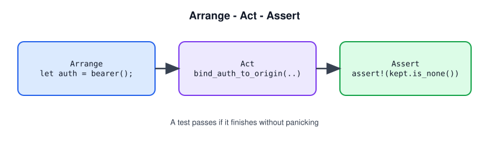
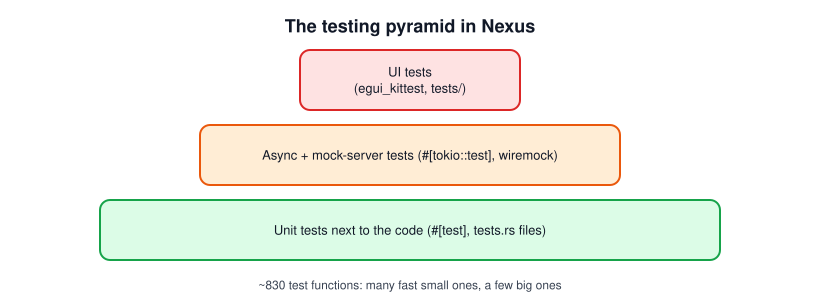

# Chapter 13: Testing

> **Brain Power**
> Nexus is a security-sensitive tool: it must not send your saved Bearer token to a *different website* after a script changes the URL. How would you *prove*, today and after every future change, that this promise still holds?

## Tests are built in

Rust ships with a test framework. No extra crate needed. Mark a function with `#[test]`, run `cargo test`. A test **passes if it finishes without panicking** and fails if it panics.



```rust
fn add(a: i32, b: i32) -> i32 {
    a + b
}

#[cfg(test)]
mod tests {
    use super::*;       // bring the parent module's items (add) into scope

    #[test]
    fn adds_two_numbers() {
        assert_eq!(add(2, 3), 5);
    }

    #[test]
    fn adds_negatives() {
        assert_eq!(add(-2, -3), -5);
    }
}
```

Save as `lib.rs` in a project and run `cargo test`, or compile quickly with `rustc --test file.rs && ./file`. You'll see:

```
running 2 tests
test tests::adds_negatives ... ok
test tests::adds_two_numbers ... ok
test result: ok. 2 passed; 0 failed
```

Conventions you've already met in Chapter 10: unit tests live in a `#[cfg(test)] mod tests`, so they are **compiled only for `cargo test`**, never in the shipped program, and `use super::*;` lets them reach private functions of the module they test.

## The assertion macros

| Macro | Passes when |
|---|---|
| `assert!(cond)` | `cond` is true |
| `assert_eq!(left, right)` | `left == right` (shows both on failure) |
| `assert_ne!(left, right)` | they differ |
| `assert!(cond, "message {x}")` | custom failure message |

Other shapes of tests:

```rust
fn parse_port(s: &str) -> Result<u16, std::num::ParseIntError> {
    s.trim().parse()
}

fn divide(a: i32, b: i32) -> i32 {
    if b == 0 {
        panic!("division by zero");
    }
    a / b
}

#[cfg(test)]
mod tests {
    use super::*;

    // a test may return Result: `?` works, and Err means failure
    #[test]
    fn parses_a_port() -> Result<(), std::num::ParseIntError> {
        let p = parse_port(" 8080 ")?;
        assert_eq!(p, 8080);
        Ok(())
    }

    // expect a panic
    #[test]
    #[should_panic(expected = "division by zero")]
    fn dividing_by_zero_panics() {
        divide(1, 0);
    }

    // checking an error case
    #[test]
    fn rejects_garbage() {
        assert!(parse_port("not a port").is_err());
    }
}
```

## Real Nexus unit tests

Open [`trust/tests.rs`](../../crates/nexus-core/src/trust/tests.rs). It tests the function from Chapter 7 (`bind_auth_to_origin`), the one that stops credentials leaking to another origin:

```rust,ignore
use super::*;
use crate::types::AuthType;

fn bearer() -> AuthConfig {
    AuthConfig::new(AuthType::Bearer)
}

#[test]
fn origin_normalises_scheme_host_and_default_port() {
    assert_eq!(
        origin_of("HTTPS://Api.Example.com:443/x?y=1").as_deref(),
        Some("https://api.example.com")
    );
    assert_eq!(origin_of("not a url"), None);
    assert_ne!(origin_of("http://a.test/"), origin_of("https://a.test/"));
}

#[test]
fn origin_change_drops_auth_with_warning() {
    let auth = bearer();
    let (kept, warn) = bind_auth_to_origin(Some(&auth), "https://a.test/x", "https://evil.test/x");
    assert!(kept.is_none());
    let msg = warn.unwrap().args[0].as_str().unwrap().to_string();
    assert!(msg.contains("Auth not sent"));
}

#[test]
fn same_origin_keeps_auth() {
    let auth = bearer();
    let (kept, warn) =
        bind_auth_to_origin(Some(&auth), "https://a.test/x", "https://a.test:443/y?q=1");
    assert!(kept.is_some() && warn.is_none());
}
```

(Trimmed slightly; see the file for the full set.) These are tiny **Arrange-Act-Assert** stories: set up a bearer token (`bearer()` is a small *helper*), call the function with a URL that changes origin, check that the auth disappeared and the user was warned. The `same_origin` test is the mirror image: no false alarms. Good test suites cover both the "must happen" and "must **not** happen".

Notice that `use super::*;` is the very first line. This test file is declared in `trust.rs` as `#[cfg(test)] mod tests;`, so it is a *child module* and sees the parent's functions.

Another test sits right next to the code in [`request_sender.rs`](../../crates/nexus-core/src/http/request_sender.rs), the one for `append_capped` from Chapter 3:

```rust,ignore
#[cfg(test)]
mod cap_tests {
    use super::append_capped;

    #[test]
    fn append_capped_stops_at_the_limit() {
        let mut b = Vec::new();
        assert!(append_capped(&mut b, b"abc", 5));
        assert!(!append_capped(&mut b, b"defg", 5));
        assert_eq!(b, b"abcde");
    }
}
```

`b"abc"` is a **byte string** literal (`&[u8]`). The test pins down the exact edge: adding `abc` fits; adding `defg` doesn't, only `de` is kept, and the function reports the cut.

## Designing code so it can be tested

Look at [`auth/handler.rs`](../../crates/nexus-core/src/auth/handler.rs):

```rust
pub fn apply_auth(config: &AuthConfig, request: &PreparedRequest) -> Result<AuthResult> {
    apply_auth_at(config, request, Utc::now(), &random_cnonce())
}

/// [`apply_auth`] with the clock and the digest client nonce injected (for tests).
pub(crate) fn apply_auth_at(
    config: &AuthConfig,
    request: &PreparedRequest,
    now: DateTime<Utc>,
    cnonce: &str,
) -> Result<AuthResult> {
```

Real authentication uses the current time and a random number, which makes outputs different on every run and impossible to compare in a test. So Nexus splits the function: the public one supplies "now" and a random nonce; the `pub(crate)` one takes them as **parameters**, so tests can pass fixed values and expect exact results. Lesson: **make the clock (and randomness) a parameter.**

The GUI does the same with the "open in browser" action. `Opener` (Chapter 9) is a closure type that tests replace with a fake, so running the test-suite doesn't pop open real browser windows.

## Async tests and mock servers

How do you test an HTTP client without hitting the internet? Start a tiny fake server inside the test. Nexus uses the `wiremock` crate, in [`service/http.rs`](../../crates/nexus-core/src/service/http.rs):

```rust,ignore
#[tokio::test]
async fn origin_change_by_script_drops_auth_and_warns() {
    let (good, evil) = (server().await, server().await);
    let script = format!("nx.request.url = '{}/steal';", evil.uri());
    let res = run(payload(redirecting(&good, &evil, script)))
        .await
        .unwrap();
    let req = evil.received_requests().await.unwrap().pop().unwrap();
    assert_eq!(req.url.path(), "/steal");
    assert_eq!(req.url.query(), None, "auth must not follow the script");
    let logs = serde_json::to_string(&res.script_logs).unwrap();
    assert!(logs.contains("Auth not sent"), "{logs}");
}
```

The story: start two local mock servers, "good" and "evil". Send a request configured for "good" whose *pre-request script* rewrites the URL to "evil". Then assert: the evil server received the request, but **without** the credentials, and the logs contain the warning. This is Chapter 7's function being tested end to end.

`#[tokio::test]` is the async version of `#[test]`: it spins up a tokio runtime so you can `.await` inside. (The *message* in `assert_eq!(..., "auth must not follow the script")` is shown if the test fails. Write messages that explain *intent*.)

A minimal standalone async test:

```rust
// needs-deps
async fn double(x: u32) -> u32 {
    x * 2
}

#[cfg(test)]
mod tests {
    use super::*;

    #[tokio::test]
    async fn doubles() {
        assert_eq!(double(21).await, 42);
    }
}
```

## Testing the whole GUI

Nexus even tests the *window*. In [`crates/nexus-gui/tests/`](../../crates/nexus-gui/tests) the `egui_kittest` crate runs the real `NexusApp` headlessly and "clicks" through its **accessibility tree** (every widget has a role and a label, the same info screen readers use). From [`tests/common/mod.rs`](../../crates/nexus-gui/tests/common/mod.rs):

```rust
pub fn click(h: &mut H, role: Role, label: &str) {
    h.get_all_by_role_and_label(role, label)
        .next()
        .unwrap_or_else(|| panic!("no {role:?} named {label:?}"))
        .click();
    settle(h);
}
```

Tests then read like a user's story ("click the Button named `Send`, type into the TextInput named `Request URL`...") using a temporary data folder from the `tempfile` crate so nothing touches your real `~/.nexus`. Integration tests (in `tests/`) can only use a crate's *public* API, which is why `nexus-gui` is also a library (Chapter 10).



## Running tests

```bash
cargo test --workspace                 # everything
cargo test -p nexus-core               # one crate
cargo test origin                      # tests whose names contain "origin"
cargo test -- --nocapture              # show println! output
cargo test -p nexus-core --lib trust   # lib tests in module paths containing "trust"
```

Before finishing any change, the project's conventions ask for three commands: `cargo fmt --all` (format), `cargo clippy --workspace --all-targets -- -D warnings` (the linter: friendly code-smell detector, with warnings treated as errors), and `cargo test --workspace`.

> **Sharpen your pencil**
> 1. Write two `#[test]`s for `fn is_secure(url: &str) -> bool { url.starts_with("https://") }`: one that expects `true` and one `false`.
> 2. Why is `apply_auth_at` (taking `now` as a parameter) easier to test than a function that calls `Utc::now()` inside?
> 3. A test calls `assert_eq!(1 + 1, 3);`. Will `cargo test` report pass, fail, or fail to compile?
>
> *(Answers at the end of the chapter.)*

> **Watch it!**
> A test that *can't fail* is worse than no test. If you write `assert!(true)` or forget to assert at all, it passes forever. When you add a test for a bug, first make sure it **fails without your fix**.

> **There are no Dumb Questions**
>
> **Q: Where do tests go?**
> A: *Unit tests* next to the code in a `#[cfg(test)] mod tests` (private access). *Integration tests* in a top-level `tests/` folder (public API only). Nexus uses both: sibling `tests.rs` files in `nexus-core`, and `crates/nexus-gui/tests/` for UI.
>
> **Q: Do tests run in parallel?**
> A: Yes, by default, on multiple threads. Tests must not share global state or the same file. Nexus gives each test its own `tempfile::tempdir()`.
>
> **Q: How do I run just one test?**
> A: `cargo test name_fragment`. Add `-- --exact` to match the whole name.
>
> **Q: Nexus has about 830 tests. Is that normal?**
> A: It's a lot for a project this size. Fast, focused tests are what let a security-minded project change code with confidence.

## Bullet Points

* `#[test]` + `cargo test`: passes if it doesn't panic.
* `assert!`, `assert_eq!`, `assert_ne!`; `#[should_panic]`; tests can return `Result`.
* Unit tests live in `#[cfg(test)] mod tests` with `use super::*;`.
* Inject time and randomness as parameters so tests are deterministic.
* `#[tokio::test]` for async; `wiremock` fakes HTTP servers; `egui_kittest` drives the GUI by accessibility labels.
* Always: `cargo fmt`, `cargo clippy`, `cargo test`.

## Cheat sheet

```
#[test] fn name() { assert_eq!(a, b); }
#[cfg(test)] mod tests { use super::*; }
#[should_panic(expected = "msg")]      -> Result<(), E> tests allow `?`
#[tokio::test] async fn ..             cargo test [name]  -- --nocapture
unit: next to code     integration: tests/ folder
```

## Answers

1. ```rust
   fn is_secure(url: &str) -> bool { url.starts_with("https://") }

   #[cfg(test)]
   mod tests {
       use super::*;

       #[test]
       fn https_is_secure() {
           assert!(is_secure("https://a.test"));
       }

       #[test]
       fn http_is_not_secure() {
           assert!(!is_secure("http://a.test"));
       }
   }
   ```
2. The test can pass a fixed time and nonce and compare against a known expected header. With `Utc::now()` inside, the output changes every run.
3. It **compiles** and the test **fails** (`left: 2, right: 3`).
