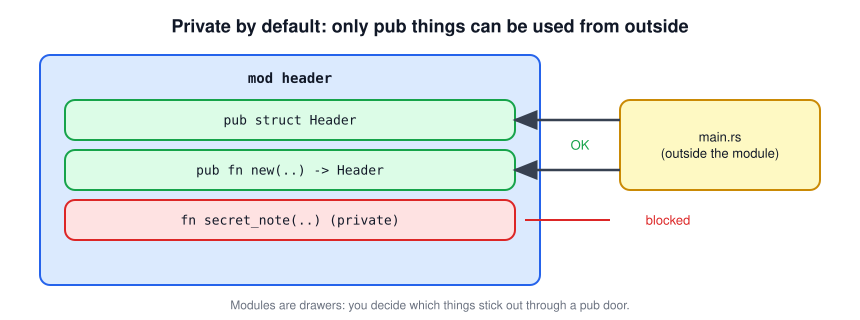
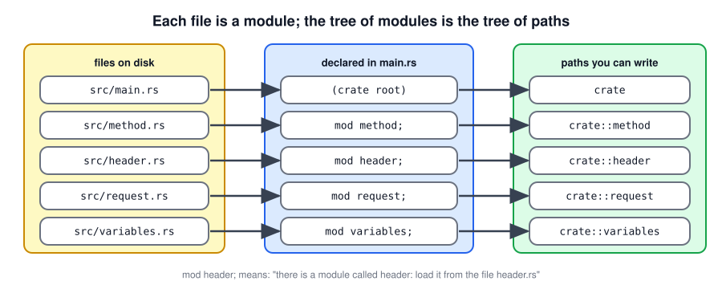

# Chapter 14: Modules: organising code into files

> **Brain Power**
> Your request builder is now about 150 lines in a single file. Nexus has roughly 48,000 lines. Where would *you* put the code for headers, for methods, for sending requests, for saving files? And how would a new teammate find "the header code" in under ten seconds?

You'd make **folders and files** and give them clear names. Rust has the same idea built into the language, and it calls it **modules**.

## The idea: drawers with labels

A **module** is a named container for related code: a drawer in a filing cabinet. Code inside the drawer can be found by its drawer name: `header::Header`, `method::Method`.

You have used module paths since Chapter 9 without noticing:

* `std::collections::HashMap`: the `HashMap` in the drawer `collections` in the drawer `std` (the standard library).
* `fmt::Display`: the `Display` in the drawer `fmt`.
* `String::from`: the `from` that lives with `String` (a type, rather than a module, but the `::` means the same: "inside").

Now you will make your own drawers. Start small: a module inside one file.

```rust
mod header {
    pub struct Header {
        pub key: String,
        pub value: String,
    }

    impl Header {
        pub fn new(key: &str, value: &str) -> Header {
            Header { key: key.to_string(), value: value.to_string() }
        }

        pub fn line(&self) -> String {
            format!("{}: {}", self.key, self.value)
        }
    }
}

fn main() {
    let h = header::Header::new("Host", "a.test");
    println!("{}", h.line());
}
```

```output
Host: a.test
```

* **`mod header { ... }`** makes a module called `header` and puts everything between the braces inside it.
* From outside, you reach things with a **path**: `header::Header::new(...)`: the function `new` of the type `Header` in the module `header`.
* And the new word **`pub`**, which you have seen in Nexus code since Chapter 4 ("ignore it for now"). Time to meet it.

## `pub`: which things stick out of the drawer

**Everything in a module is private by default**: only code inside the module can use it. A thing marked **`pub`** (public) can be used from outside. It's like a drawer where only items with a handle sticking out can be grabbed.



Predict: which line fails in this program?

```rust,fails
mod header {
    pub struct Header {
        pub key: String,
        value: String,
    }

    impl Header {
        pub fn new(key: &str, value: &str) -> Header {
            Header { key: key.to_string(), value: value.to_string() }
        }
    }
}

fn main() {
    let h = header::Header::new("Host", "a.test");
    println!("{}", h.key);
    println!("{}", h.value);
}
```

<details><summary>Answer</summary>

```error
error[E0616]: field `value` of struct `Header` is private
  --> src/main.rs:17:22
   |
17 |     println!("{}", h.value);
   |                      ^^^^^ private field

error: aborting due to 1 previous error

For more information about this error, try `rustc --explain E0616`.
```

The `h.key` line is fine because the field is `pub`. The `h.value` line fails: **"field `value` of struct `Header` is private"**, with `private field` written under the offending use.

</details>

This is **hiding**, and it is a feature: a module can keep its internals private, and change them later without breaking anyone, because nobody else was allowed to touch them. In Chapter 6 every struct had open fields because we were in one file. In real modules you choose, **field by field**, what to open (`pub key: String`) and what to hide (`value: String`).

`pub` can go on: structs, enums, functions, constants, modules, and each field of a struct. (Enum variants are automatically as public as their enum.) One more form you will see in Nexus: **`pub(crate)`**, "visible everywhere in my crate, but not to the outside world".

## `use`: shorter names

Writing `header::Header::new` every time is tiresome. **`use`** brings a name into scope so you can write it short:

```rust
mod header {
    pub struct Header {
        pub key: String,
        pub value: String,
    }

    impl Header {
        pub fn new(key: &str, value: &str) -> Header {
            Header { key: key.to_string(), value: value.to_string() }
        }
    }
}

use header::Header;

fn main() {
    let h = Header::new("Host", "a.test");
    println!("{}: {}", h.key, h.value);
}
```

```output
Host: a.test
```

Three tricks you'll see constantly:

* **Braces** pull in several names at once: `use std::fmt::{self, Display};` (`self` means "the `fmt` module itself").
* **`super::`** means "the module one level up", and **`crate::`** means "the very top of this crate". Both start a path from somewhere known:

```rust
const VERSION: &str = "HTTP/1.1";

mod http {
    pub fn status_line() -> String {
        format!("{} 200 OK", super::VERSION)
    }

    pub fn request_line(path: &str) -> String {
        format!("GET {path} {}", crate::VERSION)
    }
}

fn main() {
    println!("{}", http::status_line());
    println!("{}", http::request_line("/users"));
}
```

```output
HTTP/1.1 200 OK
GET /users HTTP/1.1
```

* **`pub use`** re-exports: it both brings a name in *and* makes it available under the current module's name. (We'll see why that's handy in a moment.)

> **New word: module**
> A named container of code, made with `mod name { ... }` or a file. Things inside are private unless marked `pub`; you reach them with a path like `header::Header`.

> **mod vs use**
> **`mod`** *declares* that a module exists (and loads it). **`use`** *shortens a name* for something that already exists. Beginners mix these up. If you see "unresolved import", you probably forgot a `mod` somewhere.

## Moving modules to their own files

An inline `mod header { ... }` is fine for small things. For real code, each module gets its own **file**. The rule is simple:

> **`mod header;`** (with a semicolon, no braces) means: "there is a module called `header`; its contents are in the file **`header.rs`**, next to this one."

So you take everything *inside* the braces, paste it into `src/header.rs` (without the `mod header { }` wrapper: the file *is* the module), and replace it with `mod header;`.



Let's reorganise the request builder that way. This is a Cargo project (Chapter 1), so run `cargo new request_builder` and make these files. First, `Cargo.toml` (cargo made this for you; just check it):

```toml,proj=rb14,file=Cargo.toml
[package]
name = "request_builder"
version = "0.1.0"
edition = "2021"
```

`src/main.rs` is the **crate root**, the top of the module tree. It declares the other modules and holds `main`:

```rust,proj=rb14,file=src/main.rs
mod header;
mod method;
mod request;
mod variables;

use std::collections::HashMap;

use header::Header;
use method::Method;
use request::Request;

fn main() {
    let mut vars = HashMap::new();
    vars.insert(String::from("host"), String::from("api.example.test"));
    vars.insert(String::from("version"), String::from("v2"));

    let mut get = Request::default();
    get.path = String::from("/{{version}}/users");
    get.add_header(("Host", "{{host}}").into());
    get.add_header(Header::from(("Accept", "application/json")));

    let mut post = Request { method: Method::Post, ..Request::default() };
    post.path = String::from("/{{version}}/users");
    post.add_header(Header::new("Host", "{{host}}"));

    println!("{}", get.to_text(&vars));
    println!();
    println!("{}", post.to_text(&vars));
    println!();
    for name in variables::sorted_names(&vars) {
        println!("variable {name} = {}", vars[name]);
    }
}
```

`src/method.rs`, with the `Method` enum:

```rust,proj=rb14,file=src/method.rs
use std::fmt;

#[derive(Debug, Clone, Copy, PartialEq, Default)]
pub enum Method {
    #[default]
    Get,
    Post,
}

impl fmt::Display for Method {
    fn fmt(&self, f: &mut fmt::Formatter) -> fmt::Result {
        let text = match self {
            Method::Get => "GET",
            Method::Post => "POST",
        };
        write!(f, "{text}")
    }
}
```

`src/header.rs`:

```rust,proj=rb14,file=src/header.rs
use std::fmt;

#[derive(Debug, Clone, PartialEq)]
pub struct Header {
    pub key: String,
    pub value: String,
    pub enabled: bool,
}

impl Header {
    pub fn new(key: &str, value: &str) -> Self {
        Self { key: key.to_string(), value: value.to_string(), enabled: true }
    }
}

impl From<(&str, &str)> for Header {
    fn from(pair: (&str, &str)) -> Self {
        Header::new(pair.0, pair.1)
    }
}

impl fmt::Display for Header {
    fn fmt(&self, f: &mut fmt::Formatter) -> fmt::Result {
        write!(f, "{}: {}", self.key, self.value)
    }
}
```

`src/variables.rs`, our `{{placeholder}}` helpers:

```rust,proj=rb14,file=src/variables.rs
use std::collections::HashMap;

pub fn resolve(template: &str, variables: &HashMap<String, String>) -> String {
    let mut result = template.to_string();
    for (name, value) in variables {
        let mut placeholder = String::from("{{");
        placeholder.push_str(name);
        placeholder.push_str("}}");
        result = result.replace(&placeholder, value);
    }
    result
}

pub fn sorted_names(variables: &HashMap<String, String>) -> Vec<&String> {
    let mut names: Vec<&String> = variables.keys().collect();
    names.sort();
    names
}
```

And `src/request.rs`, which *uses* the others:

```rust,proj=rb14,file=src/request.rs
use std::collections::HashMap;
use std::fmt;

use crate::header::Header;
use crate::method::Method;
use crate::variables::resolve;

#[derive(Debug, Clone, Default)]
pub struct Request {
    pub method: Method,
    pub path: String,
    pub headers: Vec<Header>,
}

impl fmt::Display for Request {
    fn fmt(&self, f: &mut fmt::Formatter) -> fmt::Result {
        write!(f, "{} {} HTTP/1.1", self.method, self.path)?;
        for header in self.headers.iter().filter(|h| h.enabled) {
            write!(f, "\n{header}")?;
        }
        Ok(())
    }
}

impl Request {
    pub fn add_header(&mut self, header: Header) {
        self.headers.push(header);
    }

    pub fn to_text(&self, variables: &HashMap<String, String>) -> String {
        resolve(&self.to_string(), variables)
    }
}
```

Run it with `cargo run`:

```output,proj=rb14
GET /v2/users HTTP/1.1
Host: api.example.test
Accept: application/json

POST /v2/users HTTP/1.1
Host: api.example.test

variable host = api.example.test
variable version = v2
```

Notice a few things:

* Every file starts with the `use` lines it needs: **each file is its own little world**. `request.rs` uses `crate::header::Header` (a path from the crate root: `crate` is the top, then the module `header`, then the type).
* Everything that another file needs is **`pub`**: the `Method` enum, the `Header` fields, `resolve`. Try deleting a `pub` and read the compiler's complaint: it names the file and the private item.
* In `main.rs`, `mod header;` **loads** the module, and `use header::Header;` just shortens the name. Remove a `mod` line and you will get "unresolved import". That is the `mod`/`use` rule from above.
* The line `variables::sorted_names(&vars)` is a path call: no `use` needed when you write the module name.

> **There are no Dumb Questions**
>
> **Q: What about `header/mod.rs`?**
> A: A module can be a *folder* instead of a file: `src/header/mod.rs` is the module's own code, and `src/header/parser.rs` would be a submodule declared inside it with `mod parser;`. Rust accepts both `header.rs` and `header/mod.rs`. Nexus uses the folder style for larger modules (`service/mod.rs`, `service/http.rs`).
>
> **Q: Must I write `mod` in a particular file?**
> A: Declare each module once, in its **parent**. Everything else reaches it with `crate::...` or `super::...` paths.
>
> **Q: Does splitting into files make the program slower?**
> A: No. Modules are about humans. The compiler sees one crate either way.
>
> **Q: Why was everything `pub` in chapters 6 to 13?**
> A: Because all of it lived in one module (the crate root), where everything can see everything. `pub` only matters when something crosses a module boundary.

> **Sharpen your pencil**
> In `variables.rs`, delete the `pub` in front of `fn sorted_names`. Predict the error before you run `cargo build`. Then put it back.
>
> <details><summary>Answer</summary>
>
> The error is **"function `sorted_names` is private"** (code `E0603`), reported where `main.rs` calls `variables::sorted_names`, with a note pointing at the definition in `variables.rs`. Also: `resolve` stays usable from `request.rs` only because it is `pub`.
> </details>

## Now look at real Nexus

You can now read the front page of the Nexus engine. This is the whole table of contents of `nexus-core`, [`lib.rs`](../../crates/nexus-core/src/lib.rs) (abridged):

```rust,nexus
pub mod auth;
pub mod codegen;
pub mod collections;
// ...
pub mod types;
pub mod websocket;

pub use error::{Error, Result};
```

(`lib.rs` is the root file of a *library crate*, a kind of crate that Chapter 15 introduces; for now it just plays the role `main.rs` played for your program.) Every `pub mod name;` declares a public module and loads it from a file (`auth.rs` or `auth/mod.rs`, which is a folder in this case). That is why the code is findable: the `websocket` module lives in `websocket/mod.rs`, the `types` module in `types/mod.rs`. The last line is a **re-export**: `error` is a module defined in `error.rs`, and this line makes `Error` and `Result` available as `nexus_core::Error` and `nexus_core::Result`, one step shorter. (`Error` and `Result` are the engine's own error type: Chapter 16.)

Open the `auth` module's own front page, [`auth/mod.rs`](../../crates/nexus-core/src/auth/mod.rs). It shows the "private drawer, public handle" idea at full size:

```rust,nexus
mod handler;
mod token_store;

pub use handler::{apply_auth, effective_auth, resolve_auth, AuthResult, PreparedRequest};
pub use token_store::{StoredToken, TokenStore};
```

`mod handler;` and `mod token_store;` have **no `pub`**: those files are private to `auth`. But the two `pub use` lines pick out the few names the rest of the program may use and re-export them. Outsiders write `auth::apply_auth(...)`, never `auth::handler::apply_auth(...)`. The module is free to rearrange its inner files, because nobody can see them.

And inside other modules you see paths like this one, from [`response/mod.rs`](../../crates/nexus-core/src/response/mod.rs):

```rust,nexus
use crate::types::{HeaderValue, ResponseFormat, ResponseTiming};
```

Decode: "from the top of this crate (`crate`), in the `types` module, bring in three names". Exactly `use crate::header::Header` with braces.

## Checkpoint project: request builder, version 13

You just did it: the request builder now lives in five files. The program behaves exactly as before; only the *organisation* changed. That is what a good refactoring looks like: the output is the same, the structure is cleaner.

> **Sharpen your pencil**
> Add a new module `src/body.rs` containing the `Body` enum from Chapter 7 (`Empty`, `Text(String)`, `Json(String)`). Which files must change so that `main.rs` can use it? List them without looking.
>
> <details><summary>Answer</summary>
>
> Two: create `src/body.rs` with `pub enum Body { ... }`, and add the line `mod body;` in `main.rs` (and `use body::Body;` there or `use crate::body::Body;` in `request.rs`, if you add a `body` field to `Request`). Without `mod body;` the compiler never even *looks* at the new file.
> </details>

## Bullet Points

* A **module** is a named container: `mod header { ... }`, or a file: `mod header;` loads `header.rs`.
* You reach things with a **path**: `header::Header`, `crate::header::Header` (from the crate root), `super::x` (one level up).
* Everything is **private by default**. Mark things `pub` to let outsiders use them, including each field of a struct. `pub(crate)` means "anywhere in this crate".
* **`use`** shortens names (`use header::Header;`, `use std::fmt::{self, Display};`). **`mod`** declares and loads. **`pub use`** re-exports.
* The **crate root** is `src/main.rs` (or `src/lib.rs`, Chapter 15); modules are declared once, in their parent.

## Cheat sheet

```text
mod header;                 load src/header.rs as module `header`
mod x { pub fn f() {} }     inline module
x::f()   crate::x::f()   super::f()      paths
use crate::header::Header;               shorten a name
use std::fmt::{self, Display};           several names
pub struct S { pub a: u8, b: u8 }        a is open, b is hidden
pub use inner::Thing;                    re-export
pub(crate) fn g() {}                     visible in this crate only
```
