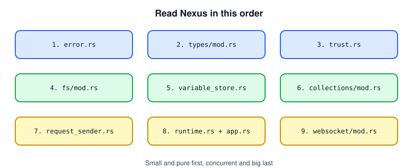
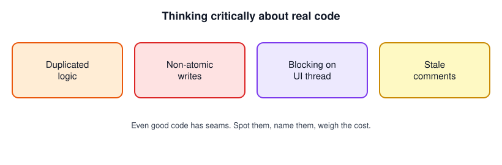

# Chapter 14: Where to go next

> **Brain Power**
> Without looking back: explain to an imaginary friend, in one sentence each, (1) what *ownership* is, (2) why `?` exists, and (3) what happens between pressing **Send** in Nexus and seeing the response. If you got stuck on one, that's your next re-read.

You made it. You can now open a 48,000-line Rust project and *read* most of it. Let's make that concrete.

## Read Nexus in this order



Start with small, pure code; end with the big concurrent parts. For each file, first read the doc comments, then the function signatures, and only then the bodies.

| # | File | What you'll practice | Book chapter |
|---|---|---|---|
| 1 | [`nexus-core/src/error.rs`](../../crates/nexus-core/src/error.rs) | a 12-line error file with `thiserror` | 5 |
| 2 | [`nexus-core/src/types/mod.rs`](../../crates/nexus-core/src/types/mod.rs) | structs, enums, derive, serde attributes | 3, 4, 8 |
| 3 | [`nexus-core/src/trust.rs`](../../crates/nexus-core/src/trust.rs) | pure functions, iterators, `Option`, lifetimes; then read `trust/tests.rs` | 5, 7, 9, 13 |
| 4 | [`nexus-core/src/fs/mod.rs`](../../crates/nexus-core/src/fs/mod.rs) | `Result`, `?`, std builders, `match` on modes | 5 |
| 5 | [`nexus-core/src/environments/variable_store.rs`](../../crates/nexus-core/src/environments/variable_store.rs) | `impl` blocks, `LazyLock` regex, closures | 3, 9 |
| 6 | [`nexus-core/src/collections/mod.rs`](../../crates/nexus-core/src/collections/mod.rs) | file I/O, `match` guards, `let ... else`, generic helpers | 4, 5, 8 |
| 7 | [`nexus-core/src/http/request_sender.rs`](../../crates/nexus-core/src/http/request_sender.rs) | async/await, `timeout`, `while let` | 12 |
| 8 | [`nexus-gui/src/runtime.rs`](../../crates/nexus-gui/src/runtime.rs) then [`app.rs`](../../crates/nexus-gui/src/app.rs) (`send_active`, `poll`) | threads, channels, `Arc`, `move` | 11, 12 |
| 9 | [`nexus-core/src/websocket/mod.rs`](../../crates/nexus-core/src/websocket/mod.rs) | `Arc<Mutex>`, mpsc, `select!`, `Drop` | 11, 12 |

Bonus rounds: [`editor/model.rs`](../../crates/nexus-gui/src/editor/model.rs) (a text editor's brain as pure functions plus unit tests, no UI at all) and the tests in [`crates/nexus-gui/tests/`](../../crates/nexus-gui/tests).

## Try-it ideas (small, safe)

* Run `cargo test -p nexus-core trust`, then deliberately break `origin_of` and watch which tests fail. Revert.
* Add a new unit test next to `origin_of` for a URL with a username (`https://user@host/`). Predict the result first.
* Add `println!`/`dbg!` to `Runtime::drain` in a debug build and watch messages arrive while you click around.
* Find three places using `?` and trace which `From` conversion makes each compile.
* Choose any `match` over `HttpMethod` and add a pretend `Trace` variant. Count the compile errors. (Revert afterwards!)

> Do these on a scratch git branch so you can throw changes away.

## Reading real-world code: what a reviewer noticed

A book that only shows good code isn't honest. Real programs have seams. A read-through of Nexus found strengths *and* things worth discussing. This section shows how to think critically about Rust code. The rule I used: **I only list what I could confirm by opening the files.**



First the good news, because it matters: Nexus keeps a clean layering (a UI-free engine behind a single `App` facade), has an unusually strong test suite, uses no `unsafe`, and is careful about security (owner-only file modes, path-traversal guards, a "trust" model for imported collections). The four observations below are about maintainability and robustness, not "this is a bad project".

### 1. Duplicated logic: two `resolve_request` functions

Variables like `{{token}}` must be substituted into a request before it's sent. Two *different* functions with the same name do this:

* [`nexus-gui/src/payload.rs`](../../crates/nexus-gui/src/payload.rs) (line 59), used by the single-request path: it resolves the URL, header and param **keys and values**, the raw body, urlencoded and form-data rows, the binary path, and GraphQL fields.
* [`nexus-core/src/runner/mod.rs`](../../crates/nexus-core/src/runner/mod.rs) (line 626, private), used by the collection runner: it resolves only enabled header **values**, the body, enabled urlencoded rows and GraphQL, and it skips form-data and binary paths. The runner sends the body it gets back from its script chain (`pre.request.body`), and that body is built by `extract_body` in `scripts/script_runner.rs`, which ends with `_ => None` for the modes it doesn't list (form-data and binary), so those bodies appear to be dropped in runs.

Two near-copies that have *drifted apart* mean the same request can behave differently when sent from the tab versus from the runner. That's the classic cost of duplication: fix a bug in one, forget the other.

**What to ask:** "Is there one pipeline both callers should share?" A Rust-flavoured fix: move one `resolve_request` into `nexus-core` and call it from both, plus tests that run the *same* request through both paths.

### 2. Non-atomic file writes

All persistence goes through [`fs/mod.rs`](../../crates/nexus-core/src/fs/mod.rs), which is where the 0600/0700 permissions are enforced. Good! But look at what "replace a file" does:

```rust
match mode {
    WriteMode::Replace => opts.create(true).truncate(true),
    WriteMode::CreateNew => opts.create_new(true),
    WriteMode::Append => opts.create(true).append(true),
};
let mut handle = opts.open(file)?;
handle.set_permissions(fs::Permissions::from_mode(PRIVATE_FILE_MODE))?;
handle.write_all(data)
```

`truncate(true)` empties the existing file *first*, then writes the new bytes. If the process is killed or the machine loses power between those two steps, you're left with an empty or half-written file. And look at how loaders treat unreadable files, e.g. [`ui_state.rs`](../../crates/nexus-gui/src/state/ui_state.rs):

```rust
let mut s: Self = std::fs::read_to_string(Self::path(home))
    .ok()
    .and_then(|t| serde_json::from_str(&t).ok())
    .unwrap_or_default();
```

`.ok()` swallows the error and `unwrap_or_default()` quietly substitutes defaults. For UI layout that's a fair choice. For a collection request file (see `load_request` in Chapter 5, which also returns `None` on a parse error) it can mean **silent data loss**: a damaged file just vanishes from the list.

**What to ask:** "What happens if this is interrupted halfway?" The standard remedy is *write to a temporary file in the same folder, then `rename` over the original*: renames are atomic on common filesystems, so readers see either the old file or the new one, never half of each. Another question this raises: is swallowing an error with `.ok()` always right, or should at least a warning be logged?

### 3. Blocking work on the UI thread

The project's own [conventions](../../.cursor/rules/project-conventions.mdc) say: "Never block the UI thread... File reads and heavy parsing go to `spawn_blocking`." And mostly they do, as you saw in Chapter 12. But follow the first lines of `send_active` in [`app.rs`](../../crates/nexus-gui/src/app.rs):

```rust
pub fn send_active(&mut self) {
    if let Some(dir) = self
        .tabs
        .active()
        .and_then(|t| t.origin.as_ref().map(|o| o.dir_name.clone()))
    {
        self.collections.recheck_trust(&self.app, &dir);
    }
    // ...
```

`recheck_trust` calls `app.collection_trust_status(dir)`, which calls `CollectionManager::trust_status`, which calls `content_hash`, which in [`collections/mod.rs`](../../crates/nexus-core/src/collections/mod.rs) does:

```rust
let c = self.load_collection(dir_name)?;
Ok(hex::encode(Sha256::digest(serde_json::to_vec(&c)?)))
```

That's: **read the whole collection from disk, parse it, re-serialize it and SHA-256 hash it**, all synchronously inside the click handler, *on the UI thread*, before the request is even spawned. For a small collection it's imperceptible. For a *trusted* collection with thousands of requests, the window can stutter on every Send. (`trust_status` returns `Untrusted` early when the collection isn't in the trusted map, so only trusted ones pay for the hash.)

A clearer, unconditional example is a few hundred lines away in the same file: `save_response_to` (`app.rs`) calls `std::fs::write` directly with the response body, which can be up to 100 MiB, *on the UI thread*. The window freezes until the disk finishes, and the write also bypasses `nexus_core::fs`, the module the conventions say all file writes should use.

It's a good example of a rule that's followed 95% of the time. The fix would be to run the check inside the async task (it already has a `spawn_blocking` for building the payload), or to cache the hash and invalidate it when files change.

**What to ask:** "Where does I/O happen relative to the thread that must stay responsive?" Reading code with that question in mind finds issues no compiler can.

### 4. Stale comments from the previous implementation

Nexus is a port of an earlier TypeScript/Electron app, and many comments still speak to that history. For example, the first lines of [`types/mod.rs`](../../crates/nexus-core/src/types/mod.rs):

```rust
//! Serde port of `packages/core/src/types/index.ts`. JSON produced/consumed here must match the
//! TypeScript shapes exactly (camelCase keys, omitted optionals, same enum strings).
```

and `fs/mod.rs` (`port of packages/core/src/fs/private-fs.ts`, plus "the `'w' | 'wx' | 'a'` open flags of the TS"), `websocket/mod.rs` ("What the TS client emitted as..."), `runner/mod.rs` ("like the TS `run()`"), `scripts/mod.rs` (`Port of packages/core/src/scripts`). A `grep` for "TS" and "port of" in the source finds a few dozen such lines.

Some of them are valuable (the JSON format *really must* stay compatible with the old app's files). But a reader who doesn't have `packages/core/` can't follow them, and references like "as in the TS" explain nothing on their own. Comments rot silently because the compiler never checks them.

**What to ask:** "Does this comment still tell the truth, and can a newcomer act on it?" Keep the *reason* (e.g. "keys must be camelCase so old collection files load") and drop the pointer to a repository the reader doesn't have.

### How to read code critically (the takeaway)

1. **Start from the promises** (docs, conventions) and check whether the code keeps them.
2. **Look for twins.** Same name or same job in two places? Compare them.
3. **Ask "what if it stops here?"** for every write, every network call, every lock.
4. **Follow the thread.** Which thread runs this? What does it wait on?
5. **Weigh the cost.** Each observation above is *fine* for a small collection and a healthy disk. A reviewer's job is to know where the edges are, and then decide with eyes open.
6. **Praise specifically.** Notice what's done well (a never-panic runner, hash-bound trust, a clock passed as a parameter) and copy it.

> **Sharpen your pencil**
> Pick **one** of the four findings and write 3 sentences: (a) the scenario in which it hurts a user, (b) the smallest change that would fix it, (c) the test you'd write first.
>
> *(Open-ended; a sample answer follows the glossary.)*

> **Watch it!**
> Critical reading is not nitpicking. A finding is only worth reporting if you can point at the line, say what goes wrong, and say *when*. Before you call something a bug, try to prove yourself wrong: finding #3 above first looked like "every Send stutters" until a closer read showed an early return for untrusted collections. Check the claim, then shrink it to what is actually true.

> **There are no Dumb Questions**
>
> **Q: Is it rude to find problems in code someone else wrote?**
> A: No. Every real codebase has them, and Nexus is no exception. Naming them kindly, with a suggested fix, is how projects get better.
>
> **Q: I can't understand a whole file. Am I doing it wrong?**
> A: No. Read doc comments and signatures first, skip bodies you don't need, and come back later. Nobody reads 48,000 lines in one go.
>
> **Q: Should I rewrite things the way I'd do them?**
> A: Not at first. Make one small change on a scratch branch, run the tests, and see what breaks.

## Glossary

| Term | Plain-language meaning |
|---|---|
| **Async / await** | A way to write code that waits without blocking its thread (Ch. 12) |
| **Arc** | Shared-ownership pointer with an atomic reference count (Ch. 6, 11) |
| **Attribute** | `#[...]` note to the compiler, e.g. `#[derive(Debug)]` (Ch. 8) |
| **Borrow** | Temporary access to a value without owning it: `&T` / `&mut T` (Ch. 7) |
| **Borrow checker** | The compiler part enforcing ownership and borrow rules (Ch. 6-7) |
| **Box** | A pointer to a value on the heap (Ch. 4) |
| **`?` operator** | Return early with the error if a `Result`/`Option` is `Err`/`None`, else unwrap the value (Ch. 5) |
| **Cargo** | Rust's build tool and package manager (Ch. 1) |
| **Channel** | A pipe for sending messages between threads/tasks (Ch. 11) |
| **Clone** | Make an explicit independent copy (Ch. 6) |
| **Closure** | An unnamed function that can capture variables (Ch. 9) |
| **Copy** | A cheap type (like `i32`) that is duplicated on assignment instead of moved (Ch. 6) |
| **Crate** | A compilation unit: a library or a binary (Ch. 10) |
| **Derive** | Ask the compiler to generate a trait implementation (Ch. 8) |
| **dyn / trait object** | A value used through a trait instead of its concrete type, e.g. `Box<dyn Error>` (Ch. 4, 8) |
| **Drop** | Cleanup that runs automatically when a value's owner ends (Ch. 6, 8) |
| **Enum** | A type that is exactly one of several variants (Ch. 4) |
| **Future** | A value representing async work not yet finished (Ch. 12) |
| **Generic** | Code parameterized over types, `<T>` (Ch. 8) |
| **Heap / Stack** | Flexible big memory vs. fast fixed-size memory (Ch. 2) |
| **Immediate mode** | A GUI style that redraws everything from plain state each frame (Ch. 12) |
| **Iterator** | A lazy sequence you transform with adapters (Ch. 9) |
| **Lifetime** | How long a reference is valid; named `'a` (Ch. 7) |
| **Macro** | Code that writes code, called with `!` (`println!`) (Ch. 1) |
| **Match** | Exhaustive pattern-based branching (Ch. 4) |
| **Module** | A namespace/folder of code with privacy rules (Ch. 10) |
| **Move** | Transferring ownership; the old name becomes unusable (Ch. 6) |
| **Mutex** | A lock wrapping data so one thread uses it at a time (Ch. 11) |
| **Option** | `Some(value)` or `None`: no null (Ch. 5) |
| **Ownership** | Every value has exactly one owner, freed when it ends (Ch. 6) |
| **Panic** | A crash of the current thread, e.g. from `unwrap()` on `None` (Ch. 5) |
| **Pattern** | The shape on the left of `match` arms and `let` (Ch. 4) |
| **Result** | `Ok(value)` or `Err(error)` (Ch. 5) |
| **Send / Sync** | Marker traits: can move to / be shared between threads (Ch. 11) |
| **serde** | Crate that converts structs to/from JSON and more (Ch. 8) |
| **RAII** | Cleanup tied to a value's scope: resources are released automatically when the owner is dropped (Ch. 6) |
| **Rc / RefCell** | Single-threaded shared ownership, and mutation checked at runtime (Ch. 6, 11) |
| **Shadowing** | Re-declaring a name with `let` to make a new variable that hides the old one (Ch. 2) |
| **Slice** | A borrowed view of part of a list or text: `&[T]`, `&str` (Ch. 2, 9) |
| **`'static`** | `&'static T` is valid for the whole program; `T: 'static` only means T holds no short-lived borrows (Ch. 7) |
| **Struct** | A type grouping named fields (Ch. 3) |
| **Task / runtime** | A unit of async work, and the engine (tokio) that runs many of them on a few threads (Ch. 12) |
| **Trait** | A set of methods a type promises to provide (Ch. 8) |
| **Unit `()`** | The type with exactly one value, "nothing"; what a function with no return value returns (Ch. 3) |
| **Workspace** | Several packages built together by Cargo (Ch. 10) |

## Sample answer to the pencil exercise

*Finding 2 (non-atomic writes).* (a) The user saves a request just as the laptop battery dies; on the next launch `collection.json` is empty, the loader returns nothing, and the collection appears to have vanished. (b) Add a new `WriteMode` variant (say `AtomicReplace`) that writes to `<name>.tmp` in the same directory and `rename`s it over the target. (c) A test that calls the new mode, checks that no `.tmp` file is left behind, and that after a simulated failure the target either still has the old content or has the new content, never an empty file.

## Keep learning

* **The Rust Book**: <https://doc.rust-lang.org/book/>. The official, thorough companion to this book.
* **Rust by Example**: <https://doc.rust-lang.org/rust-by-example/>.
* **Rustlings**: <https://github.com/rust-lang/rustlings>. Small broken programs to fix, with instant feedback.
* **Tokio tutorial**: <https://tokio.rs/tokio/tutorial>. Chapter 12, much deeper.
* **egui**: <https://www.egui.rs/>. Try the web demo, then read Nexus's `panels/` code.
* **Standard library docs**: <https://doc.rust-lang.org/std/>. Learn to love the search box (press `s`).
* Command to open the docs of everything you depend on: `cargo doc --open`.

## Bullet Points

* Read Nexus from small and pure (error, types, trust) to big and concurrent (runtime, websocket).
* Break things on a scratch branch; let the compiler and the tests teach you.
* Reading code critically means checking promises, finding twins, and asking "what if it stops here?"
* Good projects have seams. Name them kindly, and weigh them honestly.

## Cheat sheet (the whole book on one card)

```
let / let mut         bindings           struct + impl        data + behavior
enum + match          one-of + sorting    Option / Result / ?  no null, no hidden exceptions
ownership: move/clone borrowing: & / &mut lifetimes: 'a        references can't outlive owners
trait + generics      derive + serde     iter().map().collect() closures |x| ..
mod / pub / use       Cargo workspace    Arc<Mutex<T>>        mpsc channel
async/.await + tokio  spawn_blocking     #[test] + cargo test
```

Happy hacking. Go ship something.
