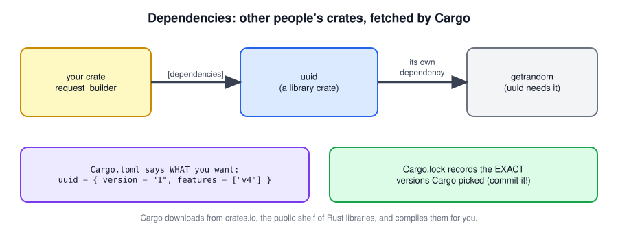
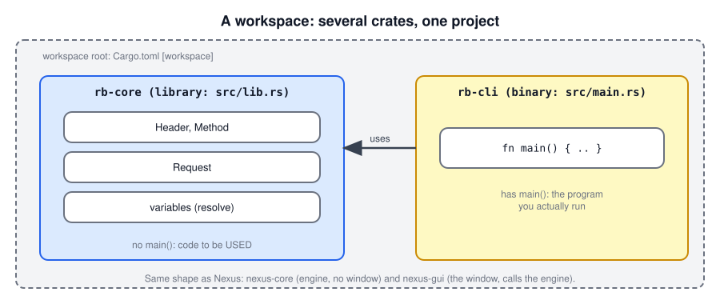

# Chapter 15: Crates, dependencies and workspaces

> **Brain Power**
> Each request you build should get a unique ID, like `67e55044-10b1-426f-9247-bb680e5fe0c8`. Writing a good random-ID generator from scratch is hard. Surely somebody has already done it well. How could you *borrow* their finished code and use it in your project, the way you install an app?

In Rust, you borrow code by adding a **dependency**. This chapter shows how, and then how to organise a project that has *several* crates. It is the last piece of the folder-and-file puzzle you started in Chapter 14.

## What is a crate? (a promise kept)

In Chapter 1 we said: *a crate is one Cargo project's worth of Rust code*. Now we can be more exact. There are two kinds:

> **New word: binary crate**
> A crate with a `main` function. It compiles to a program you can run. The request builder is one.

> **New word: library crate**
> A crate with no `main`, meant to be *used by other code*. Its starting file is `src/lib.rs` instead of `src/main.rs`. Libraries like `uuid` or `url` are library crates.

Many people publish library crates on **crates.io**, the public shelf of Rust libraries. Cargo knows how to fetch them for you.

## Adding a dependency

Let's give our requests unique IDs with a crate called **`uuid`** (a "UUID" is a long random ID that is practically never the same twice). In your project folder, type:

```bash
cargo add uuid --features v4
```

Cargo prints some notes, and edits your `Cargo.toml`. Open it:

```toml,proj=uid,file=Cargo.toml
[package]
name = "uid"
version = "0.1.0"
edition = "2021"

[dependencies]
uuid = { version = "1.29.0", features = ["v4"] }
```

(Your `version` will probably be a newer number.) The new line under **`[dependencies]`** (the heading you saw in Chapter 1, empty until now) says:

* **`uuid`**: the crate's name on crates.io.
* **`version = "1.29.0"`**: "any version *compatible with* 1.29.0". Cargo follows a convention called **semantic versioning**: `1.x.y` versions don't break each other, so it may use a newer `1.x` but never `2.0`.
* **`features = ["v4"]`**: many crates have optional parts you can switch on. `v4` turns on random IDs ("version 4" UUIDs). Features keep programs small: you pay only for what you ask for.

Now use it:

```rust,proj=uid,file=src/main.rs
use uuid::Uuid;

fn main() {
    let id = Uuid::new_v4().to_string();
    println!("{}", id.len());
    println!("{}", id.matches('-').count());
}
```

```output,proj=uid
36
4
```

* **`use uuid::Uuid;`** is Chapter 14's `use`: "in the crate `uuid`, bring in the type `Uuid`". The crate's name is the first part of the path, the way `std` is for the standard library.
* **`Uuid::new_v4()`** makes a fresh random ID (an associated function, Chapter 6), and `.to_string()` is Chapter 10's free gift for anything with `Display`.
* We print only the *length* (36 characters) and the number of dashes (4), because the ID itself would be different every time. Run it twice with `println!("{id}")` and look.

The first `cargo run` after adding a dependency takes longer: Cargo **downloads** `uuid` (and the crates `uuid` itself needs, like `getrandom`), **compiles** them, and then your code.



Cargo also creates a file called **`Cargo.lock`**. It records the *exact* version of every crate it picked, so that everybody building your program gets the same ones. You don't edit it; you do commit it, for programs.

To explore any crate, search for it on <https://crates.io> and read its documentation on <https://docs.rs>. Types, functions and examples are all there.

> **There are no Dumb Questions**
>
> **Q: Is it safe to run other people's code?**
> A: It's your decision to add a dependency, the same as with any software. Stick to well-known crates, glance at download counts, and keep the list short. Real Nexus has a *trust* feature for exactly this reason: it refuses to run scripts from collections you haven't approved.
>
> **Q: Do I need to be online to build?**
> A: Only to fetch a crate the first time. After that, Cargo reuses its download cache.
>
> **Q: What does `cargo add` do that I can't do by hand?**
> A: Nothing; it just edits `Cargo.toml` for you. You could type the line yourself.

## One package, two crates: `lib.rs` and `main.rs`

A single Cargo project can contain **both** a library crate and a binary crate. If `src/lib.rs` exists next to `src/main.rs`, Cargo builds both. Why bother? Because other code (the binary, tests, even other projects) can then **use** the library by name.

The usual recipe is: put all the real logic (your modules from Chapter 14) in the library, and make `main.rs` thin: it just calls into the library and prints.

## Workspaces: many crates, one project

When a project grows, you often want *several* crates that live side by side and are built together. Cargo calls that a **workspace**:

> **New word: workspace**
> A set of crates managed together. They share one `Cargo.lock` and one `target/` folder. A top-level `Cargo.toml` with a `[workspace]` section lists the members.

The request builder is a good candidate for exactly the split that **Nexus** uses: an *engine* with no user interface (`rb-core`, a library) and a *face* that uses it (`rb-cli`, a binary). The engine can be tested and reused without ever printing a line.



Here is the new folder layout:

```text
request_builder/
  Cargo.toml                  <- the workspace root
  crates/
    rb-core/
      Cargo.toml
      src/lib.rs  header.rs  method.rs  request.rs  variables.rs
    rb-cli/
      Cargo.toml
      src/main.rs
```

First the **workspace root** `Cargo.toml`:

```toml,proj=rb15,file=Cargo.toml
[workspace]
resolver = "2"
members = ["crates/rb-core", "crates/rb-cli"]

[workspace.package]
version = "0.1.0"
edition = "2021"

[workspace.dependencies]
uuid = { version = "1", features = ["v4"] }
rb-core = { path = "crates/rb-core" }
```

* **`[workspace] members = [...]`** lists the crates. (`resolver = "2"` is a setting for how Cargo picks versions: copy it as is.)
* **`[workspace.package]`** holds facts shared by all members, such as `version` and `edition`, so you write them once.
* **`[workspace.dependencies]`** is a shared shopping list. Every crate that wants `uuid` uses *the same version and features*. The last line, `rb-core = { path = "crates/rb-core" }`, is a **path dependency**: "this crate is not on crates.io, it's the folder over here".

The library's `Cargo.toml`:

```toml,proj=rb15,file=crates/rb-core/Cargo.toml
[package]
name = "rb-core"
version.workspace = true
edition.workspace = true

[dependencies]
uuid.workspace = true
```

`version.workspace = true` means "take my version from `[workspace.package]`", and `uuid.workspace = true` means "take the `uuid` entry from `[workspace.dependencies]`". The binary's `Cargo.toml` depends on the library:

```toml,proj=rb15,file=crates/rb-cli/Cargo.toml
[package]
name = "rb-cli"
version.workspace = true
edition.workspace = true

[dependencies]
rb-core.workspace = true
```

That one line, `rb-core.workspace = true`, is what makes `rb-cli` able to use `rb-core`'s public code. (A library whose name has a dash is used in code with an underscore: `rb_core`.)

Now the code. The library's `lib.rs` is the *front page* of the crate, declaring its modules (Chapter 14) and re-exporting the most useful names:

```rust,proj=rb15,file=crates/rb-core/src/lib.rs
pub mod header;
pub mod method;
pub mod request;
pub mod variables;

pub use header::Header;
pub use method::Method;
pub use request::Request;
```

Move `header.rs`, `method.rs` and `variables.rs` from Chapter 14 into `crates/rb-core/src/` **unchanged**. Only `request.rs` changes: each request gets an `id` from `uuid`. (A request can no longer derive `Default`, because a blank ID would be wrong: we write a `new()` instead.)

<!-- proj=rb15 copy=14_modules:rb14:src/header.rs>crates/rb-core/src/header.rs -->
<!-- proj=rb15 copy=14_modules:rb14:src/method.rs>crates/rb-core/src/method.rs -->
<!-- proj=rb15 copy=14_modules:rb14:src/variables.rs>crates/rb-core/src/variables.rs -->

```rust,proj=rb15,file=crates/rb-core/src/request.rs
use std::collections::HashMap;
use std::fmt;

use uuid::Uuid;

use crate::header::Header;
use crate::method::Method;
use crate::variables::resolve;

#[derive(Debug, Clone)]
pub struct Request {
    pub id: String,
    pub method: Method,
    pub path: String,
    pub headers: Vec<Header>,
}

impl fmt::Display for Request {
    fn fmt(&self, f: &mut fmt::Formatter) -> fmt::Result {
        write!(f, "{} {} HTTP/1.1", self.method, self.path)?;
        for header in self.headers.iter().filter(|h| h.enabled) {
            write!(f, "\n{header}")?;
        }
        Ok(())
    }
}

impl Request {
    pub fn new(method: Method, path: &str) -> Self {
        Self {
            id: Uuid::new_v4().to_string(),
            method,
            path: path.to_string(),
            headers: Vec::new(),
        }
    }

    pub fn add_header(&mut self, header: Header) {
        self.headers.push(header);
    }

    pub fn to_text(&self, variables: &HashMap<String, String>) -> String {
        resolve(&self.to_string(), variables)
    }
}
```

Finally, the binary. Look at its first lines: it **uses the library like any other crate**, by name:

```rust,proj=rb15,file=crates/rb-cli/src/main.rs
use std::collections::HashMap;

use rb_core::{variables, Header, Method, Request};

fn main() {
    let mut vars = HashMap::new();
    vars.insert(String::from("host"), String::from("api.example.test"));
    vars.insert(String::from("version"), String::from("v2"));

    let mut get = Request::new(Method::Get, "/{{version}}/users");
    get.add_header(("Host", "{{host}}").into());
    get.add_header(Header::from(("Accept", "application/json")));

    let mut post = Request::new(Method::Post, "/{{version}}/users");
    post.add_header(Header::new("Host", "{{host}}"));

    println!("{}", get.to_text(&vars));
    println!();
    println!("{}", post.to_text(&vars));
    println!();
    println!("ids differ: {}", get.id != post.id);
    for name in variables::sorted_names(&vars) {
        println!("variable {name} = {}", vars[name]);
    }
}
```

Run it from the workspace root, telling Cargo *which* crate (`-p` is short for "package"):

```bash
cargo run -p rb-cli
```

```output,proj=rb15,run=-p+rb-cli
GET /v2/users HTTP/1.1
Host: api.example.test
Accept: application/json

POST /v2/users HTTP/1.1
Host: api.example.test

ids differ: true
variable host = api.example.test
variable version = v2
```

Because every `pub` item is the library's *public face*, and `lib.rs` chose what to re-export, `rb-cli` can write `use rb_core::Request;` instead of `use rb_core::request::Request;`. Back in Chapter 14, the `auth` module of Nexus did exactly the same thing.

Handy workspace commands:

| Command | Does |
|---|---|
| `cargo run -p rb-cli` | build and run one crate |
| `cargo build --workspace` | build every member |
| `cargo test --workspace` | run every member's tests (Chapter 21) |
| `cargo test -p rb-core` | test just one crate |

> **Sharpen your pencil**
> You want `rb-cli` to start printing the unique ID of each request. Which files must change? Think about *only* the crate that needs the change.
>
> <details><summary>Answer</summary>
>
> Only `crates/rb-cli/src/main.rs`: add `println!("id: {}", get.id);`. The `id` field is already `pub` in `rb-core`, and `rb-cli` already depends on `rb-core`. It doesn't need `uuid` in its own `Cargo.toml`, because it never calls `uuid` directly. It only reads a `String`.
> </details>

## Now look at real Nexus

Now you can read the **top-level `Cargo.toml` of Nexus** like a book. It is almost word for word the same as yours:

```toml,nexus
[workspace]
resolver = "2"
members = ["crates/nexus-core", "crates/nexus-gui"]

[workspace.package]
version = "0.1.0"
edition = "2021"
license = "MIT"
```

Two crates: an engine and a face. And a shared shopping list (the first entries; the real file has more). Three of them are libraries you will meet in Chapters 16 and 17: `serde` and `serde_json` (saving data as JSON) and `thiserror` (writing error types):

```toml,nexus
[workspace.dependencies]
serde = { version = "1", features = ["derive"] }
serde_json = { version = "1", features = ["preserve_order"] }
thiserror = "2"
uuid = { version = "1", features = ["v4", "serde"] }
nexus-core = { path = "crates/nexus-core" }
```

`uuid` with the `v4` feature, exactly as you added it (plus a `serde` feature, Chapter 17). And the last line is the path dependency that lets the window use the engine. In `crates/nexus-gui/Cargo.toml`:

```toml,nexus
[package]
name = "nexus-gui"
version.workspace = true
edition.workspace = true

[lib]
name = "nexus_gui"
path = "src/lib.rs"

[[bin]]
name = "nexus"
path = "src/main.rs"

[dependencies]
nexus-core.workspace = true
uuid.workspace = true
```

(Abridged. The real file has more lines.) The `[package]` and `.workspace = true` lines are what you wrote. And it has **both** a `[lib]` and a `[[bin]]` section: this single package builds a library called `nexus_gui` (all the real window code) and a binary called `nexus` (just the program that starts it). The double brackets `[[bin]]` mean "there can be several binaries". That's the `lib.rs` + `main.rs` pair from earlier in this chapter. A `[dev-dependencies]` section lists crates needed only for testing (Chapter 21).

And at the bottom of the root file:

```toml,nexus
[profile.release]
opt-level = "s"
lto = true
codegen-units = 1
strip = true
```

Do you remember `cargo build --release` from Chapter 1? This section tunes it: `opt-level = "s"` means "optimise for small size", `lto = true` lets the compiler optimise *across* crates, `codegen-units = 1` gives it one big job so it can optimise more, and `strip = true` removes debugging information. That is part of how Nexus stays one small file.

## Checkpoint project: request builder, version 14

You now have a real multi-crate project with a third-party dependency: `rb-core` (library) and `rb-cli` (binary). The behaviour is the same as before, plus an `id` on each request. In the coming chapters, only `rb-core` will grow: errors (Chapter 16), JSON (Chapter 17), concurrency (Chapters 18 and 19), and tests (Chapter 21). `rb-cli` stays a thin shell, just like `nexus-gui`.

## Bullet Points

* A **binary crate** has `main` and produces a program; a **library crate** (`src/lib.rs`) has none and is used by other code.
* **Dependencies** live under `[dependencies]` in `Cargo.toml`: `cargo add name --features f`. A version like `"1.29.0"` means "compatible with"; **features** switch on optional parts.
* **`Cargo.lock`** pins the exact versions; commit it for programs.
* Use a crate with `use cratename::Thing;`.
* A **workspace** (`[workspace] members = [..]`) holds several crates that share a lock file and a `target/` folder. `[workspace.dependencies]` and `x.workspace = true` keep versions in one place.
* A **path dependency** (`{ path = "../x" }`) points at a crate in your own folders.
* Put logic in a library crate, and keep the binary thin.

## Cheat sheet

```text
cargo add uuid --features v4         add a dependency
[dependencies]                       libraries to use
uuid = { version = "1", features = ["v4"] }
[dev-dependencies]                   only for tests
[workspace] members = ["a", "b"]     several crates, one project
[workspace.dependencies]  /  dep.workspace = true
my-core = { path = "../my-core" }    a crate in your own folders
cargo run -p NAME    cargo build --workspace    cargo test --workspace
src/lib.rs = library crate     src/main.rs = binary crate
```
