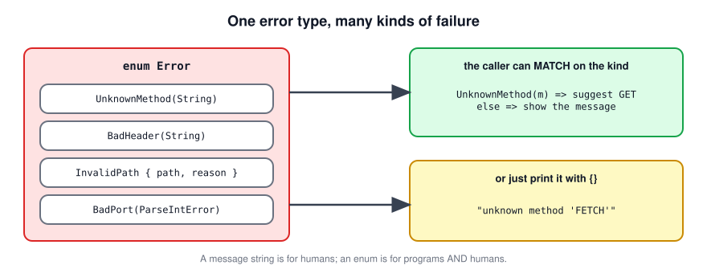

# Chapter 16: Your own error type

> **Brain Power**
> In Chapter 8 every error was a `String`: `Err(String::from("unknown method"))`. Imagine a caller that wants to *react differently*: suggest `GET` or `POST` when the method is unknown, but give up when the header is malformed. All it receives is a sentence. What would it have to do to tell the cases apart? And what if one function can fail in *two different ways*, with two unrelated error types?

Text is fine for a human reading a message, but awkward for a *program* deciding what to do. You already know the better tool: an **enum** (Chapter 7), with one variant per kind of failure.

## An error enum

```rust
#[derive(Debug)]
enum BuildError {
    UnknownMethod(String),
    BadHeader(String),
}

fn parse_method(text: &str) -> Result<&str, BuildError> {
    match text {
        "GET" | "POST" => Ok(text),
        other => Err(BuildError::UnknownMethod(other.to_string())),
    }
}

fn main() {
    match parse_method("FETCH") {
        Ok(method) => println!("method {method}"),
        Err(BuildError::UnknownMethod(name)) => println!("try GET or POST, not {name}"),
        Err(BuildError::BadHeader(line)) => println!("fix the header: {line}"),
    }
}
```

```output
try GET or POST, not FETCH
```



Now the *caller* can react to the kind: `match` on `Err(BuildError::UnknownMethod(name))` and give a custom hint. And since `match` must be exhaustive (Chapter 7), if you add a third kind of error later, the compiler shows every caller that has to decide what to do. (`other` in the first `match` is a pattern that catches any remaining text and names it. Like `_`, but you can use the value.)

An error should also be able to **explain itself** in words. You know how: `Display` (Chapter 10). And there is a standard trait, `std::error::Error`, that marks a type as "a proper error". It needs nothing else: an empty `impl` is enough, as long as the type has `Debug` and `Display`:

```rust
use std::fmt;

#[derive(Debug)]
enum BuildError {
    UnknownMethod(String),
    BadHeader(String),
}

impl fmt::Display for BuildError {
    fn fmt(&self, f: &mut fmt::Formatter) -> fmt::Result {
        match self {
            BuildError::UnknownMethod(name) => write!(f, "unknown method '{name}'"),
            BuildError::BadHeader(line) => write!(f, "header line '{line}' has no ':'"),
        }
    }
}

impl std::error::Error for BuildError {}

fn main() {
    let e = BuildError::UnknownMethod(String::from("FETCH"));
    println!("{e}");
    println!("{e:?}");
    let f = BuildError::BadHeader(String::from("Host a.test"));
    println!("{f}");
}
```

```output
unknown method 'FETCH'
UnknownMethod("FETCH")
header line 'Host a.test' has no ':'
```

Three layers of the same idea: `{e}` is the human message (`Display`), `{e:?}` is the programmer view (`Debug`), and the enum variants are what a program matches on.

## Many errors, one type: `?` and `From`

Here's the second problem from the Brain Power. A function can fail in *two* different ways, with two unrelated error types: our own `BuildError`, and the library's `ParseIntError` (what `"abc".parse::<u16>()` returns on failure). Predict what the compiler thinks of this:

```rust,fails
use std::fmt;

#[derive(Debug)]
enum BuildError {
    MissingHost,
}

impl fmt::Display for BuildError {
    fn fmt(&self, f: &mut fmt::Formatter) -> fmt::Result {
        write!(f, "host is missing")
    }
}

fn parse_port(text: &str) -> Result<u16, BuildError> {
    let port = text.parse::<u16>()?;
    Ok(port)
}

fn main() {
    println!("{:?}", parse_port("8080"));
}
```

<details><summary>Answer</summary>

```error
error[E0277]: `?` couldn't convert the error to `BuildError`
  --> src/main.rs:15:35
   |
14 | fn parse_port(text: &str) -> Result<u16, BuildError> {
   |                              ----------------------- expected `BuildError` because of this
15 |     let port = text.parse::<u16>()?;
   |                     --------------^ the trait `From<ParseIntError>` is not implemented for `BuildError`
   |                     |
   |                     this can't be annotated with `?` because it has type `Result<_, ParseIntError>`
   |
note: `BuildError` needs to implement `From<ParseIntError>`
  --> src/main.rs:4:1
   |
 4 | enum BuildError {
   | ^^^^^^^^^^^^^^^
   = note: the question mark operation (`?`) implicitly performs a conversion on the error value using the `From` trait

error: aborting due to 1 previous error

For more information about this error, try `rustc --explain E0277`.
```

`text.parse::<u16>()` returns `Result<u16, ParseIntError>`. The `?` wants to return that error from `parse_port`, which must produce a `BuildError`. The two don't match. The compiler explains: **"`?` couldn't convert the error to `BuildError`"**, because **"the trait `From<ParseIntError>` is not implemented for `BuildError`"**.

This is the hint Chapter 8 promised. `?` doesn't just *return* the error. It first passes it through **`From`** (Chapter 10) to convert it into the function's error type. Teach Rust the conversion, and `?` does the rest:

</details>

```rust
use std::fmt;
use std::num::ParseIntError;

#[derive(Debug)]
enum BuildError {
    BadPort(ParseIntError),
}

impl fmt::Display for BuildError {
    fn fmt(&self, f: &mut fmt::Formatter) -> fmt::Result {
        match self {
            BuildError::BadPort(e) => write!(f, "invalid port: {e}"),
        }
    }
}

impl From<ParseIntError> for BuildError {
    fn from(e: ParseIntError) -> Self {
        BuildError::BadPort(e)
    }
}

fn parse_port(text: &str) -> Result<u16, BuildError> {
    let port = text.parse::<u16>()?;
    Ok(port)
}

fn main() {
    println!("{:?}", parse_port("8080"));
    match parse_port("http") {
        Ok(p) => println!("port {p}"),
        Err(e) => println!("error: {e}"),
    }
}
```

```output
Ok(8080)
error: invalid port: invalid digit found in string
```

Now `?` on a `ParseIntError` quietly **wraps** it as `BuildError::BadPort(...)`. Every function that returns `Result<_, BuildError>` can use `?` on *any* error type that has a `From` impl into `BuildError`. One error type per library, many sources feeding into it.

(`parse::<u16>()` has the odd `::<u16>` in the middle: it is Chapter 13's "turbofish", spelling out which type to parse into.)

![#[from]: many error types, one error type](img/ch16-error-from.svg)

## `thiserror`: the boring parts, written for you

Look at what we wrote: an enum, a `Display` impl that mostly repeats the variants, an empty `Error` impl, and a `From` per source. It's all mechanical. This is exactly what **derive** (Chapter 10) is for, and a crate called **`thiserror`** provides a derive for it. You know how to add a dependency now (Chapter 15): `cargo add thiserror`. Then:

```rust
// needs-deps
use std::num::ParseIntError;
use thiserror::Error;

#[derive(Debug, Error)]
enum BuildError {
    #[error("unknown method '{0}'")]
    UnknownMethod(String),

    #[error("header line '{0}' has no ':'")]
    BadHeader(String),

    #[error("path '{path}' is invalid: {reason}")]
    InvalidPath { path: String, reason: String },

    #[error("invalid port: {0}")]
    BadPort(#[from] ParseIntError),
}

fn parse_port(text: &str) -> Result<u16, BuildError> {
    Ok(text.parse::<u16>()?)
}

fn main() {
    println!("{}", BuildError::UnknownMethod(String::from("FETCH")));
    println!(
        "{}",
        BuildError::InvalidPath { path: String::from("users"), reason: String::from("must start with '/'") }
    );
    match parse_port("http") {
        Ok(p) => println!("port {p}"),
        Err(e) => println!("{e}"),
    }
}
```

```output
unknown method 'FETCH'
path 'users' is invalid: must start with '/'
invalid port: invalid digit found in string
```

What each new piece does:

* **`#[derive(Debug, Error)]`**: `Error` here is `thiserror`'s derive (from `use thiserror::Error;`). It writes the empty `impl std::error::Error` for you.
* **`#[error("...")]`** above each variant is the *message*: it writes the whole `Display` impl. Inside the quotes `{0}` means "the first field" of a tuple variant, and `{path}` / `{reason}` mean the fields with those names.
* **`#[from]`** on a field says "also write `impl From<ParseIntError> for BuildError`". That's the whole `From` impl, one attribute.
* So `parse_port` can just say `Ok(text.parse::<u16>()?)`.

Around 25 lines of boilerplate became 15 lines of declarations. And it is *still just the enum, `Display` and `From`* you built by hand: nothing magic.

### A `Result` alias

One more convenience. After you write `Result<T, BuildError>` forty times you will want a shortcut. A **type alias** gives a new name to a type:

```rust,frag
pub type Result<T> = std::result::Result<T, Error>;
```

> **New word: type alias**
> A new name for an existing type, written `type Name = ExistingType;`. It creates no new type, just a shorter way to say one.

Now `Result<Request>` means `std::result::Result<Request, Error>`. The `<T>` is the generic blank from Chapter 11. This one line is in nearly every Rust library that has its own error type.

> **There are no Dumb Questions**
>
> **Q: When do I use a custom error enum, and when `String`?**
> A: A `String` is fine in small programs and at the *edge* of an application, where a human is about to read the message. Inside a library, use an enum: callers can match on it. Nexus does both, as you will see.
>
> **Q: What are `anyhow` and `Box<dyn Error>`?**
> A: Ways to say "some error, I don't care which kind", handy in the main program of an application. `Box<dyn Error>` is the standard-library one (a boxed trait object, like Chapter 13's peek). Nexus uses neither; it prefers its own error enum.
>
> **Q: Should library errors be one big enum or many small ones?**
> A: One enum per library or per module is a good start. Add variants as new failures appear.
>
> **Q: What does it mean that `?` "wraps"?**
> A: It calls `From::from(error)` and returns the result. With `#[from]`, that call just puts your error inside the matching variant.

> **Sharpen your pencil**
> Add a variant for *"the header name is empty"* to the `thiserror` enum. It should carry no data and print `header name is empty`. Then say which `match`es elsewhere would be forced to change.
>
> <details><summary>Answer</summary>
>
> ```rust,frag
> #[error("header name is empty")]
> EmptyHeaderName,
> ```
> Any `match` on `BuildError` that doesn't have a catch-all arm (`_`) stops compiling until it handles `EmptyHeaderName`. That is Chapter 7's exhaustiveness, working for you. The code that merely prints the error with `{e}` needs no change: the `#[error]` attribute already supplied its text.
> </details>

## Now look at real Nexus

Here is the **whole** error module of the Nexus engine, [`error.rs`](../../crates/nexus-core/src/error.rs). It is the same recipe, nine lines long:

```rust,nexus
#[derive(Debug, thiserror::Error)]
pub enum Error {
    #[error("io error: {0}")]
    Io(#[from] std::io::Error),
    #[error("json error: {0}")]
    Json(#[from] serde_json::Error),
    #[error("{0}")]
    Other(String),
}

pub type Result<T> = std::result::Result<T, Error>;
```

You can read all of it:

* `#[derive(Debug, thiserror::Error)]`: the derive from a dependency (Chapter 15), written with its full path instead of a `use`.
* Three kinds of failure: file problems (`Io`, from the standard library's `std::io::Error`), JSON problems (`Json`, from `serde_json`: Chapter 17), and `Other`, a plain message (the variant that the little `err(...)` function of Chapter 11 builds).
* `#[from]` on the first two: `?` converts those library errors automatically.
* `pub type Result<T> = ...`: the alias you just met. In [`lib.rs`](../../crates/nexus-core/src/lib.rs) it's re-exported (Chapter 14), so Nexus code everywhere writes `Result<Request>`.

And here is `?` earning its keep, from [`collections/mod.rs`](../../crates/nexus-core/src/collections/mod.rs):

```rust,nexus
fn read_json(path: &Path) -> Result<Value> {
    Ok(serde_json::from_str(&std::fs::read_to_string(path)?)?)
}
```

Don't worry about `Path` (a borrowed file location, like `&str` for files) or `Value` (a piece of JSON, Chapter 17). Look at the **two `?`s**. The inner one is on reading the file, which can fail with an `io::Error`. The outer one is on parsing the JSON, which can fail with a `serde_json::Error`. Two unrelated error types, **one** return type: both convert into `Error` through `#[from]`. Without `?` and `From`, this one line would be twenty.

Nexus also has a convention: *inside* the engine, functions return `Result<T>` with this `Error`. At the *boundary* with the window (the user interface layer), errors become plain `String`s: the window only needs words to show. That's the same advice as above: enums inside, strings at the edge.

![#[from]: many error types, one error type](img/ch16-error-from.svg)

## Checkpoint project: request builder, version 15

The workspace from Chapter 15 gets real errors. Starting from Chapter 15's project, make these changes. First add `thiserror` to the shared list in the root `Cargo.toml` (`thiserror = "2"`) and to `rb-core`:

```toml,proj=rb16,file=Cargo.toml
[workspace]
resolver = "2"
members = ["crates/rb-core", "crates/rb-cli"]

[workspace.package]
version = "0.1.0"
edition = "2021"

[workspace.dependencies]
thiserror = "2"
uuid = { version = "1", features = ["v4"] }
rb-core = { path = "crates/rb-core" }
```

```toml,proj=rb16,file=crates/rb-core/Cargo.toml
[package]
name = "rb-core"
version.workspace = true
edition.workspace = true

[dependencies]
thiserror.workspace = true
uuid.workspace = true
```

<!-- proj=rb16 copy=15_crates_and_workspaces:rb15:crates/rb-cli/Cargo.toml>crates/rb-cli/Cargo.toml -->

Create `crates/rb-core/src/error.rs`, in the style of Nexus:

```rust,proj=rb16,file=crates/rb-core/src/error.rs
use thiserror::Error;

#[derive(Debug, Error, PartialEq)]
pub enum Error {
    #[error("unknown method '{0}'")]
    UnknownMethod(String),

    #[error("header line '{0}' has no ':'")]
    BadHeader(String),

    #[error("path '{path}' is invalid: {reason}")]
    InvalidPath { path: String, reason: String },

    #[error("invalid port: {0}")]
    BadPort(#[from] std::num::ParseIntError),
}

pub type Result<T> = std::result::Result<T, Error>;
```

The library's front page grows two lines:

```rust,proj=rb16,file=crates/rb-core/src/lib.rs
pub mod error;
pub mod header;
pub mod method;
pub mod request;
pub mod variables;

pub use error::{Error, Result};
pub use header::Header;
pub use method::Method;
pub use request::{build, parse_port, Request};
```

Add `parse` functions to the types that can fail to be built from text. In `method.rs`, besides the `Method` and `Display` you already have:

```rust,proj=rb16,file=crates/rb-core/src/method.rs
use std::fmt;

use crate::error::{Error, Result};

#[derive(Debug, Clone, Copy, PartialEq, Default)]
pub enum Method {
    #[default]
    Get,
    Post,
}

impl Method {
    pub fn parse(text: &str) -> Result<Method> {
        match text {
            "GET" => Ok(Method::Get),
            "POST" => Ok(Method::Post),
            other => Err(Error::UnknownMethod(other.to_string())),
        }
    }
}

impl fmt::Display for Method {
    fn fmt(&self, f: &mut fmt::Formatter) -> fmt::Result {
        let text = match self {
            Method::Get => "GET",
            Method::Post => "POST",
        };
        write!(f, "{text}")
    }
}
```

`header.rs`, with `Header::parse` from Chapter 8, now returning our `Error`:

```rust,proj=rb16,file=crates/rb-core/src/header.rs
use std::fmt;

use crate::error::{Error, Result};

#[derive(Debug, Clone, PartialEq)]
pub struct Header {
    pub key: String,
    pub value: String,
    pub enabled: bool,
}

impl Header {
    pub fn new(key: &str, value: &str) -> Self {
        Self { key: key.to_string(), value: value.to_string(), enabled: true }
    }

    pub fn parse(line: &str) -> Result<Header> {
        match line.split_once(':') {
            Some((key, value)) => Ok(Header::new(key.trim(), value.trim())),
            None => Err(Error::BadHeader(line.to_string())),
        }
    }
}

impl From<(&str, &str)> for Header {
    fn from(pair: (&str, &str)) -> Self {
        Header::new(pair.0, pair.1)
    }
}

impl fmt::Display for Header {
    fn fmt(&self, f: &mut fmt::Formatter) -> fmt::Result {
        write!(f, "{}: {}", self.key, self.value)
    }
}
```

<!-- proj=rb16 copy=15_crates_and_workspaces:rb15:crates/rb-core/src/variables.rs>crates/rb-core/src/variables.rs -->

And `request.rs` gets `validate`, `parse_port` and a `build` function that puts the pieces together using `?` (changes marked in the comments):

```rust,proj=rb16,file=crates/rb-core/src/request.rs
use std::collections::HashMap;
use std::fmt;

use uuid::Uuid;

use crate::error::{Error, Result};
use crate::header::Header;
use crate::method::Method;
use crate::variables::resolve;

#[derive(Debug, Clone)]
pub struct Request {
    pub id: String,
    pub method: Method,
    pub path: String,
    pub headers: Vec<Header>,
}

impl fmt::Display for Request {
    fn fmt(&self, f: &mut fmt::Formatter) -> fmt::Result {
        write!(f, "{} {} HTTP/1.1", self.method, self.path)?;
        for header in self.headers.iter().filter(|h| h.enabled) {
            write!(f, "\n{header}")?;
        }
        Ok(())
    }
}

impl Request {
    pub fn new(method: Method, path: &str) -> Self {
        Self {
            id: Uuid::new_v4().to_string(),
            method,
            path: path.to_string(),
            headers: Vec::new(),
        }
    }

    pub fn add_header(&mut self, header: Header) {
        self.headers.push(header);
    }

    pub fn to_text(&self, variables: &HashMap<String, String>) -> String {
        resolve(&self.to_string(), variables)
    }

    // new in this chapter
    pub fn validate(&self) -> Result<()> {
        if !self.path.starts_with('/') {
            return Err(Error::InvalidPath {
                path: self.path.clone(),
                reason: String::from("must start with '/'"),
            });
        }
        Ok(())
    }
}

// new in this chapter
pub fn parse_port(text: &str) -> Result<u16> {
    Ok(text.trim().parse::<u16>()?)
}

// new in this chapter
pub fn build(method: &str, path: &str, header_line: &str) -> Result<Request> {
    let method = Method::parse(method)?;
    let header = Header::parse(header_line)?;
    let mut request = Request::new(method, path);
    request.add_header(header);
    request.validate()?;
    Ok(request)
}
```

Look at `build`: three fallible steps, three `?`s, and the happy path reads like a straight line. Each failure comes out as a *specific* variant of the same `Error` type. And in `rb-cli`, `main.rs` can now respond to the *kind*:

```rust,proj=rb16,file=crates/rb-cli/src/main.rs
use rb_core::{build, parse_port, Error};

fn main() {
    let attempts = [
        ("GET", "/users", "Host: api.example.test"),
        ("FETCH", "/users", "Host: api.example.test"),
        ("GET", "users", "Host: api.example.test"),
        ("POST", "/users", "Host api.example.test"),
    ];

    for (method, path, header) in attempts {
        match build(method, path, header) {
            Ok(request) => println!("OK:\n{}", request),
            Err(Error::UnknownMethod(name)) => println!("hint: use GET or POST, not {name}"),
            Err(other) => println!("ERROR: {other}"),
        }
    }

    println!("{:?}", parse_port("8080"));
    match parse_port("http") {
        Ok(port) => println!("port {port}"),
        Err(e) => println!("ERROR: {e}"),
    }
}
```

```output,proj=rb16,run=-p+rb-cli
OK:
GET /users HTTP/1.1
Host: api.example.test
hint: use GET or POST, not FETCH
ERROR: path 'users' is invalid: must start with '/'
ERROR: header line 'Host api.example.test' has no ':'
Ok(8080)
ERROR: invalid port: invalid digit found in string
```

The unknown method gets a custom hint; every other error just prints its message. That is something a `String` error could never give you without comparing text.

> **Sharpen your pencil**
> Add another rule: make `validate` also reject paths containing a space, with `reason` set to `"must not contain spaces"`. Which function *calls* `validate`, and do any callers need to change?
>
> <details><summary>Answer</summary>
>
> Add a second `if self.path.contains(' ') { return Err(Error::InvalidPath { ... }); }` in `validate`. Only `build` calls it, and `build` already uses `?`, so nothing else changes. Callers still see the same `Error::InvalidPath` variant, just with a different `reason`.
> </details>

## Bullet Points

* An **error enum** gives each kind of failure its own variant, so callers can `match` on the kind as well as print a message.
* Implement `Display` for the message and `std::error::Error` (an empty `impl`) to mark it as a real error.
* **`?` converts errors with `From`**: write `impl From<TheirError> for MyError` and `?` wraps automatically.
* **`thiserror`**: `#[derive(Error)]`, `#[error("message {0}")]` and `#[from]` write the `Display`, `Error` and `From` impls for you.
* `pub type Result<T> = std::result::Result<T, Error>;` is the standard alias.
* Use an enum inside libraries; plain `String` messages are fine at the edge, where a human is about to read them.

## Cheat sheet

```text
#[derive(Debug, thiserror::Error)]
enum E {
    #[error("bad thing '{0}'")]       Bad(String),
    #[error("path {path}: {reason}")] Path { path: String, reason: String },
    #[error("io: {0}")]               Io(#[from] std::io::Error),
}
pub type Result<T> = std::result::Result<T, E>;
let x = might_fail()?;                 converts the error via From, returns on Err
match r { Err(E::Bad(s)) => .., Err(other) => println!("{other}"), Ok(v) => .. }
```
