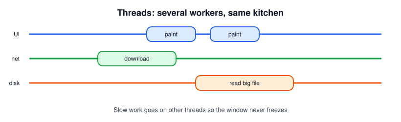
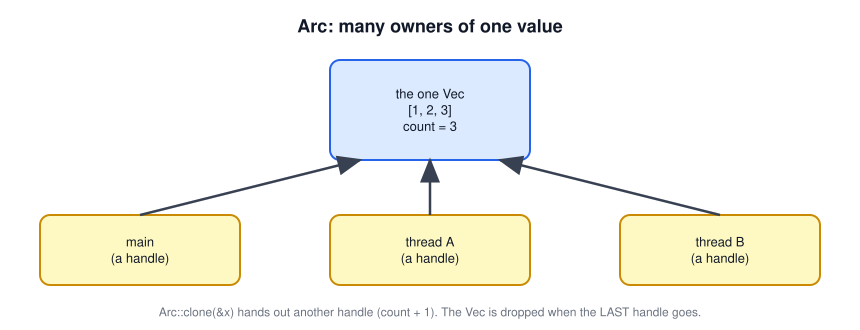
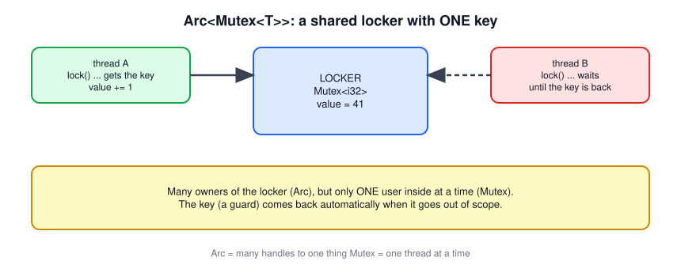
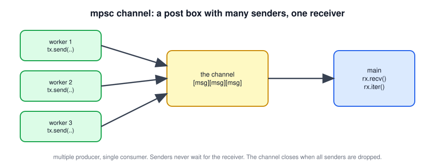

# Chapter 18: Doing several things at once: threads, `Arc`, `Mutex` and channels

> **Brain Power**
> Pressing **Send** in Nexus starts a request that may take three seconds. If the program does that work itself, right in the middle of drawing the window, what will you see during those three seconds? What would a restaurant do if its only cook *also* had to take every order and serve every table?

The window would freeze. A restaurant hires **more cooks** who work at the same time, in the same kitchen. Programs do the same with **threads**.

## Threads: more cooks in the kitchen

A **thread** is one line of work running through your program. Every program starts with one (the one running `main`). You can start more, and the computer runs them at the same time, on different processor cores (or switches between them quickly).



> **New word: thread**
> An independent path of execution inside a running program. Threads share the program's memory (same kitchen), but each works through its own list of instructions.

Starting one is a single call, **`thread::spawn`**, and you hand it a **closure** (Chapter 13) saying what to do:

```rust
use std::thread;
use std::time::Duration;

fn main() {
    let handle = thread::spawn(|| {
        thread::sleep(Duration::from_millis(100));
        println!("hello from the new thread");
    });

    println!("hello from main");
    handle.join().unwrap();
    println!("all done");
}
```

```output
hello from main
hello from the new thread
all done
```

* **`use std::thread;`** and `std::time::Duration` bring in names (Chapter 14).
* **`thread::spawn(|| { ... })`** starts a new thread that runs the closure. It returns a **handle** immediately, without waiting.
* **`thread::sleep(Duration::from_millis(100))`** makes *that* thread pause for 100 milliseconds. Main doesn't wait: it prints first.
* **`handle.join()`** means "wait here until that thread has finished". It returns a `Result` (Chapter 8): `Ok(value)` if the thread finished normally, `Err` if it panicked. We `.unwrap()` for now.

If main ended without joining, the program would exit and the new thread might never print. **Join the threads you care about.**

### Threads and borrowing

Chapter 12 said work that might outlive its starter must not borrow short-lived things. A thread is exactly that case, because it could still be running after the function that started it ends. Predict what the compiler thinks of this:

```rust,fails
use std::thread;

fn main() {
    let host = String::from("api.example.test");
    let handle = thread::spawn(|| {
        println!("sending to {host}");
    });
    handle.join().unwrap();
}
```

<details><summary>Answer</summary>

```error
error[E0373]: closure may outlive the current function, but it borrows `host`, which is owned by the current function
 --> src/main.rs:5:32
  |
5 |     let handle = thread::spawn(|| {
  |                                ^^ may outlive borrowed value `host`
6 |         println!("sending to {host}");
  |                               ---- `host` is borrowed here
  |
note: function requires argument type to outlive `'static`
 --> src/main.rs:5:18
  |
5 |       let handle = thread::spawn(|| {
  |  __________________^
6 | |         println!("sending to {host}");
7 | |     });
  | |______^
help: to force the closure to take ownership of `host` (and any other referenced variables), use the `move` keyword
  |
5 |     let handle = thread::spawn(move || {
  |                                ++++

error: aborting due to 1 previous error

For more information about this error, try `rustc --explain E0373`.
```

You have seen this message in Chapter 13: **"closure may outlive the current function, but it borrows `host`"**. The compiler can't be sure the thread ends before `main` drops `host`. (Its note, "function requires argument type to outlive `'static`", is Chapter 12's `'static` again: a thread could run forever, so it may only hold things that live that long.) The cure is the same: **`move`**, which hands ownership of `host` *into* the closure (and thread):

</details>

```rust
use std::thread;

fn main() {
    let host = String::from("api.example.test");
    let handle = thread::spawn(move || {
        println!("sending to {host}");
    });
    handle.join().unwrap();
}
```

```output
sending to api.example.test
```

A thread can also **give something back**. Whatever the closure returns comes out of `join()`:

```rust
use std::thread;
use std::time::Duration;

fn main() {
    let mut handles = Vec::new();
    for id in 1..=3u64 {
        handles.push(thread::spawn(move || {
            thread::sleep(Duration::from_millis(30 * (4 - id)));
            (id, 200 + id)
        }));
    }

    for handle in handles {
        let (id, status) = handle.join().unwrap();
        println!("request {id} -> {status}");
    }
}
```

```output
request 1 -> 201
request 2 -> 202
request 3 -> 203
```

Three "requests" run at the same time. Request 3 has the shortest wait and finishes first, request 1 the longest. We join the handles in order, so the output is in order. Notice the loop variable `id` is moved into each closure; the three threads each get their own copy, because `u64` is `Copy` (Chapter 10).

> **There are no Dumb Questions**
>
> **Q: How many threads can I make?**
> A: Thousands, but each costs memory, and a computer only has so many cores. For thousands of *waiting* jobs (network calls), Chapter 19's async is lighter. Threads shine for a handful of heavy jobs.
>
> **Q: If two threads print at the same time, what happens?**
> A: Their lines can interleave in any order, and it changes from run to run. That unpredictability is the main thing about threads. In this chapter we always arrange for a predictable result (by joining, or sorting) so the output is stable.
>
> **Q: Is it safe to share data between threads?**
> A: In most languages, it's a minefield. In Rust, the compiler *refuses* to compile unsafe sharing. Keep reading.

## Sharing data: the compiler stops you

Suppose two threads both want to look at the same list of headers. You know the rule from Chapter 4: one owner. Watch what happens:

```rust,fails
use std::thread;

fn main() {
    let headers = vec![String::from("Host"), String::from("Accept")];

    let a = thread::spawn(move || println!("A sees {:?}", headers));
    let b = thread::spawn(move || println!("B sees {:?}", headers));

    a.join().unwrap();
    b.join().unwrap();
}
```

```error
error[E0382]: use of moved value: `headers`
 --> src/main.rs:7:27
  |
4 |     let headers = vec![String::from("Host"), String::from("Accept")];
  |         ------- move occurs because `headers` has type `Vec<String>`, which does not implement the `Copy` trait
5 |
6 |     let a = thread::spawn(move || println!("A sees {:?}", headers));
  |                           -------                         ------- variable moved due to use in closure
  |                           |
  |                           value moved into closure here
7 |     let b = thread::spawn(move || println!("B sees {:?}", headers));
  |                           ^^^^^^^                         ------- use occurs due to use in closure
  |                           |
  |                           value used here after move
  |
help: consider cloning the value before moving it into the closure
  |
6 ~     let value = headers.clone();
7 ~     let a = thread::spawn(move || println!("A sees {:?}", value));
  |

error: aborting due to 1 previous error

For more information about this error, try `rustc --explain E0382`.
```

`move` handed `headers` to thread A. Thread B has nothing to take: **"use of moved value: `headers`"**. We need *shared ownership*: more than one owner at once, with the value living until the *last* one is done.

### Arc: many name tags on one value

**`Arc`** ("atomically reference counted") is exactly that. Wrap a value in an `Arc`, and `Arc::clone(&it)` hands out another **handle** to the *same* value. A hidden counter tracks how many handles exist; when the last one goes away, the value is dropped.



```rust
use std::sync::Arc;
use std::thread;

fn main() {
    let headers = Arc::new(vec![String::from("Host"), String::from("Accept")]);
    let for_a = Arc::clone(&headers);
    let for_b = Arc::clone(&headers);
    println!("handles: {}", Arc::strong_count(&headers));

    let a = thread::spawn(move || println!("A sees {:?}", for_a));
    a.join().unwrap();
    let b = thread::spawn(move || println!("B sees {:?}", for_b));
    b.join().unwrap();

    println!("handles after the threads end: {}", Arc::strong_count(&headers));
}
```

```output
handles: 3
A sees ["Host", "Accept"]
B sees ["Host", "Accept"]
handles after the threads end: 1
```

* **`Arc::new(value)`** wraps the value.
* **`Arc::clone(&headers)`** makes another handle. It does **not** copy the headers; it only adds one to the counter. That is fast. (`.clone()` on an `Arc` means the same thing: it copies the *handle*, not the data.)
* Each thread **owns its own handle**, so `move` works for both.
* Each thread's handle is dropped when the thread ends (Chapter 4), so the count goes back to 1.

An `Arc` only gives out **read-only** access: sharing and changing at the same time is exactly the data-race danger Chapter 5's rules prevent.

### Mutex: one person at a time

To *change* shared data, you add a lock. A **`Mutex`** (short for "mutual exclusion") is a locker with **one key**. A thread must take the key (**`lock()`**) before touching the value inside, and any other thread that wants it **waits** until the key is returned.



Put the two together: `Arc` for many owners, `Mutex` for one-at-a-time changes:

```rust
use std::sync::{Arc, Mutex};
use std::thread;

fn main() {
    let counter = Arc::new(Mutex::new(0));
    let mut handles = Vec::new();

    for _ in 0..4 {
        let counter = Arc::clone(&counter);
        handles.push(thread::spawn(move || {
            for _ in 0..1000 {
                let mut guard = counter.lock().unwrap();
                *guard += 1;
            }
        }));
    }

    for handle in handles {
        handle.join().unwrap();
    }
    println!("total: {}", *counter.lock().unwrap());
}
```

```output
total: 4000
```

Four threads each add 1000. If they could trample on each other, you'd get something less than 4000, in a different number every run. With the `Mutex`, you always get exactly **4000**. Unpack the key line:

* **`counter.lock()`** waits for the key, then returns a **guard** (inside a `Result`, because a lock can be "poisoned", see below). We `.unwrap()` it.
* **`*guard += 1`**: the guard works like a reference (Chapter 5): `*` reaches through it to the number.
* **When the guard goes out of scope, the key is returned.** That is Chapter 10's `Drop` at work: the guard's `drop` unlocks the mutex. You can't forget.

Keep the lock **briefly**. While a thread holds the key, everybody else waits. A common pattern is to lock, do the small change, and let the guard go in a short inner block `{ ... }`.

> **New word: Arc / Mutex**
> **`Arc<T>`**: shared ownership of a `T` between threads (a reference-counted handle). **`Mutex<T>`**: a `T` that only one thread at a time may use, via `lock()`. Together: `Arc<Mutex<T>>`, Rust's standard recipe for shared, changeable state.

> **Heads-up: poisoned locks**
> If a thread *panics* while holding the key, the mutex is marked **poisoned**, and later `lock()` calls return an `Err`. For many programs the data is still fine, so you take it anyway: `lock().unwrap_or_else(|e| e.into_inner())` (a closure, Chapter 13: "on error, take the guard out of the error"). Nexus does exactly this.

> **Sharpen your pencil**
> What is wrong with this plan: "Each of the 4 threads *locks the counter once* at the start, loops 1000 times, and unlocks at the end"? Would the answer still be 4000? What would be the downside?
>
> <details><summary>Answer</summary>
>
> The answer is still 4000: the lock guarantees the increments don't collide. The downside is that the other three threads wait for the *whole* loop, so you've turned four parallel workers into four people who go one after another. A lock protects correctness, but holding it too long costs speed.
> </details>

## Channels: sending messages instead of sharing

There is a second way to coordinate threads, often nicer than sharing: **send messages**. A **channel** is a post box. Any number of **senders** drop messages in; one **receiver** takes them out.



```rust
use std::sync::mpsc;
use std::thread;
use std::time::Duration;

fn main() {
    let (tx, rx) = mpsc::channel();

    for id in 1..=3u64 {
        let tx = tx.clone();
        thread::spawn(move || {
            thread::sleep(Duration::from_millis(20 * id));
            tx.send((id, 200 + id)).unwrap();
        });
    }
    drop(tx);

    let mut results: Vec<(u64, u64)> = rx.iter().collect();
    results.sort();
    println!("{:?}", results);
}
```

```output
[(1, 201), (2, 202), (3, 203)]
```

* **`mpsc::channel()`** makes a channel and returns two ends in a tuple: **`tx`** (transmitter, the sending end) and **`rx`** (receiver). `mpsc` stands for "multiple producer, single consumer".
* **`tx.clone()`** makes another sender, one per thread, which `move` into the thread. (Like `Arc`, cloning a sender is cheap.)
* **`tx.send(value)`** drops a message in the box. It returns immediately: **senders never wait for the receiver.** The value is *moved* into the channel (Chapter 4), so the sender can't touch it afterwards. No sharing, so no locks needed.
* **`rx.iter()`** is a belt (Chapter 13) that yields each message as it arrives, waiting when there's nothing yet, and **ends when every sender has been dropped**. That is why we `drop(tx)`: we gave clones to the threads, but our own original `tx` would otherwise keep the channel open forever.
* We collect and **sort**, because messages arrive in whatever order the threads finish.

A receiver has other ways to read a message:

```rust
use std::sync::mpsc;

fn main() {
    let (tx, rx) = mpsc::channel::<u32>();

    println!("{:?}", rx.try_recv());
    tx.send(7).unwrap();
    println!("{:?}", rx.try_recv());
    drop(tx);
    println!("{:?}", rx.try_recv());
}
```

```output
Err(Empty)
Ok(7)
Err(Disconnected)
```

* **`rx.recv()`** *waits* until a message arrives (or all senders are gone).
* **`rx.try_recv()`** *never waits*: you get a message, or `Err(Empty)` ("nothing yet"), or `Err(Disconnected)` ("nothing will ever come").
* **`rx.try_iter()`** hands you every message *already waiting*, then stops. A program that must never pause, such as a window redrawing 60 times a second, calls this each time round: "anything new for me?"

Messages usually are an **enum** (Chapter 7), so one channel can carry different kinds of news:

```rust
use std::sync::mpsc;
use std::thread;

enum Msg {
    Done { id: u32, status: u16 },
    Failed { id: u32, reason: String },
}

fn main() {
    let (tx, rx) = mpsc::channel();

    let worker = thread::spawn(move || {
        tx.send(Msg::Done { id: 1, status: 200 }).unwrap();
        tx.send(Msg::Failed { id: 2, reason: String::from("timed out") }).unwrap();
    });
    worker.join().unwrap();

    for msg in rx.try_iter() {
        match msg {
            Msg::Done { id, status } => println!("request {id} finished with {status}"),
            Msg::Failed { id, reason } => println!("request {id} failed: {reason}"),
        }
    }
}
```

```output
request 1 finished with 200
request 2 failed: timed out
```

This is the pattern that keeps Nexus's window alive: background workers send `Msg` values, and the window drains them each frame. We build up to the real thing in the next two chapters.

> **There are no Dumb Questions**
>
> **Q: Channel or `Arc<Mutex<..>>`: which should I use?**
> A: Prefer **channels** when workers produce results that someone else consumes ("here's an answer"). Use **`Arc<Mutex<..>>`** when several parties need to read and update the *same* state ("the current connection status"). Many programs use both, and so does Nexus.
>
> **Q: What are `Send` and `Sync`? I keep seeing `+ Send + Sync + 'static`.**
> A: Two ability labels (traits, Chapter 10) that the compiler attaches to types automatically. **`Send`**: this value may be *moved* to another thread. **`Sync`**: it may be *shared* between threads. Almost everything has both; the few exceptions (like single-threaded reference counters) are the ones the compiler won't let you hand to a thread. `'static` (Chapter 12) says the value doesn't borrow short-lived things.
>
> **Q: Could two threads deadlock?**
> A: Yes: A holds key 1 and waits for key 2 while B holds key 2 and waits for key 1. Rust prevents data races, *not* deadlocks. The usual cure is to hold locks briefly and avoid holding two at once.

## Now look at real Nexus

Here is a Nexus type that does exactly the `Arc<Mutex<..>>` dance, from [`websocket/mod.rs`](../../crates/nexus-core/src/websocket/mod.rs). A `WebSocketClient` is a live connection to a server; the connection runs on background threads and tasks, while the window asks about its status. The shared data is:

```rust,nexus
struct Shared {
    state: Mutex<State>,
    sink: Box<dyn Fn(WsEvent) + Send + Sync>,
}
```

and the client itself holds it in an `Arc`:

```rust,nexus
pub struct WebSocketClient {
    shared: Arc<Shared>,
}
```

Decode:

* `Shared` holds a **`Mutex<State>`**: the status, the message log and so on, locked so that the background connection and the UI never change them at the same moment. (`State` is a struct of ordinary fields, Chapter 6.)
* `sink` is a **callback** (Chapter 13's peek: `Box<dyn Fn(..)>`) that tells the window "something happened". `+ Send + Sync` says it may be called from any thread.
* `WebSocketClient` keeps an **`Arc<Shared>`**: background tasks and the owner each hold a handle to the same `Shared`.

And the little helper that locks it:

```rust,nexus
impl Shared {
    fn lock(&self) -> MutexGuard<'_, State> {
        self.state.lock().unwrap_or_else(|e| e.into_inner())
    }
```

It is the poisoned-lock recipe from above, written *once*, so every other function says `self.lock().status = ...` and never worries about it. `MutexGuard<'_, State>` is the guard type (with Chapter 12's "borrowed from `self`" label `'_`): "the key, which you may use as long as you borrow `self`".

## Checkpoint project: request builder, version 17

Let's give the builder a "network layer": a function that sends many requests *concurrently* and collects the answers. We don't have a real server, so it **pretends** (sleeps a few milliseconds and answers `200`, or `404` for paths ending in `missing`). The threading is real.

Add a new module `client.rs` to `rb-core`. It uses a channel to collect the responses and an `Arc<Mutex<..>>` counter for "how many have been sent":

```rust,proj=rb18,file=crates/rb-core/src/client.rs
use std::sync::mpsc;
use std::sync::{Arc, Mutex};
use std::thread;
use std::time::Duration;

use crate::request::Request;

#[derive(Debug, Clone, PartialEq)]
pub struct Response {
    pub request_id: String,
    pub status: u16,
}

/// Pretends to talk to a server: waits a little, then answers.
pub fn fake_send(request: &Request) -> Response {
    thread::sleep(Duration::from_millis(10 + request.path.len() as u64));
    let status = if request.path.ends_with("missing") { 404 } else { 200 };
    Response { request_id: request.id.clone(), status }
}

/// Sends every request on its own thread; returns the responses sorted by request id,
/// plus how many were sent.
pub fn send_all(requests: Vec<Request>) -> (Vec<Response>, u32) {
    let (tx, rx) = mpsc::channel();
    let sent = Arc::new(Mutex::new(0u32));

    for request in requests {
        let tx = tx.clone();
        let sent = Arc::clone(&sent);
        thread::spawn(move || {
            let response = fake_send(&request);
            *sent.lock().unwrap() += 1;
            tx.send(response).unwrap();
        });
    }
    drop(tx);

    let mut responses: Vec<Response> = rx.iter().collect();
    responses.sort_by_key(|r| r.request_id.clone());
    let total = *sent.lock().unwrap();
    (responses, total)
}
```

Read it as a story: one channel for results, one shared counter, one thread per request. Each thread sends, increments, and reports. The main thread collects until all senders are gone, then sorts. Every idea in it is from this chapter or earlier.

The library's front page learns about it:

```rust,proj=rb18,file=crates/rb-core/src/lib.rs
pub mod client;
pub mod error;
pub mod header;
pub mod method;
pub mod request;
pub mod variables;

pub use client::{send_all, Response};
pub use error::{Error, Result};
pub use header::Header;
pub use method::Method;
pub use request::{build, parse_port, Request};
```

<!-- proj=rb18 copy=17_serde_and_json:rb17:Cargo.toml>Cargo.toml -->
<!-- proj=rb18 copy=17_serde_and_json:rb17:crates/rb-core/Cargo.toml>crates/rb-core/Cargo.toml -->
<!-- proj=rb18 copy=17_serde_and_json:rb17:crates/rb-cli/Cargo.toml>crates/rb-cli/Cargo.toml -->
<!-- proj=rb18 copy=17_serde_and_json:rb17:crates/rb-core/src/error.rs>crates/rb-core/src/error.rs -->
<!-- proj=rb18 copy=17_serde_and_json:rb17:crates/rb-core/src/header.rs>crates/rb-core/src/header.rs -->
<!-- proj=rb18 copy=17_serde_and_json:rb17:crates/rb-core/src/method.rs>crates/rb-core/src/method.rs -->
<!-- proj=rb18 copy=17_serde_and_json:rb17:crates/rb-core/src/request.rs>crates/rb-core/src/request.rs -->
<!-- proj=rb18 copy=17_serde_and_json:rb17:crates/rb-core/src/variables.rs>crates/rb-core/src/variables.rs -->

All other files stay as in Chapter 17. And `rb-cli/src/main.rs` now sends three requests at once:

```rust,proj=rb18,file=crates/rb-cli/src/main.rs
use rb_core::{send_all, Header, Method, Request};

fn main() {
    let mut requests = Vec::new();
    for (n, path) in ["/users", "/users/missing", "/orders"].iter().enumerate() {
        let mut request = Request::new(Method::Get, path);
        request.id = format!("req-{}", n + 1);
        request.add_header(Header::new("Host", "api.example.test"));
        requests.push(request);
    }

    let (responses, total) = send_all(requests);
    for response in &responses {
        println!("{} -> {}", response.request_id, response.status);
    }
    println!("sent {total} requests");
}
```

```output,proj=rb18,run=-p+rb-cli
req-1 -> 200
req-2 -> 404
req-3 -> 200
sent 3 requests
```

(`.iter().enumerate()` is a belt that pairs each item with its position: `(0, "/users")`, `(1, "/users/missing")`... Chapter 13's belts, plus one new station.) The three "requests" run concurrently, yet the output is always the same, because `send_all` sorts what the channel collected.

> **Sharpen your pencil**
> `send_all` spawns one thread per request. What would happen with 10,000 requests? Think about *threads* as a resource, and about what Chapter 19 might offer.
>
> <details><summary>Answer</summary>
>
> Ten thousand threads would use a lot of memory and spend much of their lives just *waiting* for the network. Threads are great for a few heavy jobs; for thousands of waiting jobs you want something lighter: **async tasks**, the subject of Chapter 19.
> </details>

## Bullet Points

* A **thread** is an independent line of work: `thread::spawn(move || { ... })` starts one and returns a handle; `handle.join()` waits and gives back the result (a `Result`).
* Closures given to threads usually need **`move`**: the thread must own what it uses.
* **`Arc<T>`**: shared ownership; `Arc::clone(&x)` adds a handle. Read-only.
* **`Mutex<T>`**: one thread at a time; `lock()` returns a guard that unlocks when dropped. `Arc<Mutex<T>>` is shared, changeable state. Keep locks short.
* A **channel** (`mpsc::channel()`) sends messages: `tx.send(v)` (never waits), `rx.recv()` (waits), `rx.try_recv()` / `rx.try_iter()` (never wait), `rx.iter()` (until all senders are dropped). Clone `tx` for each producer.
* Messages are often an **enum**.
* Rust **refuses to compile data races**: sharing without `Arc`/`Mutex` is an error. It does not prevent deadlocks.

## Cheat sheet

```text
let h = thread::spawn(move || { .. value });    let v = h.join().unwrap();
let a = Arc::new(Mutex::new(0));
let a2 = Arc::clone(&a);                         another handle for a thread
{ let mut g = a.lock().unwrap(); *g += 1; }      key returned at the closing brace
let (tx, rx) = mpsc::channel();
let tx2 = tx.clone();       tx.send(msg).unwrap();
rx.recv()   rx.try_recv()   rx.try_iter()   rx.iter()
drop(tx);                                       let the receiver finish
```
