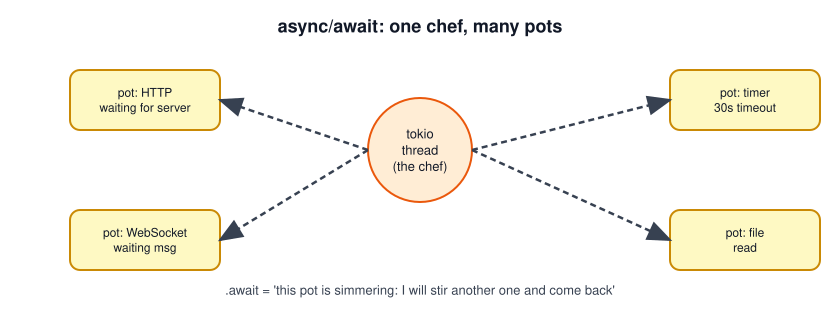
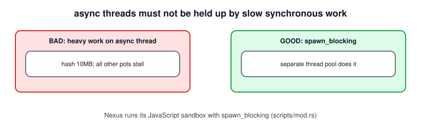

# Chapter 19: Waiting without blocking: async and tokio

> **Brain Power**
> A cook who stands staring at a pot until the water boils is wasting time. A smarter cook puts the water on, starts chopping vegetables, and glances back at the pot when it bubbles. Now imagine your program has to wait on **ten thousand** network replies. Would you hire ten thousand cooks (threads, Chapter 18)? What would the one smart cook look like in code?

Most of the time a program that talks to the internet is just **waiting**: for a server to answer, a timer to expire, a file to arrive. Threads work, but each one costs memory. **Async** lets a single worker juggle thousands of waiting jobs.



## The words: future, async, await

> **New word: future**
> A value that stands for **work that is not finished yet**: a promise of a result later. A future is like a kitchen ticket: *"pasta, table 4"*. It describes the job; it is not the pasta.

Two keywords make futures easy to write:

* **`async fn`** defines a function that returns a *future* instead of running right away.
* **`.await`** (after a future) means: *"wait here for this to finish, but let other jobs run in the meantime."*

> **New word: runtime**
> The "smart cook" that runs futures, switching between them whenever one has to wait. Rust's standard library does *not* include one. You use a library; the popular one is **`tokio`**, which Nexus uses too.

To follow along, add the dependency (Chapter 15):

```bash
cargo add tokio --features rt-multi-thread,macros,time
```

The smallest async program:

```rust
// needs-deps
use std::time::Duration;

#[tokio::main]
async fn main() {
    println!("start");
    tokio::time::sleep(Duration::from_millis(50)).await;
    println!("done");
}
```

```output
start
done
```

Line by line:

* **`#[tokio::main]`** is an attribute (Chapter 6) that sets up the runtime and runs `main` on it. A plain `fn main` can't be `async`: someone has to be the cook.
* **`async fn main()`**: `main` itself is now asynchronous.
* **`tokio::time::sleep(...)`** is the async cousin of `thread::sleep`: it returns a *future* that finishes after 50 ms.
* **`.await`** pauses `main` *here*. The runtime is free to do other work meanwhile. Then `main` continues with "done".

`.await` only works inside an `async` function or block. Predict what the compiler says if you try elsewhere:

```rust,fails
async fn answer() -> u32 {
    42
}

fn main() {
    let x = answer().await;
    println!("{x}");
}
```

<details><summary>Answer</summary>

```error
error[E0728]: `await` is only allowed inside `async` functions and blocks
 --> src/main.rs:6:22
  |
5 | fn main() {
  | --------- this is not `async`
6 |     let x = answer().await;
  |                      ^^^^^ only allowed inside `async` functions and blocks

error: aborting due to 1 previous error

For more information about this error, try `rustc --explain E0728`.
```

**"`await` is only allowed inside `async` functions and blocks"**, with a note pointing at the plain `fn main`. A normal function can't pause in the middle, so only `async` code can `.await`.

</details>

### Futures are lazy

The most surprising thing for newcomers: calling an `async fn` **does not run it**. It builds the future. Only `.await` (or giving it to the runtime) makes it go:

```rust
// needs-deps
async fn say(message: &str) {
    println!("{message}");
}

#[tokio::main]
async fn main() {
    say("first");
    say("second").await;
}
```

Before running: which lines get printed?

<details><summary>Answer</summary>

```output
second
```

Only `second`. The first call made a future and then threw it away without awaiting, so nothing ran. The compiler warns you:

```text
warning: unused implementer of `Future` that must be used
  = note: futures do nothing unless you `.await` or poll them
```

(This is the same "nothing happens until pulled" idea as iterators in Chapter 13.)

</details>

## Doing two things at once

Here is the payoff. Two jobs, one slow and one quick. With `tokio::join!`, **both wait at the same time**:

```rust
// needs-deps
use std::time::Duration;
use tokio::time::sleep;

async fn fetch(name: &str, millis: u64) -> String {
    sleep(Duration::from_millis(millis)).await;
    println!("{name} finished");
    format!("{name}: ok")
}

#[tokio::main]
async fn main() {
    let (a, b) = tokio::join!(fetch("slow", 80), fetch("quick", 30));
    println!("{a} / {b}");
}
```

```output
quick finished
slow finished
slow: ok / quick: ok
```

`join!` starts both futures and waits for both. The quick one finishes first even though it was started second: while `slow` was waiting, the single worker got on with `quick`. Total time is about 80 ms (the longer one), not 110 ms (the sum). No threads were created.

## Tasks: `tokio::spawn`

`join!` is perfect for a fixed few. For jobs that you start in a loop, use **`tokio::spawn`**: the async version of `thread::spawn` (Chapter 18). It starts a **task**, a future running on its own, and returns a handle you can `.await`:

```rust
// needs-deps
use std::time::Duration;
use tokio::time::sleep;

#[tokio::main]
async fn main() {
    let mut handles = Vec::new();
    for id in 1..=3u64 {
        handles.push(tokio::spawn(async move {
            sleep(Duration::from_millis(30 * (4 - id))).await;
            (id, 200 + id)
        }));
    }

    for handle in handles {
        let (id, status) = handle.await.unwrap();
        println!("request {id} -> {status}");
    }
}
```

```output
request 1 -> 201
request 2 -> 202
request 3 -> 203
```

It reads almost exactly like the threaded version from Chapter 18, with three differences:

* **`async move { ... }`** is an *async block*: a future written inline, without a name. `move` works as in Chapter 13: the block takes ownership of what it uses. Like threads, spawned tasks may outlive the function that started them, so they must own what they use (the `'static` rule of Chapter 12).
* **`handle.await`** instead of `handle.join()`. It gives back a `Result` (Chapter 8) because the task could have panicked.
* The tasks are **cheap**. Let's prove it:

```rust
// needs-deps
use std::time::Duration;
use tokio::time::sleep;

#[tokio::main]
async fn main() {
    let mut handles = Vec::new();
    for id in 1..=1000u64 {
        handles.push(tokio::spawn(async move {
            sleep(Duration::from_millis(10)).await;
            id
        }));
    }

    let mut total = 0;
    for handle in handles {
        total += handle.await.unwrap();
    }
    println!("finished {} tasks, sum {total}", 1000);
}
```

```output
finished 1000 tasks, sum 500500
```

A thousand tasks all waiting at once, on a handful of threads. A thousand *threads* would work too, but it would use far more memory, and ten thousand would struggle.

> **There are no Dumb Questions**
>
> **Q: So should I make everything `async`?**
> A: No. Async is for programs that spend their time **waiting** (network, timers, files). For heavy *computation*, plain threads are the right tool. Many programs need both; Nexus does.
>
> **Q: What does `#[tokio::main]` actually do?**
> A: It rewrites `main` into an ordinary function that builds a runtime and says "run this async code on it until it finishes". You can build the runtime yourself: Nexus does, in the next chapter, because it has a window to run too.
>
> **Q: Does a future need to be `Send`?**
> A: For `tokio::spawn` on a multi-threaded runtime, yes: the task may be moved between worker threads (Chapter 18's `Send`). The compiler will tell you if you hold something that can't cross threads.
>
> **Q: Is async harder than threads?**
> A: It has more words, and error messages about futures can look dense. The reward is much cheaper waiting. Start with threads for small programs and reach for async when you have lots of I/O.

## Don't block the cook

There is one rule you must remember: **never do slow, blocking work directly in async code.** If a task calls `std::thread::sleep` or hashes a huge file, the worker is stuck in *that* task and *none* of the other tasks can run. It's the cook staring at the pot again.



For slow synchronous work, hand it to a separate pool of threads, with **`tokio::task::spawn_blocking`**. It runs a normal closure on a helper thread, and gives you a future for the result:

```rust
// needs-deps
#[tokio::main]
async fn main() {
    let result = tokio::task::spawn_blocking(|| (1..=1_000_000u64).sum::<u64>())
        .await
        .unwrap();
    println!("{result}");
}
```

```output
500000500000
```

The closure `|| (1..=1_000_000u64).sum::<u64>()` (Chapter 13) is plain, blocking code. `spawn_blocking` runs it elsewhere while the async worker stays free. `.await` gets the answer, and `.unwrap()` handles the possible panic.

## Timeouts

Waiting forever for a server that never answers is a bug. Tokio gives you a timeout wrapper for any future:

```rust
// needs-deps
use std::time::Duration;
use tokio::time::{sleep, timeout};

#[tokio::main]
async fn main() {
    let slow = async {
        sleep(Duration::from_millis(200)).await;
        "slow answer"
    };

    match timeout(Duration::from_millis(50), slow).await {
        Ok(answer) => println!("got {answer}"),
        Err(_) => println!("timed out"),
    }
}
```

```output
timed out
```

`timeout(limit, future).await` gives a `Result`: `Ok(value)` if the future finished in time, `Err(_)` if it didn't, and the slow future is simply dropped (cancelled). That's the same `Result` you've used since Chapter 8.

## Now look at real Nexus

Here is the heart of how Nexus sends an HTTP request, from [`request_sender.rs`](../../crates/nexus-core/src/http/request_sender.rs). You can read every line:

```rust,nexus
pub async fn send_http_request(opts: SendOptions) -> Result<NexusResponse> {
    let timeout = Duration::from_millis(opts.settings.timeout.unwrap_or(30_000));
    match tokio::time::timeout(timeout, send_inner(opts)).await {
        Ok(r) => r,
        Err(_) => Err(Error::Other("Request timed out".to_string())),
    }
}
```

Decode:

* **`pub async fn ... -> Result<NexusResponse>`**: an async function returning Chapter 16's `Result`.
* **`opts.settings.timeout.unwrap_or(30_000)`**: the user's timeout setting is an `Option` (Chapter 8); if they didn't set one, use 30,000 ms. `Duration::from_millis` makes it a duration.
* **`tokio::time::timeout(timeout, send_inner(opts)).await`**: exactly your example above. `send_inner` does the real network work. If it takes too long, the `Err(_)` arm turns that into Nexus's own `Error::Other` message.
* **`Ok(r) => r`**: the work finished in time, and `r` is *itself* a `Result` (success or failure of the request), which we return as is.

And here is Nexus following the "don't block the cook" rule, from [`scripts/mod.rs`](../../crates/nexus-core/src/scripts/mod.rs). Nexus runs your JavaScript test scripts in an embedded interpreter, which is ordinary blocking code, so:

```rust,nexus
pub async fn execute_blocking(
    sandbox: &ScriptSandbox,
    script: &str,
    mut ctx: ScriptContext,
) -> crate::Result<(ScriptResult, ScriptContext)> {
    let sandbox = sandbox.clone();
    let script = script.to_string();
    tokio::task::spawn_blocking(move || {
        let result = sandbox.execute(&script, &mut ctx);
        (result, ctx)
    })
    // ...
}
```

Look closely at the three lines before `spawn_blocking`: `.clone()` and `.to_string()` make *owned* copies of the sandbox and script, because the blocking closure is `move` (it takes them) and may outlive this function (Chapter 12's `'static`). `ctx` is moved into the closure, and *handed back* in the returned tuple `(result, ctx)`: Chapter 4's "give it back" trick, now with a thread. Everything from Chapters 4, 12, 13 and this chapter in ten lines.

## Checkpoint project: request builder, version 18

Let's add an *async* sender to `rb-core`, alongside the threaded one: it fires all requests at once, gives each a timeout, and reports a `408 Timeout` status for the ones that are too slow. Add `tokio` to the shared dependency list, to `rb-core`, and to `rb-cli`:

```toml,proj=rb19,file=Cargo.toml
[workspace]
resolver = "2"
members = ["crates/rb-core", "crates/rb-cli"]

[workspace.package]
version = "0.1.0"
edition = "2021"

[workspace.dependencies]
serde = { version = "1", features = ["derive"] }
serde_json = "1"
thiserror = "2"
tokio = { version = "1", features = ["rt-multi-thread", "macros", "time"] }
uuid = { version = "1", features = ["v4"] }
rb-core = { path = "crates/rb-core" }
```

```toml,proj=rb19,file=crates/rb-core/Cargo.toml
[package]
name = "rb-core"
version.workspace = true
edition.workspace = true

[dependencies]
serde.workspace = true
serde_json.workspace = true
thiserror.workspace = true
tokio.workspace = true
uuid.workspace = true
```

```toml,proj=rb19,file=crates/rb-cli/Cargo.toml
[package]
name = "rb-cli"
version.workspace = true
edition.workspace = true

[dependencies]
rb-core.workspace = true
tokio.workspace = true
```

In `client.rs`, keep the threaded `send_all` from Chapter 18 and add the async pair below it. The new parts are the second half:

```rust,proj=rb19,file=crates/rb-core/src/client.rs
use std::sync::mpsc;
use std::sync::{Arc, Mutex};
use std::thread;
use std::time::Duration;

use crate::request::Request;

#[derive(Debug, Clone, PartialEq)]
pub struct Response {
    pub request_id: String,
    pub status: u16,
}

/// Pretends to talk to a server: waits a little, then answers.
pub fn fake_send(request: &Request) -> Response {
    thread::sleep(Duration::from_millis(10 + request.path.len() as u64));
    let status = if request.path.ends_with("missing") { 404 } else { 200 };
    Response { request_id: request.id.clone(), status }
}

/// Sends every request on its own thread; returns the responses sorted by request id,
/// plus how many were sent.
pub fn send_all(requests: Vec<Request>) -> (Vec<Response>, u32) {
    let (tx, rx) = mpsc::channel();
    let sent = Arc::new(Mutex::new(0u32));

    for request in requests {
        let tx = tx.clone();
        let sent = Arc::clone(&sent);
        thread::spawn(move || {
            let response = fake_send(&request);
            *sent.lock().unwrap() += 1;
            tx.send(response).unwrap();
        });
    }
    drop(tx);

    let mut responses: Vec<Response> = rx.iter().collect();
    responses.sort_by_key(|r| r.request_id.clone());
    let total = *sent.lock().unwrap();
    (responses, total)
}

// ---- new in this chapter: the async version ----

pub async fn fake_send_async(request: &Request) -> Response {
    let delay = if request.path.ends_with("slow") {
        300
    } else {
        10 + request.path.len() as u64
    };
    tokio::time::sleep(Duration::from_millis(delay)).await;
    let status = if request.path.ends_with("missing") { 404 } else { 200 };
    Response { request_id: request.id.clone(), status }
}

/// Sends every request as a task; any that takes longer than `limit` gets status 408.
pub async fn send_all_async(requests: Vec<Request>, limit: Duration) -> Vec<Response> {
    let mut handles = Vec::new();
    for request in requests {
        handles.push(tokio::spawn(async move {
            match tokio::time::timeout(limit, fake_send_async(&request)).await {
                Ok(response) => response,
                Err(_) => Response { request_id: request.id.clone(), status: 408 },
            }
        }));
    }

    let mut responses = Vec::new();
    for handle in handles {
        responses.push(handle.await.unwrap());
    }
    responses
}
```

Compare the two senders. They have the same shape: start one unit of work per request, collect the answers. But the async one needs no channel (the handles carry the results), no `Arc<Mutex<...>>`, and it adds a timeout for just three lines.

<!-- proj=rb19 copy=17_serde_and_json:rb17:crates/rb-core/src/error.rs>crates/rb-core/src/error.rs -->
<!-- proj=rb19 copy=17_serde_and_json:rb17:crates/rb-core/src/header.rs>crates/rb-core/src/header.rs -->
<!-- proj=rb19 copy=17_serde_and_json:rb17:crates/rb-core/src/method.rs>crates/rb-core/src/method.rs -->
<!-- proj=rb19 copy=17_serde_and_json:rb17:crates/rb-core/src/request.rs>crates/rb-core/src/request.rs -->
<!-- proj=rb19 copy=17_serde_and_json:rb17:crates/rb-core/src/variables.rs>crates/rb-core/src/variables.rs -->

`lib.rs` exports the new function:

```rust,proj=rb19,file=crates/rb-core/src/lib.rs
pub mod client;
pub mod error;
pub mod header;
pub mod method;
pub mod request;
pub mod variables;

pub use client::{send_all, send_all_async, Response};
pub use error::{Error, Result};
pub use header::Header;
pub use method::Method;
pub use request::{build, parse_port, Request};
```

And `rb-cli`'s `main` becomes async, runs both senders, and shows the timeout in action:

```rust,proj=rb19,file=crates/rb-cli/src/main.rs
use std::time::Duration;

use rb_core::{send_all, send_all_async, Header, Method, Request};

fn make(id: &str, path: &str) -> Request {
    let mut request = Request::new(Method::Get, path);
    request.id = id.to_string();
    request.add_header(Header::new("Host", "api.example.test"));
    request
}

#[tokio::main]
async fn main() {
    let (responses, total) = send_all(vec![make("req-1", "/users"), make("req-2", "/users/missing")]);
    println!("threads: {} responses, {total} sent", responses.len());

    let requests = vec![
        make("req-1", "/users"),
        make("req-2", "/users/missing"),
        make("req-3", "/reports/slow"),
    ];
    for response in send_all_async(requests, Duration::from_millis(100)).await {
        println!("{} -> {}", response.request_id, response.status);
    }
}
```

```output,proj=rb19,run=-p+rb-cli
threads: 2 responses, 2 sent
req-1 -> 200
req-2 -> 404
req-3 -> 408
```

(`send_all` is a plain blocking function and we call it from an async `main`. It's fine in this toy, because it finishes in a few milliseconds. In a real async program you'd wrap it in `spawn_blocking`, the rule from above.)

The slow request would take 300 ms but the limit is 100 ms, so it's reported as `408`. The other two finish in time.

> **Sharpen your pencil**
> What status would `req-3` get if you raised the limit to 500 ms? And what if you *forgot* the `.await` on `send_all_async(...)` in `main`?
>
> <details><summary>Answer</summary>
>
> With a 500 ms limit, `/reports/slow` (300 ms) finishes in time and gets `200`. Forgetting `.await` would not even compile in a `for ... in` loop: `for` wants something it can iterate, and a bare future isn't one. (In other positions you'd get the "futures do nothing unless you `.await`" warning from earlier.)
> </details>

## Bullet Points

* A **future** is work that isn't finished yet; `async fn` returns one; **`.await`** waits for it *without blocking the worker*. A **runtime** such as **tokio** runs futures.
* `#[tokio::main] async fn main()` sets up the runtime. `.await` only works inside `async`.
* Futures are **lazy**: nothing runs until awaited or spawned.
* `tokio::join!(a, b)` waits for several futures at once. `tokio::spawn(async move { .. })` starts a **task** and returns a handle: `.await` it for a `Result`.
* Tasks are **cheap**: thousands are fine. Async is for **waiting**; for heavy computation use threads.
* **Never block** in async code. Put slow synchronous work in `tokio::task::spawn_blocking`.
* `tokio::time::timeout(limit, future).await` gives `Ok(value)` or `Err(_)`.

## Cheat sheet

```text
cargo add tokio --features rt-multi-thread,macros,time
#[tokio::main] async fn main() { .. }
async fn f() -> u32 { 42 }            let x = f().await;
tokio::join!(f(), g())                both at once
let h = tokio::spawn(async move { .. });   let v = h.await.unwrap();
tokio::time::sleep(Duration::from_millis(50)).await;
tokio::time::timeout(limit, fut).await     Ok(v) | Err(_)
tokio::task::spawn_blocking(|| heavy())    .await.unwrap()
```
