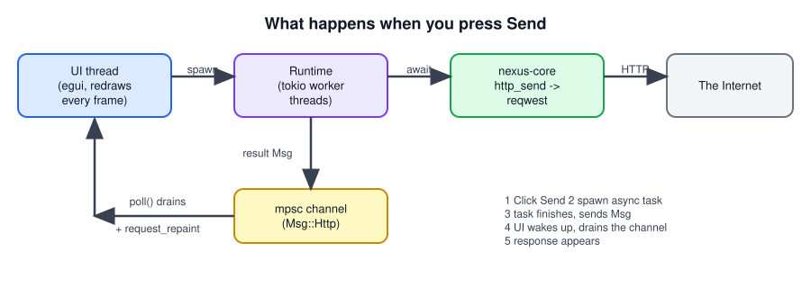
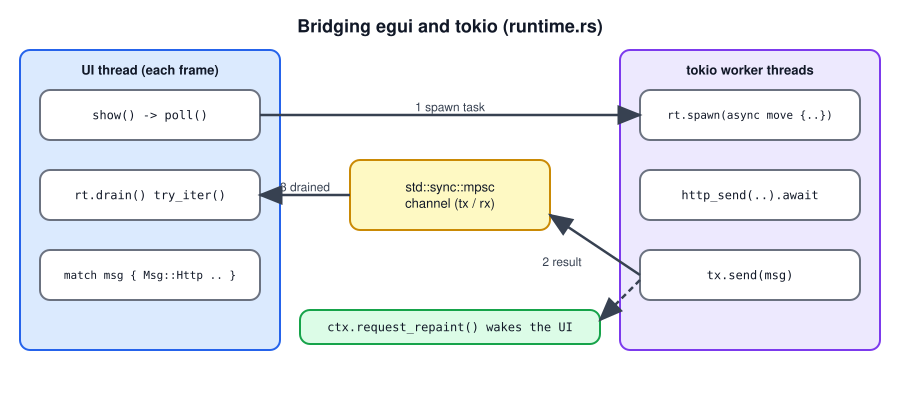

# Chapter 20: Putting it together: how Nexus keeps its window alive

> **Brain Power**
> You now know threads, channels, `Arc`, futures, tasks, `spawn_blocking`, timeouts, enums, and `Result`. Back in Chapter 1 you saw a picture of what happens when you press **Send** in Nexus, and you promised yourself you would understand every arrow by Chapter 20. Look at the picture once more *before* you read on. Can you guess what each arrow is?



This chapter is a reading tour. There is almost no new Rust, only **real Nexus code** built from pieces you have already learned. First, one fact about the window.

## The window draws itself again and again

Nexus's window is drawn by a library called **egui**. Unlike most UI toolkits, egui is an **immediate mode** library: every time something might have changed, egui calls *your* function, and your function *draws the entire window from scratch*, using the current data. Mostly this happens about 60 times a second.

> **New word: frame**
> One redraw of the window. A smooth window produces about 60 frames per second, so each frame has roughly 16 milliseconds to finish. If one frame takes three seconds (for example because it waits for a web service), the window freezes for three seconds.

That is why Nexus must **never wait** inside a frame. The frame code starts the slow work on the side, then continues; and *next* frame, it checks "has anything finished?". The two halves of that conversation are exactly Chapters 18 and 19:

* **sending work out:** a tokio **task** (Chapter 19), started with `spawn`;
* **getting answers back:** a **channel** (Chapter 18), drained once per frame with `try_iter`.

Let's read the real thing, in the order the data flows.



## The message: an enum

Everything that can come back from background work is one **enum** (Chapter 7), in [`runtime.rs`](../../crates/nexus-gui/src/runtime.rs). Here are two of its variants:

```rust,nexus
pub enum Msg {
    /// A request finished (tab id = request id).
    Http {
        tab_id: String,
        result: Result<Box<(Resp, Vec<LogEntry>)>, String>,
    },
    // ...
    History(Result<Vec<HistoryEntry>, String>),
```

Read it with your own eyes:

* A **data-carrying enum** (Chapter 7): `Http { .. }` has named fields, `History(..)` has one unnamed field.
* **`result: Result<..., String>`**: the success or an error *message*. This is Chapter 16's advice in action: inside the engine, errors are an enum; at this boundary, where a human is about to read them, plain `String`s.
* **`Box<(Resp, Vec<LogEntry>)>`**: a `Box` (the warehouse ticket from Chapter 13's peek) around a tuple (Chapter 2) of a response and a list of log lines. Boxing a big value keeps the enum itself small, since an enum is as big as its biggest variant.
* There are about fifteen variants in the real enum: HTTP finished, a file was picked, history loaded, a collection run progressed... Each says "*this* just finished, here's the result".

## The runtime: a tokio runtime plus a channel

`#[tokio::main]` (Chapter 19) builds a runtime and runs `main` on it. A window can't do that: `main` belongs to the window. So Nexus builds the runtime by hand, and keeps it, together with the two ends of a channel, in one struct:

```rust,nexus
pub struct Runtime {
    rt: tokio::runtime::Runtime,
    tx: Sender<Msg>,
    rx: Receiver<Msg>,
    ctx: Option<eframe::egui::Context>,
}
```

* `rt`: the tokio runtime (the "smart cook").
* `tx` and `rx`: the sending and receiving ends of an `mpsc` **channel of `Msg`** (Chapter 18). They are *both* stored here.
* `ctx`: a handle to the window (an `Option`, Chapter 8, because tests have no window). We'll see in a moment what it's for.

Building it is what `#[tokio::main]` hid from you:

```rust,nexus
    pub fn new() -> Self {
        let (tx, rx) = channel();
        Self {
            rt: tokio::runtime::Builder::new_multi_thread()
                .worker_threads(2)
                .enable_all()
                .build()
                .expect("tokio runtime"),
```

`channel()` makes the post box (Chapter 18). The *builder* asks for a runtime with two worker threads and everything switched on; `.expect("tokio runtime")` is Chapter 8: panic with that message if the runtime can't be built (which would be very unusual).

## Sending work out: `spawn`

This is the method the window calls to start a job. Its signature:

```rust,nexus
    pub fn spawn(
        &self,
        fut: impl Future<Output = Msg> + Send + 'static,
    ) -> tokio::task::AbortHandle {
        let tx = self.tx.clone();
        let ctx = self.ctx.clone();
```

Decode the parameter: **`fut: impl Future<Output = Msg> + Send + 'static`** reads, piece by piece:

* `impl ...`: Chapter 11's shorthand: "any type that...";
* `Future<Output = Msg>`: ...is a future (Chapter 19) whose finished result is a `Msg`;
* `+ Send`: ...may be moved to another thread (Chapter 18);
* `+ 'static`: ...and owns everything it uses, so it can outlive this function (Chapter 12).

The two `.clone()`s copy the channel's sender (cheap, Chapter 18) and the window handle, so the spawned task can own them. And the body that follows:

```rust,nexus
        self.rt
            .spawn(async move {
                let msg = fut.await;
                let _ = tx.send(msg);
                if let Some(ctx) = ctx {
                    ctx.request_repaint();
                }
            })
            .abort_handle()
```

Four lines of logic, and you know them all:

1. **`self.rt.spawn(async move { ... })`**: start a tokio task (Chapter 19), an `async move` block that owns `fut`, `tx` and `ctx`.
2. **`let msg = fut.await;`**: wait for the real work to finish. Meanwhile the worker runs other tasks.
3. **`let _ = tx.send(msg);`**: put the result in the post box. `send` returns a `Result`; if the window is already gone there is nobody to tell, so `let _ =` throws the `Result` away on purpose.
4. **`ctx.request_repaint();`**: *"window, wake up and draw a frame."* egui may sleep when nothing is happening; this nudge makes it run the frame function, which will find the new message.

It ends with `.abort_handle()`, so the caller can cancel the task later (this is how the **Cancel** button on a request works).

## Getting answers back: `drain`

Once per frame, the window picks up whatever has arrived. The method is two lines, and a direct copy of Chapter 18's `try_iter`:

```rust,nexus
    pub fn drain(&self) -> Vec<Msg> {
        self.rx.try_iter().collect()
    }
```

`try_iter()` yields every message *already waiting* and **never waits** (Chapter 18); `.collect()` (Chapter 13) packs them into a `Vec`. If there is nothing, you get an empty `Vec`, instantly. The frame carries on.

And the code that uses it, in [`app.rs`](../../crates/nexus-gui/src/app.rs):

```rust,nexus
    fn poll(&mut self) {
        for msg in self.rt.drain() {
            match msg {
                Msg::Http { tab_id, result } => {
```

A `for` over the drained messages (Chapter 9), then a `match` (Chapter 7) on *which kind* of news this is. Inside the `Http` arm, `tab_id` and `result` are pulled out by the pattern. And in that arm, Nexus decides how to colour the line in its console:

```rust,nexus
let level = match (&resp.error, resp.status) {
    (Some(_), _) | (_, 500..) => LogLevel::Error,
    (_, 400..=499) => LogLevel::Warn,
    _ => LogLevel::Info,
};
```

This is the most compact `match` in the book, and you can read it: a `match` on a **tuple** of two things (Chapter 2): the response's error (an `Option`, so `Some(_)` means "there was an error") and the status code (a number). First arm: *an error present, whatever the status, **or** any status of 500 and up* (`|` and the open range `500..`, Chapter 7) means `Error`. Second: *any error-free status from 400 to 499* means `Warn`. Third: everything else is `Info`. And it must be exhaustive, so the final `_` is there.

## Starting the work

When you press **Send**, the window calls `send_active` ([`app.rs`](../../crates/nexus-gui/src/app.rs)). Here are the lines just before the work is spawned:

```rust,nexus
        let request = t.request.clone();
        // ...
        let tab_id = t.id.clone();
        let app = self.app.clone();
        // ...
        let handle = self.rt.spawn(async move {
```

This is Chapter 4 meeting Chapter 19. The spawned `async move` block will outlive this function (the user may click elsewhere while the request runs), so it must **own** everything it uses. So, one line at a time, Nexus makes owned copies: `request` and `tab_id` are cloned out of the tab, which is *borrowed* from `self` (Chapter 5, the "borrow checker dance": you can't keep a reference into `self.tabs` while also calling methods on `self`). And `self.app.clone()` is an **`Arc` clone** (Chapter 18): only a new handle to the one shared engine object, not a copy of the engine.

Inside the block, the first thing it does is a Chapter 19 rule: file reads for the request body are *blocking*, so they go to the side:

```rust,nexus
            let built = tokio::task::spawn_blocking(move || {
                file_check?;
                build_payload(&request, &request_id, &scopes, collection.as_ref())
            })
```

`spawn_blocking(move || ...)`, with a `?` inside the closure (Chapter 8) to bail out early. Later the block calls the engine's `http_send` (the `reqwest` call, with the timeout from Chapter 19), and finally **returns a `Msg::Http { tab_id, result }`**. That value is what `spawn` sends through the channel. The loop is closed.

Every arrow of the Chapter 1 picture now has a name:

1. **Click Send** → `send_active` clones what it needs.
2. **spawn async task** → `Runtime::spawn`.
3. **task finishes, sends `Msg`** → `tx.send(msg)`.
4. **UI wakes up** → `request_repaint()`.
5. **drains the channel** → `poll()` calls `drain()`, then a `match`.

### A new piece of syntax: `let ... else`

You will see this form often in Nexus, in `send_active` and elsewhere:

```rust,nexus
        let Some(t) = self.tabs.active() else { return };
```

It's `if let` (Chapter 7) turned around: *"try to match this pattern; if it doesn't match, run the `else` block, which must leave this function (or loop), and otherwise carry on with `t` in hand."* Here: "get the active tab, or, if there isn't one, do nothing and return". A toy version you can run:

```rust
fn first_word_len(text: &str) -> usize {
    let Some((word, _)) = text.split_once(' ') else {
        return text.len();
    };
    word.len()
}

fn main() {
    println!("{}", first_word_len("GET /users"));
    println!("{}", first_word_len("HEAD"));
}
```

```output
3
4
```

If there is a space, the pattern matches, `word` is the part before it, and we return its length. If there is none, `split_once` gives `None`, the `else` block runs and returns the whole text's length. It saves an indentation level compared with a `match`: the happy path continues unindented.

## Build your own bridge

You now know enough to write a miniature of the whole mechanism without any window. In this program, `main` plays the window: it starts two background jobs, then loops "frames" and drains the messages like Nexus does:

```rust
// needs-deps
use std::future::Future;
use std::sync::mpsc::{channel, Receiver, Sender};
use std::thread;
use std::time::Duration;

enum Msg {
    Http { id: u32, status: u16 },
    Failed(String),
}

struct Runtime {
    rt: tokio::runtime::Runtime,
    tx: Sender<Msg>,
    rx: Receiver<Msg>,
}

impl Runtime {
    fn new() -> Self {
        let (tx, rx) = channel();
        let rt = tokio::runtime::Builder::new_multi_thread()
            .worker_threads(2)
            .enable_all()
            .build()
            .expect("tokio runtime");
        Self { rt, tx, rx }
    }

    fn spawn(&self, fut: impl Future<Output = Msg> + Send + 'static) {
        let tx = self.tx.clone();
        self.rt.spawn(async move {
            let msg = fut.await;
            let _ = tx.send(msg);
        });
    }

    fn drain(&self) -> Vec<Msg> {
        self.rx.try_iter().collect()
    }
}

fn main() {
    let runtime = Runtime::new();

    runtime.spawn(async {
        tokio::time::sleep(Duration::from_millis(80)).await;
        Msg::Http { id: 1, status: 200 }
    });
    runtime.spawn(async {
        tokio::time::sleep(Duration::from_millis(30)).await;
        Msg::Failed(String::from("timed out"))
    });

    let mut seen = 0;
    while seen < 2 {
        for msg in runtime.drain() {
            seen += 1;
            match msg {
                Msg::Http { id, status } => println!("request {id} finished with {status}"),
                Msg::Failed(reason) => println!("failed: {reason}"),
            }
        }
        thread::sleep(Duration::from_millis(10)); // the "window" draws a frame
    }
}
```

```output
failed: timed out
request 1 finished with 200
```

Run it. The quicker job answers first, even though it was started second. The `while` loop never blocks for more than a frame; it just checks the post box and carries on drawing. Swap the `thread::sleep` for real drawing code, and you have a GUI.

> **There are no Dumb Questions**
>
> **Q: Why does Nexus use a plain `std::sync::mpsc` channel instead of tokio's channels?**
> A: Because the *receiver* lives in the window, which is not async: it calls `try_iter()` in an ordinary function, once per frame. The standard channel is perfect for that. (Tokio's own `mpsc` is for talking between async tasks.)
>
> **Q: What if the window closes while a task is still running?**
> A: `tx.send(msg)` returns an `Err` (nobody is listening), and `let _ =` ignores it. The task then ends. Nothing crashes.
>
> **Q: Why only two worker threads?**
> A: The work is mostly waiting (network). Two threads can juggle many tasks (Chapter 19), and everything blocking goes to `spawn_blocking`'s separate pool.
>
> **Q: Is this pattern special to Nexus?**
> A: No. "A background runtime plus a channel that the UI drains each frame" is *the* standard way to put async code behind any frame-based or event-loop UI in Rust.

## Checkpoint project: request builder, version 19 (the finale)

Let's give the request builder the same architecture as Nexus, so `rb-core` is the engine and `rb-cli` plays the window. Create a new module `bridge.rs` in `rb-cli`: it is your mini-bridge from above, with the real `rb-core` types:

<!-- proj=rb20 copy=19_async:rb19:Cargo.toml>Cargo.toml -->
<!-- proj=rb20 copy=19_async:rb19:crates/rb-cli/Cargo.toml>crates/rb-cli/Cargo.toml -->
<!-- proj=rb20 copy=19_async:rb19:crates/rb-core/Cargo.toml>crates/rb-core/Cargo.toml -->
<!-- proj=rb20 copy=19_async:rb19:crates/rb-core/src/lib.rs>crates/rb-core/src/lib.rs -->
<!-- proj=rb20 copy=19_async:rb19:crates/rb-core/src/client.rs>crates/rb-core/src/client.rs -->
<!-- proj=rb20 copy=19_async:rb19:crates/rb-core/src/error.rs>crates/rb-core/src/error.rs -->
<!-- proj=rb20 copy=19_async:rb19:crates/rb-core/src/header.rs>crates/rb-core/src/header.rs -->
<!-- proj=rb20 copy=19_async:rb19:crates/rb-core/src/method.rs>crates/rb-core/src/method.rs -->
<!-- proj=rb20 copy=19_async:rb19:crates/rb-core/src/request.rs>crates/rb-core/src/request.rs -->
<!-- proj=rb20 copy=19_async:rb19:crates/rb-core/src/variables.rs>crates/rb-core/src/variables.rs -->

```rust,proj=rb20,file=crates/rb-cli/src/bridge.rs
use std::future::Future;
use std::sync::mpsc::{channel, Receiver, Sender};

use rb_core::Response;

/// Results of background work, drained once per "frame".
pub enum Msg {
    Sent(Response),
    Failed { request_id: String, reason: String },
}

pub struct Runtime {
    rt: tokio::runtime::Runtime,
    tx: Sender<Msg>,
    rx: Receiver<Msg>,
}

impl Runtime {
    pub fn new() -> Self {
        let (tx, rx) = channel();
        let rt = tokio::runtime::Builder::new_multi_thread()
            .worker_threads(2)
            .enable_all()
            .build()
            .expect("tokio runtime");
        Self { rt, tx, rx }
    }

    pub fn spawn(&self, fut: impl Future<Output = Msg> + Send + 'static) {
        let tx = self.tx.clone();
        self.rt.spawn(async move {
            let msg = fut.await;
            let _ = tx.send(msg);
        });
    }

    pub fn drain(&self) -> Vec<Msg> {
        self.rx.try_iter().collect()
    }
}
```

And `main.rs` is the "window": it starts the jobs, then loops frames:

```rust,proj=rb20,file=crates/rb-cli/src/main.rs
mod bridge;

use std::thread;
use std::time::Duration;

use bridge::{Msg, Runtime};
use rb_core::client::fake_send_async;
use rb_core::{Header, Method, Request};

fn make(id: &str, path: &str) -> Request {
    let mut request = Request::new(Method::Get, path);
    request.id = id.to_string();
    request.add_header(Header::new("Host", "api.example.test"));
    request
}

fn main() {
    let runtime = Runtime::new();

    let jobs = [("req-1", "/users"), ("req-2", "/users/missing"), ("req-3", "/reports/slow")];
    for (id, path) in jobs {
        let request = make(id, path);
        runtime.spawn(async move {
            let limit = Duration::from_millis(100);
            match tokio::time::timeout(limit, fake_send_async(&request)).await {
                Ok(response) => Msg::Sent(response),
                Err(_) => Msg::Failed {
                    request_id: request.id.clone(),
                    reason: String::from("timed out"),
                },
            }
        });
    }

    let mut lines = Vec::new();
    while lines.len() < jobs.len() {
        for msg in runtime.drain() {
            lines.push(match msg {
                Msg::Sent(response) => format!("{} -> {}", response.request_id, response.status),
                Msg::Failed { request_id, reason } => format!("{request_id} failed: {reason}"),
            });
        }
        thread::sleep(Duration::from_millis(10)); // a "frame"
    }

    lines.sort();
    for line in lines {
        println!("{line}");
    }
}
```

```output,proj=rb20,run=-p+rb-cli
req-1 -> 200
req-2 -> 404
req-3 failed: timed out
```

(The final `sort` just keeps the output the same on every run; in a real window each message would update the screen the instant it arrived.)

Compare this with Nexus: `rb-core` is `nexus-core` (the engine, with no idea what a window is), `rb-cli` is `nexus-gui`, `Msg` is `Msg`, `bridge::Runtime` is `runtime::Runtime`, the `while` loop is egui calling the frame function, and `runtime.drain()` is `poll()`. You have just rebuilt, in about 80 lines, the architecture of a 48,000-line application.

> **Sharpen your pencil**
> Add a new message variant `Msg::Cancelled(String)` and decide where it would come from. Which `match` expressions will the compiler force you to update?
>
> <details><summary>Answer</summary>
>
> Only the one `match msg { ... }` in `main.rs` that turns messages into text: it must gain a `Msg::Cancelled(id) => ...` arm. (This is Chapter 7's guarantee again. In Nexus, adding a variant to `Msg` forces you to handle it in `poll()`.) Where it would come from: a task that notices a cancel flag, or the `AbortHandle` from `spawn`.
> </details>

## Bullet Points

* egui redraws the window in **frames**, about 60 times a second; a frame must never wait.
* Nexus's bridge is a **tokio runtime** plus an **`mpsc` channel** of a **`Msg` enum**: tasks send a `Msg`; once per frame the UI **drains** the channel with `try_iter()` and `match`es on it.
* `Runtime::spawn` takes `impl Future<Output = Msg> + Send + 'static`, runs it as a task, sends the result, and calls `request_repaint()` to wake the window.
* Because a task outlives the function that starts it, everything it uses is **cloned or moved** in first (`.clone()`, `Arc` handles, `async move`).
* Blocking work (files, scripts) goes through `spawn_blocking`; waits go through `.await` with a `timeout`.
* `let Some(x) = value else { return };` is `if let` turned around.

## Cheat sheet

```text
enum Msg { Http { .. }, Failed(String) }         what can come back
let (tx, rx) = channel();                         the post box
rt.spawn(async move { let m = fut.await; tx.send(m); ctx.request_repaint(); })
for msg in rx.try_iter() { match msg { .. } }     once per frame, never waits
let Some(x) = maybe else { return };              early exit
```
