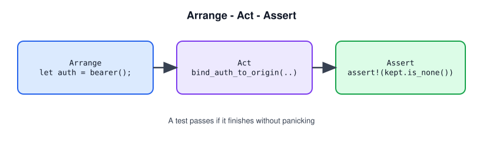
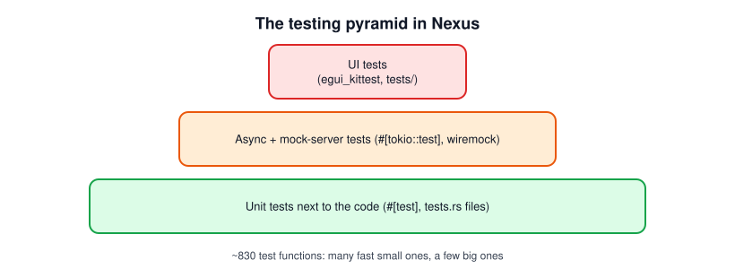

# Chapter 21: Testing: knowing it works

> **Brain Power**
> You change the way `build` parses a header line. How do you find out you didn't break the case where the header contains *two* colons (`Host: a.test:8080`), or the case where the method is lower-case? Running the program by hand and eyeballing the output, every time? What would a tireless assistant do instead?

A tireless assistant that re-checks everything in a second: that is an **automated test**. Rust has testing built into the language and into Cargo. No extra libraries needed.

## The smallest test

A **test** is an ordinary function with an attribute (Chapter 6) above it: **`#[test]`**. If the function finishes normally, the test **passes**. If it **panics** (Chapter 8), the test **fails**.

```rust
fn add(a: i32, b: i32) -> i32 {
    a + b
}

#[test]
fn adds_two_numbers() {
    assert_eq!(add(2, 3), 5);
}
```

You don't run it with `cargo run` (there is no `main`). You run it with:

```bash
cargo test
```

and you see something like this:

```text
running 1 test
test adds_two_numbers ... ok

test result: ok. 1 passed; 0 failed; 0 ignored; 0 measured; 0 filtered out; finished in 0.00s
```

One test ran and passed. Cargo found it because of `#[test]`: you never list your tests anywhere.

* **`assert_eq!(left, right)`** is a macro (the `!` from Chapter 1) that panics if the two values aren't equal. It needs `PartialEq` (Chapter 10) to compare, and `Debug` to print them if they differ.
* Two siblings: **`assert!(condition)`** panics when the condition is false, and **`assert_ne!(a, b)`** panics when they *are* equal.



Let's see a failure. Change the expected value to something wrong:

```rust,testfails
fn add(a: i32, b: i32) -> i32 {
    a + b
}

#[test]
fn adds_two_numbers() {
    assert_eq!(add(2, 2), 5);
}
```

<details><summary>What you see</summary>

```text
running 1 test
test adds_two_numbers ... FAILED

failures:

---- adds_two_numbers stdout ----

thread 'adds_two_numbers' (478446) panicked at src/main.rs:7:5:
assertion `left == right` failed
  left: 4
 right: 5
```

(Followed by a list of the failing tests and `test result: FAILED. 0 passed; 1 failed;`. The number in parentheses is different on every run, and older versions of Rust don't print it.) Read it like the compiler errors from Chapter 1: **which test** (`adds_two_numbers`), **where** (file, line and column), **what** (the assertion failed), and the **actual values**: `left` is what the code produced (4), `right` what you expected (5).

</details>

> **New word: test**
> A function marked `#[test]` that checks one behaviour of your code, and fails by panicking. **Unit tests** check small pieces from inside the code; **integration tests** check the finished library from outside, like a user.

A good test follows three steps, **Arrange, Act, Assert**: set up the inputs, run the code, check the result.

## Where do tests live?

Two common places.

**Unit tests** sit right next to the code they check, in a submodule (Chapter 14) at the bottom of the file:

```rust
fn parse_method(text: &str) -> Option<&str> {
    match text {
        "GET" | "POST" => Some(text),
        _ => None,
    }
}

#[cfg(test)]
mod tests {
    use super::*;

    #[test]
    fn accepts_known_methods() {
        assert_eq!(parse_method("GET"), Some("GET"));
    }

    #[test]
    fn rejects_unknown_methods() {
        assert_eq!(parse_method("FETCH"), None);
        assert!(parse_method("get").is_none());
    }
}
```

* **`#[cfg(test)]`** means "compile this module *only* when running `cargo test`". Your tests never end up in the program you ship.
* **`mod tests { ... }`**: a module like any other (Chapter 14). Because it is a *child* of the file's module, it can see private items too: ideal for checking internals.
* **`use super::*;`**: bring everything from the parent module (`super`, Chapter 14) into scope; the `*` is a "glob", meaning *all names*. Now `parse_method` is available.
* Two checks in one test are fine when they're about one idea. Prefer many small tests with descriptive names: when one fails, the name tells you what broke.

**Integration tests** live in a folder called `tests/` next to `src/`. Each file there is a separate crate that can only use your library's **public** API (Chapter 15), exactly like a user would. They check that the pieces work together.

## Testing the unhappy path

Real code spends much of its life handling errors (Chapters 8 and 16), and so should your tests. A few tools:

```rust
#[derive(Debug)]
enum Error {
    UnknownMethod(String),
}

fn parse_method(text: &str) -> Result<&str, Error> {
    match text {
        "GET" | "POST" => Ok(text),
        other => Err(Error::UnknownMethod(other.to_string())),
    }
}

#[cfg(test)]
mod tests {
    use super::*;

    #[test]
    fn unknown_method_is_an_error() {
        let result = parse_method("FETCH");
        assert!(matches!(result, Err(Error::UnknownMethod(_))));
    }

    #[test]
    fn the_error_remembers_the_name() {
        match parse_method("FETCH") {
            Err(Error::UnknownMethod(name)) => assert_eq!(name, "FETCH"),
            other => panic!("expected UnknownMethod, got {other:?}"),
        }
    }

    #[test]
    #[should_panic(expected = "unknown method")]
    fn unwrapping_an_error_panics() {
        parse_method("FETCH").expect("unknown method");
    }

    #[test]
    fn a_test_can_return_a_result() -> Result<(), Error> {
        let method = parse_method("POST")?;
        assert_eq!(method, "POST");
        Ok(())
    }
}
```

* **`assert!(matches!(result, Err(Error::UnknownMethod(_))))`**: Chapter 7's `matches!` inside `assert!`: "the result is *that* variant, whatever is inside". This is the neat way to test an error whose type isn't comparable with `==`.
* **`panic!("...")`** panics on purpose, with your message (`{other:?}` uses the debug format, Chapter 2). It's the fallback arm of the `match`.
* **`#[should_panic(expected = "unknown method")]`** flips the test: it passes only if the code panics, and the panic message must contain that text. Good for "this must refuse to continue" cases.
* A test may **return a `Result`**, which lets you use `?` inside (Chapter 8). If it returns `Err`, the test fails.

> **There are no Dumb Questions**
>
> **Q: How do I run just one test?**
> A: Give `cargo test` a piece of the name: `cargo test unknown` runs every test whose name contains "unknown". (Nexus's own conventions mention `cargo test -p nexus-core trust`.)
>
> **Q: My test prints with `println!`, but I see nothing.**
> A: Cargo hides output from *passing* tests. To see it: `cargo test -- --nocapture`. (Everything after the `--` goes to the test program itself.)
>
> **Q: In what order do tests run?**
> A: In parallel, on several threads, in no promised order (Chapter 18!). So tests must not depend on each other, and must not share files without care. Use a fresh temporary folder per test.
>
> **Q: How many tests are enough?**
> A: A test for every behaviour you'd be upset to lose, and one for every bug you fix: write the failing test first, then fix the code, and the bug can never return.

## Async tests

Code that is `async` (Chapter 19) needs a runtime to run, and so does its test. The same attribute trick as `#[tokio::main]`, for tests:

```rust
// needs-deps
use std::time::Duration;
use tokio::time::{sleep, timeout};

async fn slow_job() -> u32 {
    sleep(Duration::from_millis(200)).await;
    7
}

#[cfg(test)]
mod tests {
    use super::*;

    #[tokio::test]
    async fn finishes_in_time_when_given_enough_time() {
        let result = timeout(Duration::from_millis(500), slow_job()).await;
        assert_eq!(result.unwrap(), 7);
    }

    #[tokio::test]
    async fn times_out_when_the_limit_is_short() {
        let result = timeout(Duration::from_millis(20), slow_job()).await;
        assert!(result.is_err());
    }
}
```

**`#[tokio::test]`** turns the `async fn` into a normal test running on a tokio runtime, and you can `.await` inside it.

## Now look at real Nexus

Nexus has about 830 test functions. They sit in sibling files: `trust.rs` is the code, `trust/tests.rs` the tests, and `trust.rs` ends with just two lines (Chapters 14 and 21 together):

```rust,nexus
#[cfg(test)]
mod tests;
```

"There is a module called `tests`: load it from `tests.rs` next to this file, but only when testing." Open [`trust/tests.rs`](../../crates/nexus-core/src/trust/tests.rs). It begins with what you now recognise:

```rust,nexus
use super::*;
```

And here is a real test of the function you decoded in Chapter 12, `bind_auth_to_origin`, which refuses to send saved credentials to a different website:

```rust,nexus
#[test]
fn origin_change_drops_auth_with_warning() {
    let auth = bearer();
    let (kept, warn) = bind_auth_to_origin(Some(&auth), "https://a.test/x", "https://evil.test/x");
    assert!(kept.is_none());
```

It is **Arrange, Act, Assert**: *arrange* an auth config (`bearer()` is a small helper); *act* by calling the function with a URL that changes from `a.test` to `evil.test`; *assert* that the returned auth is `None`, and then (a few lines on) that the warning mentions "Auth not sent". Exactly the kind of security promise you want guarded by a test that runs in milliseconds.

The same file tests the happy path next to it: a change from `https://a.test/x` to `https://a.test:443/y?q=1` is the *same origin* (default port, different path), so `assert!(kept.is_some() && warn.is_none())`. Both directions, both tested.

Async code is tested the same way you saw above:

```rust,nexus
#[tokio::test]
async fn keeps_headers_on_a_same_origin_redirect() {
    let target = ok_server().await;
    let source = redirector(&target).await;
```

A fake web server is started *inside* the test (`ok_server`, `redirector`), so the HTTP client is tested without the internet. (This uses a test-only library listed under `[dev-dependencies]`, Chapter 15: crates needed for tests but not for the finished program.)



The pyramid above shows the shape of Nexus's tests: **many** fast unit tests (like the ones you just read) at the bottom, **some** async tests with fake servers in the middle, and a **few** big tests at the top that drive the whole window as if a user were clicking.

## Checkpoint project: request builder, version 20

Time to test the request builder. We add three kinds of tests to `rb-core`. Everything else stays as in Chapter 20 (copy it).

<!-- proj=rb21 copy=20_nexus_runtime_bridge:rb20:crates/rb-core/src/lib.rs>crates/rb-core/src/lib.rs -->
<!-- proj=rb21 copy=20_nexus_runtime_bridge:rb20:crates/rb-core/src/client.rs>crates/rb-core/src/client.rs -->
<!-- proj=rb21 copy=20_nexus_runtime_bridge:rb20:crates/rb-core/src/error.rs>crates/rb-core/src/error.rs -->
<!-- proj=rb21 copy=20_nexus_runtime_bridge:rb20:crates/rb-core/src/header.rs>crates/rb-core/src/header.rs -->
<!-- proj=rb21 copy=20_nexus_runtime_bridge:rb20:crates/rb-core/src/method.rs>crates/rb-core/src/method.rs -->
<!-- proj=rb21 copy=20_nexus_runtime_bridge:rb20:crates/rb-core/src/request.rs>crates/rb-core/src/request.rs -->
<!-- proj=rb21 copy=20_nexus_runtime_bridge:rb20:crates/rb-cli/Cargo.toml>crates/rb-cli/Cargo.toml -->
<!-- proj=rb21 copy=20_nexus_runtime_bridge:rb20:crates/rb-cli/src/main.rs>crates/rb-cli/src/main.rs -->
<!-- proj=rb21 copy=20_nexus_runtime_bridge:rb20:crates/rb-cli/src/bridge.rs>crates/rb-cli/src/bridge.rs -->

**1. Unit tests** at the bottom of `variables.rs` (the only change to that file is the `tests` module):

```rust,proj=rb21,file=crates/rb-core/src/variables.rs
use std::collections::HashMap;

pub fn resolve(template: &str, variables: &HashMap<String, String>) -> String {
    let mut result = template.to_string();
    for (name, value) in variables {
        let mut placeholder = String::from("{{");
        placeholder.push_str(name);
        placeholder.push_str("}}");
        result = result.replace(&placeholder, value);
    }
    result
}

pub fn sorted_names(variables: &HashMap<String, String>) -> Vec<&String> {
    let mut names: Vec<&String> = variables.keys().collect();
    names.sort();
    names
}

#[cfg(test)]
mod tests {
    use super::*;

    fn vars() -> HashMap<String, String> {
        let mut vars = HashMap::new();
        vars.insert(String::from("host"), String::from("api.example.test"));
        vars.insert(String::from("version"), String::from("v2"));
        vars
    }

    #[test]
    fn fills_in_known_variables() {
        assert_eq!(resolve("https://{{host}}/{{version}}", &vars()), "https://api.example.test/v2");
    }

    #[test]
    fn leaves_unknown_placeholders_alone() {
        assert_eq!(resolve("/{{missing}}/x", &vars()), "/{{missing}}/x");
    }

    #[test]
    fn names_come_out_sorted() {
        let vars = vars();
        let names = sorted_names(&vars);
        assert_eq!(names, vec!["host", "version"]);
    }
}
```

`vars()` is a small helper function in the tests module, a handy way to *arrange* the same inputs for several tests.

**2. Integration tests** in a new file, `crates/rb-core/tests/behaviour.rs`. It only sees the **public** API of `rb-core`, like `rb-cli` does:

```rust,proj=rb21,file=crates/rb-core/tests/behaviour.rs
use std::time::Duration;

use rb_core::client::send_all_async;
use rb_core::{build, parse_port, Error, Header, Method, Request};

#[test]
fn builds_a_valid_request() {
    let request = build("GET", "/users", "Host: api.example.test").unwrap();
    assert_eq!(request.method, Method::Get);
    assert_eq!(request.headers.len(), 1);
}

#[test]
fn header_values_may_contain_colons() {
    let header = Header::parse("Host: a.test:8080").unwrap();
    assert_eq!(header.key, "Host");
    assert_eq!(header.value, "a.test:8080");
}

#[test]
fn unknown_methods_are_rejected() {
    let result = build("FETCH", "/users", "Host: x");
    assert!(matches!(result, Err(Error::UnknownMethod(name)) if name == "FETCH"));
}

#[test]
fn paths_must_start_with_a_slash() {
    let result = build("GET", "users", "Host: x");
    assert!(matches!(result, Err(Error::InvalidPath { .. })));
}

#[test]
fn ports_must_be_numbers() {
    assert_eq!(parse_port(" 8080 ").unwrap(), 8080);
    assert!(parse_port("http").is_err());
    assert!(parse_port("70000").is_err());
}

#[test]
fn a_request_survives_a_round_trip_through_a_file() {
    let dir = tempfile::tempdir().unwrap();
    let file = dir.path().join("request.json");

    let mut request = Request::new(Method::Post, "/orders");
    request.add_header(Header::new("Content-Type", "application/json"));
    request.save(&file).unwrap();

    let loaded = Request::load(&file).unwrap();
    assert_eq!(loaded, request);
}

#[tokio::test]
async fn slow_requests_get_a_408() {
    let mut fast = Request::new(Method::Get, "/users");
    fast.id = String::from("a");
    let mut slow = Request::new(Method::Get, "/reports/slow");
    slow.id = String::from("b");

    let responses = send_all_async(vec![fast, slow], Duration::from_millis(100)).await;
    assert_eq!(responses[0].status, 200);
    assert_eq!(responses[1].status, 408);
}
```

A few details:

* `matches!(result, Err(Error::UnknownMethod(name)) if name == "FETCH")`: `matches!` accepts an extra `if` guard, just like `match` (Chapter 7).
* `Err(Error::InvalidPath { .. })` uses `..` (Chapter 7) for "whatever fields".
* The round-trip test uses a **temporary directory** from the `tempfile` crate: a fresh folder, deleted automatically when `dir` is dropped (Chapter 10's `Drop`, again). That keeps parallel tests from stepping on each other.
* The last test is `#[tokio::test]`, because `send_all_async` is `async` (Chapter 19).

**3. Dependencies.** `tempfile` is needed only by the tests, so it goes under `[dev-dependencies]` (Chapter 15). Add it to the shared list and to `rb-core`:

```toml,proj=rb21,file=Cargo.toml
[workspace]
resolver = "2"
members = ["crates/rb-core", "crates/rb-cli"]

[workspace.package]
version = "0.1.0"
edition = "2021"

[workspace.dependencies]
serde = { version = "1", features = ["derive"] }
serde_json = "1"
tempfile = "3"
thiserror = "2"
tokio = { version = "1", features = ["rt-multi-thread", "macros", "time"] }
uuid = { version = "1", features = ["v4"] }
rb-core = { path = "crates/rb-core" }
```

```toml,proj=rb21,file=crates/rb-core/Cargo.toml
[package]
name = "rb-core"
version.workspace = true
edition.workspace = true

[dependencies]
serde.workspace = true
serde_json.workspace = true
thiserror.workspace = true
tokio.workspace = true
uuid.workspace = true

[dev-dependencies]
tempfile.workspace = true
```

Now run everything:

```bash
cargo test --workspace
```

```output,proj=rb21,cmd=test
(cargo test runs the unit tests, the integration tests and the doc tests; the result lines are checked by the book's build)
```

You will see a block for each kind: the unit tests in `src/` (3 tests), the integration tests in `tests/behaviour.rs` (7 tests), and empty runs for crates without tests. Typically something like:

```text
running 3 tests
test variables::tests::fills_in_known_variables ... ok
test variables::tests::leaves_unknown_placeholders_alone ... ok
test variables::tests::names_come_out_sorted ... ok

test result: ok. 3 passed; 0 failed; 0 ignored; 0 measured; 0 filtered out

running 7 tests
test header_values_may_contain_colons ... ok
test builds_a_valid_request ... ok
test paths_must_start_with_a_slash ... ok
...
test result: ok. 7 passed; 0 failed; 0 ignored; 0 measured; 0 filtered out
```

(The order within a block varies, because tests run in parallel.)

> **Sharpen your pencil**
> Write a test that proves `Header::parse` rejects a line with no colon, and returns the error variant that carries the whole line. Which of this chapter's tools fits best, `assert_eq!`, `matches!` or `#[should_panic]`?
>
> <details><summary>Answer</summary>
>
> `matches!`, since the error type has no `PartialEq` (we removed it in Chapter 17 because `io::Error` can't be compared):
>
> ```rust,frag
> #[test]
> fn a_header_without_a_colon_is_rejected() {
>     let result = Header::parse("Host api.example.test");
>     assert!(matches!(result, Err(Error::BadHeader(line)) if line == "Host api.example.test"));
> }
> ```
> It goes in `tests/behaviour.rs`.
> </details>

## Bullet Points

* A **test** is a function marked `#[test]` that panics on failure. Run them with **`cargo test`**.
* **`assert!`**, **`assert_eq!`**, **`assert_ne!`** check things. `assert!(matches!(value, Pattern))` checks a variant. `#[should_panic(expected = "..")]` expects a panic. A test may return a `Result` and use `?`.
* **Unit tests** live in `#[cfg(test)] mod tests { use super::*; ... }` next to the code (Nexus puts them in a sibling `tests.rs`). **Integration tests** live in `tests/` and use only the public API.
* **`#[tokio::test]`** runs an `async fn` as a test.
* Test crates go under **`[dev-dependencies]`**.
* Arrange, Act, Assert; many small tests with descriptive names; write the failing test first when fixing a bug.
* `cargo test name` filters; `cargo test -- --nocapture` shows output; `cargo test --workspace` tests every crate.

## Cheat sheet

```text
#[test] fn name() { assert_eq!(f(2), 4); }
assert!(cond)   assert_eq!(a, b)   assert_ne!(a, b)
assert!(matches!(r, Err(E::Bad(_))))
#[should_panic(expected = "text")]
#[cfg(test)] mod tests { use super::*; .. }        unit tests
tests/name.rs                                      integration tests
#[tokio::test] async fn t() { .. }
cargo test   cargo test word   cargo test -- --nocapture   cargo test --workspace
```
