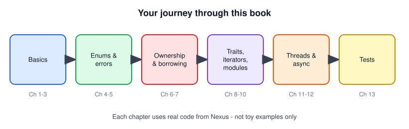

# Head First Rust, with Nexus

*A friendly, picture-heavy introduction to Rust for people who have never seen it, taught with a small program you build yourself and a real one you slowly learn to read: Nexus, a local-first API client (think "Postman, but a single native Rust app").*



---

## Who is this book for?

You have **never seen Rust**. You might never have seen a "systems" language at all: no C, no C++, no assumptions. Maybe you know a bit of Python or JavaScript, maybe you have only done spreadsheets. Words like *ownership* and *borrow checker* may sound like something from a law firm.

Good. This book is for you.

## How this book teaches

Every chapter works the same way. **One new idea at a time**, in this order:

1. **Start from something you know** (a library, a kitchen, a filing cabinet) and a concrete problem.
2. **The smallest program** that shows the idea. You type it, you see exactly the output shown, and every line is explained.
3. **Vary it.** Change one thing and see what happens, including making the compiler complain on purpose. Every error message is shown for real and decoded piece by piece, so error messages become friends.
4. **Predict before you read the answer.** Exercises come *before* their answers, and the answers are folded away.
5. **Say it several ways:** an analogy, a picture, code, an exercise.
6. **Only then, "Now look at real Nexus":** a short excerpt (about ten lines) from the real program, decoded line by line, using *only* ideas already taught.
7. **A checkpoint:** a small request-builder program that grows a little in every chapter and ends as a miniature of Nexus.

Nothing is used before it is explained. The page [`CONCEPT-LADDER.md`](CONCEPT-LADDER.md) lists exactly what each chapter introduces and assumes. A few forward references do exist, and each one is flagged on the spot ("ignore this for now, Chapter N explains it").

### The furniture

| Device | What it is |
|---|---|
| **Brain Power** | A question at the top of the chapter. Think about it *before* reading on. Wrong guesses help you learn. |
| **New word** | A box that defines each new term, the first time it appears. |
| **Sharpen your pencil** | A short exercise with the answer folded underneath. Try first! |
| **There are no Dumb Questions** | The questions you were too polite to ask. |
| **Watch it!** | A trap that catches almost every beginner. |
| **Now look at real Nexus** | A short excerpt from the real project, decoded. |
| **Checkpoint project** | The request builder, one step further. |
| **Bullet Points / Cheat sheet** | A recap of *only* what that chapter taught. |

And lots of **pictures** (SVG files in [`img/`](img/)). If a paragraph confuses you, look at the picture, then re-read.

> **Standing rule:** real Nexus code is full of the word `pub`, which Chapter 14 explains. Until then, read every excerpt as if `pub` were not there.
>
> Nexus excerpts are marked with a link such as [`error.rs`](../../crates/nexus-core/src/error.rs). Open the file next to the book. Line numbers drift as the project changes, so excerpts are quoted in full; search for them with your editor.

## Table of contents

**Part 1: First steps**

1. [Hello, Cargo!](01-hello-cargo.md): install, run, the compiler, Cargo, a picture tour of Nexus
2. [Values, variables and types](02-values-and-variables.md)
3. [Functions and decisions](03-functions-and-decisions.md)

**Part 2: Owning things**

4. [Ownership](04-ownership.md): desk and warehouse, `String`, move, clone, copy
5. [Borrowing](05-borrowing.md): `&`, `&mut`, `&str`, slices

**Part 3: Modelling data**

6. [Structs and methods](06-structs-and-methods.md)
7. [Enums and `match`](07-enums-and-match.md)
8. [When things go missing or wrong: `Option`, `Result` and `?`](08-option-result.md)
9. [Collections: `Vec`, arrays, `HashMap`](09-collections.md)

**Part 4: Reusable code**

10. [Traits: shared abilities](10-traits.md): `Display`, `derive`, `From`, `Drop`
11. [Generics](11-generics.md)
12. [Lifetimes](12-lifetimes.md)
13. [Closures and iterators](13-closures-and-iterators.md)

**Part 5: Real projects**

14. [Modules: organising code into files](14-modules.md)
15. [Crates, dependencies and workspaces](15-crates-and-workspaces.md)
16. [Your own error type](16-your-own-errors.md)
17. [Saving data: JSON and serde](17-serde-and-json.md)

**Part 6: Many things at once**

18. [Threads, `Arc`, `Mutex` and channels](18-threads.md)
19. [Async and tokio](19-async.md)
20. [Putting it together: how Nexus keeps its window alive](20-nexus-runtime-bridge.md)

**Part 7: Quality**

21. [Testing](21-testing.md)
22. [Where to go next](22-where-to-go-next.md): reading order, a critical read of Nexus, glossary

## Installing Rust

Chapter 1 walks you through it with every step explained. In short, Rust ships with a tool called **rustup** that installs and updates everything:

```bash
# Linux / macOS
curl --proto '=https' --tlsv1.2 -sSf https://sh.rustup.rs | sh
# then restart your terminal and check:
rustc --version
cargo --version
```

(On Windows, download the installer from <https://rustup.rs>.) You get two main tools: **`rustc`**, the compiler, and **`cargo`**, the project manager. You will mostly type `cargo`.

> **Watch it!** Nexus needs a *recent* stable Rust (it uses newer library functions such as `Option::is_none_or`). The repository does not pin a version, so if the build complains about unknown methods, run `rustup update`. This book was checked with `rustc 1.99` / `cargo 1.99`.

## Trying the examples

Almost every example is a small **complete program**. Two ways to run one:

```bash
rustc hello.rs && ./hello      # one file
```

or make a playground project with `cargo new playground`, paste the code into `src/main.rs`, and `cargo run`. The book shows the exact output of each program. Where an example is meant to fail, the book shows the real compiler message.

A few examples use outside crates (`serde`, `serde_json`, `thiserror`, `tokio`). Those start with the comment `// needs-deps`; in a `cargo new` project, add the crates with `cargo add serde --features derive`, `cargo add serde_json`, `cargo add thiserror`, `cargo add tokio --features rt-multi-thread,macros,time`. Chapters 14 to 21 build a multi-file Cargo workspace that you assemble from the listings, file by file.

## Running and testing Nexus

From the repository's own [README](../../README.md): Nexus is a native Linux app. You need Rust, plus a Wayland or X11 session with OpenGL (Mesa). The usual runtime libraries (libxkbcommon, libwayland or libX11, libEGL, libGL) are expected to be on your machine. No Node.js, no webview.

Get the code and run it:

```bash
cd nexus                    # the repository folder
./start.sh                  # release build + run (first build is slow)
cargo run -p nexus-gui      # debug build + run (faster to compile, enables dev flags)
cargo build --release -p nexus-gui   # binary lands in target/release/nexus
```

Run the test suites (from the repo's [conventions](../../.cursor/rules/project-conventions.mdc)):

```bash
cargo test --workspace                                  # all tests
cargo test -p nexus-core trust                          # only tests with "trust" in their name
cargo fmt --all                                         # auto-format
cargo clippy --workspace --all-targets -- -D warnings   # the strict linter
```

> The first build downloads and compiles many crates and can take minutes. Later builds are incremental and fast.

> **Note on platform:** the code uses Unix file-permission APIs (`std::os::unix`) in [`fs/mod.rs`](../../crates/nexus-core/src/fs/mod.rs), so Nexus builds on Linux/macOS, not Windows.

Ready? Turn the page to [Chapter 1](01-hello-cargo.md).
